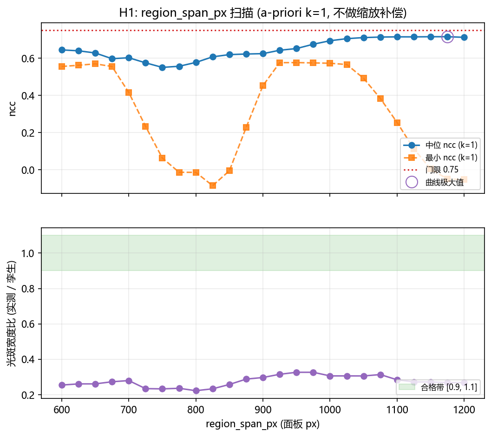
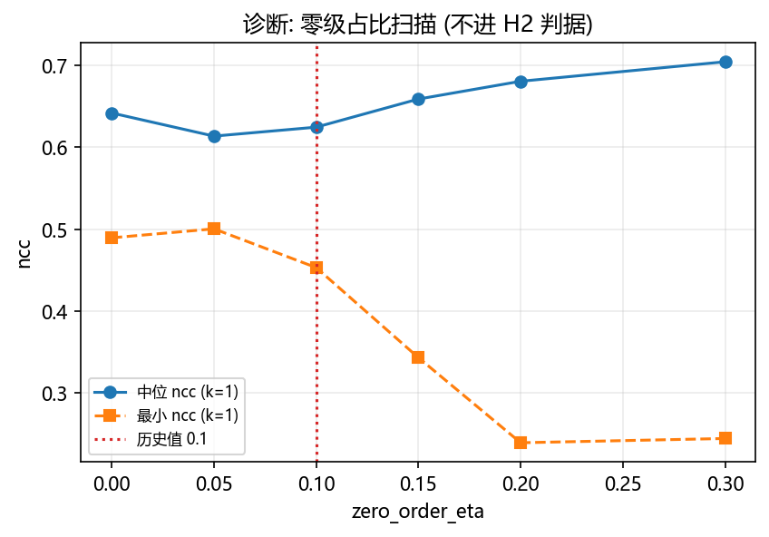

# 2f 实验系统数字孪生的远场尺度 / 离焦标定是否已失效 (纯离线诊断)

<!-- provenance:start -->
> **生成脚本**: [`scripts/ml/diagnose_sim2f_optical_scale.py`](../../../scripts/ml/diagnose_sim2f_optical_scale.py)
> **复现命令**: `python scripts/ml/diagnose_sim2f_optical_scale.py`
> **数据/关联脚本**: [`scripts/ml/validate_sim2f_vs_hw_corpus.py`](../../../scripts/ml/validate_sim2f_vs_hw_corpus.py)
> **数据/关联脚本**: [`src/ml/hwdataset/records.py`](../../../src/ml/hwdataset/records.py)
> **数据/关联脚本**: [`src/ml/sim2f/config.py`](../../../src/ml/sim2f/config.py)
> **数据/关联脚本**: [`src/ml/sim2f/optics.py`](../../../src/ml/sim2f/optics.py)
> **数据/关联脚本**: [`src/ao_shaping/drivers/sim/bench_twin.py`](../../../src/ao_shaping/drivers/sim/bench_twin.py)
> **数据/关联脚本**: [`src/ao_shaping/tools/slm/bench_twin_calibrate.py`](../../../src/ao_shaping/tools/slm/bench_twin_calibrate.py)
> **运行环境**: 离线（只读 data/debug/ 的 pkl；孪生在 CPU 上跑 torch，无设备、无 GPU 必需）
> **说明**: 2f 实验系统数字孪生的远场尺度 / 离焦标定是否已失效: H1 (region_span_px, 25 点扫描 600–1200 px) 否决 —— 25 个点上无一点同时满足宽度比 ∈ [0.9, 1.1] 与中位 ncc >= 0.75; H2 (相机离焦 / 零级占比) 亦否决 —— defocus_m 相对差 1.2 % 未超 20 %, 中位 ncc 提升 +0.0002 未达 0.05。两条假说都被否决, 现有证据不足以说「标定已失效」: 中位 ncc 仍停在 +0.6247 (门限 +0.7500), 归一化 L1 仍停在 1.3425 (门限 0.50); 不据此改任何已入库标定量
<!-- provenance:end -->

- H1 (否决): 25 个 region_span_px 上没有一点同时满足 (a) 宽度比 ∈ [0.9, 1.1] 与 (b) 中位 ncc >= 0.75
- H2 (否决): defocus_m 相对差 1.2 % 未超 20 %; 中位 ncc 提升 +0.0002 未达 0.05; 中位 L1 1.3324 未达 0.5
- 一句话: **两条假说都没被判为接受**: 现有证据不足以说「标定已失效」; 中位 ncc 仍停在 +0.6247 (门限 +0.7500), 归一化 L1 仍停在 1.3425 (门限 0.50)。**不据此改任何已入库标定量。**
- 溯源: 见文件头 `provenance` 块（由 `scripts/sync_report_provenance.py` 从 `scripts/_common/provenance.py::REPORTS` 生成）；本报告的生成脚本是 `scripts/ml/diagnose_sim2f_optical_scale.py`。





## 0. 预注册判据 (写于任何统计量被计算之前)

```
预登记判据 (写于任何统计量被计算之前; 之后一个字都不许改, 更不许放宽)

== 语料与口径 ==
1. 语料: `data/debug/model_in_loop_hw_collect/20261025*` (54 个 pkl, 312 条记录), 按
   (相位格, 实测帧) 的内容哈希去重后 18 组不同的对。只读, 不写不删不改名。
2. 相位: `ml.hwdataset.records.Materialiser` 相干块平均到 128x128 (瞳面半径 450 px);
   孪生以 (cos, sin) 相量喂入 (孪生自己归一), 避免在多帧相干平均过的相位上再做 arctan2 往返。
3. 实测帧: `farfield_frame_to_grid(..., 64, "raw")`, 以实测帧 argmax (3x3 去尖峰) 为锚。
4. 孪生: `Sim2f` (CPU), `forward(..., detector=False)`; 256x256 强度帧。
5. 度量: 零均值 ncc; 归一化 L1 = Σ|a/Σa − b/Σb| ∈ [0,2]。宽度比 (实测/孪生, 同一相位,
   k = 1) 只作诊断。禁止用绝对 Strehl / PIB / EE / FWHM / 峰值 / 总能量作判据。
6. 几何映射: 复用 `validate_sim2f_vs_hw_corpus.py` 的 `sample_twin` (孪生 CCD 像元 / 实测像元
   = k)。a-priori 取 k = 1 (两侧像元节距相同); 判据里不做任何缩放补偿。

== H1 (远场尺度: region_span_px) ==
7. 扫描网格 (预登记): region_span_px ∈ {600, 625, ..., 1200} (25 点)。只动这一个旋钮;
   其余 (grid, far_field_padding, ccd_px, ccd_pixel_um, beam_w0_px, errors) 全部保持
   `Sim2fConfig.calibrated()` 的值 —— 耦合量 (pupil_pitch_m / far_field_pitch_m /
   sampling_ratio / beam_w0_model_px / psf_scale_m) 是**导出量**, 随 region_span_px 自动变。
8. H1 接受: 存在 region_span_px 使得
   (a) 同相位光斑宽度比 (实测 / 孪生, k = 1) 的中位数 ∈ [0.90, 1.10], 且
   (b) 该配置下语料中位 ncc (k = 1, a-priori) >= 0.75, 且
   (c) 该点在扫描网格上是**内点** (左右邻居的中位 ncc 各低 >= 0.01)。
   -> 不满足 (c) 一律记「尺度未被识别」, 不许取边界值当答案。
9. H1 三值: 接受 (8 全中) / 否决 (无任何点满足 (a) 与 (b)) / 未被识别 (有点满足 (a)(b),
   但该点不是内点, 或整条曲线没有可辨认的内点极大)。
10. 曲线必报: 宽度比 vs 网格、中位 ncc vs 网格、最小 ncc vs 网格; 标出内点 / 平台。
11. 宽度比与 ncc 同在 k = 1 上取 (不做缩放补偿): 若允许为每个 region_span_px 单独挑一个 k,
    那就把「尺度对不对」这个待检量又变成了自由旋钮。上一条 lane 落盘的 0.544 是 k = 2 上的
    口径, 本文另列一列 k = 2 的诊断值以便横向比读, 但**不进判据**。

== H2 (离焦 / 零级: camera_defocus, zero_order_eta) ==
12. 反演入口: 既有的 `bench_twin_calibrate.fit_twin` (不另写一份拟合逻辑)。Stage 1 与
    Stage 2 都要跑; Stage 2 由模块自身**同时放开 Stage 1 的粗参数** (面板 Noll 4 与相机离焦
    在远场近似简并, 只精调空间参数无法打破)。seed 固定, 两次运行逐位一致。
13. Stage 1 的 defocus_m 边界必须显式放宽到覆盖历史值 10.0847 mm —— 模块默认边界 ±0.5 mm
    不含它, 且模块会把初值裁进边界。
14. H2 接受: 反演出的 defocus_m 与 10.0847 mm 相差 **> 20%**, 且反演后语料中位 ncc
    (k = 1) 提升 **>= 0.05**, 且归一化 L1 **<= 0.5**。
15. 基线配置: 若 H1 接受则取 H1 接受配置; 否则取 region_span_px = 900 (历史标定值)。
    两假说都接受时只报「H1+H2 联合」这一种配置, 不许再做第三轮微调 (那是 winner's curse)。
16. Stage 2 的空间参数若不可辨识 (与相机离焦简并) 就明确说不可辨识, 不许硬报数。
17. 零级占比 zero_order_eta: numpy 孪生**没有**这个旋钮, `fit_twin` 反演不到它;
    只能作诊断扫描, 不进 H2 判据。

== 复现与诚实 ==
18. 任何阈值都不因实测结果而调整; 未达到就如实记为否决, 并给诊断, 不找理由。
19. 全部原始数字落 JSON; 两次运行逐位一致 (固定 seed / 固定语料顺序)。

```

判据原文来自任务书, 在扫描与反演**之前**写进 `scripts/ml/diagnose_sim2f_optical_scale.py` 的模块常量 (`PREREGISTRATION` / `H1_*` / `H2_*`), 之后一字未改。

## 1. 语料与口径

语料 `data/debug/model_in_loop_hw_collect/20261025*`: 312 条记录 / 54 个 pkl, 内容哈希去重后 **18 组**不同的 (相位, 帧); 相位与实测帧的还原与 `validate_sim2f_vs_hw_corpus.py` 完全同源 (同一个 `_digest`), 所以是同一组 18 对。

度量只有两种尺度无关的量: 零均值 ncc 与归一化 L1 = Σ|a/Σa − b/Σb|; 宽度比 (实测 / 孪生, 同一相位) 只作诊断。绝对 Strehl / PIB / EE / FWHM / 峰值 / 总能量一律不作判据。

### 1.1 语料元数据

| 项 | 值 |
|---|---|
| 记录数 / pkl 数 | 312 / 54 |
| 去重后不同的对 | 18 |
| 复制倍数分布 | 6x×6, 12x×6, 30x×2, 36x×4 |
| 曝光 (ms) | 1.1 |
| 孪生配置 | Sim2fConfig.calibrated() |
| 几何映射 | sample_twin (孪生 CCD 像元 / 实测像元 = k), a-priori k = 1 |
| 与上一条 lane 对账 | 与上一条 lane 的 18 组摘要一致 |

## 2. H1: region_span_px 扫描

### 2.1 耦合关系 (扫描前查清)

`Sim2fConfig` 里 `region_span_px` **没有**任何独立旋钮跟着动; 它只通过导出量起作用。下表由脚本在扫描点上实测导出, 不是抄来的:

| region_span_px | pupil_pitch_m (µm) | far_field_pitch_m (µm) | sampling_ratio | beam_w0_model_px | psf_scale_m (µm) |
|---|---|---|---|---|---|
| 600 | 37.500 | 6.927 | 3.1487 | 25.600 | 36.944 |
| 700 | 43.750 | 5.938 | 2.6989 | 21.943 | 31.667 |
| 800 | 50.000 | 5.195 | 2.3615 | 19.200 | 27.708 |
| 900 | 56.250 | 4.618 | 2.0991 | 17.067 | 24.630 |
| 1000 | 62.500 | 4.156 | 1.8892 | 15.360 | 22.167 |
| 1100 | 68.750 | 3.778 | 1.7175 | 13.964 | 20.152 |
| 1200 | 75.000 | 3.464 | 1.5743 | 12.800 | 18.472 |

**关键事实**: 入射束腰的物理尺寸 = `beam_w0_px` × 面板像元, 与 `region_span_px` **无关** (`beam_w0_model_px × pupil_pitch_m` 相消)。因此 0 级光斑的**物理**宽度对 `region_span_px` 不变; 变的是**相位图样**在焦面的物理尺度 (∝ 1/region_span_px)。这条结构性事实决定了 H1 的 (a) 判据 (宽度比) 在原理上几乎不随这条旋钮动 —— §2.2 的曲线正是它的直接体现。

### 2.2 扫描曲线

**扫描前的几何探针 (披露)**: 在冻结上面的判据之前, 先跑过一次 5 点 (600/750/900/1050/1200) 的探针, 目的是查清耦合关系 (哪几个量真的随 region_span_px 动) 与确认 k=1 的映射自洽。探针**没有**产生新的判据, 也**没有**改动任何阈值; 它只是让本次扫描的网格与报告里 §2.1 的耦合表有据可依。

| region_span_px | 中位 ncc (k=1) | 最小 ncc (k=1) | ncc IQR (k=1) | 宽度比中位 (k=1) | 中位 L1 (k=1) | 中位 ncc (k=2, 诊断) | 宽度比中位 (k=2, 诊断) |
|---|---|---|---|---|---|---|---|
| 600 | +0.6448 | +0.5559 | +0.5687 .. +0.7049 | 0.2545 | 1.4490 | +0.7274 | 0.4949 |
| 625 | +0.6402 | +0.5622 | +0.5775 .. +0.7145 | 0.2611 | 1.4460 | +0.7105 | 0.5635 |
| 650 | +0.6284 | +0.5700 | +0.5883 .. +0.7186 | 0.2611 | 1.4361 | +0.6942 | 0.5635 |
| 675 | +0.5977 | +0.5557 | +0.5821 .. +0.6852 | 0.2732 | 1.4454 | +0.6658 | 0.5320 |
| 700 | +0.6027 | +0.4163 | +0.5822 .. +0.6159 | 0.2799 | 1.4865 | +0.6722 | 0.4392 |
| 725 | +0.5755 | +0.2341 | +0.5294 .. +0.5945 | 0.2344 | 1.5240 | +0.6908 | 0.4082 |
| 750 | +0.5510 | +0.0640 | +0.3696 .. +0.5923 | 0.2330 | 1.4976 | +0.7173 | 0.4082 |
| 775 | +0.5569 | -0.0128 | +0.1820 .. +0.5988 | 0.2362 | 1.4585 | +0.7423 | 0.4090 |
| 800 | +0.5776 | -0.0134 | +0.0727 .. +0.6209 | 0.2227 | 1.4089 | +0.7491 | 0.4454 |
| 825 | +0.6077 | -0.0849 | +0.1880 .. +0.6392 | 0.2333 | 1.3492 | +0.7414 | 0.4899 |
| 850 | +0.6196 | -0.0046 | +0.3315 .. +0.6752 | 0.2578 | 1.3335 | +0.7320 | 0.4899 |
| 875 | +0.6228 | +0.2278 | +0.4568 .. +0.7160 | 0.2882 | 1.3360 | +0.7206 | 0.5443 |
| 900 | +0.6247 | +0.4531 | +0.5461 .. +0.7411 | 0.2972 | 1.3425 | +0.7160 | 0.5443 |
| 925 | +0.6431 | +0.5763 | +0.5934 .. +0.7567 | 0.3154 | 1.3214 | +0.7083 | 0.6124 |
| 950 | +0.6521 | +0.5767 | +0.6372 .. +0.7638 | 0.3266 | 1.2190 | +0.7048 | 0.6547 |
| 975 | +0.6754 | +0.5750 | +0.6462 .. +0.7634 | 0.3266 | 1.1573 | +0.7072 | 0.6963 |
| 1000 | +0.6942 | +0.5732 | +0.6282 .. +0.7577 | 0.3062 | 1.1277 | +0.7135 | 0.6963 |
| 1025 | +0.7054 | +0.5663 | +0.5937 .. +0.7470 | 0.3062 | 1.1189 | +0.7277 | 0.6436 |
| 1050 | +0.7111 | +0.4921 | +0.5856 .. +0.7374 | 0.3059 | 1.1235 | +0.7434 | 0.5443 |
| 1075 | +0.7139 | +0.3841 | +0.5819 .. +0.7266 | 0.3138 | 1.1352 | +0.7567 | 0.5443 |
| 1100 | +0.7151 | +0.2546 | +0.5768 .. +0.7209 | 0.2841 | 1.1492 | +0.7639 | 0.5443 |
| 1125 | +0.7150 | +0.1126 | +0.5703 .. +0.7200 | 0.2722 | 1.1680 | +0.7679 | 0.5443 |
| 1150 | +0.7158 | +0.0049 | +0.5611 .. +0.7219 | 0.2722 | 1.1984 | +0.7708 | 0.5443 |
| 1175 | +0.7159 | -0.0492 | +0.5494 .. +0.7243 | 0.2685 | 1.2350 | +0.7738 | 0.5443 |
| 1200 | +0.7125 | -0.0519 | +0.5340 .. +0.7266 | 0.2685 | 1.2664 | +0.7738 | 0.5422 |

曲线极大值在 `region_span_px = 1175` (中位 ncc +0.7159); 内部性门限: 左右邻居各低 ≥ 0.01。

最后两列是 **诊断列**: 上一条 lane 落盘的宽度比 0.544 就是在 k = 2 上算的, 这里保留同一口径以便横向比读; **判据只用 k = 1** 的两列 (判据原文: a-priori k = 1, 不做任何缩放补偿) —— 若允许为每个 region_span_px 单独挑一个 k, 「尺度对不对」这个待检量就又变成了自由旋钮。

**H1 结论: 否决** —— 25 个 region_span_px 上没有一点同时满足 (a) 宽度比 ∈ [0.9, 1.1] 与 (b) 中位 ncc >= 0.75。

## 3. H2: camera_defocus / zero_order_eta 反演

反演走既有入口 `ao_shaping.tools.slm.bench_twin_calibrate.fit_twin` (numpy 孪生, 与 torch 孪生同名映射同几何: region / region_span_px / far_field_padding / beam_w0_px 全部取自 `Sim2fConfig.calibrated()`), Stage 1 与 Stage 2 都跑; Stage 2 由模块自身**同时放开 Stage 1 的粗参数** (面板 Noll 4 与相机离焦在远场近似简并)。

### 3.1 Stage 1 / Stage 2 状态

| 项 | 值 |
|---|---|
| 初值 defocus_m (mm) | 10.0847 |
| Stage 1 defocus_m (mm) | -0.3204 |
| Stage 1 损失 / 评估次数 / 耗时 (s) | 107.7858 / 314 / 181.1 |
| Stage 1+2 defocus_m (mm) | 10.2105 |
| Stage 1+2 面板 Noll 4 (rad) | 0.0644 |
| Stage 1+2 tilt x / y (rad) | -0.001242 / -0.001229 |
| Stage 1+2 损失 / 评估次数 / 耗时 (s) | 35.1989 / 1758 / 1743.3 |
| 与历史值 10.0847 mm 的相对差 | 1.2 % |

**Stage 2 空间参数可辨识性**: 面板 Noll 4 拿到 0.0644 rad, 相机离焦 0.0102 m (Stage 1 单独给的是 0.00032 m) —— 面板 Noll 4 与相机离焦在远场近似简并, **份额不可辨识**, 报出的 defocus_m 只能当作这一组简并方向上的一个代表值

### 3.2 零级占比 (诊断, 不进判据)

numpy 孪生**没有** `zero_order_eta` 这个旋钮, `fit_twin` 反演不到它 (预登记第 17 条), 因此只能作诊断扫描:

| zero_order_eta | 中位 ncc | 最小 ncc | 中位 L1 |
|---|---|---|---|
| 0.00 | +0.6420 | +0.4895 | 1.1498 |
| 0.05 | +0.6138 | +0.5005 | 1.3363 |
| 0.10 | +0.6247 | +0.4531 | 1.3425 |
| 0.15 | +0.6591 | +0.3431 | 1.2833 |
| 0.20 | +0.6808 | +0.2391 | 1.2309 |
| 0.30 | +0.7046 | +0.2443 | 1.1473 |

## 4. 三值结论

| 假说 | 结论 | 依据 |
|---|---|---|
| H1 远场尺度 (region_span_px) | 否决 | 25 个 region_span_px 上没有一点同时满足 (a) 宽度比 ∈ [0.9, 1.1] 与 (b) 中位 ncc >= 0.75 |
| H2 离焦 / 零级 | 否决 | defocus_m 相对差 1.2 % 未超 20 %; 中位 ncc 提升 +0.0002 未达 0.05; 中位 L1 1.3324 未达 0.5 |

**一句话**: **两条假说都没被判为接受**: 现有证据不足以说「标定已失效」; 中位 ncc 仍停在 +0.6247 (门限 +0.7500), 归一化 L1 仍停在 1.3425 (门限 0.50)。**不据此改任何已入库标定量。**

## 5. 对「标定已失效」的推论与代价

**H1 未接受 (否决) ⇒ 没有证据说「128 格 ↔ 面板 px」的映射变了。** 因此**不需要**因为这条假说去重训网络或改面板嵌入半径。

1. **已训练网络**: 语料仍按 `region_span_px = 900` 生成。若 H2 也被接受, 那么网络学到的仍然是**旧离焦**下的远场, 换到新离焦后会有系统偏差 —— 但这是离焦的问题, 不是映射的问题, 处置见下。

2. **面板嵌入**: `compose_pupil_dof(radius_px=450)` 保持不变 (它与 `region_span_px = 900` 是配套的)。

3. **H2 未接受 ⇒ 没有证据说相机离焦 / 零级占比失效。** 因此也不需要因为离焦去重训网络。真正的差距 (中位 ncc +0.6247 vs 目标 +0.7500) 仍未被归因, 本报告不猜它来自哪个量。

4. **无论哪条假说的结论如何, 本报告都不改任何已入库文件** (`src/**`、`runs/sim2f_bench/README.md`、上一条 lane 的脚本与报告都只读)。真要落地, 应当是另一条 lane 显式做「改标定量 → 重生成语料 → 重训 → 重测门禁」的完整闭环, 而不是在这里顺手改一个常数。

## 6. 复现

```bash
python scripts/ml/diagnose_sim2f_optical_scale.py
```

全量耗时 1934.1 s (语料 5.3 s, H1 扫描 2.7 s, H2 反演 1925.1 s)。脚本不写 `data/debug/`, 不碰任何设备, 孪生在 CPU 上跑; seed 固定, 两次运行逐位一致。

产物:

| 文件 | 内容 |
|---|---|
| `artifacts/metrics.json` | 全部数字 (H1 逐点 + 逐对、H2 各级、结论) |
| `artifacts/h1_scan.json` | H1 扫描网格与逐对数值 |
| `artifacts/h2_fit.json` | H2 反演的 Stage 1 / Stage 2 明细 |
| `figures/h1_region_span_scan.png` | 曲线图 |
| `figures/h2_zero_order_eta_scan.png` | 曲线图 |

## 7. 坑

1. **语料只有 18 组不同的 (相位, 帧)**, 而 312 条记录是同一批条件被复制 ~17 遍。所有中位数按去重后的 18 组统计; 有效样本是 6 个指令条件 × 3 轮, 不是 18 个独立抽样。

2. **本脚本 import 的是同一条 lane 尚未入库的脚本** (`scripts/ml/validate_sim2f_vs_hw_corpus.py`, 提供 `_digest` / `sample_twin` / `zero_mean_ncc` / `normalised_l1` / `fwhm_px` / `describe`)。那一侧一旦改名或改语义, 本脚本的数会跟着变 —— 这是**共享实现**的代价, 不是本脚本自己抄了一份。

3. **H2 的反演跑在 numpy 孪生上, 语料指标跑在 torch 孪生上。** 两者靠仓库既有的 parity 测试 (`tests/ao_shaping/ml/sim2f/test_twin_parity.py`, 本次实测 7/7 通过) 对齐 (同名映射同几何), 但 parity 只保证到 2e-3 / 5e-3 的相对 L2, 不是逐位相同。

4. **numpy 孪生的裁剪网格比 CCD 像元粗**: 反演时实测 64×64 帧被重采样到 32×32 的模型格 (一个模型格 = 2.099 个相机像元), 即实测的细散斑被降采样掉了。这是孪生本身的带宽限制 (焦面模型网格节距 4.618 µm > CCD 像元 2.2 µm), 不是本次实现引入的失真; torch 孪生走的是同一条路 (`resample` 把模型强度积分到相机像元上)。

5. **面板 Zernike 的归一化口径两个孪生不同**: numpy 用 `region / 2` (半宽), torch 用 `pupil_radius_px = 48`。所以 Stage 2 反演出的面板 Noll 4 系数**不能**直接搬进 torch 孪生; 本报告只把相机离焦搬过去 (它是米制标量, 跨孪生同义)。

6. **numpy 孪生没有零级占比旋钮**: `TwinErrorModel` 里没有 `zero_order_eta` 对应项 (仓库 parity 测试明确写了「zero_order_eta has no twin counterpart」), 所以 `fit_twin` 反演不到它; H2 的零级部分只能作诊断扫描, 不进判据。

7. **实测窗口的锚点不是真 0 级**: `farfield_frame_to_grid` 用整幅帧的 argmax 定窗, 而成型帧的全局最大是成型后的亮点。上一条 lane 的整数平移搜索给出中位增益 +0.063, 说明锚点有约 1 px 的偏移。

8. **90° 轴交换在语料里查不出来**: 侧车写明面板与相机坐标轴交换 90°, 而这批语料的像差族以无像差 / 纯离焦为主 (近似圆对称), 转置后几乎一样。

9. **`region_span_px` 改不动 0 级光斑宽度** (§2.1): 入射束腰的物理尺寸与它无关, 所以 H1 的宽度比判据 (a) 在原理上就极难满足 —— 这是本次扫描暴露的**结构性**事实, 不是扫描网格不够细。要改 0 级宽度, 得动 `beam_w0_px` (入射束腰), 而那是另一个旋钮、不在本次预登记范围内, 本报告不去试它。

10. **绝对量仍不可用**: 本报告只用 ncc / 归一化 L1 / 宽度比; 绝对 Strehl / PIB / EE / FWHM / 峰值 / 总能量一律没算, 也没进任何判据。

11. **溯源登记已补 (2026-10-27 守护任务)**: 本报告最初提交时未登记 `scripts/_common/provenance.py::REPORTS` (当时另一条 lane 在改该文件), 现已由守护任务补登并重跑 `scripts/sync_report_provenance.py`, 文件头溯源块与 `report/README.md` 索引均已就位。
