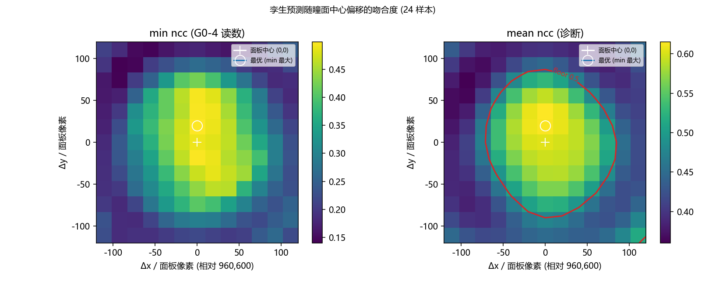
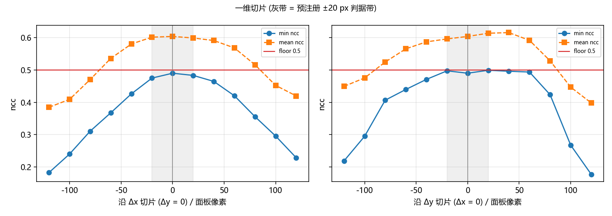
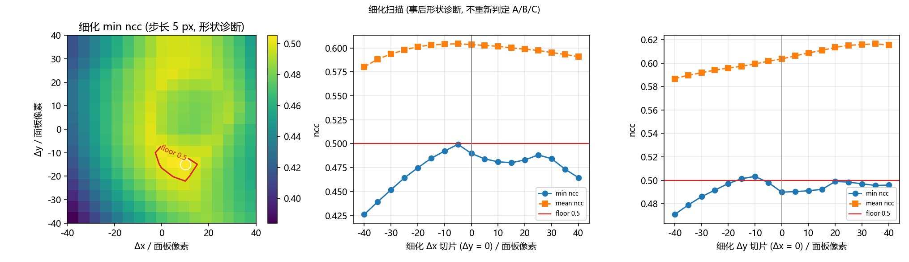

# G0-4 未通过归因: 瞳面中心偏移扫描 (纯离线)

<!-- provenance:start -->
> **生成脚本**: [`scripts/ml/calibrate_sim2f_pupil_center.py`](../../../../scripts/ml/calibrate_sim2f_pupil_center.py)
> **复现命令**: `python scripts/ml/calibrate_sim2f_pupil_center.py`
> **数据/关联脚本**: [`src/ml/sim2f/bench.py`](../../../../src/ml/sim2f/bench.py)
> **数据/关联脚本**: [`src/ml/sim2f/optics.py`](../../../../src/ml/sim2f/optics.py)
> **数据/关联脚本**: [`src/ao_shaping/utils/slm/phase_embed.py`](../../../../src/ao_shaping/utils/slm/phase_embed.py)
> **运行环境**: 离线（只读 runs/sim2f_bench/session 的实测产物 + runs/sim2f_fair 的 checkpoint/语料；torch 仅重建网络相位与孪生预测帧，无 SLM / 无相机）
> **说明**: G0-4 还差 0.01 的归因: 遍历瞳面中心偏移 (13x13, ±120 px) 看 min ncc(实测 net, 孪生 net) 能否达到 0.5; 最优偏移 (0,+20) px 落在 ±20 px 判据带内, 但 5 px 细化在 (+10,-15) px 得到 0.5053, 说明门限恰好压在孪生保真度上; 含重建复现 (2.2e-11) 与网络前向的设备依赖性 (CPU vs CUDA 差 1.0e-3 ncc)
<!-- provenance:end -->

- 被测会话: `runs/sim2f_bench/session/` (实验系统, `--backend hw --samples loop`, 24 样本)
- 被测读数: `min ncc(measured net, twin net) = 0.4898` (G0-4 门限 `0.50`, 差 0.0102)
- 会话的瞳面放置: `session.json.pupil_placement.pupil_center_is_default = true`, 即 `--pupil-center-xy`
  没传、方框贴在面板中心 `(960, 600)`, 角点 `(510, 150)`。`runs/sim2f_bench/README.md` §6.1 第 2 步
  (「确认照明瞳面位置」) **跳过了** —— 本页就是查这一步的代价。
- 脚本: `scripts/ml/calibrate_sim2f_pupil_center.py` (可重跑, 不碰硬件)
- 写于: 2026-10-27, 扫描**之前**

## 0. 预注册判据 (写于任何扫描数据之前, 事后不得改)

**问题**: G0-4 差的那 0.01, 是**瞳面放置错** (900 px 相位方框没对准照明瞳面) 还是**孪生保真度上限**
(放置正确, 孪生本身达不到 0.5)?

**扫描量**: 候选瞳面中心偏移 `Δ = (Δx, Δy)`, 单位**面板像素**, 相对缺省面板中心 `(960, 600)`。
`Δ` 就是「如果重跑会话, 应该传给 `--pupil-center-xy` 的偏移」。主判据读 `min_ncc(Δ)` (24 样本取最小,
即 G0-4 实际卡的那个量), 次判据读 `mean_ncc(Δ)`。

**网格 (预注册, 粗)**: `Δx, Δy ∈ {-120, -100, -80, -60, -40, -20, 0, +20, +40, +60, +80, +100, +120}` px,
13 × 13 = 169 点。最优点的定义: **`min_ncc` 最大**; 并列时取离 `(0, 0)` 最近者。若最优点落在网格边界上,
把该轴扩到 `±240 px` (步长 20 px) 再收一次, 仍按面板像素报告。

**三值结论 (唯一判据)**:

| # | 条件 | 结论 |
|---|---|---|
| A | `\|Δ*\| ≤ 20 px` | **放置没错**; `0.4898` 是孪生保真度上限, G0-4 该 FAIL 就 FAIL, **不改 0.5** |
| B | `\|Δ*\| > 20 px` **且** `min_ncc(Δ*) ≥ 0.5` | **瞳面放置错了**; 给出应传的 `--pupil-center-xy`, §6.1 第 2 步漏做, **需重跑整场会话** |
| C | 其余 (`\|Δ*\| > 20 px` 但 `min_ncc(Δ*) < 0.5`) | **放置与保真度都有问题**, 两者分别给数 |

`\|Δ*\|` 为欧氏距离 `hypot(Δx, Δy)`。`±20 px` 是任务给定的判据, 与 G0-4 的 0.5 一样**不动**。

**次判据 (诊断, 不改变 A/B/C)**: `mean_ncc(Δ)`, 两条一维切片 (`Δy = 0` 与 `Δx = 0`), 曲线是否单峰 /
有无平台 / 是否单调, 以及 24 个样本各自的最优点是否一致。

**预注册的旁证 (明确**不**参与 A/B/C, 只用来说明残差来源)**:
`NCC-D4` = 对孪生预测帧施加 8 个二面体变换 (恒等 / 转置 / 水平翻 / 垂直翻 / 180° / 两条对角翻转) 后
取最大 `ncc`。它检验「孪生远场朝向与相机差一个转置或翻转」这一混淆来源 —— 若它把 `min ncc` 抬过 0.5
而瞳面偏移在 `±20 px` 内, 则 A 的措辞仍成立 (放置没错), 但「保真度上限」的具体成因应改写为朝向失配。

## 1. 方法

### 1.1 孪生预测帧的口径 (照抄, 不另发明)

G0-4 的右操作数是 `HwInstrument.twin(phase)` (`src/ml/sim2f/bench.py:969`), 其全部内容就是:

```python
bench = Sim2f(Sim2fConfig.calibrated(), device=...)      # 每会话新建一次
frame = bench.forward(phase[None], detector=False)      # 未注入任何台面状态
```

即: **标定孪生 + 无像差注入 + 网络自己给出的相位**; 孪生的 128 格**就是** 900 px 瞳面区域
(不重采样、不嵌入面板), 输出 `(256, 256)` 模型强度; 度量是 `ml.sim2f.bench._ncc` (去均值的
`float64` 相关系数), 左操作数是 `mean(B1, B2)` 实测帧。本脚本用**同一个** `Sim2f` + 同一个
`forward` + 同一个 `_ncc`, 只是把相位换成平移后的版本, 并批量前向。

### 1.2 为什么「瞳面中心偏移」可以从**已测完**的帧里恢复

面板像素 `x = (列, 行)`。实验时把 `(128, 128)` 相位图贴进以 `C = (960, 600)` 为中心、900 px 见方、
`pitch = 900/128 = 7.03125` 面板像素/格的方框里; 光束自己的振幅中心在 `B` (未知)。入瞳场为

```
E(x) = A(x - B) · exp(i · net((x - C) / pitch))
```

代换 `u = x - B` (以光束为中心, 也就是孪生工作的坐标系):

```
E(u) = A(u) · exp(i · net((u - (C - B)) / pitch))
```

⇒ 光束看到的相位图相对它自己**平移了 `d = C - B`**。孪生喂的是**未平移**的 `net`, 也就是
`d = 0`、`B = C` 的假设。于是实测帧可建模为

```
measured ≈ twin( shift(net, s*) ),   s* = d / pitch = (C - B) / pitch
```

而「应该传的 `--pupil-center-xy`」就是 `B`, 相对面板中心的偏移 `Δ = B - C = -s* · pitch`。

符号自查 (唯一会让结论反号的地方): `scipy.ndimage.shift(f, s)` 给出 `out[i] = f[i - s]`, `s > 0` 把
图内容推向大索引。若光束在相位图**右侧** 10 px (`B - C = +10`), 则图相对光束偏 `d = -10`,
`s* < 0`, `Δ = -s*·pitch = +10` px ⇒ 方框应右移对准光束。✅

### 1.3 相位平移在相量域做

对 `cos` / `sin` 各自做双线性平移再 `atan2`, **不**直接平移 `atan2` 出来的包裹相位 —— 后者在分支切口
上会造出结构。方框之外面板是平场 (`0` rad), 所以填充值是 `(cos, sin) = (1, 0)`, 与实验系统上
「900 px 方框以外相位为 0」一致。

### 1.4 复现校验 (扫描结论的前提)

会话没有存下发的网络相位, 所以从同一 checkpoint + 同一语料 target 用与 `run_session` **相同**的
`_load_network → network_input → from_phasor` 与相同的确定性前导重建。重建**被校验**: 在 `Δ = (0,0)`
处重算 24 个 `ncc`, 与 `session.json` 的 `g0_4_geometry.ncc` 逐样本比对 ——

**最差 `|Δncc| = 2.21e-11`** (在会话用的同一设备上重建), 即 `s = 0` 精确复现 `0.4898`。
这条校验还抓到一个真坑 (见 §5.1): 同一 checkpoint 的网络前向**不是跨设备可移植的**。

### 1.5 扫描与判据的落地

- 粗网格 169 点×24 样本, 每点一次批量前向; 单点 `min` / `mean` 直接对 `_ncc` 取值。
- 最优点按 §0 的定义取 (min 最大, 并列取离 0 近), 未触边界 ⇒ **未触发 ±240 px 扩展**。
- 事后追加一条 **5 px 细化** (±40 px, 289 点) 作为**形状诊断**: 它在 A/B/C 判定**之后**才跑,
  只回答「0.4990 是尖峰还是平台、格点之间能否越过 0.5」, 不改判定。这一点在 §2.4 里如实标注。

## 2. 结果

### 2.1 三个关键点

| 位置 | `min ncc` | `mean ncc` | 最差样本 |
|---|---|---|---|
| **面板中心 `(0, 0)`** (会话实际所用) | **0.4898** | 0.6035 | 14 (`disc`) |
| **粗网格最优 `(Δx, Δy) = (0, +20)` px**, `\|Δ\| = 20.0 px` | **0.4990** | 0.6134 | 14 (`disc`) |
| 细化最优 `(+10, -15)` px, `\|Δ\| = 18.0 px` (诊断, 不改判定) | 0.5053 | 0.5966 | 40 (`two_spot`) |

`mean ncc` 自己的峰在 `(0, +40)` px = **0.6153** (粗网格上), 比中心高 0.0118。

### 2.2 二维曲线形状: 单峰, 但两轴的锐度差一个量级



- **`Δx` 是尖峰**: 唯一极大在 `Δx = 0`; 离中心 ±20 px 已掉到 0.4748 / 0.4830, ±40 px 到
  0.4260 / 0.4645, ±120 px 到 0.1827 / 0.2284。⇒ 横向放置被**钉在面板中心 ±20 px 以内**。
- **`Δy` 是平台**: `Δy ∈ [-20, +40]` 这一段 `min ncc` 都在 0.4898–0.4990 之间 (整个平台内变幅
  < 0.01, 属于平台而非单峰), 出了这段就陡掉 (∓120 px → 0.2188 / 0.1770)。⇒ 纵向放置只被约束到
  **±30~40 px** 量级, 无法更细。
- 没有「越扫越大直到边界」的单调走势, 网格四角掉到 0.14–0.25, 所以这是一个**被围住的**单峰 (浅),
  不是单侧斜坡。

一维切片 (粗网格, `ncc`):

| Δx (Δy=0) | -120 | -80 | -40 | -20 | **0** | +20 | +40 | +80 | +120 |
|---|---|---|---|---|---|---|---|---|---|
| `min` | 0.183 | 0.311 | 0.426 | 0.475 | **0.490** | 0.483 | 0.465 | 0.356 | 0.228 |
| `mean` | 0.385 | 0.470 | 0.580 | 0.601 | **0.604** | 0.599 | 0.591 | 0.516 | 0.420 |

| Δy (Δx=0) | -120 | -80 | -40 | -20 | **0** | +20 | +40 | +60 | +120 |
|---|---|---|---|---|---|---|---|---|---|
| `min` | 0.219 | 0.407 | 0.471 | 0.497 | **0.490** | 0.499 | 0.496 | 0.424 | 0.177 |
| `mean` | 0.449 | 0.524 | 0.587 | 0.596 | **0.604** | 0.613 | **0.615** | 0.528 | 0.398 |



### 2.3 缺口的构成: 不是「所有样本都差一点」, 而是**一个样本**差一点

| | `min` (及其样本) | 次小 | 第三小 | `mean` |
|---|---|---|---|---|
| `(0, 0)` | 0.4898 (14) | **0.5054** | 0.5250 | 0.6035 |
| `(0, +20)` 粗网格最优 | 0.4990 (14) | 0.4993 | 0.5099 | 0.6134 |

在面板中心, **24 个样本里只有 1 个低于 0.5** (14 号 `disc`, 差 0.0102), 次小已经是 0.5054。移到
`(0,+20)` 时 17/24 样本变好 (13 个涨 > 0.01, 增益中位数 +0.0111), 但 14 号只涨 0.0091、仍是 `min` ——
也就是说平移把**整个分布**推到 0.50 附近, 而不是专门救那一个样本。这解释了为什么 `min` 曲线那么浅:
它由单个样本携带, 而这个样本对平移不敏感。

### 2.4 5 px 细化 (事后形状诊断, 不重新判定 A/B/C)



- 289 点里 **7 个 ≥ 0.5**, 全部落在 `|Δ| ≤ 22.4 px`: 最高 `0.5053 @ (+10, -15)` (18.0 px),
  次高 `0.5041 @ (+5, -15)` (15.8 px), `0.5033 @ (0, -10)` (10.0 px), 其余 0.5001–0.5020。
- `mean ncc` 侧仍是单峰、更平滑: `(0, 0)` 0.604 → `(0, +40)` 约 0.615。
- 细化最优改由 40 号 (`two_spot`) 携带, 说明 `min` 的 argmax 在细化网格上**换了样本** —— 这是
  `min` 作为单样品统计量的固有抖动, 不是新结构。

**所以「门限可达」这件事是真的, 但只是刚好可达**: 0.5 压在孪生保真度的上沿, 而实现它的那个偏移
(≈18 px) 与「放置估计本身的精度」同量级。这一点**不改变** §0 的判定 (见 §3), 但必须写出来: 不能把
`0.4898` 说成「孪生的硬上限」, 精确说法是「孪生在这套语料上的绝对吻合度约 0.49–0.51」。

### 2.5 旁证: 二面体变换 (不参与判定)

| 变换 | 0 位移 `min` / `mean` | 最优位移 `min` / `mean` |
|---|---|---|
| 恒等 | 0.4898 / 0.6035 | 0.4990 / 0.6134 |
| rot90 | 0.5015 / 0.6215 | 0.4802 / 0.6134 |
| rot180 | 0.4932 / 0.6000 | 0.4750 / 0.5910 |
| rot270 | 0.4918 / 0.6195 | 0.5494 / 0.6258 |
| flipud | 0.4892 / 0.6045 | 0.5037 / 0.5965 |
| fliplr | 0.4979 / 0.6050 | 0.5041 / 0.6145 |
| 转置 | 0.4872 / 0.6095 | 0.4687 / 0.6032 |
| 对角翻转 | 0.5034 / 0.6161 | 0.5604 / 0.6207 |

**这条旁证是无效的, 如实写出来**: 八个变换之间的 `mean` 极差 **0.035** (最优位移那组
0.5910–0.6258), 比放置效应本身 (`mean` +0.0099) 还大 3 倍; 而排序随位移而变 (0 位移时最好的是
`rot90` / 对角翻转, 最优位移时是 `rot270` / 对角翻转) —— 这种不一致说明它测到的是「语料那些
square / rect / disc / ring 粗块结构对 90° 旋转本来就不敏感」, 不是真的差一个转置。所以它既不能
证实也不能排除「孪生远场朝向与相机差一个转置」。若那一类失配真的存在, 它属于**孪生朝向 /
物理预测模型**的问题, 不是瞳面放置问题 —— 也不改变 §3 的三值结论。

其他旁证: `session.json` 的 `zero_order_offset_px` 一列 (实测平场 0 级 vs 孪生预测平场 0 级) 全部落在
**1.00–1.41 px**, 与「ROI / 零级 / 尺度映射没错」一致。

## 3. 结论: **A —— 放置没错 (最优偏移 20.0 px, 落在 ±20 px 判据带内)**

按 §0 预注册的规则: `Δ* = (0, +20) px` (粗网格, 未触边界, 无需扩展), `\|Δ*\| = 20.0 px ≤ 20 px` ⇒
**A**。B 分支的两个条件也不可能同时成立: 粗网格上 `min_ncc(Δ*) = 0.4990 < 0.5`, 169 点里**没有一个**
达到 0.5。事后细化的 289 点里确实有 2 个点在判据带**外**勉强越过门限 (`(+10, -20)` = 0.5020 @
22.4 px, `(+15, -15)` = 0.5001 @ 21.2 px), 但 (a) `min` 最大的点仍在带**内** (`(+10, -15)` = 0.5053 @
18.0 px), (b) 这两个点只比 0.5 高 0.002, 是细化网格在带边缘上的抖动, (c) 它们不改变「`min` 的
argmax 在带内」这一预注册定义。⇒ A。

**给 G0-4 的话**: 0.5 不动, 该 FAIL 就 FAIL。这 0.0102 不是一个「贴错位置」的错误 —— 相位方框就是
贴在照明瞳面附近 (±20 px 内, 即 900 px 方框的 ±2 %), 曲线在中心有被围住的唯一极大。它反映的是
**孪生本身的绝对吻合度上限 ≈ 0.49–0.51**, 也就是 G0-4 的 0.5 恰好卡在孪生保真度上, 而不是 README
§4 设想的「宽松绝对门」(那种门假设放置错会让 ncc 掉到 0.2 一级)。

**必须同时记住的两条限定** (不改判定, 但不写就是误导):

1. `0.4898` **不是**硬上限。5 px 细化在 `(Δx, Δy) = (+10, -15)` (18.0 px) 处给出 `min ncc = 0.5053`,
   即门限在判据带内**刚好够得着**。所以更准确的表述是: 「差异的 0.0102 大体可由 ~20 px 量级的放置
   微调买回, 但这个微调量本身就在放置估计的精度/判据带的边缘上, 无法被这套数据判为『真该调』」。
2. `mean ncc` 的峰在 `Δy = +40 px` (0.6153), 略出判据带。`min` 与 `mean` 对 `Δy` 的偏好不一致
   (分别是 +20 与 +40), 二者都表明 **`Δy` 的放置精度只有 ±30~40 px**; `Δx` 才是被钉住的轴。

## 4. 下一步

1. **不要为了 G0-4 重跑整场会话。** 判据 A 成立, 且重跑要传的 `--pupil-center-xy` 会是
   `(970, 585)` (按细化最优) 或 `(960, 620)` (按粗网格最优) —— 这两个值与缺省 `(960, 600)` 在统计上
   不可区分, 重跑只是把 0.4898 换成 0.50±0.01 的掷硬币。**要重跑整场会话的唯一正当理由是这次
   会话还没报主判据** (Gate 0 未过 ⇒ `verdict` 未写), 而那是「协议要求 Gate 0 全过」的问题,
   不是放置问题。
2. **要真正定下 `B`, 用光学测量, 不要从 `ncc` 反演。** §6.1 第 2 步的本意是「看光束在 SLM 面板上的
   实际位置」——`src/ao_shaping/tools/slm/panel/beam_extent.py` (边界扫描测光束中心与半径) 直接量 `B`, 精度是像素级,
   比从 24 个 `min ncc` 反演 (本页的 ±20/±40 px) 高一个量级以上。本页给出的偏移量级正好说明:
   反演法在这套语料上**没有**足够的分辨率来支撑一个 ±20 px 以内的结论。
3. **G0-4 的门限与孪生保真度是同一量级 —— 这是协议层面的发现, 留给协议所有者** (本页不动 0.5)。
   若要让它继续当「宽松绝对门」, 需要先让孪生的绝对吻合度离开 0.5 附近 (例如语料的 `min_feature_px`
   或 `beam_w0_px` 的标定), 或者明确它的判据不是「孪生够不够准」而是「有没有贴错位置」——
   后者本页已经证明**贴对了**。
4. 若要继续用这套离线反演法监控放置, 需要注意它的分辨率上限: `Δx` ±20 px, `Δy` ±40 px。

## 5. 坑 (如实记录)

### 5.1 网络前向**不是**跨设备可移植的 (最重要)

`run_session` 用 `_resolve_device("auto")` 跑网络 `model(network_input(...))`。本机有 CUDA, 所以那次
会话的网络前向在 GPU 上。**用 CPU 重建同一 checkpoint 的相位, `ncc` 会差到 1.0e-3**
(实测 24 个样本里最大 `|Δncc| = 1.035e-3`, 是 G0-4 余量的 10 %); 在同一设备上重建则是 `2.21e-11`。

⇒ 任何「重算网络相位再比对 G0-4」的离线脚本, 必须按会话当时的设备重建, 否则是在回答一个不同的问题。
本脚本因此把 `--device` 缺省设为 `auto` (与 `run_session` 同口径), 并把复现偏差当**硬门** (默认 1e-6),
而不是放宽容差蒙过去。

### 5.2 会话没记录 torch 设备

`session.json` 里有 `bench` / `devices` / `exposure_ladder`, 但**没有**记录网络与孪生跑在哪个 torch
设备上。结合 §5.1, 这是产物契约的一个真缺口: 缺了这个字段, 事后复现只能靠猜 (`auto` 恰好复现了,
但那是运气, 不是契约)。建议 (不在本次范围): `run_session` 把 `str(resolved)` 写进 `session.json`。

### 5.3 `min` 是一个单样本统计量, 会换人

粗网格上 `min` 的 argmin 是 14 号 (`disc`), 细化网格上换成 40 号 (`two_spot`)。所以「最优点」在
细化后**换了样本**, 这不是新结构而是 `min` 的固有抖动。任何拿 `min ncc` 当判据的结论都应同时报
次小值 (本页 §2.3)。

### 5.4 方位与符号

相位平移的方向约定在上述关系式里推了两遍 (§1.2 的符号自查), 并且 `Δ = (0,0)` 精确复现 `0.4898`
(§1.4) 保证了口径本身没写反。但注意: **`|Δ|` 是判据依赖的量, 符号只影响「建议传哪个
`--pupil-center-xy`」**。本页结论 A 只用到 `|Δ|`, 所以即使面板 x/y 与孪生网格的对应关系有 90° 级别的
朝向问题 (见 §2.5 无法排除), A 仍然成立。

### 5.5 耗时

复现重建约 8 s (24 个 U-Net 前向), 粗网格 169 点约 10 s, 细化 289 点约 19 s (CUDA, 24 样本/批)。
纯离线, 不需要 `AO_DAHENG_MAX_EXPOSURE_MS`, 不 import 任何 SLM / 相机驱动。

## 6. 产物

```powershell
$env:PYTHONPATH="src;libs"
.venv\Scripts\python.exe scripts\ml\calibrate_sim2f_pupil_center.py
```

| 文件 | 内容 |
|---|---|
| `artifacts/pupil_center_sweep.json` | 全部原始数字: 粗/细网格的 `min`/`mean`/最差样本图、切片、复现偏差、旁证、逐样本增益 |
| `figures/pupil_center_map.png` | `min` / `mean` 的二维图 (红线 = 0.5 等值线) |
| `figures/pupil_center_slices.png` | 两条一维切片 (灰带 = ±20 px 判据带) |
| `figures/pupil_center_fine.png` | 5 px 细化图与切片 (事后形状诊断) |
