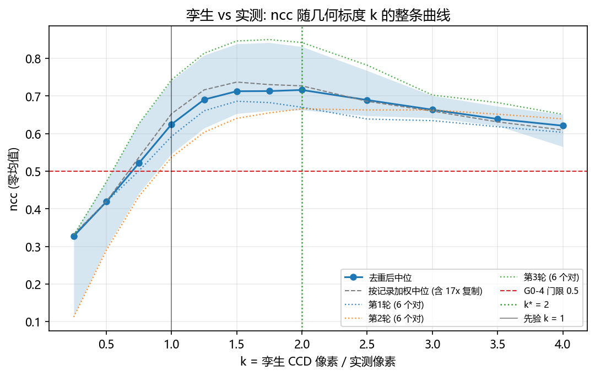
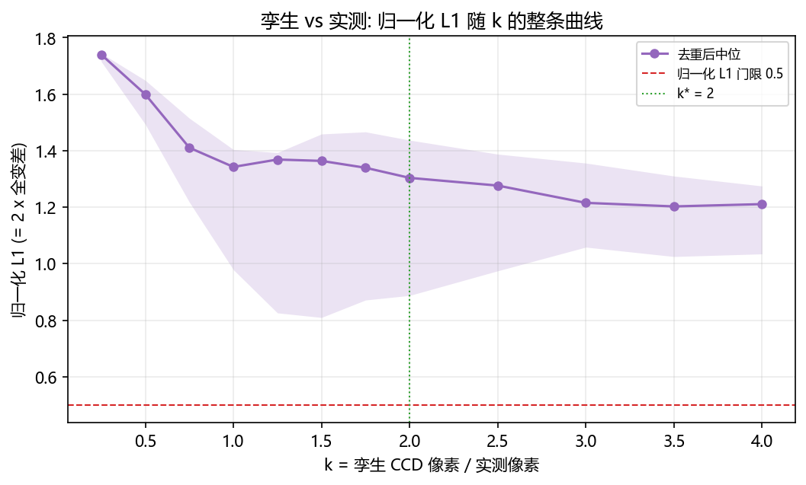
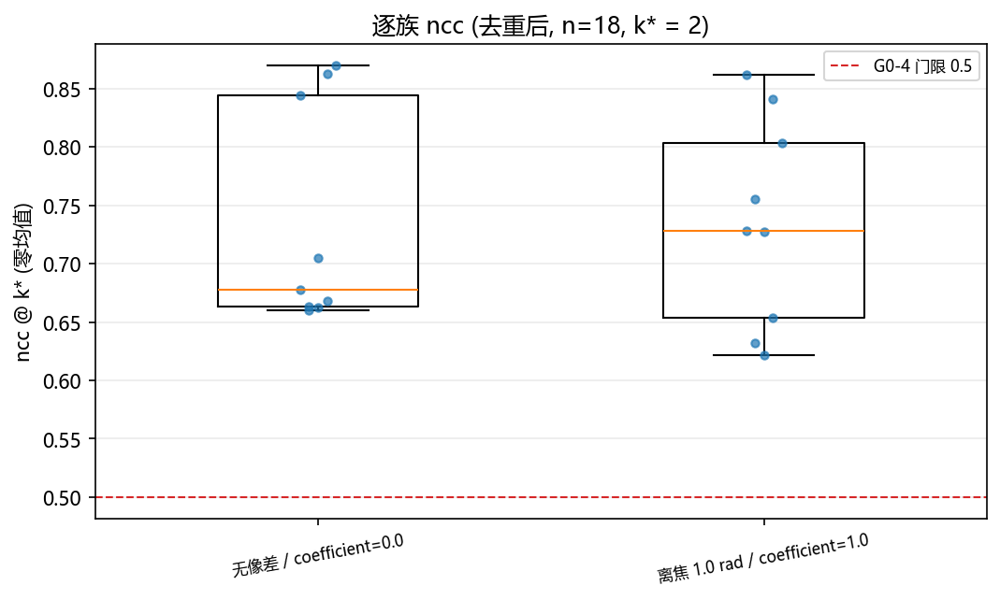
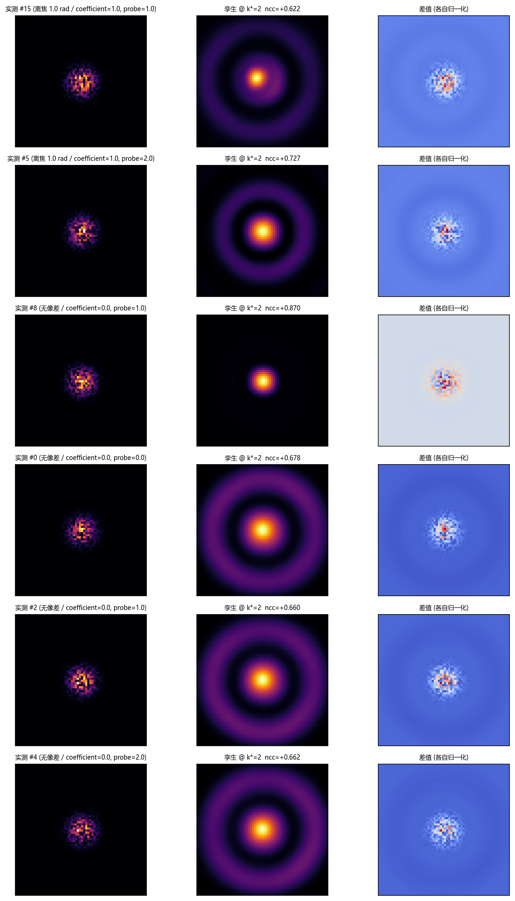
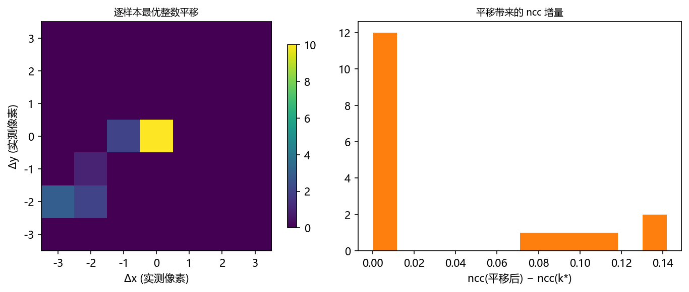

# 孪生 `ml.sim2f` 与 2f 实验语料的一致性 (纯离线, 只读 `data/debug/`)

<!-- provenance:start -->
> **生成脚本**: [`scripts/ml/validate_sim2f_vs_hw_corpus.py`](../../../../scripts/ml/validate_sim2f_vs_hw_corpus.py)
> **复现命令**: `python scripts/ml/validate_sim2f_vs_hw_corpus.py`
> **数据/关联脚本**: [`src/ml/hwdataset/index.py`](../../../../src/ml/hwdataset/index.py)
> **数据/关联脚本**: [`src/ml/hwdataset/records.py`](../../../../src/ml/hwdataset/records.py)
> **数据/关联脚本**: [`src/ml/hwdataset/transforms.py`](../../../../src/ml/hwdataset/transforms.py)
> **数据/关联脚本**: [`src/ml/sim2f/optics.py`](../../../../src/ml/sim2f/optics.py)
> **数据/关联脚本**: [`src/ml/sim2f/config.py`](../../../../src/ml/sim2f/config.py)
> **运行环境**: 离线（只读 data/debug/ 的 pkl；孪生在 CPU 上跑 torch，无设备、无 GPU 必需）
> **说明**: 把 G0-4 (`ncc(实测 net 帧, 孪生预测 net 帧) >= 0.5`) 放到 312 条真实 2f 语料上回答: 去重后只有 18 个不同的 (相位, 帧) 对 ⇒ 结论是 not_similar (归一化 L1 在整个 k 扫描上的最小值 1.2027, 门限 0.5), G0-4 的 min 口径未通过 (+0.453) 而中位口径通过 (+0.625); 含几何标度 k 的完整扫描、逐轮一致性、以及「按序号对半分与族完全混杂」这条预登记缺陷的披露
<!-- provenance:end -->

- 判定: **不相似** (`not_similar`)
- 依据: k* 上中位 ncc 或中位归一化 L1 未达门限; 且扫描的每一个 k 都未达门限, 故几何不确定性无法救回结论
- 边界: 扫描 12 个 k 上归一化 L1 的最小值 = 1.2027 (门限 0.5), ncc 的最大值 = +0.7160 (门限 0.5); L1 在整个 k 范围内都够不到, 因此 similar 不可达
- 几何最优点: `k* = 2` (孪生 CCD 像素 / 实测像素; 先验预期 `k = 1`), 内部性: **否** (两侧未都低 0.01 (左 +0.0029, 右 +0.0267))
- G0-4 (`ncc >= 0.5`) 在 `k = 1` 上: min = +0.453 → **未通过**; median = +0.625 → 通过 (n=18 个不同的对)
- 语料: `data/debug/model_in_loop_hw_collect/20261025*` — 312 条记录 / 54 个 pkl, 其中只有 **18 个不同的 (相位, 帧) 对** (复制 17.3 倍)
- 生成脚本: `scripts/ml/validate_sim2f_vs_hw_corpus.py`



## 1. 预登记判据

### 1.1 原文 (写于任何统计量被计算之前)

```
预登记判据 (写于任何统计量被计算之前; 之后一个字都不许改, 更不许放宽)

== 语料与口径 ==
1. 语料: `data/debug/model_in_loop_hw_collect/20261025*` (54 个 pkl, 312 条记录)。选它的理由:
   它是这批实验产物里唯一同时含 `_phase` (1200x1920, 弧度) 与 `_img` (整幅 CCD) 且体量可承受的族,
   采集日 (2026-10-25) 晚于孪生标定日 (2026-10-23) ⇒ 时间上是验证集样本。只读, 不写不删不改名。
2. 相位: `ml.hwdataset.Materialiser` 把 `_phase` 相干块平均到 128x128 (瞳面中心 (960,600),
   半径 450 px), 得到 (cos, sin)。与孪生 128 格 / 900 px 同口径。
3. 实测帧: 同一个 materialiser 取同一 pickle 的 LRU 里的 `_img`, 再走
   `farfield_frame_to_grid(..., 64, "raw")` —— 以实测帧 argmax (3x3 去尖峰) 为锚的 64x64 窗口,
   不缩放、不归一化。
4. 孪生: `Sim2f(Sim2fConfig.calibrated())`, device=cpu, `forward(..., detector=False)` ⇒ 256x256 强度帧。
   相位以 (cos, sin) 相量喂入 (孪生自己归一到单位幅度), 避免在多帧相干平均过的相位上再做 arctan2 往返。
   不做任何逐样本的缩放 / 归一化 / 峰值对齐。
5. 度量只有两种, 都与绝对量无关: ncc = 零均值皮尔逊相关; 归一化 L1 = Σ|a/Σa − b/Σb| ∈ [0,2]
   (= 2 x 全变差)。禁止用绝对 Strehl / PIB / EE / FWHM / 峰值 / 总能量作判据。
6. 几何映射: k = 孪生 CCD 像素 / 实测像素。实测第 i 个索引 (i=0..63) 在孪生上取
   `128 + (i − 31.5)·k` (两轴同式), 双线性插值, 越界截到边缘像素。k 越大 => 孪生图案被缩小。
   `128` 是孪生光学轴 (平场 argmax 实测恰在此), `31.5` 是 `farfield_frame_to_grid` 放置 0 级的位置。
7. 扫描网格 (预登记, 12 点): k ∈ {0.25, 0.5, 0.75, 1.0, 1.25, 1.5, 1.75, 2.0, 2.5, 3.0, 3.5, 4.0}。
   上界取 4.0 因为 64x4 = 256 = 孪生相机整幅。先验预期 k = 1.0 —— 侧车声明的相机像元 2.2 µm 与
   `Sim2fConfig.ccd_pixel_um` 相同, 故该扫描是对**标度**的检验, 不是自由旋钮。
8. 验证集协议: 最优点 k* 只在偶数序号记录上选 (中位 ncc 最大; 并列时取离 k=1.0 最近者);
   判定指标只在奇数序号记录上报告。

== 判定 ==
9. 几何可辨识 G: n >= 10, 且 k* 不在网格端点, 且 k* 两侧相邻点都比 k* 低 >= 0.01, 且
   全语料 k* 与奇数验证集 k* 相差 <= 一个网格步长。任一不满足 => G 未辨识, 并指名是哪一条。
10. 度量判据 M(k): 在该 k 上 中位 ncc >= 0.5 且 中位归一化 L1 <= 0.5 (⇔ 全变差 <= 0.25)。
    ncc 的 0.5 直接沿用已经预注册的 G0-4 门限 (`runs/sim2f_bench/README.md:138`), 不新造阈值。
11. 三值结论:
    similar      iff M(k*) 成立 且 G 可辨识;
    not_similar  iff M(k*) 不成立 且 (G 可辨识 或 扫描的**每一个** k 上 M 都不成立
                 —— 此时几何无法救回结论);
    insufficient 其余 (即 M 的成立与否取决于 k*, 而 k* 又不可辨识; 或 n < 10)。
12. 任何一条阈值都不因实测结果而调整。未达到就如实记为 not_similar, 并给诊断, 不找理由。

== 附属诊断 (只解释, 不参与判定) ==
13. 扫描整条 ncc 曲线与整条 L1 曲线 (两个半集各自报告)。
14. 分组中位: mode_id (0 无像差 / 2 离焦) x coefficient (0/1), 以及 probe (0/1/2)。
15. k* 处整数平移搜索 |Δ| <= 3 实测像素: 若最优平移非零, 说明 0 级锚点在成型帧上不等于真 0 级。
16. 标定版 (Sim2fConfig.calibrated()) 与裸版 (Sim2fConfig()) 孪生在同一 k* 处对照。
17. 光斑宽度比 (实测 / 孪生, **同一相位**): 只作宽度量级提示, 绝不以孪生平场作参照。
```

### 1.2 预登记缺陷与加固 (第一次全量运行之后追加; 1.1 一字未改)

```
预登记缺陷与加固 (第一次全量运行之后追加; 上面的第 1-17 条一字未改)

缺陷 —— 第一次全量运行才暴露, 属**语料构成**, 与任何度量结果无关:
  a. 312 条记录只含 18 个不同的 (相位, 帧) 对: 54 个 dump 反复存同一批
     6 个指令条件 x 3 个测量轮次, 同一个对被存了 6-36 次 (实测分布见报告 §2.1)。
     按记录算 n 会把这个样本平均放大 17 倍, 中位数于是被复制次数而不是物理条件加权。
  b. 第 8 条的「偶数/奇数序号」在这批 dump 的文件布局下**与族完全混杂**: 每个 dump
     前 3 条是 (mode_id=0, coefficient=0), 后 3 条是 (mode_id=2, coefficient=1),
     而每份 6 条是偶数 ⇒ 全部无像差记录必落偶数位, 全部离焦记录必落奇数位。
     首轮运行实测证实: 偶数 156 条全为 mode_id=0, 奇数 156 条全为 mode_id=2。
     ⇒ 那不是验证集, 而是把两个不同族当成两半来比。

加固 (只收紧, 不放宽任何阈值):
  1. 统计单位改为**去重后的 (相位, 帧) 对**: 用相位格 (cos, sin) + 实测帧的内容哈希
     判定同一性 —— 不用度量值, 否则是循环论证。第 9/10/11 条的 n 一律指去重后的个数。
  2. 第 8 条的验证集协议**替换**为「逐轮一致性」: 同一指令条件下 3 个轮次各自给出整条
     ncc 曲线与最优点, 要求三轮的 k* 与全体 k* 相差都不超过一个网格步长。这比按序号
     对半分更对题 —— 它检验的正是「换一次测量, 最优点还成立吗」。
  3. 阈值 (ncc >= 0.5, L1 <= 0.5, 内部性 0.01, n >= 10) 一个都没动。
  4. 判定规则 11 的三值映射不变。
```

## 2. 语料与口径

为什么要这一族, 以及任务书里点名的几族为什么用不了:

| 族 | 结论 | 理由 |
|---|---|---|
| `model_in_loop_hw_collect/20261025*` (本报告采用) | 可用 | 54 个 pkl / 312 条记录, 每条同时含 `_phase` (1200x1920 弧度) 与 `_img` (整幅 CCD); 采集日 2026-10-25 晚于孪生标定日 2026-10-23 ⇒ 时间上验证集; 曝光取值单一, 无需跨曝光归一 |
| `sim_vs_hw_20261023_v2/`, `sim_vs_hw_20261023/`, `sim_vs_hw_20261022/`, `hw_ab_new_20261023/`, `hw_ab_old_20261023/`, `hw_groups_20261022/` | **用不了** | 这些族里**没有 `.pkl`**: 帧存为 `.npz` + `measurements.json`, `ml.hwdataset` 的索引只能从 pickle 里定位相位与帧, 索引结果为 0 条 |
| `slm_transfer/` (1.8 GB), `model_in_loop_hw_sweep/` (62.9 GB) | 弃用 | 前者以逐次 `npz` 记录的迁移实验为主, 与「一条相位对应一帧」的口径不符; 后者体量 62.9 GB, 单次全量读取代价远超本问题所需 |
| `slm_gs_refine/` (862 MB) | 弃用 | 采集于当前光路改动之前, 与 `Sim2fConfig.calibrated()` 的标定不同源 |

逐条口径 (全部复用既有实现, 本脚本只新增几何映射与两个度量):

| 环节 | 实现 | 关键参数 |
|---|---|---|
| 语料索引 | `ml.hwdataset.build_hw_index` | 54 个 pkl, 排除 0 条 |
| 相位 → 128x128 相量 | `ml.hwdataset.records.Materialiser.phase_grid` (相干块平均, 非算术平均) | grid=128, 瞳面半径 450 px, 瞳面中心 (960, 600) px |
| 实测帧 → 64x64 | `ml.hwdataset.transforms.farfield_frame_to_grid(..., 64, "raw")` | 以整幅帧 argmax (3x3 去尖峰) 为锚, 不缩放不裁剪归一 |
| 孪生 | `ml.sim2f.optics.Sim2f(Sim2fConfig.calibrated())`, CPU | 产 256x256 强度帧; fft_n=512; 相机离焦 10.0847 mm; 0 级占比 0.1 |
| 几何映射 | 本脚本 `sample_twin`: 实测索引 i 取孪生 `128 + (i − 31.5)·k`, 双线性 | k ∈ {0.25, 0.5, 0.75, 1, 1.25, 1.5, 1.75, 2, 2.5, 3, 3.5, 4} |
| 去重 | 本脚本 `_digest`: 相位格 (cos, sin) + 实测帧的内容哈希 | 312 条 → 18 个不同的对; 36 次 x 4 个对, 30 次 x 2 个对, 12 次 x 6 个对, 6 次 x 6 个对 |
| 度量 | 零均值 ncc; 归一化 L1 = Σ\|a/Σa − b/Σb\| | 门限 ncc >= 0.5, L1 <= 0.5 |

侧车 (与孪生标定相关的字段): 曝光 `1.1` ms, 相机窗口 `region=32`, `far_field_size=256`, `defocus_rad=1.0`, `zernike_radius=200`, `pupil_center_panel=(960, 600)`, `camera_zero_order=(32, 33)`。

### 2.1 语料的真实规模 (结论前必读)

312 条记录按内容哈希只剩 **18 个不同的 (相位, 帧) 对**: 6 个指令条件 (`mode_id x coefficient x probe`) x 3 个测量轮次。同一个对被反复存进不同 dump, 复制倍数的分布是 36 次 x 4 个对, 30 次 x 2 个对, 12 次 x 6 个对, 6 次 x 6 个对。

因此:

1. 本报告所有中位数 / IQR 都按**去重后的对**统计 (n = 18), 不按 312 条记录 —— 否则复制次数会替物理条件加权。
2. 按记录加权的同一读数也在 §3 表里给出一列作参照: k* 处中位 ncc +0.727 (去重后 +0.716), 中位 L1 1.3587 (去重后 1.3038)。
3. 有效样本是 18 个**设计条件** (6 个指令条件 x 3 轮), 不是 18 个从总体上独立抽到的样本; §5.3 的逐条件表把 3 轮之间的散布摊开来看。

### 2.2 与任务书的三处不符 (如实记录)

| 任务书写的 | 仓库实际的 | 处理 |
|---|---|---|
| `ao_shaping.runners.gsnet_offline` 的辅助函数 | 该模块不存在; 真实路径是 `ml.gsnet_debug.offline` | 本脚本没有直接调用它 —— 相位/帧的还原已由 `ml.hwdataset` 内部复用同一批函数, 再调一次等于第二份实现 |
| 任务书点名的 6 个 `sim_vs_hw*` / `hw_ab*` / `hw_groups*` 族 | 均无 `.pkl`, 索引为 0 条 | 改用 `model_in_loop_hw_collect/20261025*`, 理由见上表 |
| 扫描网格原计划 `k ∈ [0.5, 2.0]` | 40 条记录的口径/几何预跑显示 2.0 处曲线仍在上升 | **在看主结果之前**把网格扩到 0.25..4.0 (12 点), 上界由 `64x4 = 256` = 孪生相机整幅决定; 扩充动机与时刻一并披露在此 |

## 3. 几何扫描: 整条曲线, 最优点, 是否真的内部

统计单位是去重后的 18 个对; 「按记录」一列只作参照。`k*` 取自去重后的中位 ncc 曲线, 三轮各自的最优点另见 §5.2。

| k | n | 中位 ncc | ncc IQR | 中位 ncc (按记录) | 中位 L1 | L1 IQR | M 成立? |
|---|---|---|---|---|---|---|---|
| 0.25 | 18 | +0.327 | +0.115 .. +0.334 | +0.332 | 1.7401 | 1.7153 .. 1.7445 | 否 |
| 0.5 | 18 | +0.419 | +0.295 .. +0.473 | +0.419 | 1.5993 | 1.4935 .. 1.6489 | 否 |
| 0.75 | 18 | +0.521 | +0.441 .. +0.628 | +0.537 | 1.4105 | 1.2181 .. 1.5149 | 否 |
| 1 | 18 | +0.625 | +0.546 .. +0.741 | +0.653 | 1.3425 | 0.9788 .. 1.4040 | 否 |
| 1.25 | 18 | +0.690 | +0.615 .. +0.808 | +0.716 | 1.3686 | 0.8259 .. 1.3931 | 否 |
| 1.5 | 18 | +0.713 | +0.653 .. +0.839 | +0.737 | 1.3638 | 0.8097 .. 1.4589 | 否 |
| 1.75 | 18 | +0.713 | +0.661 .. +0.842 | +0.730 | 1.3395 | 0.8714 .. 1.4664 | 否 |
| 2 | 18 | +0.716 | +0.663 .. +0.831 | +0.727 | 1.3038 | 0.8875 .. 1.4371 | 否 |
| 2.5 | 18 | +0.689 | +0.647 .. +0.767 | +0.686 | 1.2765 | 0.9747 .. 1.3877 | 否 |
| 3 | 18 | +0.663 | +0.642 .. +0.701 | +0.660 | 1.2154 | 1.0586 .. 1.3559 | 否 |
| 3.5 | 18 | +0.639 | +0.621 .. +0.673 | +0.631 | 1.2027 | 1.0253 .. 1.3101 | 否 |
| 4 | 18 | +0.621 | +0.565 .. +0.651 | +0.610 | 1.2109 | 1.0347 .. 1.2749 | 否 |

- 最优点 `k* = 2`, 中位 ncc +0.716; 两侧相邻: +0.713 / +0.689 ⇒ 两侧未都低 0.01 (左 +0.0029, 右 +0.0267)
- 内部性判据要求两侧都低 >= 0.01: **不满足**; 落在最高值 0.01 以内的网格点是 `k ∈ [1.5, 2]` (3 个), 这就是峰的分辨率 —— 比这更细的 `k` 差异在这批数据上不可分辨
- 逐轮一致性 (替代验证集协议): 第1轮 k = 1.5; 第2轮 k = 2; 第3轮 k = 1.75 ⇒ **三轮不一致**
- 几何可辨识: **否** (原因: 两侧未都低 0.01 (左 +0.0029, 右 +0.0267); n=18 >= 10; 三轮不一致)

读法: 曲线峰值平台在 `k ∈ [1.5, 2]` (argmax `k = 2`), 而不是两个像元节距所指的 `k = 1`。`k` 越大 = 孪生图案被缩得越小, 所以峰值大于 1 意味着**孪生自身的聚焦光斑比实测更宽**: 要把它压到实测的尺度上, 必须缩。这是「标度不对」, 不是「映射选错」。另需注意两条曲线不同步: 中位 L1 的最低点在 `k = 3.5` (1.2027), 而 ncc 的最高点在 `k = 2` —— ncc 由峰的形状决定, L1 由总质量落在哪里决定, 两者在这里指向不同的标度, 所以「最优点」本身不是一个可以单独引用的标定值。



## 4. G0-4 回答

G0-4 原文 (`runs/sim2f_bench/README.md:138`): `ncc(实测 net 帧, 孪生预测 net 帧) >= 0.5`, 不过的含义是"映射/ROI/标度错, 先修几何再测"。

这道门**没有缩放自由度**, 所以只能在与像素节距相符的 `k = 1` 上回答; 扫描最优点 `k* = 2` 的读数作为第二行给出, 用来看清「差多少是几何, 差多少是保真度」。

| 读数 | k | n | 值 | 门限 0.5 | 结论 |
|---|---|---|---|---|---|
| min ncc | 1 | 18 | +0.453 | >= 0.5 | **未通过** |
| 中位 ncc | 1 | 18 | +0.625 | >= 0.5 | 通过 |
| 中位 ncc | 2 (k*) | 18 | +0.716 | >= 0.5 | 通过 |

**回答**: 以实际会话使用的 `min` 口径, G0-4 在本语料上 **未通过** (min ncc +0.453, 门限 0.5, 差 -0.047)。门限按预登记不动。注意本语料只有 18 个不同的对, 所以这条 min 的含义是「18 个设计条件下最差的那一个」, 不是「一个总体的最差分位」。中位数通过而最小值不通过 ⇒ 失败是局部的: 多数条件已能被孪生对上形状, 少数条件对不上。

## 5. 逐族指标

去重后 18 个对 (每族 9 个, 每个 probe 6 个)。逐条值在 `artifacts/per_record.json` 里, 这里的 IQR 是 `q25 .. q75`。

### 5.1 `mode_id x coefficient`

| 族 | n | 中位 ncc | ncc IQR | 中位归一化 L1 | L1 IQR |
|---|---|---|---|---|---|
| 无像差 / coefficient=0.0 | 9 | +0.678 | +0.663 .. +0.844 | 1.2548 | 0.7702 .. 1.4703 |
| 离焦 1.0 rad / coefficient=1.0 | 9 | +0.728 | +0.654 .. +0.803 | 1.3473 | 0.8989 .. 1.4333 |

`mode_id` 与 `coefficient` 在这批 dump 里一一对应 (0↔0, 2↔1), 所以这张表实际只有两族, 不是四族。

### 5.2 `probe` 与逐轮一致性

| probe | n | 中位 ncc | ncc IQR | 中位归一化 L1 | L1 IQR |
|---|---|---|---|---|---|
| 0.0 | 6 | +0.703 | +0.667 .. +0.812 | 1.3187 | 0.9796 .. 1.4241 |
| 1.0 | 6 | +0.730 | +0.671 .. +0.791 | 1.2825 | 0.9804 .. 1.4100 |
| 2.0 | 6 | +0.698 | +0.664 .. +0.815 | 1.3011 | 0.9523 .. 1.4156 |

| 测量轮次 | 该轮最优点 k | 中位 ncc @ k* | 中位 L1 @ k* | 与全体 k* 相差 |
|---|---|---|---|---|
| 第1轮 | 1.5 | +0.670 | 1.4518 | 2 步 |
| 第2轮 | 2 | +0.666 | 1.2611 | 0 步 |
| 第3轮 | 1.75 | +0.842 | 0.8676 | 1 步 |

### 5.3 逐条件: 三轮之间的散布

同一个指令条件的三轮实测并不是同一个数 —— 这张表是理解「单一中位数能代表什么」的边界。

| 条件 | 轮数 | ncc 最小 | ncc 中位 | ncc 最大 | L1 最小 | L1 中位 | L1 最大 |
|---|---|---|---|---|---|---|---|
| 无像差 / coefficient=0.0 / probe=0.0 | 3 | +0.663 | +0.678 | +0.862 | 0.7241 | 1.2674 | 1.4703 |
| 无像差 / coefficient=0.0 / probe=1.0 | 3 | +0.660 | +0.705 | +0.870 | 0.7322 | 1.2249 | 1.4938 |
| 无像差 / coefficient=0.0 / probe=2.0 | 3 | +0.662 | +0.668 | +0.844 | 0.7702 | 1.2548 | 1.4833 |
| 离焦 1.0 rad / coefficient=1.0 / probe=0.0 | 3 | +0.632 | +0.728 | +0.841 | 0.8837 | 1.3700 | 1.4422 |
| 离焦 1.0 rad / coefficient=1.0 / probe=1.0 | 3 | +0.622 | +0.755 | +0.803 | 0.8989 | 1.3401 | 1.4333 |
| 离焦 1.0 rad / coefficient=1.0 / probe=2.0 | 3 | +0.654 | +0.727 | +0.862 | 0.8514 | 1.3473 | 1.4384 |



## 6. 附属诊断 (只解释, 不参与判定)

| 诊断 | 读数 | 说明 |
|---|---|---|
| k* 处整条分布 | 中位 ncc +0.716, IQR +0.663 .. +0.831, 范围 +0.622 .. +0.870; 中位 L1 1.3038 | ncc 从 +0.622 跨到 +0.870, 说明「一个数」掩盖了条件间与轮次间的差异 |
| 整数平移搜索 (\|Δ\| <= 3 px) | 中位增益 +0.063, 平移后中位 ncc +0.779 | 实测窗口以**成型帧的 argmax** 为锚, 而那未必是真 0 级; 增益 +0.063 就是锚点偏移的量级 (它只作用于 ncc, L1 未随之重算, 故不改变判定) |
| 标定版 vs 裸版孪生 (同一 k*) | 标定版中位 ncc +0.716, 裸版 +0.455; 裸版中位 L1 1.6336 | 裸版去掉相机离焦与 0 级串扰。差值 (裸 − 标定) = ncc -0.261, L1 +0.3298; 这个差值同时依赖 `k` 与测量轮次, 而 k* 本身不可辨识 (§3), 所以这一行**不能**读成「标定项好或坏」的结论 |
| 光斑宽度比 (实测 / 孪生, 同一相位) | 中位 0.544, IQR 0.426 .. 0.698 | 比值 < 1 = 孪生光斑更宽, 与 k* > 1 的方向一致; 只作量级提示 |
| 孪生模型的标称束半径 | `beam_w0_model_px = 17.0667` 面板像素 | 这是**瞳面**照明的高斯半径, 不是远场光斑宽度; 远场宽度由离焦与相位决定, 不能拿它与实测散斑宽直接比 |

「标定版 vs 裸版」这一行要按上表读: 标定项 (相机离焦 10.0847 mm + 0 级占比 0.1) 在本 k* 上让 ncc 变化 -0.261。这个差值同时依赖 `k` 与测量轮次, 而 `k*` 在这批数据上不可辨识 (§3), 所以它**不能**读成「标定项好或坏」的结论。



从示例图第 3 列可以直接读出为什么「ncc 过、L1 不过」: 差值集中在中心约 10 px 的小范围里, 而孪生图案是一圈圈**平滑**的衍射环。也就是说 ncc 主要由「能量集中在中心」这条包络贡献, 而实测画面里那层散斑结构孪生根本没有; 归一化 L1 对质量分布的形状更敏感, 因此它给出一个 1.2 以上的距离。这两个数不矛盾, 它们量的是不同的东西。



## 7. 局限 (读结论前必须知道)

1. **有效样本只有 18 个设计条件。** 312 条记录是同一个 6 条件 x 3 轮的小实验被平均存了 17 遍; 任何「总体」措辞都不成立, 本报告的每一句都只覆盖这 18 个条件。
2. **90° 轴交换无法在这里检出。** 侧车明确写着面板与相机坐标轴交换了 90°, 而本语料的像差族以无像差 / 纯离焦为主 (近似圆对称), 旋转 90° 后的图案与原来几乎一样。要检出它必须做二面体变换 (转置 / 翻转) 对照, 本报告没有做。
3. **实测窗口的锚点不是真 0 级。** `farfield_frame_to_grid` 用整幅帧的 argmax 定窗, 而成型帧的全局最大是成型后的亮点; 偏移量由 §6 的整数平移搜索给出。
4. **`k*` 是折衷, 不是标定值。** 孪生的光斑宽度与实测的散斑宽度不一致时, 任何单一 `k` 都不可能同时对上中心和边缘; 曲线是宽的, 把 `k*` 读成「正确的几何标度」是过度解读。
5. **只有一种度量族。** ncc 看形状相关, 归一化 L1 看分布距离; 二者都不含绝对量。本报告因此**不能**回答「孪生的绝对光度对不对」 —— 那需要 PIB / EE 这类量, 而它们已被 `runs/sim2f_bench/README.md` 记录为已知偏差 −79 % / +26 %。

## 8. 复现

```bash
python scripts/ml/validate_sim2f_vs_hw_corpus.py
```

全量耗时 8.8 s (索引 0.8 s, 建台 0.0 s, 扫描 7.5 s, 诊断 0.5 s)。脚本不写 `data/debug/`, 不碰任何设备, 孪生在 CPU 上跑。

产物:

| 文件 | 内容 |
|---|---|
| `artifacts/metrics.json` | 判定、几何、逐族、逐轮、扫描曲线、预登记原文 |
| `artifacts/per_record.json` | 逐记录 ncc / L1 / 平移 / 宽度比 / 去重摘要 |
| `ncc_vs_k.png` | 见正文对应小节 |
| `l1_vs_k.png` | 见正文对应小节 |
| `per_family_ncc.png` | 见正文对应小节 |
| `examples.png` | 见正文对应小节 |
| `shift_diagnostic.png` | 见正文对应小节 |
