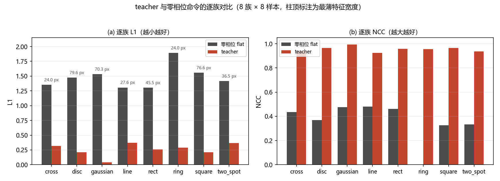
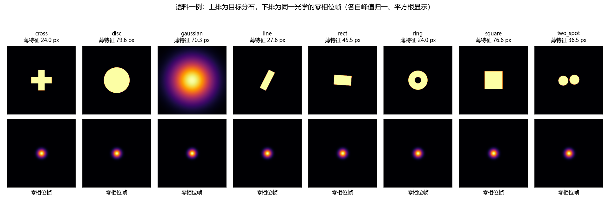
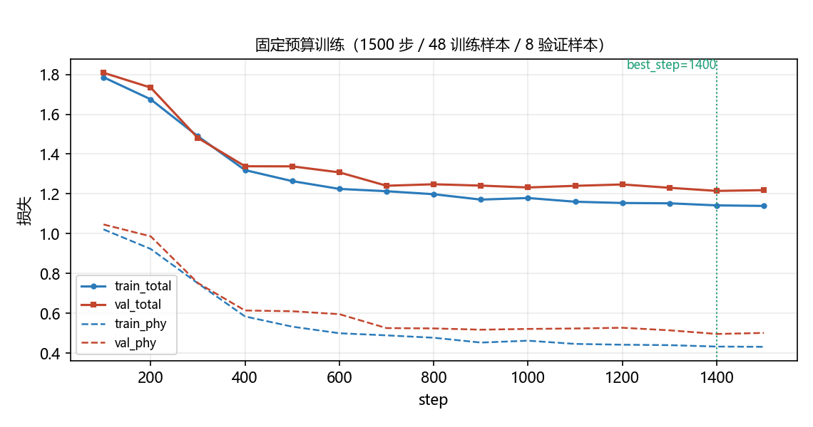
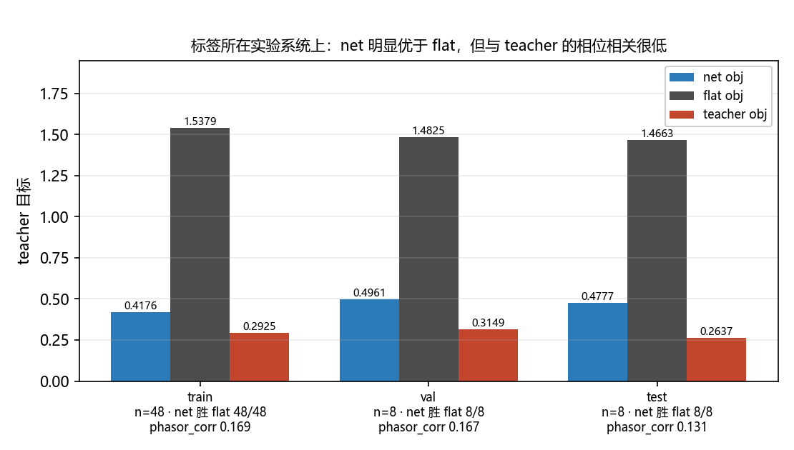
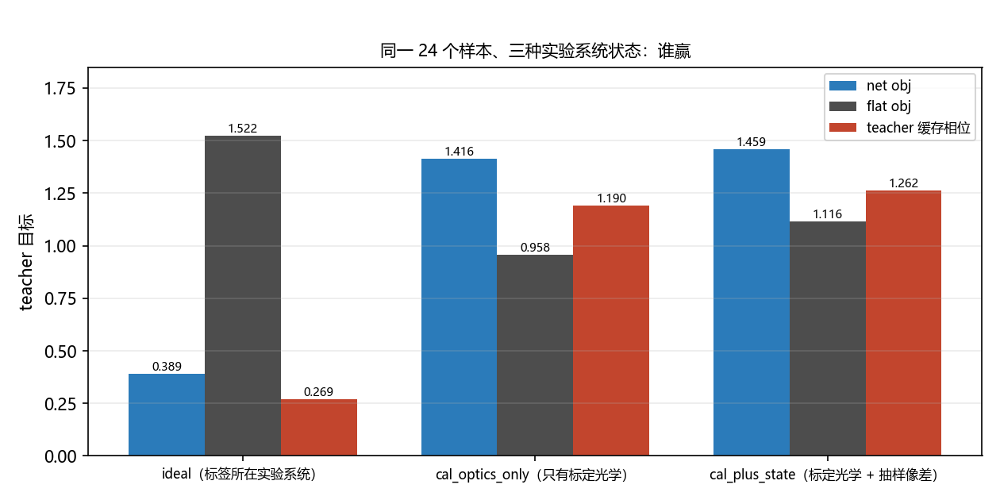
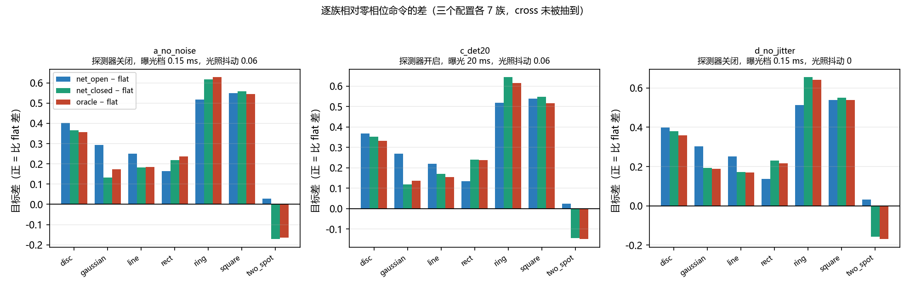
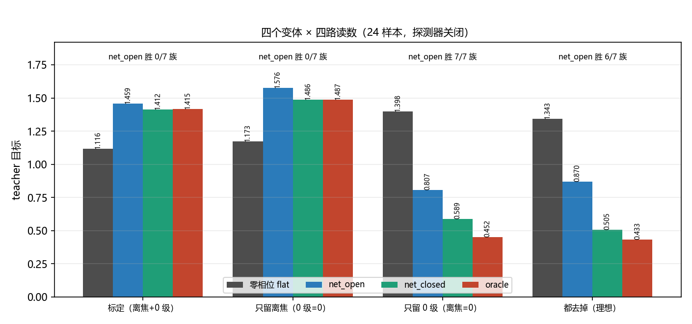
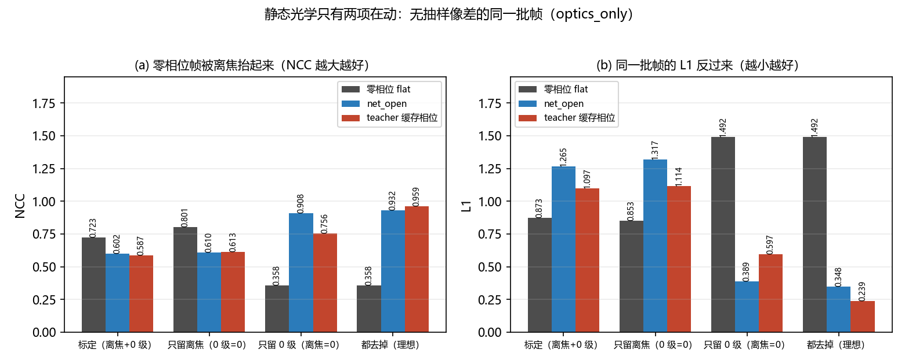
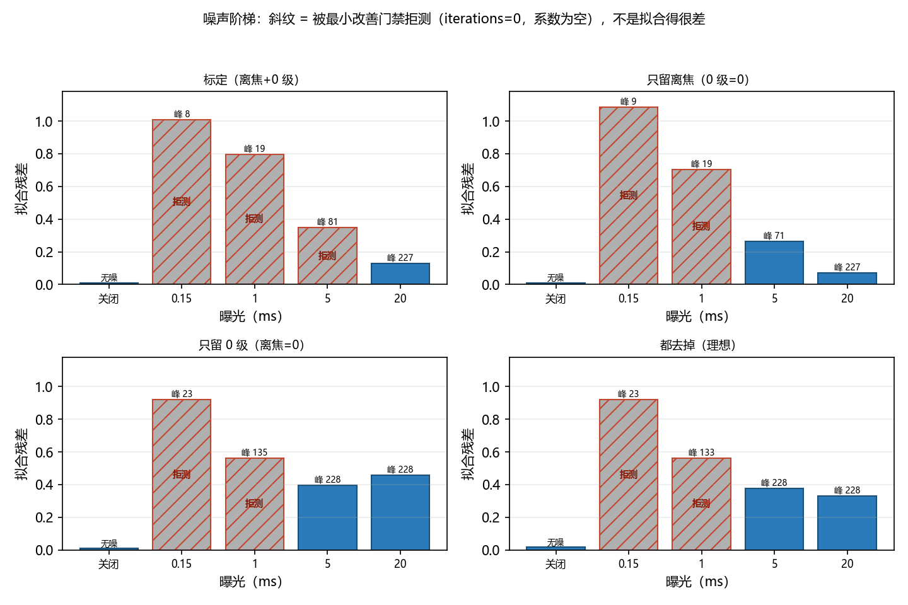

# 2f 孪生上的整形闭环：摊销、闭环估计与静态光学的归因（2026-10-25）

<!-- provenance:start -->
> **生成脚本**: [`scripts/ml/generate_sim2f_shaping_report.py`](../../../scripts/ml/generate_sim2f_shaping_report.py)
> **复现命令**: `python scripts/ml/generate_sim2f_shaping_report.py`
> **数据/关联脚本**: [`src/ml/sim2f/loop.py`](../../../src/ml/sim2f/loop.py)
> **数据/关联脚本**: [`src/ml/sim2f/train.py`](../../../src/ml/sim2f/train.py)
> **数据/关联脚本**: [`src/ml/sim2f/teacher.py`](../../../src/ml/sim2f/teacher.py)
> **数据/关联脚本**: [`src/ml/sim2f/optics.py`](../../../src/ml/sim2f/optics.py)
> **数据/关联脚本**: [`src/ml/sim2f/synth.py`](../../../src/ml/sim2f/synth.py)
> **数据/关联脚本**: [`src/ml/sim2f/losses.py`](../../../src/ml/sim2f/losses.py)
> **数据/关联脚本**: [`src/ao_shaping/drivers/sim/bench_twin.py`](../../../src/ao_shaping/drivers/sim/bench_twin.py)
> **数据/关联脚本**: [`tests/ao_shaping/ml/sim2f/test_twin_parity.py`](../../../tests/ao_shaping/ml/sim2f/test_twin_parity.py)
> **运行环境**: 离线（只读 runs/sim2f_fair 的 JSON/npz 产物；无 torch / 无 GPU / 无硬件）
> **说明**: 2f 实验系统数字孪生 (ml.sim2f) 上的整形闭环: 语料可行性下限 (24 px 特征底线, line 族从不可达变为可达)、U-Net 在标签实验系统上 48/48 + 8/8 胜过零相位、换到标定实验系统后五路读数全输给零相位 (net_open 0/7 族)、teacher 对照证明差别在实验系统而不在摊销、四变体消融把差异归到 10.0847 mm 相机离焦而非 0 级、噪声阶梯的拒测档位与重跑的逐字段确定性; 含 §8 三条被推翻的结论
<!-- provenance:end -->

## 0 结论摘要

1. **目标可达**：64 对样本 / 8 族，最薄特征设 24 px 下限。teacher（逐样本可微优化）在 **8/8** 族都优于零相位命令：L1 0.041–0.373 对 1.303–1.891，NCC 0.925–0.994。`line` 是下限的直接受益者：下限之前它是 1.5–3.0 px 的不可达目标（L1 1.62），现在是 27.6 px、L1 0.3731。
2. **网络不是欠训练、也没过拟合**：在它的标签所在的孪生上，net 在训练集 0.4176 对 flat 1.5379（48/48 样本）、测试集 0.4777 对 flat 1.4663（8/8）。但它与 teacher 的 phasor 相关只有 0.131（训练集 0.169）；相位差 RMS 1.632 rad。它找到的是**一个**解，不是 teacher 的解。
3. **换到标定后的实验系统，所有相位读数都输给零相位**：flat 1.1160，net_open 1.4588、net_probe 1.4151、net_closed 1.4116、oracle 1.4153（net_open 只赢 0/7 族）。
4. **teacher 也输**（1.2617 对 flat 1.1160；只保留标定光学时 1.1901 对 0.9583，teacher 只在 3/24 个样本上赢）⇒ 这既不是摊销（amortisation）差，也不是网络缺陷：**产出标签的实验系统与评估用的实验系统不是同一个**。
5. **归因是 10.0847 mm 相机离焦，不是 0 级 η**：只留离焦时反转仍在（flat 1.1731 对 net_open 1.5765，net_open 0/7 族）；只留 η 时反转消失（flat 1.3982 对 net_open 0.8066，7/7 族）；两者都去掉时 flat 1.3434 对 net_open 0.8697。机制实测：离焦把零相位点斑弥散到目标自己的尺度，flat 的 NCC 0.358→0.801、L1 1.492→0.853；而正确整形的光束反过来被弥散，net 的 NCC 0.932→0.610。

## 1 环境与契约

| 项 | 值 |
|---|---|
| 光学 / 探测器 | 2f 实验系统的数字孪生；瞳面 128 格 → 相机 256 px |
| 相机像元 / 视场 | 2.2 µm / 0.5632 mm |
| 采样比 `sampling_ratio` | 2.0991（远场采样间距 / 相机像元）|
| 远场角标度 | `far_field_padding` = 4，`fft_length` = 512，远场采样间距 4.6181 µm |
| 波长 / 焦距 / 有效口径 | 1064.0 nm / 125.0 mm / 5.40 mm |
| 面板像元 / 瞳面节距 | 8.0 µm / 56.25 µm（`region_span_px` = 900）|
| 视场内 PSF 宽度数 | 22.87 |
| 标签所在配置 | 理想：`defocus_m` = 0.0、`zero_order_eta` = 0.0、曝光 0.0 ms、探测器关闭 |
| 辐照度标度 | 平场峰 133.5 counts/ms，暗电平 26.75 counts |

**孪生一致性由测试钉住**，不是本文的断言：`tests/ao_shaping/ml/sim2f/test_twin_parity.py` 把 `Sim2fConfig` 逐字段映射到 `BenchTwinConfig`，在 `sampling_ratio = 1` 的对齐口径上比帧。该测试模块文档记录的峰归一偏差：理想光路平坦帧 3.4e-16 / 整形帧 1.9e-4，10.08 mm 离焦下 2.9e-5 / 3.9e-4，预算 2e-3 / 5e-3。

**相机是像元积分的，不是点采样**：`sampling_ratio` = 2.0991，所以模型在每个相机像元上做面积积分，而不是把 FFT 采样点当成像元（`exact_fft_n` = 1080 是两者重合的长度）。

**0 级是瞳面的相干混合**：`U = A·[sqrt(1-η)·e^{iφ} + sqrt(η)]`，未调制的那一份保持入射振幅，所以它和整形场**干涉**，而不是单纯叠加本底；调制通道的能量随 η 下降，不能假设能量守恒。标定配置 η = 0.1。

**没有建模的东西**（全部读自配置，不是推测）：面板静态像差与粗糙度（`slm_zernike` 空、`slm_roughness_sigma_rad` = 0）、LUT 非线性（`lut_gamma` = 1.0，即线性）、透镜像差（`lens_zernike` 空）、光路倾斜（`tilt_*` = 0）、面板串扰（`phase_blur_px` = 0，孪生不建模）。也就是说 `calibrated()` 只有两个非恒等旋钮：离焦与 η。另外，标签所在的理想配置不经过探测器（曝光 0、无量化 / 读出噪声）。

语料自检：64 个样本的几何重建与缓存目标逐位一致（`all_geometry_rebuilds_match = true`），所以 teacher 标签与网络训练用的是同一批帧。

## 2 目标形状与可行性下限

语料 `count` = 64，每族 8 个，划分 train/val/test = 48/8/8，抽取种子 20261024，尺寸比 0.16–0.44。

**24 px 的特征下限不是口味旋钮。** 孪生 PSF 的半高全宽实测 15.95 × 15.95 px（二阶矩等效宽度 23.70 px；引用值 16.0 px）。比 1.5 倍 FWHM 更细的特征，对这个实验系统就是一个 delta 函数：`draw_target` 因此把每一族的目标放大到最薄特征越线为止，越不过就报错，既不静默重抽，也不把不可达的样本写进缓存。

**`line` 就是这条下限的答案。** 该族原先抽到的线宽 1.5–3.0 px（0.12 倍 FWHM），teacher 停在 L1 1.62 / NCC 0.38（数字记录在 `src/ml/sim2f/config.py` 与 `src/ml/sim2f/targets.py` 的文档里）；加下限之后，本语料的 `line` 样本线宽为 27.6 px（1.72 倍 FWHM），teacher L1 0.3731、NCC 0.9247。也就是说**那次停滞是目标不可达，不是优化器不行**；同一族现在仍然是全部族里 L1 最差的一族（可达，但不容易）。

全部样本的 teacher 目标见 §3；逐族最薄特征与 FWHM 的比值在 1.50–4.98 之间。

## 3 teacher：逐族 vs 零相位

判据只用 L1 与 NCC。`flat` 的 EE 不是判据：零相位光斑通常落在支持域内部，所以它的 EE 接近 1 是构造使然（实测按族 0.0794–1.0000，下限那两个是支撑成空洞 / 双斑的 `ring` 与 `two_spot`）；`peak_ratio` 不报（量纲混合：counts 帧对单位和控制目标）。

| family | n | flat L1 | teacher L1 | flat NCC | teacher NCC | teacher 目标 | 最薄特征 px | 薄特征/FWHM |
|---|---|---|---|---|---|---|---|---|
| `cross` | 8 | 1.3542 | 0.3176 | 0.4366 | 0.9399 | 0.3490 | 24.0 | 1.50 |
| `disc` | 8 | 1.4739 | 0.2093 | 0.3681 | 0.9659 | 0.2286 | 79.6 | 4.98 |
| `gaussian` | 8 | 1.5321 | 0.0409 | 0.4759 | 0.9937 | 0.1136 | 70.3 | 4.40 |
| `line` | 8 | 1.3066 | 0.3731 | 0.4817 | 0.9247 | 0.4060 | 27.6 | 1.72 |
| `rect` | 8 | 1.3030 | 0.2607 | 0.4615 | 0.9585 | 0.2866 | 45.5 | 2.84 |
| `ring` | 8 | 1.8908 | 0.2912 | 0.0017 | 0.9546 | 0.3203 | 24.0 | 1.50 |
| `square` | 8 | 1.5579 | 0.2104 | 0.3251 | 0.9639 | 0.2301 | 76.6 | 4.79 |
| `two_spot` | 8 | 1.4173 | 0.3672 | 0.3344 | 0.9373 | 0.3995 | 36.5 | 2.28 |

两条判据在 teacher 列上给出**完全相同**的族排序（`gaussian` > `disc` > `square` > `rect` > `ring` > `cross` > `two_spot` > `line`），所以逐族排序不依赖选哪一条。

两列仍不可互相替代，因为在 **flat 列**它们差得很远：`ring` 的 flat NCC 只有 0.0017（零相位点斑落在环的空洞里，与目标几乎不相关），而它的 flat L1 是 1.8908——两条判据都判它最差，但只有 NCC 会掉到 0 附近，两者的数值含义不同。判据（`objective`）本身还额外带 EE 项，所以目标值、L1、NCC 三者的排序可以不同。



图中柱顶数字是最薄特征宽度（px），用来对照 §2 的下限。



上排是目标分布，下排是同一光学的零相位帧。零相位帧是一个落在支持域内部的点斑，对分布式的目标，它把能量全放在一个格子上——这正是它 L1 大、NCC 低的来源。

## 4 U-Net（标签所在的实验系统）

预算固定：width 16、depth 3、batch 4、1500 步、lr 0.0002、seed 0、`w_sup` 1 / `w_phy` 1 / `w_tv` 0，参数量 487874。验证集非空（8 样本，每 100 步验一次），`best_step` = 1400、`best_val_phy` = 0.4961；末步 train_total 1.1395 / val_total 1.2188。（`best` 与 `last` 不是同一个状态。）

| split | n | net 目标 | flat 目标 | teacher 目标 | net 胜 flat | phasor_corr | 相位差 RMS vs teacher (rad) | dist_ratio |
|---|---|---|---|---|---|---|---|---|
| train | 48 | 0.4176 | 1.5379 | 0.2925 | 48/48 | 0.1685 | 1.6321 | 0.8879 |
| val | 8 | 0.4961 | 1.4825 | 0.3149 | 8/8 | 0.1674 | 1.6260 | 0.9231 |
| test | 8 | 0.4777 | 1.4663 | 0.2637 | 8/8 | 0.1313 | 1.6513 | 0.9398 |

读到的东西：

- **不是欠训练**：训练集 48/48 个样本都优于 flat，目标 0.4176 对 1.5379。
- **也没有过拟合**：测试集 8/8 个样本都优于 flat（0.4777 对 1.4663），与训练集同向；48 个训练样本、487874 个参数，这个规模本来也过拟合不到哪里去。
- **它给的不是 teacher 的解**：与 teacher 的 phasor 相关只有 0.131–0.169，卷绕相位差 RMS 约 1.63 rad，`dist_ratio` 0.888–0.940（1 表示与 flat 一样远离 teacher）。整形问题在相位域是多解的，这一点决定 §5 的 oracle 只能当**系数**上限，不能当目标上限。





### 4.1 从标签实验系统搬到标定实验系统

同一 24 个样本（`torch.randperm(64, seed=7)[:24]`）、三种实验系统状态，判据不变。`tp` 是**缓存 teacher 相位**在同一状态上的传播——用来问「有没有任何理想实验系统上的相位能搬过来」的对照。探测器关闭。

| 实验系统状态 | n | net 目标 | flat 目标 | teacher 缓存相位 | Δ(net−flat) | Δ(tp−flat) | net<flat | tp<flat |
|---|---|---|---|---|---|---|---|---|
| `ideal`（标签所在） | 24 | 0.3892 | 1.5224 | 0.2693 | -1.1332 | -1.2530 | 24/24 | 24/24 |
| `cal_optics_only`（只有标定光学） | 24 | 1.4158 | 0.9583 | 1.1901 | +0.4574 | +0.2318 | 0/24 | 3/24 |
| `cal_plus_state`（标定光学 + 抽样像差） | 24 | 1.4588 | 1.1160 | 1.2617 | +0.3428 | +0.1457 | 4/24 | 6/24 |

三步走完，结论就定在这里：**在标签所在的实验系统上 net 赢 24/24，只加标定光学就掉到 0/24，再加上抽样像差就是闭环看到的那个状态。** 而缓存 teacher 相位在新实验系统上同样翻车（1.1901 对 flat 0.9583），所以这不是网络的问题。

与闭环自己的 JSON 对拍：`cal_plus_state` 的 flat 与 `loop/a_no_noise` 的 flat 相差 0.0e+00，net_open 相差 3.0e-08 —— 同一个量的两次测量，不是两个不同的量。



## 5 闭环五路读数（三个配置）

判据是 teacher 自己的 `objective = L1 + w_ee·(1-EE)`（在 prepared 帧上），对所有读数一致；`l1` / `ncc` 并列报出。`ee` / `cv_in_support` / `iou50` 是诊断量，不参与排序；`peak_ratio` 不报（量纲混合）。

五路读数：`flat`（零相位）、`net_open`（一次前向）、`net_probe`（探针拟合像差后）、`net_closed`（再加闭环重拟合）、`oracle`（真值**系数**，不是目标上限）。

| 配置 | 读数 | 目标 | L1 | NCC | EE | CV（支持域内） | IoU50 |
|---|---|---|---|---|---|---|---|
| `a_no_noise` | `flat` | 1.1160 | 1.0142 | 0.6344 | 0.5927 | 0.8786 | 0.1355 |
| `a_no_noise` | `net_open` | 1.4588 | 1.3009 | 0.5437 | 0.3685 | 0.9132 | 0.0903 |
| `a_no_noise` | `net_probe` | 1.4151 | 1.2640 | 0.5954 | 0.3954 | 0.7269 | 0.1067 |
| `a_no_noise` | `net_closed` | 1.4116 | 1.2605 | 0.6041 | 0.3955 | 0.6965 | 0.1068 |
| `a_no_noise` | `oracle` | 1.4153 | 1.2633 | 0.6026 | 0.3917 | 0.6821 | 0.1231 |
| `c_det20` | `flat` | 1.1244 | 1.0201 | 0.6490 | 0.5830 | 0.8376 | 0.2114 |
| `c_det20` | `net_open` | 1.4481 | 1.2915 | 0.5439 | 0.3735 | 0.9227 | 0.0949 |
| `c_det20` | `net_probe` | 1.3927 | 1.2451 | 0.6069 | 0.4095 | 0.7490 | 0.1038 |
| `c_det20` | `net_closed` | 1.4190 | 1.2657 | 0.5973 | 0.3868 | 0.7163 | 0.0951 |
| `c_det20` | `oracle` | 1.4042 | 1.2530 | 0.6039 | 0.3950 | 0.6971 | 0.1139 |
| `d_no_jitter` | `flat` | 1.1077 | 1.0066 | 0.6367 | 0.5957 | 0.8742 | 0.1393 |
| `d_no_jitter` | `net_open` | 1.4468 | 1.2903 | 0.5539 | 0.3739 | 0.9043 | 0.0967 |
| `d_no_jitter` | `net_probe` | 1.4081 | 1.2578 | 0.6029 | 0.3989 | 0.6993 | 0.1105 |
| `d_no_jitter` | `net_closed` | 1.4157 | 1.2644 | 0.6043 | 0.3946 | 0.6863 | 0.1136 |
| `d_no_jitter` | `oracle` | 1.4045 | 1.2545 | 0.6125 | 0.3999 | 0.6703 | 0.1243 |

三个配置的差别只是测量侧：

- `a_no_noise`：探测器关闭，曝光档 0.15 ms，光照抖动 0.06；离焦 10.0847 mm、η = 0.10、样本 24、轮数 2、seed 7。
- `c_det20`：探测器开启，曝光 20 ms，光照抖动 0.06；离焦 10.0847 mm、η = 0.10、样本 24、轮数 2、seed 7。
- `d_no_jitter`：探测器关闭，曝光档 0.15 ms，光照抖动 0；离焦 10.0847 mm、η = 0.10、样本 24、轮数 2、seed 7。

### 5.1 逐族（以 `a_no_noise` 为正文，另两个配置方向相同）

| family | n | flat | net_open | net_probe | net_closed | oracle | 胜者 |
|---|---|---|---|---|---|---|---|
| `disc` | 4 | 0.9734 | 1.3756 | 1.3335 | 1.3393 | 1.3309 | `flat` |
| `gaussian` | 3 | 0.7446 | 1.0372 | 0.8943 | 0.8765 | 0.9185 | `flat` |
| `line` | 4 | 1.3612 | 1.6106 | 1.5646 | 1.5429 | 1.5453 | `flat` |
| `rect` | 2 | 1.1292 | 1.2923 | 1.3315 | 1.3481 | 1.3654 | `flat` |
| `ring` | 2 | 1.1597 | 1.6764 | 1.7736 | 1.7762 | 1.7879 | `flat` |
| `square` | 6 | 0.8509 | 1.4006 | 1.3951 | 1.4099 | 1.3947 | `flat` |
| `two_spot` | 3 | 1.8428 | 1.8712 | 1.7022 | 1.6711 | 1.6779 | `net_closed` |

`torch.randperm(64, seed=7)[:24]` 没有抽到 `cross`，所以本表的族数是 **7/8**，所有「n/7 族」都以抽到的族为分母，不能读成 8 族里的占比。

**`net_closed` 相对 `net_open`**：在 `disc`、`gaussian`、`line`、`two_spot` 上更好，在 `rect`、`ring`、`square` 上更差；三个配置的分族方向一致，所以这**不是**测量噪声。在 `rect` 上，两个含离焦的变体都更差（见 §6），两个不含离焦的变体都更好——与 §6 的归因同向。

每轮的改善也不该被藏起来：下表是三个配置的逐轮统计（分母是该配置实际记到的轮数）。

| 配置 | 改善轮数 | 单调改善样本 | 探针拟合 ok | 系数 RMSE | 线性读数 cos |
|---|---|---|---|---|---|
| `a_no_noise` | 19/48 | 3/24 | 24/24 | 0.0849 | 0.3309 |
| `c_det20` | 23/48 | 3/24 | 24/24 | 0.1720 | 0.0206 |
| `d_no_jitter` | 24/46 | 5/24 | 24/24 | 0.0670 | 0.3759 |

「改善轮数」只统计相邻两轮之间目标变好的次数，所以它比 `net_closed` 与 `net_open` 的总差更容易被单轮抖动左右；把它与 §7 的噪声阶梯一起读，不要单独当成收敛证据。

分母不是 `样本数 × 轮数` 的那一个配置要解释清楚：`d_no_jitter` 记到 46 轮（24 × 2 应为 48），缺轮的是 `disc` 14 号、`gaussian` 52 号，这些样本的第 1 轮重拟合都被拒（保留上一步估计）。所以 `improved/total` 只在同一配置内部可比，不能跨配置直接比分子。



## 6 归因：离焦 vs 0 级

同一语料、同一检查点、同一闭环契约（24 样本、2 轮、seed 7、探针与重拟合开启、探测器关闭、光照抖动 0.06），**唯一变量**是 `Sim2fConfig.calibrated()` 里的 `defocus_m` 与 `zero_order_eta`，用 `dataclasses.replace` 改。

| 变体 | 离焦 (mm) | η | flat | net_open | net_closed | oracle | net_open 胜族 |
|---|---|---|---|---|---|---|---|
| `calibrated` | 10.0847 | 0.10 | 1.1160 | 1.4588 | 1.4116 | 1.4153 | 0/7 |
| `defocus_only` | 10.0847 | 0.00 | 1.1731 | 1.5765 | 1.4859 | 1.4870 | 0/7 |
| `eta_only` | 0.0000 | 0.10 | 1.3982 | 0.8066 | 0.5891 | 0.4519 | 7/7 |
| `ideal` | 0.0000 | 0.00 | 1.3434 | 0.8697 | 0.5048 | 0.4329 | 6/7 |

**归因读法**：去掉离焦（保留 η）就恢复了理想实验系统的顺序 —— net_open 0.8066 对 flat 1.3982；去掉 η（保留离焦）没有恢复 —— net_open 1.5765 对 flat 1.1731，与标定结果同向。两个都去掉是该实验系统上的下限：flat 1.3434 对 net_open 0.8697（6/7 族，例外是 `two_spot`，net_closed 把它拉回到 1.1093）。

### 6.1 teacher 对照：独立复算同一件事

| 变体 | 情形 | n | flat | net_open | teacher | net_open<flat | teacher<flat |
|---|---|---|---|---|---|---|---|
| `calibrated` | 抽样像差 + 抖动 | 24 | 1.1160 | 1.4588 | 1.2617 | 4/24 | 6/24 |
| `calibrated` | 只有静态光学 | 24 | 0.9583 | 1.4158 | 1.1901 | 0/24 | 3/24 |
| `defocus_only` | 抽样像差 + 抖动 | 24 | 1.1731 | 1.5765 | 1.3614 | 3/24 | 3/24 |
| `defocus_only` | 只有静态光学 | 24 | 0.9536 | 1.4829 | 1.2303 | 0/24 | 3/24 |
| `eta_only` | 抽样像差 + 抖动 | 24 | 1.3982 | 0.8066 | 0.8733 | 21/24 | 23/24 |
| `eta_only` | 只有静态光学 | 24 | 1.5224 | 0.4258 | 0.6237 | 24/24 | 24/24 |
| `ideal` | 抽样像差 + 抖动 | 24 | 1.3434 | 0.8697 | 0.7529 | 19/24 | 20/24 |
| `ideal` | 只有静态光学 | 24 | 1.5224 | 0.3892 | 0.2693 | 24/24 | 24/24 |

`teacher` 是语料自己给该目标的标签相位——监督能要求的最好情况。它在只保留标定光学时也输给 flat（1.1901 对 0.9583，3/24），所以**是实验系统把排序倒过来了**，不是监督信号或网络的问题。

### 6.2 机制：离焦把零相位帧抬起来，而不是把网络压下去

1. **η 动不了零相位帧。** φ = 0 时两项同相、携带同一个场分布，单位和控制目标做完归一化后帧完全相同；实测 flat 目标在 `eta_only` 与 `ideal` 上同为 1.5224（两者相等）。（绝对亮度会按调制通道的 η 掉一档，但判据是归一化后的分布。）
2. **离焦把零相位帧抬到目标的尺度。** 同一批无抽样像差的帧，flat 的目标从 `ideal` 的 1.5224 降到 `defocus_only` 的 0.9536（越低越好）：NCC 0.358→0.801、L1 1.492→0.853。在焦时 flat 是衍射极限的点斑，对分布式目标反而是最差的形状；离焦把它弥散到目标自己的尺度，于是它突然「像」了。整形那一支朝反方向走，因为它的光斑本来尺度就对，离焦把它过度弥散：NCC 0.932→0.610。两支因此交叉，而不是网络变差。
3. **在含离焦的实验系统上没有相位能赢 flat**，连知道真值系数的 `oracle` 也不行（`defocus_only` 1.4870 对 1.1731；`calibrated` 1.4153 对 1.1160）。**注意**：`oracle` 只知道抽样的像差状态，从不知道静态离焦，所以「一个下发的相位能否抵消它」**没有被测过** —— 本报告只能说「没有哪一路读数估计它」，不能说「它不可补偿」。

复现校验（读自 `ablation_loops.json`）：`calibrated` 变体重现 `loop/a_no_noise` —— identical = True、max|Δ| = 0.0；teacher 对照的 `ideal`/`optics_only` 对 `bench_transfer.json` 的 ideal 行 max|Δ| = 0.0。两条都是独立进程重跑，只改了那两个静态误差字段。





## 7 噪声阶梯与确定性

阶梯每个档位跑一次 80 步 Adam 系数拟合（只拟合一个抽样状态，名义照明），判据是残差的最小改善；改善不过门禁就**拒绝**（`iterations = 0`、系数为空）。拒测不是「拟合得很差」，是「这一档没有可用的测量」。

| 变体 | 档位 | 峰值 counts | 残差（起→终） | 迭代 | 系数 RMSE | cos |
|---|---|---|---|---|---|---|
| `calibrated` | 关闭 | 0.52（模型强度） | 0.1081 → 0.0097 | 80 | 0.0051 | 0.9953 |
| `calibrated` | 0.15 ms | 8.00 | 1.0099 → 1.0066 | **拒测** | 未测 | 未测 |
| `calibrated` | 1 ms | 19.00 | 0.8047 → 0.7967 | **拒测** | 未测 | 未测 |
| `calibrated` | 5 ms | 81.00 | 0.3780 → 0.3473 | **拒测** | 未测 | 未测 |
| `calibrated` | 20 ms | 227.00 | 0.1916 → 0.1293 | 80 | 0.3787 | 0.4623 |
| `defocus_only` | 关闭 | 0.27（模型强度） | 0.1631 → 0.0112 | 80 | 0.0049 | 0.9957 |
| `defocus_only` | 0.15 ms | 9.00 | 1.0097 → 1.0842 | **拒测** | 未测 | 未测 |
| `defocus_only` | 1 ms | 19.00 | 0.7227 → 0.7034 | **拒测** | 未测 | 未测 |
| `defocus_only` | 5 ms | 71.00 | 0.3316 → 0.2624 | 80 | 0.0477 | 0.6967 |
| `defocus_only` | 20 ms | 227.00 | 0.2018 → 0.0692 | 80 | 0.0711 | 0.4932 |
| `eta_only` | 关闭 | 4.49（模型强度） | 0.0822 → 0.0089 | 80 | 0.0909 | -0.6067 |
| `eta_only` | 0.15 ms | 23.00 | 0.9200 → 0.9192 | **拒测** | 未测 | 未测 |
| `eta_only` | 1 ms | 135.00 | 0.5783 → 0.5608 | **拒测** | 未测 | 未测 |
| `eta_only` | 5 ms | 228.00 | 0.5027 → 0.3954 | 80 | 0.6941 | -0.0496 |
| `eta_only` | 20 ms | 228.00 | 0.6703 → 0.4584 | 80 | 0.4889 | 0.3943 |
| `ideal` | 关闭 | 2.78（模型强度） | 0.1134 → 0.0165 | 80 | 0.0860 | -0.5185 |
| `ideal` | 0.15 ms | 23.00 | 0.9208 → 0.9194 | **拒测** | 未测 | 未测 |
| `ideal` | 1 ms | 133.00 | 0.5874 → 0.5598 | **拒测** | 未测 | 未测 |
| `ideal` | 5 ms | 228.00 | 0.5091 → 0.3746 | 80 | 0.6131 | -0.1206 |
| `ideal` | 20 ms | 228.00 | 0.6798 → 0.3308 | 80 | 0.2917 | 0.4572 |

要点：0.15 ms、1 ms 在**每个**变体上都被拒测（峰值 8–135 counts）；5 ms 在 `calibrated` 上也被拒测（峰 81 counts），在 `defocus_only`、`eta_only`、`ideal` 上能测；20 ms（峰 227–228 counts）是唯一在每个变体上都测到的档位。

- **系数误差不是单调的**，可观测性由实验系统决定，不由曝光决定。
- 在 `defocus_only` 上 20 ms 的系数误差（0.0711）反而比 5 ms（0.0477）更差；曝光档位本身不构成质量排序。
- 两个在焦变体上，关闭探测器的档位给出的系数与真值**负相关**（cos `eta_only` -0.607、`ideal` -0.519）：那里离焦不在光路里，探针看不到它，拟合只能返回一个与真值反向的向量。这一档只作诊断，不参与任何整形目标的排序。

### 7.1 确定性

`ablate/loops/calibrated` 与 `loop/a_no_noise` 是**两次独立进程**，输入相同。

| 对照项 | 结果 |
|---|---|
| 数值场逐字段相等（aggregate / per_kind / per_sample / rounds / probe / 噪声阶梯） | 是 |
| 不等的字符串字段 | /cache、/checkpoint、/loop/out_dir |
| `eval_loop.csv` 逐行相等 | 是 |

所以在这个配置上，同一输入的重跑是**逐字段确定**的（包括逐样本读数与 CSV）；差异只有记录输出路径的字符串。`teacher_control` 与 `bench_transfer` 的 ideal 行同样给出 max|Δ| = 0（§6）。这只证明**在给定种子与固定输入下**可复现，不证明换种子后结论不变——本文没有做种子扫描。



## 8 被推翻的结论

这一节保留在此，是因为三条结论都曾经被写过一次，而且在当时的产物上看起来成立。

### 8.1 「闭环有效」——来自 4 对样本的试运行

试运行只有 4 对样本（`cross`、`gaussian`、`line`、`rect`），没有测试集，teacher 与语料都在 24 px 下限之前抽取。它的结论是 `net_closed` 1.3372 优于 flat 1.5598（差 +0.2225）—— 看上去闭环有效。

| family | flat | net_closed | net_closed − flat |
|---|---|---|---|
| `cross` | 1.0190 | 1.1114 | +0.0923 |
| `gaussian` | 1.6104 | 0.8837 | -0.7268 |
| `line` | 2.1750 | 2.1181 | -0.0569 |
| `rect` | 1.4346 | 1.2358 | -0.1988 |

`net_closed` 在 3/4 个样本上优于 flat。汇总的 +0.2225 差距其实由 `gaussian` 一族撑起来（-0.7268，单族就超过总差距），`cross` 反向贡献 +0.0923。

为什么它站不住：

- `line` 正是**下限之前**抽的那个不可达目标：它的 flat 目标 2.1750 是全组最差的一个，而这个「最差」来自目标不可达（§2），不是来自闭环的功劳。同一族在 24 样本语料上的 flat L1 只有 1.3066（口径不同，只能看量级）。
- 4 个样本的族组成 `cross`、`gaussian`、`line`、`rect` 没有测试集，无法区分「学到了」与「记住了这 4 个样本」；跨族均值不构成任何族的结论。
- 在 24 样本、带 24 px 下限的语料上，同一判定是反的（§5）。

### 8.2 「net 欠训练」

不成立。同一个检查点（1500 步，§4）在训练集上赢 flat 48/48、测试集 8/8（§4）。训练曲线在 `best_step` 之后已经平（学习率固定、损失不再下降），验证集也非空（8 样本），所以「再加步数就会赢」没有证据；真正的差异在实验系统，不在优化预算。

### 8.3 「η 是主因」

不成立。η 单独存在时反转**消失**（7/7 族 net_open 赢），离焦单独存在时反转**仍在**（0/7 族）。η 只在 φ = 0 时动不了零相位帧（§6.2），所以它不可能是主因；把两者都去掉才回到理想顺序，说明这两个静态项里只有离焦在起作用。

## 9 局限与下一步

1. **这是匹配模型结果，不是 sim-to-real。** teacher、net、闭环共用同一个正向模型，所以测到的只是「摊销（amortisation）+ 闭环估计」这一层的预算，不包含模型失配。孪生自身对实验系统的残差见 [`../sim_vs_hw/sim_vs_hw_20261023.md`](../../shape_trials/sim_vs_hw/sim_vs_hw_20261023.md)（V2.0，即 `calibrated()` 用的那一轮）：绝对 PIB / EE 差 −79.8 % / −79.3 %（判定 不一致），CV +11.9 %、复合分数 −14.8 %（判定 一致），FWHM +26.4 %（判定 偏差）。**所以本报告只能引用相对改善（谁赢、方向），不能把绝对 PIB、EE、FWHM 当实验系统的数字。**
2. **标签所在的实验系统 ≠ 评估用的实验系统。** 语料在理想配置上生成（无离焦、无 η、无探测器），闭环在标定配置上评估（10.0847 mm 离焦 + η 0.10）。这不是「仿真到实验」的落差，而是同一个孪生内部两个配置的落差；下一步要么在标定配置上重做标签（成本是 64 次 teacher 优化），要么让评估也在理想配置上做（那就测不到部署时会遇到的问题）。
3. **判据奖励弥散。** L1 + w_ee(1-EE) 在单位和控制目标上比较，所以一个被离焦弥散到目标尺度的点斑，比一个尺度正确但位置/形状略有偏差的整形光斑得分更好。在含离焦的实验系统上这会让 flat 变成很强的对照项（连 oracle 都赢不了它，§6.2）。换判据（例如加结构项、或在去卷积后的帧上评分）会得到不同排序——本文没有测。
4. **静态离焦是否可补偿没有被测。** `oracle` 只提供抽样状态的系数，从不提供静态离焦；所以「下发一个补偿离焦的相位能不能追上」是**未测**，不是「不可补偿」。要回答它，需要把 `defocus_m` 放进可优化变量，或在探针里显式拟合它。
5. **语料与样本量小。** 64 对 / 8 族，闭环仅用 24 个样本、7 族，噪声阶梯每个档位只拟合**一个**状态。跨族均值不是任何族的结论，族内 n 只有 2–6；逐族差异的量级可以看，显著性没有做（也没有做种子扫描）。
6. **下一步的最小充分实验**：在标定配置上重生成语料并按同一预算重训；把 `defocus_m` 加入探针拟合的可辨识参数；用 3 个种子重复 §5 以给出折叠/种子方差；把判据换成「去卷积后的形状误差」，检查排序是否仍然由 flat 主导。

## 10 复现

**溯源**：文首的溯源块由 `insert_header` 从 `scripts/_common/provenance.py::REPORTS` 生成（键 `report/sim2f_shaping/closed_loop_20261025/report.md`），不要手改；`python scripts/sync_report_provenance.py --check` 验证它没有漂移。

**渲染**（离线，无 torch / 无 GPU / 无硬件）：

```bash
.venv\Scripts\python.exe scripts\ml\generate_sim2f_shaping_report.py
```

`--run-dir` 指到别的 `runs/<lane>` 就渲染那一条 lane；缺哪个产物，对应数字写 `未测`，不写占位值。

**测量侧**（本报告不执行、只在 `runs/sim2f_fair/` 落盘的产物上读）：

```bash
python -m ml.sim2f synth --count 64 --out runs/sim2f_fair/corpus
python runs/sim2f_fair/measure_teacher_vs_flat.py
python -m ml.sim2f train --cache runs/sim2f_fair/corpus --steps 1500 --width 16 --depth 3 --batch-size 4 --val-every 100 --out-dir runs/sim2f_fair/train
python runs/sim2f_fair/diagnose_net.py --cache runs/sim2f_fair/corpus --checkpoint runs/sim2f_fair/train/model_best.pt
python runs/sim2f_fair/diagnose_bench_transfer.py --cache runs/sim2f_fair/corpus --checkpoint runs/sim2f_fair/train/model_best.pt
python -m ml.sim2f loop --cache runs/sim2f_fair/corpus --checkpoint runs/sim2f_fair/train/model_best.pt --out-dir runs/sim2f_fair/loop/a_no_noise
python -m ml.sim2f loop --cache runs/sim2f_fair/corpus --checkpoint runs/sim2f_fair/train/model_best.pt --detector --exposure-ms 20 --out-dir runs/sim2f_fair/loop/c_det20
python -m ml.sim2f loop --cache runs/sim2f_fair/corpus --checkpoint runs/sim2f_fair/train/model_best.pt --illum-jitter 0 --out-dir runs/sim2f_fair/loop/d_no_jitter
python runs/sim2f_fair/ablate/run_ablations.py
```

语料构建墙钟 478.8 s（GPU 自选 CUDA），`git_commit` = `fc5385a3`，numpy 2.4.4 / torch 2.14.0+cu132。全部 1500 步 + 三次闭环 + 消融的总墙钟见 `runs/sim2f_fair/COMMANDS.md`。

**产物映射**：

| 数字出处 | 产物（仓库根路径） |
|---|---|
| §1 几何与辐照度、§2 语料计数 | runs/sim2f_fair/corpus/meta.json |
| §2 FWHM、§3 逐族 teacher/flat | runs/sim2f_fair/teacher_vs_flat.json |
| §2/§3 目标与零相位帧图像 | runs/sim2f_fair/corpus/pairs.npz（numpy 读） |
| §4 训练预算与曲线 | runs/sim2f_fair/train/{config,metrics}.json |
| §4 分划分诊断 | runs/sim2f_fair/diagnose.json |
| §4.1 三种实验系统状态 | runs/sim2f_fair/bench_transfer.json |
| §5 三个配置的五路读数 | runs/sim2f_fair/loop/{a_no_noise,c_det20,d_no_jitter}/eval_loop.json |
| §6 四个变体 | runs/sim2f_fair/ablate/loops/{calibrated,defocus_only,eta_only,ideal}/eval_loop.json |
| §6 复现校验 | runs/sim2f_fair/ablate/ablation_loops.json |
| §6 teacher 对照 | runs/sim2f_fair/ablate/teacher_control.json |
| §7 噪声阶梯、§5 逐轮统计 | 上表四变体与三配置的 `eval_loop.json` 内 `noise_ladder` / `rounds` |
| §8.1 试运行 | runs/sim2f_smoke800/loop_c/eval_loop.json |

**同目录的 `artifacts/`** 是上表 JSON 的逐字节副本（报告引用的输入契约）：

- `artifacts/corpus_meta.json`
- `artifacts/teacher_vs_flat.json`
- `artifacts/train_metrics.json`
- `artifacts/train_config.json`
- `artifacts/diagnose.json`
- `artifacts/bench_transfer.json`
- `artifacts/ablation_loops.json`
- `artifacts/teacher_control.json`
- `artifacts/smoke_loop_c.json`
- `artifacts/loop_a_no_noise.json`
- `artifacts/loop_c_det20.json`
- `artifacts/loop_d_no_jitter.json`
- `artifacts/ablation_calibrated.json`
- `artifacts/ablation_defocus_only.json`
- `artifacts/ablation_eta_only.json`
- `artifacts/ablation_ideal.json`

CSV 不复制进 `artifacts/`：本仓库全局忽略 `*.csv`（`.gitignore` 第 7 行），复制进来既不会被提交，链接在干净克隆上也永远解不开；CSV 原文件留在 `runs/sim2f_fair/**/eval_loop.csv`、`diagnose.csv`、`bench_transfer.csv`、`teacher_vs_flat.csv`，与本表列的 JSON 同源。

**图**：

- `figures/fig01_teacher_vs_flat_family_20261025.png`
- `figures/fig02_corpus_target_vs_flat_20261025.png`
- `figures/fig03_train_curve_20261025.png`
- `figures/fig04_bench_transfer_20261025.png`
- `figures/fig05_diagnose_splits_20261025.png`
- `figures/fig06_ablation_variants_20261025.png`
- `figures/fig07_ablation_mechanism_20261025.png`
- `figures/fig08_loop_family_delta_20261025.png`
- `figures/fig09_noise_ladder_20261025.png`
