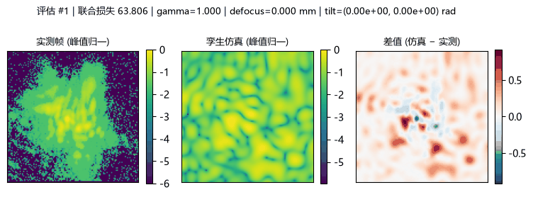
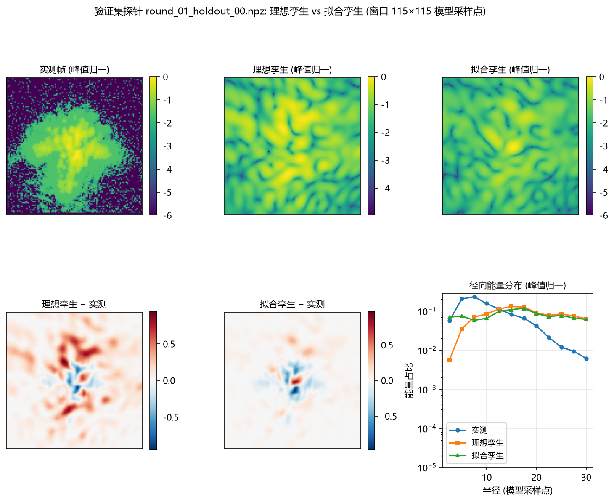
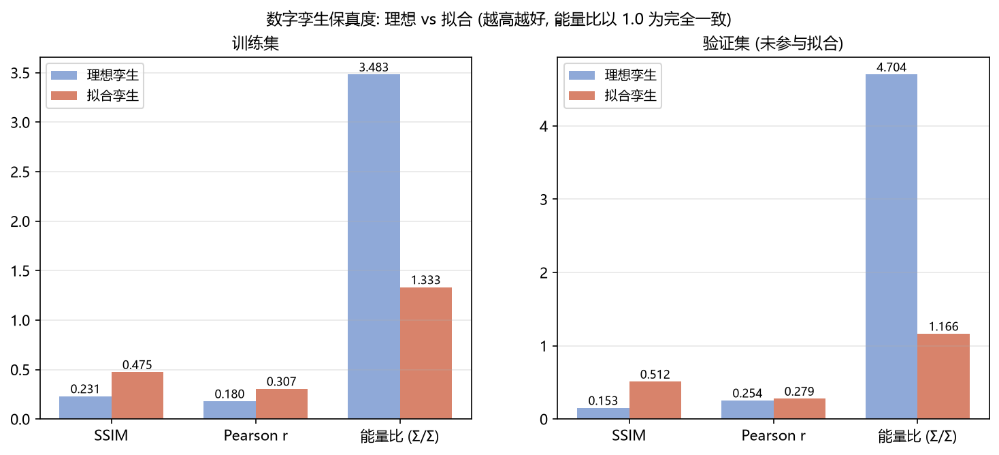
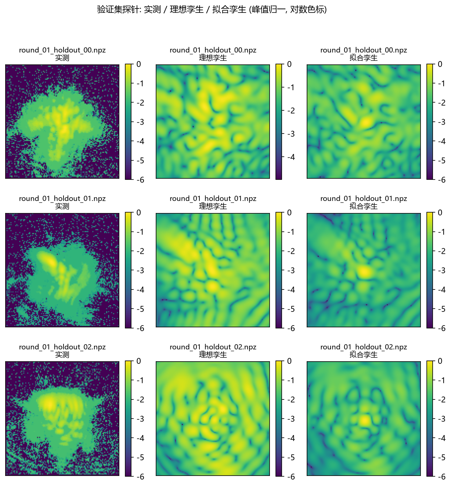

# 数字孪生保真度验证: 理想孪生 vs 误差参数反演后的孪生 (20261021)

<!-- provenance:start -->
> **生成脚本**: [`scripts/slm/generate_bench_twin_report.py`](../../../scripts/slm/generate_bench_twin_report.py)
> **复现命令**: `python scripts/slm/generate_bench_twin_report.py --run-dir data/debug/slm_model_in_loop/20261019_103208 --n-train 5 --maxiter 3 --popsize 5 --maxiter-fine 8 --seed 0`
> **数据/关联脚本**: [`src/ao_shaping/runners/slm/model_in_loop_runner.py`](../../../src/ao_shaping/runners/slm/model_in_loop_runner.py)
> **运行环境**: 离线
> **说明**: 2f 实验系统数字孪生 (bench_twin) 的保真度验证与误差参数反演: 读 2026-10-19 那次 MIL 实验落盘的探针 npz / bench_geometry.json / run_config.json / recorder pkl, 把 300×300 相机像元窗口换算到 115×115 模型采样点 (旋转象限由落盘 model_grid 逐像素反推, 偏差 7.44e-08), 比较理想孪生与反演后孪生在训练集/验证集上的 SSIM / Pearson r / 标度无关能量比 (验证集: SSIM 0.1526→0.5116, 能量比 4.7044→1.1656), 并与 MIL 自己的正向模型在 1024² 网格上同口径对拍 (复现其落盘的验证集相关 0.3918); **焦面标度口径已统一**: 孪生按实测标度 2.614022 经 BenchTwinConfig.from_measured_scale 反推等效焦距 311.32 mm (解析/实测比 1.000000000), 标称 122.4060 mm 的解析标度与之差 2.54 倍仅作提醒; 反演走 bench_twin_calibrate.fit_twin 自己的两阶段路径, 过程 GIF 由拟合期间临时包一层模块级 twin_loss 取优化器真实访问过的候选序列
<!-- provenance:end -->

**问题.** `src/ao_shaping/drivers/sim/bench_twin.py` 的参数化 2f 数字孪生, 能不能定量解释实验系统真实拍到的画面? 反演出的误差参数, 是不是真的把**验证集** (未参与拟合的独立相位探针) 上的残差压下去了?

**数据.** 一次真实 MIL 实验的落盘目录 `data/debug/slm_model_in_loop/20261019_103208` (训练集探针 5 条, 验证集探针 3 条, 平场参考 1 条)。全部离线, 不碰任何设备。

## 1. 数据与口径

| 项 | 值 | 来源 |
|---|---|---|
| 区域 (region) | 128 | `run_config.json` |
| 瞳面网格覆盖面板边长 | 900 px | `run_config.json` |
| 远场补零因子 | 8 | `run_config.json` |
| 远场网格边长 | 1024 | region × 补零因子 |
| 波长 | 1064 nm | `run_config.json` |
| 透镜焦距 (标称, **未采用**) | 122.4060 mm | `run_config.json` |
| 孪生工作焦距 (实测标度反推的等效焦距) | 311.32 mm | `BenchTwinConfig.from_measured_scale` |
| SLM 像元节距 | 8.0 µm | `run_config.json` |
| CCD 像元节距 | 2.2 µm | `run_config.json` |
| 入射光束腰 (1/e⁴ 强度) | 450 面板 px | `bench_geometry.json` |
| 相机窗口 | 300×300 相机 px | `run_config.json` |
| 相机像元 / 模型采样点 (实测标度) | 2.614022 | `bench_geometry.json` (相位斜坡扫描) |
| 冻结光轴 (相机 px) | (153, 150) | 平场帧全局 argmax |
| 比较窗口 | 115×115 模型采样点 | round(cam_size / 实测标度) |
| 孪生峰值标度 (peak_adu) | 0.7268 | 训练集实测峰值中位数 (与 fit_twin 内部取值一致) |

## 2. 帧网格换算: 相机像元 ↔ 模型采样点

### 2.1 为什么必须换算

实测帧是 **300×300 相机像元**的窗口, 孪生 `far_field()` 输出的是**模型采样点**网格 (region × 补零因子 = 1024², 裁剪后 115²)。两者直接比会张冠李戴, 所以先把它们放到同一张网格上。

换算链: 相机窗口 `cam_size` 个像元 ↔ 实测标度 `camera_px_per_model_px = 2.614022` (相机像元/模型采样点) ↔ **115 个模型采样点**。孪生侧用 `crop_px = 115` 裁出中央窗口 (与 `BenchTwin._crop` 的取整口径 `(m - side) // 2` 一致), 实测侧用 MIL 那套 已验证的 `_to_model_grid` 落到模型采样点网格后再裁同一个窗口。

### 2.2 焦面标度口径: 由实测标度反推等效焦距

| 路线 | 相机像元 / 模型采样点 | 说明 |
|---|---|---|
| 孪生解析值 `BenchTwin.camera_px_per_model_px()` | 2.614022 | `p_fft / d_ccd`, `p_fft = λf/(N_pad·d_model)` |
| 实验系统实测标度 (`bench_geometry.json`) | 2.614022 | 相位斜坡扫描 (`ramp sweep`), 标定脚本判定它更可信 |
| 两者之比 (实测 / 解析) | 1.000000000 | **一致** —— 孪生按实测标度反推的等效焦距工作 |
| 孪生工作焦距 (等效焦距, 由实测标度反推) | 311.32 mm | `BenchTwinConfig.from_measured_scale` |
| 若改用标称焦距的解析标度 | 1.027778 | 标称 122.4060 mm, 与实测差 2.54 倍 |

✅ **焦面标度口径已统一**: 孪生不再按标称焦距工作, 而是由实测标度 `2.614022` 反推出等效焦距 **311.32 mm** (`BenchTwinConfig.from_measured_scale`), 于是孪生自己的解析标度 `BenchTwin.camera_px_per_model_px()` = `2.614022` 与实测**逐位一致** (相对偏差 0.00e+00, < 1e-12)。「模型预测 → 相机网格」的映射与孪生自身的标度因此**天然同源**, 不再需要手工换算。

⚠️ **提醒: 若仍按标称焦距 122.4060 mm 算, 解析标度只有 1.027778, 与实测差 **2.54 倍**。** 标称焦距是标定书上的名义值, 这套光路的实际焦面标度与之不符 —— 这正是本报告此前记的「口径缺口」, 现在由 `from_measured_scale` 入口统一掉了。裁剪窗口仍按实测标度算 (`round(cam_size / 实测标度)`), 与 §2.3 的逐像素核对一致。

### 2.3 换算的逐像素核对

旋转象限**不写死**: 脚本拿验证集探针里落盘的 `model_grid` (MIL 自己算的「实测帧 → 模型采样点网格」) 逐像素比对, 选出最吻合的象限 = **1** (最大绝对偏差 7.44e-08, 即 float32 落盘精度)。实测帧与孪生用同一个旋转, 否则两者的 x/y 轴是交换的。

## 3. 孪生构造 (理想 = 三族误差全零)

孪生配置由上表的实测几何直接构造 (焦距取**实测标度反推的等效焦距**, 见 §2.2), 误差参数 `lut_gamma / lut_phase_max_rad / slm_zernike / slm_roughness / defocus_m / tilt / lens_zernike` 全为零 (理想系统), `noise_adu = 0` (反演必须确定性)。正向链、居中补零、`fftshift(fft2(ifftshift(·)))` 全部走 `bench_twin.py` 自己的实现, 本脚本不重写传播链。

## 4. 保真度数字

三项指标: **SSIM** 与 **Pearson r** 在峰值归一化后计算 (直接取 `bench_twin_calibrate.twin_loss` 的逐样本明细, 与损失函数口径一致); **能量比** 是标度无关的 `(Σsim/peak_sim)/(Σmeas/peak_meas)`, 1.0 表示两者光斑展宽完全一致 (孪生自身的 `twin_loss` 能量项用绝对 ADU, 会把「孪生峰值标度」混进「光斑展宽」, 所以另列这一项)。

| 集合 | 孪生 | SSIM | Pearson r | 能量比 | 残差 RMS | 联合损失 |
|---|---|---|---|---|---|---|
| 训练集 | 理想孪生 | 0.2312 | 0.1805 | 3.4833 | 0.1485 | 63.8062 |
| 训练集 | 拟合孪生 | 0.4753 | 0.3066 | 1.3330 | 0.0846 | 1.2399 |
| 验证集 (未参与拟合) | 理想孪生 | 0.1526 | 0.2544 | 4.7044 | 0.1514 | 65.9841 |
| 验证集 (未参与拟合) | 拟合孪生 | 0.5116 | 0.2789 | 1.1656 | 0.0775 | 2.5380 |
| 平场参考 (零相位) | 理想孪生 | 0.9669 | 0.9065 | 1.3860 | 0.0242 | 8.1021 |

### 4.1 验证集逐探针明细

| 探针 | SSIM (理想) | SSIM (拟合) | r (理想) | r (拟合) | 能量偏差 (理想) | 能量偏差 (拟合) |
|---|---|---|---|---|---|---|
| round_01_holdout_00.npz | 0.1106 | 0.3986 | 0.2310 | 0.3196 | 3.2437 | 0.3393 |
| round_01_holdout_01.npz | 0.2047 | 0.6437 | 0.3420 | 0.3949 | 1.2750 | -0.4574 |
| round_01_holdout_02.npz | 0.1425 | 0.4926 | 0.1902 | 0.1223 | 2.6778 | -0.2725 |

**逐探针看并不是全面变好**: 相关下降的探针 `round_01_holdout_02.npz`; SSIM 全部改善。上表的改善是**集合均值**上的改善; 单条探针的走向并不一致, 所以只能说「反演把整体残差压下去了」, 不能说「每一条探针都变好了」。

**自检**: 拟合后的验证集 SSIM 与相关都不劣于理想孪生, 能量比也更接近 1.0 —— 反演确实把残差压下去了, 且不是只压训练集。

### 4.2 与 MIL 自己的正向模型同口径对拍

MIL 的判定口径是「1024² 远场网格 vs 落盘的 `model_grid`」上的 Pearson 相关 (`slm_model_in_loop._prediction_correlation`)。孪生用**同一张网格、同一指标**算一遍, 于是三者 (MIL 自己的正向模型 / 理想孪生 / 拟合孪生) 是同口径的, 可以直接比。

| 验证集探针 | MIL 正向模型 | 理想孪生 | 拟合孪生 |
|---|---|---|---|
| round_01_holdout_00.npz | 0.4497 | 0.3729 | 0.4235 |
| round_01_holdout_01.npz | 0.4618 | 0.3984 | 0.4348 |
| round_01_holdout_02.npz | 0.2638 | 0.3314 | 0.2320 |

平均: MIL 正向模型 0.3918 / 理想孪生 0.3676 / 拟合孪生 0.3634。

同一次实验自身的记录: 运行状态 `aborted_unidentifiable`; MIL 自己落盘的验证集相关 0.3918。

⚠️ 注意: 这个指标上反演**几乎没有动** (0.3676 → 0.3634), 与 §4.1 的窗口指标形成对照。原因是这个指标把整张 1024² 网格都算进去, 而实测画面在**相机窗口之外全是零** —— 窗口之外的残差在两个口径里权重完全不同: 窗口口径 (§4/§4.1) 只看相机真正看到的那 115×115 个采样点, 所以它能反映「光斑展宽/形状」被反演改善; 这个全网格口径则被「窗口外有多少弥散光」主导。**两个口径都不是错的, 但它们量的不是同一件事, 引用时必须说清是哪一个。**

## 5. 反演出的误差参数

| 参数 | 反演值 |
|---|---|
| lut_gamma (灰度→相位 Gamma) | 2.1391 |
| lut_phase_max_rad (满灰度相位, rad) | 6.0748 |
| defocus_m (相机离焦, m) | 0.0005 |
| tilt_x_rad (光路倾斜 x) | 3.554e-06 |
| tilt_y_rad (光路倾斜 y) | 6.005e-06 |
| 面板静态相差 Noll 4 (rad) | 0.2879 |
| 面板静态相差 Noll 5 (rad) | -0.0286 |
| 面板静态相差 Noll 6 (rad) | 0.2277 |
| 面板静态相差 Noll 7 (rad) | -0.0496 |
| 透镜像差 Noll 4 (rad) | 0.2250 |
| 透镜像差 Noll 7 (rad) | -0.0699 |

| 阶段 | 损失 | 评估次数 |
|---|---|---|
| 初值 | 63.8062 | - |
| Stage 1 (DE 粗调) | 1.4126 | 61 |
| Stage 2 (L-BFGS-B 精调) | 1.2399 | 714 |
| 总评估次数 | - | 776 |

拟合耗时 1762.1 s; 联合损失 63.8062 → 1.2399 (训练集)。反演用 `bench_twin_calibrate.fit_twin` 自己的两阶段路径, 边界取模块的 `DEFAULT_BOUNDS`。

## 6. 反演过程的 GIF



| 项 | 值 |
|---|---|
| 文件 | `report/simulation/bench_twin/figures/20261021_fit_process.gif` |
| 帧数 | 22 |
| 每帧停留 | 700 ms |
| 总时长 | 15.4 s |
| 文件大小 | 1583.3 KiB |
| 帧源 | `figures/fit_steps_20261021/step_*.png` |

**每帧三块**: 左 = 实测帧 (峰值归一, 对数色标), 中 = 当前候选孪生的仿真远场 (峰值归一, 对数色标), 右 = 差值图 (仿真 − 实测, 发散色标)。**帧戳**画在图标题上: 评估序号、联合损失、以及当前候选的关键误差参数 (gamma / 相机离焦 / 光路倾斜)。

快照来自 `fit_twin` **真实访问过的候选序列**: 拟合期间临时包一层模块级 `twin_loss` (`fit_twin` 每评估一个候选就调它一次), 包住的正是那一次评估的候选孪生, 拟合结束后原样恢复。**没有另写迭代循环**, 所以 GIF 里的每一帧都是优化器自己走过的点。

快照共 22 次改进 (评估 #1 损失 63.806 → 评估 #270 损失 1.2399); GIF 取其中 22 帧。

## 7. 对照图



验证集第一条探针: 上排左 = 实测帧, 中 = 理想孪生, 右 = 拟合孪生; 下排左 = 理想孪生 − 实测, 中 = 拟合孪生 − 实测, 右 = 三者的径向能量分布 (半径越大能量占比越低的那条曲线, 光斑越紧)。





验证集逐探针: 实测 / 理想孪生 / 拟合孪生 (峰值归一, 对数色标)。

## 8. 结论

1. **孪生能定量解释真实画面, 但只在「理想」层面部分成立**: 零相位平场参考上 理想孪生的 SSIM = 0.9669、相关 = 0.9065, 说明传播链与标度口径本身是对的; 但在随机相位探针上, 理想孪生的验证集 SSIM 只有 0.1526、相关 0.2544 —— **零误差假设本身解释不了真实画面**。
2. **反演确实把残差压下去了, 而且压的是验证集** (集合均值上): 验证集 SSIM 0.1526 → 0.5116, 相关 0.2544 → 0.2789, 能量比 4.7044 → 1.1656 (1.0 为完全一致)。逐探针的走向并不一致 (§4.1), 所以这是「整体残差被压下去」而不是「每条探针都变好」。

3. **同口径对拍 (§4.2)**: 验证集相关 (1024² 网格上的 Pearson) —— MIL 自己的正向模型 0.3918 / 理想孪生 0.3676 / 拟合孪生 0.3634。 换句话说, **这个实验系统上, 孪生与 MIL 的正向模型是同一量级的解释力**, 而 MIL 那次运行自己判的是 `aborted_unidentifiable`。

## 9. 限制与剩余问题

**焦面标度口径: 已统一 (原先的第一条缺口已关闭)**。孪生不再按标称焦距工作 —— 由实测标度 `2.614022` 反推出等效焦距 **311.32 mm** (`BenchTwinConfig.from_measured_scale`), 孪生的解析标度与实测标度**逐位一致** (相对偏差 0.00e+00 < 1e-12), 因此孪生的远场**角标度**在这套实验系统上是自洽的, 反演出来的 `defocus_m` / `tilt_*` 等参数也不再依赖「网格对齐被强行拉齐」的前提。

⚠️ 提醒: 若改回标称焦距 122.4060 mm, 解析标度会差 2.54 倍 (标称焦距不适用于这套光路) —— 引用孪生的绝对角标度时, 必须说明用的是等效焦距。

1. **瞳面照明模型不同**: MIL 的正向模型把入射振幅限制在**内切圆**内 (`gaussian_grid` 自带圆孔掩膜), 而 `bench_twin` 的 `pupil_amplitude()` 是**无掩膜高斯** (角上有光)。两者在瞳面边缘的场分布不同, 这是孪生与 MIL 模型在同一相位上给出不同远场的一个来源。
2. **面板上真正显示的相位是插值过的**: MIL 把 128×128 的模型相位用双线性插值放大到面板上的方框 (`phase_to_panel`), 所以真实瞳面相位是**带限**的; 孪生 (和 MIL 模型) 直接用 128×128 数组, 于是两者的远场都比真实画面**更弥散**。这解释了为什么「实测帧的近场更紧」而模型更散。
3. **面相差与透镜像差近似简并**: 两者都是加在瞳面上的相位, 只有「是否经过 SLM 灰度量化」这一点不同, 所以它们的分配不唯一; 反演给出的面/透镜系数只能当作**一组等效解**, 不宜单独解读某一项。
4. **实测帧含探测器噪声**: 实测帧经 `prepare_frame` (扣中位数 + 截零) 处理, tails 里主要是探测器噪声底; 孪生反演时 `noise_adu = 0` (确定性), 所以 SSIM 在弱结构区天然吃亏, 相关与能量比更可信。
5. **验证集只有 3 条探针**, 且都是 MIL 生成的平滑/低阶相位族; 结论的统计强度有限, 但这是该次实验实际落盘的全部验证集数据。

## 10. 复现

```bash
python scripts/slm/generate_bench_twin_report.py --run-dir data/debug/slm_model_in_loop/20261019_103208 --n-train 5 --maxiter 3 --popsize 5 --maxiter-fine 8 --seed 0
```

输入数据: `data/debug/slm_model_in_loop/20261019_103208` (实验系统实测, 本脚本只读)。输出: 本报告与 `figures/` 下的图。
