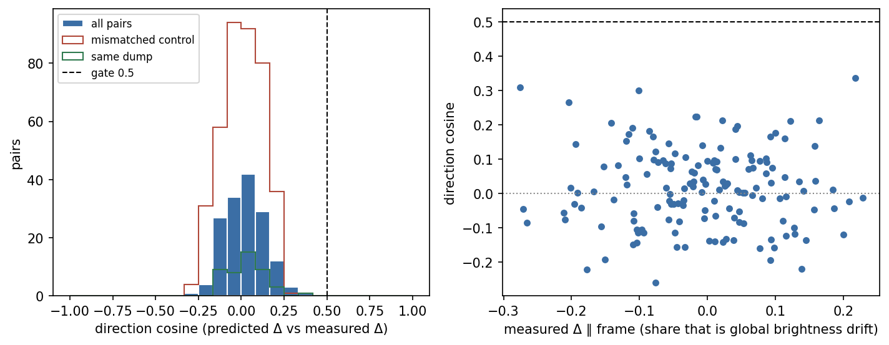
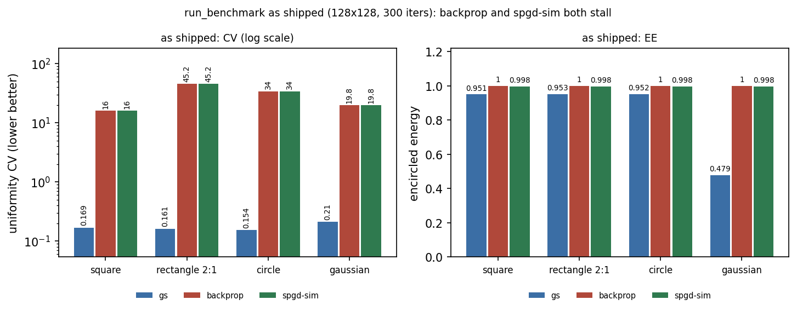
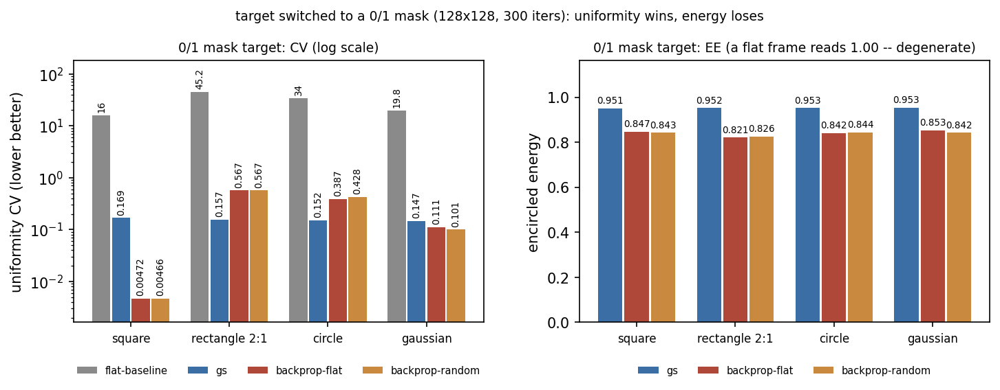
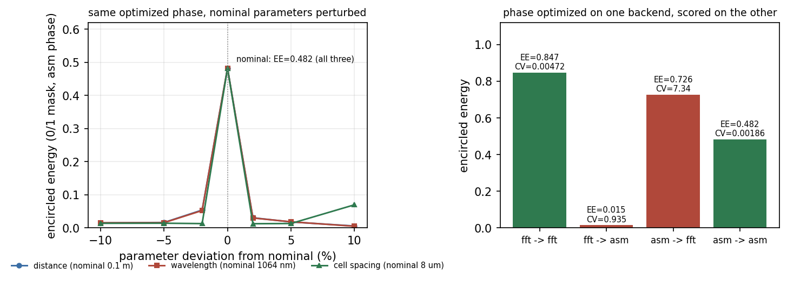

# 2f 数字孪生的可信度边界: 绝对画面像、变化方向不像, 以及可微整形在仿真里今天到底做了什么 (20261030)

<!-- provenance:start -->
> **生成脚本**: [`scripts/slm/render_sim_credibility_report.py`](../../../scripts/slm/render_sim_credibility_report.py)
> **复现命令**: `python scripts/slm/render_sim_credibility_report.py`
> **数据/关联脚本**: [`scripts/ml/analyze_sim2f_direction_corpus.py`](../../../scripts/ml/analyze_sim2f_direction_corpus.py)
> **数据/关联脚本**: [`scripts/slm/analyze_sim_differentiable.py`](../../../scripts/slm/analyze_sim_differentiable.py)
> **数据/关联脚本**: [`scripts/ml/validate_sim2f_vs_hw_corpus.py`](../../../scripts/ml/validate_sim2f_vs_hw_corpus.py)
> **运行环境**: 离线（只读 data/debug 的 pkl 与 report/ 下两份 JSON；torch 在 CPU 上跑，无设备、无 GPU）
> **说明**: 2f 数字孪生的可信度边界 + 可微整形在仿真里的现状: 方向判据用 18 个去重 (相位, 帧) 对的 153 全配对 / 45 同批次配对 / 397 错配对照, 同批次余弦中位 0.0288 (对照 0.0102, 门限 0.5), 符号一致率 0.5056 ⇒ 孪生对变化方向无信息 (判据 false); 绝对画面零均值 ncc 中位 0.7160 与既有 not_similar 报告的 max-over-k 0.7160 是同一个点, 不构成新证据; 另复现 `run_benchmark` 默认 sum1 目标下 `uniformity_loss` 恒 0 与 `efficiency_loss` 零点错位 256 倍的退化 (不修), 并用 0/1 掩膜口径重跑四形状的 GS 与 backprop (两个初相位; SPGD 未重跑) 及跨后端、参数敏感性。**本文件的正文是手写的** (数字取自两份 JSON), 渲染脚本只生成三张图, 不改正文也不改数字
<!-- provenance:end -->

**问题.** 这个仓库同时靠两样东西做决策: (a) `drivers/sim` 的 2f 数字孪生被当作实验系统的替代品来
设计闭环策略、标定参数、预训练模型; (b) `algorithm/signal_processing` 的可微分整形被当作
「比黑盒 SPGD 更聪明的那个优化器」。这两条信任在今天有没有证据支撑? 本报告把问题拆成两个**互相
独立**的判据, 各自给出可复现的三值结论:

1. 孪生对**绝对画面**的预测有多像实测? 对**变化方向**的预测有没有信息?
2. 可微分整形在仿真里, 相对 GS 与 SPGD, 到底把目标函数压下去了没有?

**一句话.** 孪生「像」但「不准」—— 绝对画面的零均值 ncc 中位 0.716, 而它预测的**变化方向**
与实测的余弦中位只有 0.0288 (错配对照组 0.0102, 判据要求 ≥ 0.5 且领先 0.2), 符号一致率
0.5056 正好是抛硬币。也就是说: **能用来当"长得像"的示意图, 不能用来当梯度优化的物理预测模型**。
可微分整形这一侧则是另一类坏消息 —— 按现状 (`run_benchmark` 默认口径) 报出的「可微分 ≈ SPGD」
是**两个算法都停在起点**, 不是两个算法都收敛; 把目标换成 0/1 掩膜后可微分确实动了 (正方形 CV
0.0047 vs GS 0.1687), 但代价是桶内能量 (0.8465 vs 0.9509), 且 300 轮预算内另外两个形状还没
收敛到 GS 的水平。

**结论 (先说).**

| 判据 | 结果 | 证据 | 该拿它做什么 |
|---|---|---|---|
| 绝对画面相似度 | 部分成立, 但未过既有判据 | 帧对零均值 ncc 中位 0.716 / 最小 0.622 (n=306) | 只能当示意图与形状先验 |
| 变化方向相似度 | **不成立** | 同批次配对余弦中位 0.0288, 对照 0.0102, 门限 0.5; 符号一致率 0.5056 | **不可**当物理预测模型喂梯度 |
| 实测差分本身可测 | 成立 | 差分信噪比中位 52.09 | 失败不是"测不出来" |
| 可微分梯度正确性 | 成立 | fft 相对误差中位 4.2e-06, asm 1.8e-08 | 实现没问题, 问题在目标函数 |
| 可微分损失函数 (sum 归一化目标) | **退化** | 均匀项恒为 0; 效率项把平场读成 EE=0.0039 (度量口径 1.0000) | 现状基准的数字不可用 |
| 可微分 vs GS (0/1 掩膜, 300 轮) | 混合 | 正方形 CV 36× 更好但 EE 低 0.10; 圆/长方形未收敛; 高斯基本持平 | 正方形是 CV/EE 权衡, 不是无条件更优 |
| 跨仿真后端迁移 | **崩塌** | 同一相位 fft→asm 的 EE 0.8465 → 0.0147 | 不可跨后端复用最优相位 |
| 参数敏感性 | 极陡 | 距离/波长偏 ±2 % 即 EE 掉 9–16 倍 | 物理参数必须实测, 不能取标称值 |

---

## 0. 判据 (写于任何数字被计算之前)

方向判据 (由 `scripts/ml/analyze_sim2f_direction_corpus.py` 的模块常量固定, 本报告不改):

| 常量 | 值 | 含义 |
|---|---|---|
| `COSINE_GATE` | 0.5 | 同批配对的中位方向余弦必须达到 |
| `CONTROL_MARGIN` | 0.2 | 且必须比错配对照组的中位余弦领先这么多 |
| `SIGN_GATE` | 0.75 | 同批配对的中位符号一致率必须达到 |
| `MIN_PAIRS` | 10 | 低于此值只报中位、不判门 |
| `DIFF_FRACTION` / `MIN_CORE_PX` | 0.15 / 20 | 差分支撑区只由**实测**差分选出, 不看模型输出 |

方向判据刻意不设「绝对画面对不对」这一项 —— 那是另一份报告的判据, 而且两份判据的答案本来就可以
不同 (见 §2)。

可微分判据: 梯度用中心差分对拍 (相对误差容限 `1e-3`, `fd_eps=1e-5`, 同时要求余弦 > 0.9999),
再用「按最大分量归一化后走一步」检验损失确实下降 (`DESCENT_STEP_RAD=1e-3`)。有效性只在**两种目标
约定**下分别报, 不混: `as_shipped` = `run_benchmark` 原样 (目标按总和归一化), `mask_fixed` =
0/1 掩膜目标。**不跨约定求平均**。

---

## 1. 语料与口径

方向分析复用 `scripts/ml/validate_sim2f_vs_hw_corpus.py::measure_corpus` —— 语料读取、去重规则、
孪生、`k*` 选择与度量全部**原样复用**, 本报告不新增第二份实现。

| 项 | 值 | 来源 |
|---|---|---|
| 语料根 / 匹配 | `data/debug/model_in_loop_hw_collect`, `20261025*` | 生产者默认值 |
| pickle 数 / 记录数 | 54 / 312 | `corpus.files` / `corpus.records` |
| 去重后不同的 (相位, 帧) 对 | 18 | `distinct_pairs` |
| 每对重复次数 | 中位 12 (q25 6, q75 30, 最大 36) | `replicas` |
| 曝光 | 单一 1.1 ms | `exposures_ms` |
| 相位网格 / 实测网格 | 128 / 64 | `corpus.grid_*` |
| 面板半径 | 450 px | `corpus.panel_radius_px` |
| 几何标度 | `k* = 2.0` (先验 1.0) | `k_star` / `corpus.k_apriori` |
| 孪生 | `Sim2fConfig.calibrated()`: 离焦 10.084735 mm, 零级 η 0.1, LUT γ 1.0, CCD 256 px @ 2.2 µm, `fft_n` 512, 标度比 2.0991, 瞳面半径 48 px | `corpus.twin` |

口径上有三件事必须写在前面, 否则数字会被读错:

1. **实测帧经 `radiometry.count_rate` 做曝光归一** (仓库唯一的曝光归一入口), 因此不同曝光的帧
   可比。孪生预测是相对强度 (`detector=False`), **不带曝光**。所以本报告只读**标度无关**的量:
   方向余弦、符号一致率、零均值 ncc、漂移余弦、最佳平移余弦。差分范数、相对 L2、增益这类带量纲
   或带标度的量**一概不引用** —— 两侧单位本来就不同, 引用它们等于编数字。
2. **配对有两种, 分别判, 主判据取「同批次」**: 全配对 153 对 (任意两条不同记录), 同批次配对
   45 对 (同一 pickle 内的两条记录, 共享同一次采集会话)。同批次配对排除了跨会话的漂移, 是更干净
   的那一版, 所以只要它 ≥ `MIN_PAIRS` 就以它为准。
3. **错配对照是刻意错配的**: 把 A 对的预测差分拿去和 B 对的实测差分比。两组之间没有任何信息关联,
   它们能达到的余弦就是噪声/几何地板。

---

## 2. 绝对画面: 像, 但没到能用

| 量 | 中位 | q25 | q75 | 最小 | 最大 | n |
|---|---|---|---|---|---|---|
| 帧对零均值 ncc | **0.7160** | 0.6622 | 0.8405 | 0.6218 | 0.8698 | 306 |

(306 = 153 对 × 每对两帧; 这 306 个读数只来自 18 条不同的记录, 所以 n 是重复出现次数, 不是独立样本量。)

这个数字与既有结论**不矛盾, 也不新增好消息**, 必须并排读:

- `report/sim2f_bench/twin_vs_hw_corpus/20261027/report.md` 的判定是 `not_similar`, 主判据是
  **归一化 L1** (整个 `k` 扫描上的最小值 1.2027, 门限 0.5)。ncc 只是次判据。
- 同一份报告里 `ncc` 随 `k` 的**最大值**是 +0.7160 (在 `k = 2.0` 上, 18 对的中位)。本次在
  `k* = 2.0` 上按 306 个**帧对**量到中位 0.7160 —— 同一个点, 只是样本单位不同。所以这里不是
  「新测出一个更高的相似度」, 而是「把已有的那个点用更细的单位复述了一遍」。
- `report/sim2f_bench/alignment_20261027/report.md` 把 G0-4 归因为**孪生保真度上限**而不是放置
  误差; `report/sim2f_bench/optical_scale_20261027/report.md` 又否决了 H1/H2 两条「标定已失效」
  假说。三条线合起来的意思正是: ncc 能到 0.72 左右, L1 到不了 0.5, 而且换几何尺度救不回来。

一句话: **零均值 ncc 是尺度无关的**, 所以它能到 0.72 恰恰不说明绝对标度对了。绝对标度错在哪,
上面三份报告已经查过并且没查出来 —— 本报告不重复那一轮排查。

---

## 3. 变化方向: 孪生对「往哪变」没有信息

优化器要的从来不是绝对画面, 而是「相位动一点, 远场往哪动」。这一节把同一份语料的 306 帧换成
**差分对**来问:

| 量 | 同批次配对 (主判据, 45 对) | 全配对 (153 对) | 判据 |
|---|---|---|---|
| 方向余弦 中位 | **0.0288** | 0.0147 | ≥ 0.5 |
| 错配对照 中位 | 0.0102 | 0.0102 | — |
| 领先量 | 0.0186 | 0.0045 | ≥ 0.2 |
| 符号一致率 中位 | 0.5056 | 0.5048 | ≥ 0.75 |
| 实测差分信噪比 中位 | 52.09 | 52.00 | 只作可测性旁证 |
| 实测差分沿均值帧余弦 中位 | −0.0004 | −0.0040 | 只作漂移旁证 |
| 最佳 ±3 px 平移后余弦 中位 | 0.1969 | 0.2034 | 事后上界, 非判据 |

**`direction_ok = false`, `sign_ok = false`**, 两种配对一致。同批次配对虽然把余弦从 0.0147 抬到
0.0288, 领先量也只从 0.0045 到 0.0186 —— 距离 0.2 的领先门限差一个数量级。符号一致率 0.5056
就是抛硬币。



读这张图的方式: 左面板蓝色填充柱是全部 153 对配对, 红色阶梯线是错配对照组, 绿色阶梯线是同批次
配对, 黑色虚线是 0.5 的门限; 右面板把每对的「实测差分沿均值帧的余弦」(即亮度漂移所占份额) 横着
放, 看余弦高是不是只出现在漂移大的那一端。如果孪生带方向信息, 分布应该整体右移向 +1; 实际上
三个分布几乎重合在 0 附近, 右面板也没有任何随漂移上升的趋势。

**这不是度量写错了.** 度量自带自检: 把预测差分原样喂进去得到余弦 1.0, 把其中一帧换掉得到
−1.0 (`selftest: identical 1.0, swapped -1.0`)。度量本身能给出满分和负分, 只是这次没有。

**也不是"实测差分太小、测不出来".** 实测差分对重复帧噪声的信噪比中位 52.09 —— 变化量比噪声高
两个数量级。所以失败不是信噪比问题。

---

## 4. 排除项: 不是配准、不是亮度漂移、不是模式族

方向失败有三种常见解释, 这一节逐一排除 (全部是同一份语料上的附加读数):

| 解释 | 检验 | 结果 |
|---|---|---|
| 只是没对准, 平移几像素就能对上 | 在 ±3 px 内搜最佳平移后重算余弦 | 0.1969 (同批) / 0.2034 (全配对), 仍远低于 0.5 |
| 亮度/曝光漂移把差分淹了 | 实测差分沿均值帧的余弦 | −0.0004 / −0.0040, 差分与亮度变化正交 |
| 只在某个 Zernike 模式族上失败 | 同模式配对 vs 跨模式配对 | 同模式 0.0133 (n=72) / 跨模式 0.0147 (n=81), 都只比对照 (0.0102) 高 0.003–0.005 |

第三条尤其值得注意: 同模式配对 (同一阶模式、不同系数) 的余弦**并不优于跨模式** (0.0133 vs
0.0147), 两者都停在对照组的水平上 (对照 0.0102)。如果孪生的传播是对的、只是幅度标定错了,
同模式配对应该明显更好 —— 它没有。这与 §2 的「ncc 0.72」并不冲突:
ncc 高说明**光斑包络**对得上, 余弦低说明**包络内部的强度重新分配**对不上。梯度优化器读的正是
后者。

---

## 5. 可微整形的损失函数在今天的状态下是退化的 (缺陷复现)

这一段是**取证**, 不是调参。缺陷在 `src/ao_shaping/algorithm/signal_processing/differentiable_shaping.py`:
`uniformity_loss` 用 `target > 0.5` 取掩膜, `efficiency_loss` 把目标当成「总和 = 目标面积」。
而 `beam_shaping_benchmark.run_benchmark` 交给它的目标是**按总和归一化**的 (总和 = 1)。

同一个平场相位, 两种目标约定下的损失分项:

| 目标约定 | 相位 | 均匀项 | 效率项 | 总损失 | 度量 CV | 度量 EE | 效率项隐含的 EE | 目标掩膜像素 | 目标最大值 |
|---|---|---|---|---|---|---|---|---|---|
| sum1 | 平场 | **0.0000** | 0.9961 | 0.5977 | 15.9687 | 1.0000 | **0.0039** | 256 | 0.0039 |
| sum1 | 随机 | **0.0000** | 0.9961 | 0.5977 | 15.9662 | 0.9901 | **0.0039** | 256 | 0.0039 |
| mask01 | 平场 | 16.0000 | 0.0000 | 6.4000 | 15.9687 | 1.0000 | 1.0000 | 256 | 1.0000 |
| mask01 | 随机 | 15.9975 | 0.0099 | 6.4049 | 15.9662 | 0.9901 | 0.9901 | 256 | 1.0000 |

两个缺陷都成立, 且互不相同:

1. **均匀项在 sum1 上恒为 0。** 目标最大值 1/256 = 0.0039 < 0.5, `target > 0.5` 得到空掩膜,
   函数返回 0。不是"这一帧恰好均匀", 是**任何**相位都返回 0 —— 这一项没有梯度。
2. **效率项把 sum 归一化的目标当成面积归一化的目标。** 平场帧的全部能量落在目标内一个像素上
   (CV 15.97 就是这么来的), 度量口径的桶内能量是 1.0000; 而效率项读出来是 1/256 = 0.0039。
   零点错位 256 倍, 与目标面积相等 —— 这是目标总和的倒数, 不是巧合。

把目标换成 0/1 掩膜后两项都活了 (均匀项 16.0, 效率项与度量 EE 逐位对齐), 这就是 §7 那张表用
mask01 的原因。**本报告不修这个缺陷**, 只给复现路径: `scripts/slm/analyze_sim_differentiable.py`
的 `loss_degeneracy` 一节, 两个约定 × 两个相位共四行。

---

## 6. 按现状跑基准: 两个算法都停在起点

`run_benchmark` 原样调用 (128² 网格, 300 轮, seed 42), 每形状每算法一行:



| 形状 | 算法 | 均匀度 CV | 桶内能量 | 用时 (s) | 实测面积 / 请求面积 |
|---|---|---|---|---|---|
| 正方形 | gs | 0.1687 | 0.9509 | 1.65 | 247 / 256 |
| 正方形 | backprop | **15.9662** | 1.0000 | 5.39 | 1 / 256 |
| 正方形 | spgd-sim | **15.9681** | 0.9975 | 1.70 | 1 / 256 |
| 长方形 2:1 | gs | 0.1610 | 0.9528 | 1.04 | 1661 / 2048 |
| 长方形 2:1 | backprop | **45.1894** | 1.0000 | 1.31 | 1 / 2048 |
| 长方形 2:1 | spgd-sim | **45.2294** | 0.9978 | 1.13 | 1 / 2048 |
| 圆形 | gs | 0.1536 | 0.9520 | 0.87 | 1016 / 1160 |
| 圆形 | backprop | **34.0218** | 1.0000 | 1.27 | 1 / 1160 |
| 圆形 | spgd-sim | **34.0382** | 0.9977 | 1.52 | 1 / 1160 |
| 高斯 | gs | 0.2104 | 0.4787 | 1.56 | 351 / 392 |
| 高斯 | backprop | **19.7737** | 1.0000 | 1.44 | 1 / 392 |
| 高斯 | spgd-sim | **19.7726** | 0.9975 | 1.24 | 1 / 392 |

同一份语料上的**平场基线** (相位全零, 不优化) 的 CV / EE:

| 形状 | 平场 CV | 平场 EE |
|---|---|---|
| 正方形 | 15.9687 | 1.0000 |
| 长方形 2:1 | 45.2438 | 1.0000 |
| 圆形 | 34.0441 | 1.0000 |
| 高斯 | 19.7737 | 1.0000 |

对照着看, 结论是硬的:

- 每个形状上, backprop 的 CV 都**与平场基线基本一致** —— 差值 1.2e-5 到 0.054 (相对差 6e-7 到
  1.2e-3): 正方形 15.9662 vs 15.9687, 长方形 45.1894 vs 45.2438, 圆形 34.0218 vs 34.0441, 高斯
  19.7737 vs 19.7737。实测面积 1 像素与请求面积 (256 / 2048 / 1160 / 392) 之差, 也是"能量还
  卡在零级一个像素里"的读数。
- spgd-sim 同样停在起点 (与平场基线的差在 1e-2 量级)。
- 所以「可微分 ≈ SPGD」这个读法**是错的**: 两个都没动。这与 §5 的两个缺陷一致 —— 均匀项没有
  梯度, 效率项零点错位 256 倍, 300 轮里两个算法都没能离开起点。(至于损失曲面是否处处平坦,
  本报告没有扫过, 只记录了「没动」这个观测。)

**这一节的数字不应该被引用为「可微分整形的能力」。** 它们是缺陷的读数。

---

## 7. 目标改成 0/1 掩膜后: 均匀度赢、能量输

把目标换成 0/1 掩膜 (`mask01`), 其余不变 (128², 300 轮, seed 42), 三种初相位各跑一遍, 并加
平场基线:



| 形状 | 算法 | 均匀度 CV | 桶内能量 | 损失 (首→末) | 用时 (s) |
|---|---|---|---|---|---|
| 正方形 | 平场基线 | 15.9687 | 1.0000 | — | 0.00 |
| 正方形 | backprop (平场初相) | **0.0047** | 0.8465 | 6.405 → 0.0944 | 1.63 |
| 正方形 | backprop (随机初相) | 0.0047 | 0.8427 | 6.405 → 0.0966 | 2.01 |
| 正方形 | gs | 0.1687 | **0.9509** | — | 1.70 |
| 长方形 2:1 | 平场基线 | 45.2438 | 1.0000 | — | 0.00 |
| 长方形 2:1 | backprop (平场初相) | 0.5666 | 0.8212 | 18.084 → 0.3355 | 2.62 |
| 长方形 2:1 | backprop (随机初相) | 0.5667 | 0.8260 | 18.085 → 0.3329 | 1.94 |
| 长方形 2:1 | gs | **0.1568** | **0.9524** | — | 1.75 |
| 圆形 | 平场基线 | 34.0441 | 1.0000 | — | 0.00 |
| 圆形 | backprop (平场初相) | 0.3872 | 0.8416 | 13.620 → 0.2517 | 1.92 |
| 圆形 | backprop (随机初相) | 0.4276 | 0.8440 | 13.620 → 0.2663 | 1.97 |
| 圆形 | gs | **0.1517** | **0.9527** | — | 0.84 |
| 高斯 | 平场基线 | 19.7737 | 1.0000 | — | 0.00 |
| 高斯 | backprop (平场初相) | 0.1115 | 0.8528 | 7.924 → 0.1343 | 1.36 |
| 高斯 | backprop (随机初相) | 0.1007 | 0.8419 | 7.924 → 0.1367 | 1.36 |
| 高斯 | gs | 0.1467 | **0.9532** | — | 0.78 |

读法 (逐形状, 不求平均):

- **正方形**: 可微分把 CV 从 15.97 压到 0.0047, 比 GS 的 0.1687 好约 36 倍; 但桶内能量
  0.8465 < 0.9509。**这是净收益还是净损失, 取决于目标函数怎么权衡 CV 与能量** —— 本报告不替
  使用方决定权重, 只把两个数摆出来。
- **长方形 / 圆形**: 300 轮内可微分**还没到** GS 的水平 (0.57 / 0.39 vs 0.157 / 0.152)。首末损失
  是 18.08 → 0.34 (长方形) 与 13.62 → 0.25 (圆形), 说明预算内没有收敛到 GS 的读数 —— 这是
  **收敛预算**的陈述, 不是能力上限; 本报告没有跑更长预算, 所以不能反过来说"可微分做不好长方形"。
- **高斯**: CV 基本持平 (0.1115 vs 0.1467), 但 EE 更低 (0.8528 vs 0.9532)。
- **这两个初相位看不出主导差别**: 平场初相与随机初相的末态 CV 差最大 0.0404 (圆形 0.3872 vs
  0.4276), 其余三个形状 ≤ 0.0108 (高斯 0.1115 vs 0.1007 是第二处)。**只有两个起点**, 所以这只
  说明「这两点之间没有明显差别」, 不能推广成「损失曲面对初相位不敏感」, 更不能用来推断收敛速度。
- **平场基线的 EE = 1.0000 是退化读数**: 全部能量落在目标内一个像素上, 桶内能量当然是 1。
  所以 EE **只能和 CV 一起读**, 单看 EE 会把最差的相位读成满分。这也是平场基线只画在 CV 面板、
  不画在 EE 面板的原因。
- **GS 的跨表差异, 以及高斯那张表不可直接比**: 正方形在两张表里逐位相同 (0.1687 / 0.9509)。
  长方形 (0.1610/0.9528 → 0.1568/0.9524) 与圆形 (0.1536/0.9520 → 0.1517/0.9527) 只差在第三位,
  这两个形状在两张表里是**同一个目标**, 只是目标从 `1/面积` 变成 `1` —— 按振幅口径 (GS/backprop
  的振幅约束是 √目标) 相当于 16× / 45× / 34× (正方形/长方形/圆形, 各自面积的平方根), 而 GS 的
  停止判据是绝对容差 —— 机制说得通, 但**本报告没有单独验证**。
  **高斯不是这种情况**: 硬边形状 (正方形/长方形/圆形) 的目标本来就是 0/1, 二值化不改形状; 高斯是
  软剖面, `> 0.5 × 峰值` 把它截成 392 px 的硬区 (而 `target > 0` 覆盖整幅 16384 px)。两张表的
  **指标掩膜都是半高区** —— as-shipped 表由 `run_benchmark` 用 `target_norm > 0.5 × max` 算,
  mask-fixed 表用 `mask01 > 0` 算, 同一块 392 px 区域。所以 0.4787 与 0.9532 的差别**不来自掩膜
  口径**, 而来自优化目标: 按软高斯优化时 GS 复现的就是那条高斯剖面, 而高斯自身落在自己半高区内
  的能量只有 **0.4919** —— 0.4787 已经贴着这个上限; 按 0/1 硬块优化时 GS 复现的是硬块, 于是
  0.9532。两行仍是两个不同的优化问题, 不能读成"优化变好了"; CV 从 0.2104 到 0.1467 同理。

---

## 8. 模型与参数敏感性: 跨仿真后端不可迁移, 参数偏 2 % 即崩

### 8.1 梯度本身是对的

在报"优化效果不好"之前, 先确认实现没写错。用中心差分逐像素对拍 (8 个采样像素, `fd_eps=1e-5`):

| 传播 | 相对误差 中位 | 相对误差 最大 | 余弦 | 走一步的下降比例 | 判定 |
|---|---|---|---|---|---|
| fft | 4.249e-06 | 2.312e-05 | 1.000000 | 1.002 | 通过 |
| asm | 1.753e-08 | 9.015e-08 | 1.000000 | 0.998 | 通过 |

把符号翻转后, 相对误差立刻变成 2.000 —— 这个检验能识别错号, 不是空转。所以 §5–§7 的问题**不在
梯度实现**, 在目标函数与预算。

### 8.2 同一相位跨仿真后端评估: 崩塌

同一条优化出来的相位, 在两个仿真后端分支之间交叉评估:



| 优化于 | 评估于 | 均匀度 CV | 桶内能量 |
|---|---|---|---|
| fft | fft | 0.0047 | **0.8465** |
| fft | asm | 0.9351 | **0.0147** |
| asm | fft | 7.3350 | 0.7264 |
| asm | asm | 0.0019 | 0.4823 |

fft 上优化出的相位拿到 asm 上, 桶内能量从 0.8465 掉到 0.0147 —— 掉 58 倍, 基本等于"能量散掉"。
反方向 (asm→fft) 能量保住了 0.7264, 但均匀度从 0.0019 崩到 7.3350。**两个方向都不可迁移**, 只是
崩的维度不同。

### 8.3 参数敏感性: ±2 % 就崩

拿 asm 上优化出的相位 (它自己也只到 EE 0.4823), 把物理参数逐个偏离标称值:

| 相对偏离 | 距离 (EE) | 波长 (EE) | 单元间距 (EE) |
|---|---|---|---|
| −10 % | 0.0153 | 0.0157 | 0.0141 |
| −5 % | 0.0166 | 0.0159 | 0.0143 |
| −2 % | 0.0542 | 0.0526 | 0.0132 |
| 0 % | **0.4823** | **0.4823** | **0.4823** |
| +2 % | 0.0309 | 0.0301 | 0.0128 |
| +5 % | 0.0182 | 0.0186 | 0.0135 |
| +10 % | 0.0059 | 0.0052 | 0.0699 |

标称: 距离 0.1 m, 波长 1064 nm, 单元间距 8 µm。

读法必须是**相对的**, 不能读绝对值: 这条曲线最优点只有 0.4823, 不是 0.95 —— 它描述的是
"同一个相位在参数偏离下塌多快", 不是"整形能做到多好"。在 ±2 % 上, 距离/波长两个参数各掉
9–16 倍; 单元间距对**负**方向更敏感 (偏 −2 % 就到 0.0132), 但对 +10 % 反而回升到 0.0699
(非单调, 一个孤立的回升点, 本报告不解释它)。

结论: **孪生里的物理参数必须是实测的, 取标称值等于随机。** 这与 §3 的方向失败**方向一致** ——
物理预测模型对参数的依赖陡到 ±2 %, 而标定链只把 `k*` 定到一个网格步长; 但本报告没有把参数扰动扫到
方向余弦上, 所以只能说"一致", 不能说"这就是原因"。

---

## 9. 使用边界清单

把上面的读数翻成"能不能用":

| 用法 | 能不能 | 依据 |
|---|---|---|
| 当示意图 / 形状先验看远场大概长什么样 | 可以 | §2 ncc 中位 0.716 |
| 当绝对标度的参考 (定量比较亮度/能量) | **不可以** | §2 归一化 L1 到不了门限; ncc 是尺度无关的 |
| 当物理预测模型给梯度优化器算方向 | **不可以** | §3 余弦 0.0288, 符号 0.5056 |
| 用方向信息做仿真预训练, 再迁到实验 | **不建议** (未验证) | 方向无信息 ⇒ 预训练很可能学到错方向; 本报告未做该迁移实验 |
| 跨仿真后端分支复用同一条最优相位 | **不可以** | §8.2 EE 0.8465 → 0.0147 |
| 用标称物理参数跑孪生 | **不可以** | §8.3 ±2 % 掉 9–16 倍 |
| 引用 `run_benchmark` 默认口径的可微分数字 | **不可以** | §5 损失退化, §6 两个算法都停在起点 |
| 引用 0/1 掩膜口径的可微分数字 | 可以, 但要带 CV 与 EE 两个数 | §7 正方形 CV 大胜、EE 低 0.10; 长方形/圆形 300 轮内未收敛; 高斯 CV 持平但 EE 更低 |

---

## 10. 复现

三条命令, 全部离线, 不碰任何设备:

```bash
python scripts/ml/analyze_sim2f_direction_corpus.py      # §2–§4 + 方向图
python scripts/slm/analyze_sim_differentiable.py         # §5–§8 + 两份 JSON 的可微部分
python scripts/slm/render_sim_credibility_report.py      # 本报告的三张图 (只渲染, 不算数)
```

产物:

| 文件 | 内容 |
|---|---|
| `artifacts/direction_corpus_20261030.json` | 方向/绝对画面的全部读数 (153 全配对 + 45 同批配对 + 397 对照) |
| `artifacts/differentiable_20261030.json` | 梯度对拍、损失退化、两张基准表、模型与参数敏感性 |
| `figures/direction_corpus_20261030.png` | 方向余弦分布 (由方向生产者自己画) |
| `figures/benchmark_as_shipped_20261030.png` | §6 |
| `figures/benchmark_mask_fixed_20261030.png` | §7 |
| `figures/model_sensitivity_20261030.png` | §8 |

可微部分的环境: 128² 网格, 300 轮, seed 42, `fd_eps=1e-5`, 8 个梯度采样像素, torch 2.14.0+cu132
(CPU), 墙钟 46.92 s, git `4c81b8be`。方向部分墙钟 16.41 s。

正文的每个数字都来自上面两份 JSON; 重跑渲染脚本不会改动正文, 也不会改动任何一个数字 —— 这是
有意的: 数字的真源是 JSON, 不是图, 也不是这份 Markdown。

---

## 11. 坑

1. **按 `shape` 给柱状图分组会把长方形那一组整个吞掉。** 长方形目标不是独立形状, 是
   `shape="square"` + `aspect_ratio=2`。只按 `shape` 分组时它和正方形撞键, 画出来只剩三组, 而且
   **不报错**。分组键必须是 `(shape, aspect_ratio)`。
2. **对数轴上旋转 90° 的数值标注需要约 4 倍的顶部留白。** 按 1.05 倍自动留白时, 顶端那根柱子的
   标注会被上边框切掉 —— 切掉的部分看起来像"没标注", 很容易漏过去。
3. **图例放在轴内会压住柱子或标注。** 两张基准图的 EE 面板都出现过图例盖住高斯组标注的情况。
   统一放到轴下方。
4. **三条曲线在 0 % 处重合时, 逐条标注会叠成三行糊在一起。** 标一次, 标称值放图例。
5. **平场帧的桶内能量恒为 1.0000**, 因为全部能量在目标内一个像素上。EE 单独读会把最差的相位读成
   满分, 必须和 CV 一起读。
6. **孪生预测不带曝光**, 所以差分范数/相对 L2/增益这类量在实测与预测之间**不同单位**, 引用即错。
   只读标度无关的量。
7. **`run_benchmark` 的 `uniformity_cv` 与 `efficiency_loss` 不是同一个东西**: 前者是度量, 后者
   是损失分项, 在 sum1 目标下二者差 256 倍 (§5)。看到"损失降了但指标没动"先查这一条。
