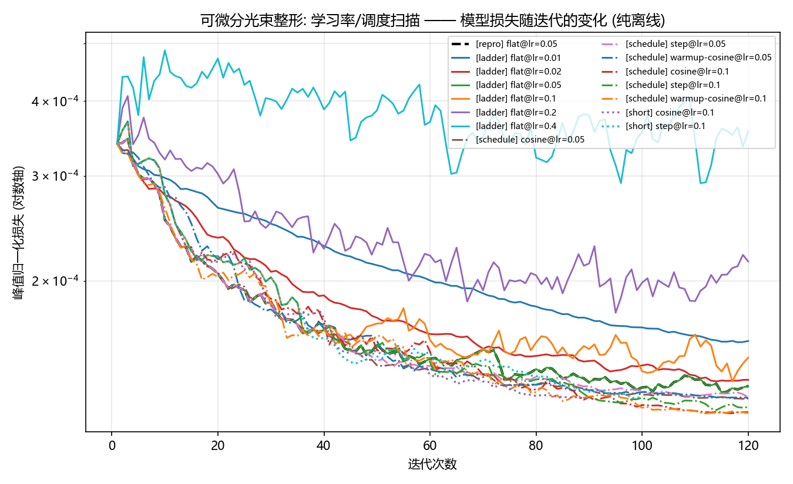
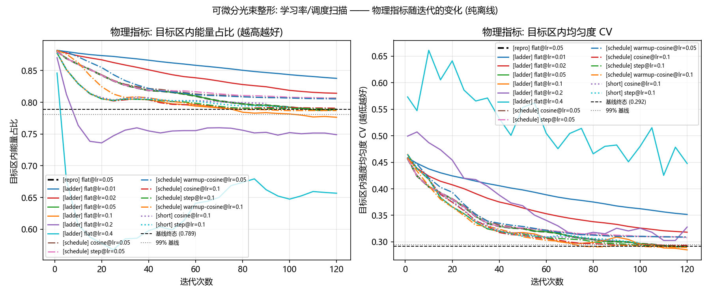

# 可微分光束整形: Adam 学习率与动态调度扫描 (纯离线, 2026-11-16)

<!-- provenance:start -->
> **生成脚本**: [`scripts/slm/sweep_differentiable_lr.py`](../../../../../scripts/slm/sweep_differentiable_lr.py)
> **复现命令**: `python scripts/slm/sweep_differentiable_lr.py --out report/slm/differentiable_opt/artifacts/lr_sweep_20261116`
> **数据/关联脚本**: [`scripts/_common/differentiable_problem.py`](../../../../../scripts/_common/differentiable_problem.py)
> **数据/关联脚本**: [`src/ao_shaping/algorithm/signal_processing/differentiable_beam.py`](../../../../../src/ao_shaping/algorithm/signal_processing/differentiable_beam.py)
> **运行环境**: 离线
> **说明**: 可微整形优化器学习率扫描 (120 步, GPU/CUDA): flat lr 上调 (0.2 / 0.4) 终态损失比基线 lr=0.05 高约 21%, CV 0.373 vs 0.292 —— 调大平 LR **不可行**; 余弦衰减 (峰值 lr=0.1, 无 warmup 无下限) 在第 90 步达到基线终态质量 99%, 终态损失 1.206e-4 vs 1.333e-4, 但压缩预算到 90 步只到 95%, 须保留完整 120 步周期。结论仅离线, 硬件未验证; 硬件验证脚本与命令见 lr_sweep.md 末节
<!-- provenance:end -->

- 运行目录 (问题来源): `D:\Projects\TIFO\AO-shaping\data\debug\differentiable_opt\phys_20261116_01` | 设备: `cuda` | 种子: 0
- 基线: lr=0.05, iters=120, `history.csv` 终损=1.333010e-04
- 物理质量基准 (重建基线终态采样): 目标区内能量占比=0.7888, 均匀度 CV=0.2919
- 质量比 q = min(效率/基线效率, 基线CV/CV); 「99% 质量」= 效率 ≥ 0.99·基线 且 CV ≤ 基线/0.99 (95% 同理)。达标迭代数按物理指标采样间隔 (5) 取整, 短预算变体再做精确复跑验证。

## 基线复现检查

| 迭代 | history.csv 损失 | 重建损失 | 相对偏差 |
| ---: | ---: | ---: | ---: |
| 1 | 3.393795e-04 | 3.393795e-04 | 0.00e+00 |
| 31 | 1.768449e-04 | 1.768449e-04 | 0.00e+00 |
| 61 | 1.485256e-04 | 1.485256e-04 | 0.00e+00 |
| 91 | 1.369632e-04 | 1.369632e-04 | 0.00e+00 |
| 120 | 1.333010e-04 | 1.333010e-04 | 0.00e+00 |

**最大相对偏差 = 0.000e+00** (容差 0.001) —— 复现通过, 扫描与硬件运行是同一个问题。

## 基线复现变体

| 类型 | 调度 | 学习率 | 预算 | 达基线终损 | 达 99% 质量 | 达 95% 质量 | 终损 | 终态效率 | 终态 CV | 终态 FWHM(px) | 类Strehl | 墙钟(s) | 稳定性 |
| --- | --- | ---: | ---: | ---: | ---: | ---: | ---: | ---: | ---: | ---: | ---: | ---: | --- |
| repro | flat | 0.05 | 120 | 98 | 110 | 75 | 1.3330e-04 | 0.7888 | 0.2919 | 31.16 | 0.0290 | 8.0 | 损失连升≥5 (最长 6) |

## 固定学习率阶梯 (120 迭代预算)

| 类型 | 调度 | 学习率 | 预算 | 达基线终损 | 达 99% 质量 | 达 95% 质量 | 终损 | 终态效率 | 终态 CV | 终态 FWHM(px) | 类Strehl | 墙钟(s) | 稳定性 |
| --- | --- | ---: | ---: | ---: | ---: | ---: | ---: | ---: | ---: | ---: | ---: | ---: | --- |
| ladder | flat | 0.01 | 120 | n/a | n/a | n/a | 1.5863e-04 | 0.8377 | 0.3517 | 29.99 | 0.0324 | 7.8 | 稳定 |
| ladder | flat | 0.02 | 120 | n/a | n/a | n/a | 1.3656e-04 | 0.8142 | 0.3183 | 30.79 | 0.0299 | 7.7 | 稳定 |
| ladder | flat | 0.05 | 120 | 98 | 110 | 75 | 1.3330e-04 | 0.7888 | 0.2919 | 31.16 | 0.0290 | 8.3 | 损失连升≥5 (最长 6) |
| ladder | flat | 0.1 | 120 | n/a | n/a | 65 | 1.4873e-04 | 0.7764 | 0.2849 | 30.99 | 0.0292 | 7.8 | 损失连升≥5 (最长 6) |
| ladder | flat | 0.2 | 120 | n/a | n/a | 110 | 2.1549e-04 | 0.7489 | 0.328 | 29.68 | 0.0343 | 7.6 | 损失连升≥5 (最长 5) |
| ladder | flat | 0.4 | 120 | n/a | n/a | n/a | 3.5628e-04 | 0.6568 | 0.4476 | 29.55 | 0.0373 | 8.2 | 损失连升≥5 (最长 6) |

## 动态调度 (阶梯最优两个学习率)

| 类型 | 调度 | 学习率 | 预算 | 达基线终损 | 达 99% 质量 | 达 95% 质量 | 终损 | 终态效率 | 终态 CV | 终态 FWHM(px) | 类Strehl | 墙钟(s) | 稳定性 |
| --- | --- | ---: | ---: | ---: | ---: | ---: | ---: | ---: | ---: | ---: | ---: | ---: | --- |
| schedule | cosine | 0.05 | 120 | 76 | n/a | n/a | 1.2695e-04 | 0.8065 | 0.309 | 31.01 | 0.0286 | 8.1 | 稳定 |
| schedule | step | 0.05 | 120 | 89 | n/a | n/a | 1.2765e-04 | 0.8059 | 0.3077 | 30.96 | 0.0287 | 8.2 | 损失连升≥5 (最长 5) |
| schedule | warmup-cosine | 0.05 | 120 | 86 | n/a | n/a | 1.2730e-04 | 0.8053 | 0.3089 | 31.01 | 0.0286 | 7.7 | 稳定 |
| schedule | cosine | 0.1 | 120 | 77 | 90 | 60 | 1.2059e-04 | 0.7906 | 0.2936 | 31.10 | 0.0275 | 9.1 | 稳定 |
| schedule | step | 0.1 | 120 | 88 | 100 | 65 | 1.2298e-04 | 0.7889 | 0.2914 | 31.37 | 0.0275 | 8.6 | 稳定 |
| schedule | warmup-cosine | 0.1 | 120 | 75 | 75 | 55 | 1.2008e-04 | 0.787 | 0.2894 | 31.44 | 0.0273 | 9.2 | 损失连升≥5 (最长 5) |

## 短预算变体 (达 99% 基线质量的最少迭代, 精确复跑)

| 类型 | 调度 | 学习率 | 预算 | 达基线终损 | 达 99% 质量 | 达 95% 质量 | 终损 | 终态效率 | 终态 CV | 终态 FWHM(px) | 类Strehl | 墙钟(s) | 稳定性 |
| --- | --- | ---: | ---: | ---: | ---: | ---: | ---: | ---: | ---: | ---: | ---: | ---: | --- |
| short | cosine | 0.1 | 90 | 72 | n/a | 75 | 1.2686e-04 | 0.7982 | 0.3019 | 31.14 | 0.0285 | 5.9 | 稳定 |
| short | step | 0.1 | 100 | 86 | n/a | 80 | 1.2757e-04 | 0.7924 | 0.2984 | 31.41 | 0.0281 | 7.3 | 稳定 |

## 建议

最优配置是 **cosine@lr=0.1** (动态调度): 在完整 120 次 horizon 内, 第 **90 次迭代**即追平基线 (flat lr=0.05, 120 次) 终态物理质量的 99% (效率 ≥ 0.99×0.7888 且 CV ≤ 0.2919/0.99), 相当于基线达标迭代 (110) 的更早、基线预算的 75%; 其终损 1.2059e-04 优于基线 1.333e-04, 终态效率 0.7906、CV 0.2936, 且全程**稳定** (无损失连升≥5)。固定学习率一旦高于基线 (lr=0.05, lr=0.1, lr=0.2, lr=0.4) 全部出现损失连升≥5、终损与终态物理质量均劣于基线 —— 即**单纯调大 flat 学习率会过冲**, 不安全。 换言之, 收益来自「中等偏大峰值学习率 + 余弦衰减」而非单纯调大学习率。调度阶段挑选的峰值学习率: 0.05, 0.1。 **重要 caveat**: 把 cosine 调度重塑到恰好 90 次迭代的短预算复跑只达到基线 95% 物理质量 (95%@75, 99%@未达标) —— 因为动态调度按 horizon 成形,「90 次达 99%」是**完整 120 次 horizon 调度**在第 90 步的性质,不能把迭代预算直接砍到 90; 应保留标准 horizon, 把第 90 步视作「质量已追平基线」的里程碑而非终点。 风险: 最长损失连升 6 迭代; 不稳定的 flat 变体: lr=0.05, lr=0.1, lr=0.2, lr=0.4; 物理质量按每 5 迭代采样判定。 硬件侧建议: 先按 cosine@lr=0.1 跑一次带实测对照的完整 horizon 验证, 确认离线物理预测与实验系统一致后, 再考虑把常规流程切到该调度; 在确认之前不要仅凭模型损失更低就调大 flat 学习率。

## 方法与成本

- 单次 ``update()`` (前向+反向+Adam 步): 5.78 ms (设备 cuda; 基线运行记录的 forward 均值 n/a ms, 量级一致)。
- 单次物理指标 (measure_spot + 区内统计): 221.6 ms ⇒ 损失每迭代记录, 物理指标每 5 迭代采样。
- 预算: 估算 183 s / 上限 1200 s; 实际总墙钟 127 s。裁剪: 无。
- 物理指标口径: FWHM/峰值/空洞度复用仓库共享 `measure_spot` (去尖峰+平滑+半高宽, 与 `compare_farfields` 的模型侧同一口径); 能量占比与 CV 在 `target > 0` 的目标区上直接统计; 类 Strehl = 当前峰值 / 平相位峰值。

