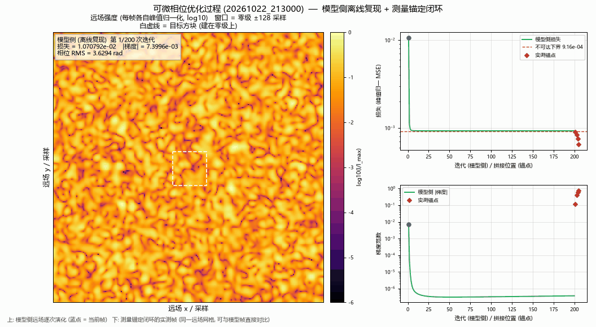
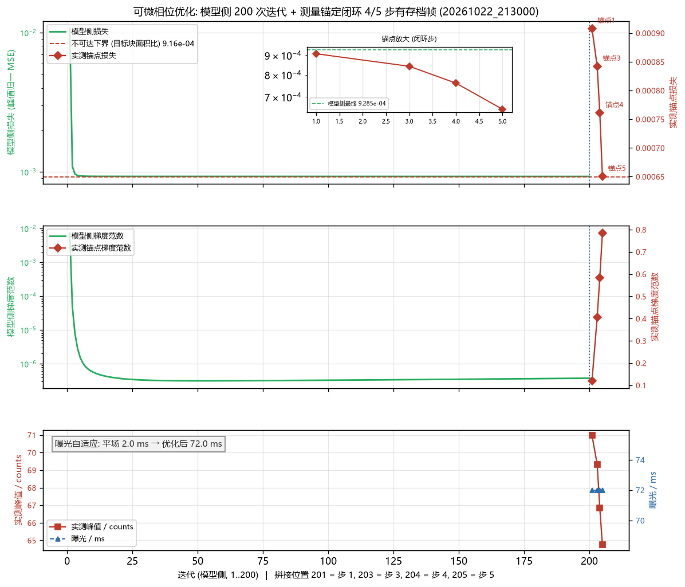

# 可微相位优化 (20261022_213000) — 过程动画配套报告

<!-- provenance:start -->
> **生成脚本**: [`scripts/slm/render_differentiable_opt_animation.py`](../../../scripts/slm/render_differentiable_opt_animation.py)
> **复现命令**: `python scripts/slm/render_differentiable_opt_animation.py --run-dir data/debug/differentiable_opt/20261022_213000`
> **数据/关联脚本**: [`scripts/slm/hw_differentiable_phase_opt.py`](../../../scripts/slm/hw_differentiable_phase_opt.py)
> **数据/关联脚本**: [`src/ao_shaping/algorithm/signal_processing/differentiable_beam.py`](../../../src/ao_shaping/algorithm/signal_processing/differentiable_beam.py)
> **运行环境**: 离线
> **说明**: 可微相位优化实验的**过程动画**配套报告: 模型侧 200 次反向传播**离线复现**(同初值 + 同 seed, 与 history.csv 的最大相对偏差 1.06e-07, 最终相位差 6.29e-05 rad), GIF 展示「随机初值 → 远场演化 → 测量锚定实测帧」并逐帧标注损失/梯度范数, 曲线图把 5 个测量锚定点叠加到模型侧损失/梯度范数曲线上 (拼接时间轴) 并标出 曝光自适应 2.0 → 72.0 ms; 附落盘数据 (每帧远场/损失/梯度)
<!-- provenance:end -->

## 0. 这一轮是什么

**一句话**：2026-10-22 21:30 那一轮 2f 实验系统上的**可微相位优化**硬件验证，
本报告只补一件事 —— 把「优化过程」做成**动画**，并把模型侧 200 次反向传播
**离线复现**出来，让「损失到底怎么降的、相位到底有没有真的动」这两件事可以看。

本报告**不重复**主报告的内容，只引用它的节号：

| 项 | 口径 | 出处 |
|---|---|---|
| 设备 / 参数 / 环境 | Santec SLM #1 @1064 nm、Daheng MER2-507 (cam_id 0)、自适应曝光上限 200 ms；Adam lr 0.05、200 次迭代、seed 0；测量锚定闭环 5 步 | 主报告 §0.2 / §0.3 / §2 |
| 在焦判定 | 最佳 1/f = 0.611 m⁻¹（焦距 1637.6 mm），最佳点 FWHM 12.94 px ≤ 40 px 门限 | 主报告 §1 |
| 前向模型 | 瞳面 256×256 采样 → 零填充到 1024×1024 远场网格；远场采样 1.958 CCD px | 主报告 §3 |
| 目标 | 以零级为中心的均匀方块，60 CCD px = 31×31 远场采样 | 主报告 §3 |
| 模型 vs 硬件 | 强度相关系数 0.089、峰值偏移 [-6, -3] 采样、类 Strehl 0.450 | 主报告 §6 |
| 运行目录 | `data/debug/differentiable_opt/20261022_213000/`（UTC 2026-10-22 13:29:15，本地 21:29） | — |

**本报告新增的产物**（生成脚本 `scripts/slm/render_differentiable_opt_animation.py`，
纯离线，不碰设备）：

* 过程动画 GIF：`figures/20261022_213000_opt_process.gif`
* 曲线图：`figures/20261022_213000_opt_curves.png`
* 落盘数据：`data/debug/differentiable_opt/20261022_213000/animation/`

## 1. 过程动画 (GIF)



### 1.1 画面构成

| 区域 | 内容 |
|---|---|
| 左（主面板，479 px 宽） | **远场强度**：每帧各自峰值归一化后取 log10，色标 `inferno`；窗口 = 零级 ±128 采样（256×256，远场网格 1024×1024 的中心裁剪）；**白虚线** = 目标方块（建在零级上，31×31 采样） |
| 右上（331 px 宽） | 损失 vs 迭代（对数轴，绿色 = 模型侧）；红色虚线 = **不可达下界**（目标块面积比 9.16e-04）；红色菱形 = **测量锚定点**（有存档帧的 4 步：1/3/4/5）；蓝点 = 当前帧 |
| 右下（331 px 宽） | 梯度范数 vs 迭代（对数轴）；红色菱形 = 测量锚点；蓝点 = 当前帧 |
| 左上角浮层 | 当前帧的**活数字**：迭代号、损失、梯度范数、相位 RMS（实测帧另加实测峰值与曝光） |

### 1.2 帧的构成与口径

* **44 帧 = 40 个模型侧帧 + 4 个实测帧**，每帧 200 ms ⇒ **时长 8.80 s**，
  画面 **1056×580 px**，文件 7.21 MB。三个面板的实测宽度分别是
  479 / 331 / 331 px（脚本里对 ≥300 px 有硬门禁，不满足直接报错）。
* **模型侧帧**：第 *i* 帧画的是**第 i 次迭代开始时**那张相位的远场。
  这样帧里的损失与梯度范数就与 `history.csv` 第 *i* 行**同口径**
  （`update()` 记录的就是步前那一刻的损失/梯度；Adam 步之后才变相位）。
  40 帧覆盖第 1…200 次迭代。
* **实测帧**：4 帧，取测量锚定闭环的存档 CCD 帧，重采样到**同一张**模型远场网格
  （`prepare_frame` → `resample_ccd_to_model`，与主脚本同一条路径），并按主报告
  §6 选定的轴向口径（`transpose_flip_cols`）变换，因此**可以和模型帧直接对比**。
  对应关系：**第 1 步 = `ccd_optimized.npz`**（模型侧最终相位上屏）、**第 3 步 =
  `ccd_hw_iter_002.npz`**、**第 4 步 = `ccd_hw_iter_003.npz`**、**第 5 步 =
  `ccd_hw_iter_004.npz`**。**第 2 步没有存档帧**（主脚本只写最后三步），故该步
  在动画里缺一帧。
* 帧序是**连续**的：模型侧第 200 次迭代（= 上屏前那张相位）之后紧接着就是
  第 1 个实测帧（模型侧最终相位上屏的那张）。

### 1.3 动画说明了什么

* 远场**始终是一团散斑**：从第 1 帧（随机初值）到第 40 帧（200 次迭代后），
  目标方块（白虚线）里**始终没有出现**亮结构。这正是主报告 §8.1 的负结果
  ——「随机初值 + 强度 MSE 会掉进『把远场摊平』的局部极小」——在动画里是
  一帧一帧看得见的，而不是只靠一行损失数字。
* 损失在**第 1 帧与第 2 帧之间**就掉了一个量级（1.0708e-02 → 9.3381e-04；40 帧
  取的是第 1、6、11…200 次迭代，所以第 2 帧对应的是第 6 次迭代），之后 38 帧几乎
  不动（末段斜率 −5.0e-09 / 次），一直贴在**不可达下界**（9.16e-04）上 ——
  「目标一块都没命中」时的理论损失。
* 实测帧（右起 4 帧）的背景**暗得多**、能量**聚得更拢**：硬件只保留了模型峰值的
  类 Strehl 比值 0.450，且整团散斑相对目标块**偏心**（主报告 §6 的
  峰值偏移 [-6, -3] 采样）。这一眼就能看出模型与硬件不是同一个东西。

### 1.4 模型侧是**离线复现**，不是降级

本次**没有**走降级路径。脚本用主脚本自己的前向模型与目标构造函数
（importlib 按路径加载 `scripts/slm/hw_differentiable_phase_opt.py`），
从落盘的 `phase_initial.npy` + `run_config.json` 里的 seed/lr 出发，
**离线重跑 200 次反向传播**，并把结果与硬件那一轮留下的产物逐项比对：

| 比对项 | 结果 |
|---|---|
| 设备 | `cuda`（与 `run_config.json` 记录的一致） |
| 200 次迭代的损失轨迹 vs `history.csv` | **最大相对偏差 1.06e-07** |
| 最终相位 vs `phase_final.npy` | 最大绝对偏差 **6.29e-05 rad**（相位 RMS 本身是 3.63 rad） |
| 最终远场 vs `model_farfield.npy` | 最大相对偏差 **1.56e-08** |

⇒ 模型侧演化是**逐位级复现**的，动画里的模型帧就是那一轮真正算出来的东西。

脚本另有一条**降级路径**（模型侧无法离线复现时，改用存档的
`phase_initial/mid/final` + `model_farfield.npy` + 实测帧拼一段
「实测 → 优化」的对比动画，并把降级原因写进
`animation/animation_meta.json` 的 `degrade_reason`）。**本轮没有触发它**，
所以本报告不需要降级说明。

## 2. 曲线图



三栏共用一条**拼接时间轴**：模型侧迭代占 1…200，测量锚定点接在
**201 / 203 / 204 / 205**（= 闭环第 1 / 3 / 4 / 5 步，第 2 步无存档帧）。
这么排是因为主脚本的测量锚定闭环**接着同一个优化器实例**往下跑
（`_run_bench` 里的 `opt` 跨两段共用），所以锚点确实在模型侧迭代之后。

| 栏 | 左轴 | 右轴 | 其它 |
|---|---|---|---|
| 上 | 模型侧损失（对数，绿） | 实测锚点损失（红菱形，标注为「锚点1/3/4/5」） | 红色虚线 = 不可达下界 9.16e-04；蓝色点线 = 模型侧/硬件段的分界；内嵌小图 = 锚点区放大（单调下降） |
| 中 | 模型侧梯度范数（对数，绿） | 实测锚点梯度范数（红菱形） | 分界线同上 |
| 下 | 实测峰值 / counts（红方块） | 曝光 / ms（蓝三角） | 标注「曝光自适应：平场 2.0 ms → 优化后 72.0 ms」 |

> **曝光为什么变**：平场参考帧在 2.0 ms 时峰值 104.3 counts（满刻度 255 的 41%，
> 落在自动曝光的接受带 25%–80% 内，所以停在 2.0 ms）；上了优化相位之后能量摊成
> 一片散斑，同一曝光下峰值掉到接受带以下，脚本按线性响应把曝光抬到 **72.0 ms**
> 才回到接受带（峰值 72.3 counts = 满刻度 28%）。
> **曝光变了 ⇒ 两帧的 counts 不是同一个口径，不能直接相比** —— 所以表里的
> 「实测峰值」只在锚点之间比（5 步曝光都是 72.0 ms，是同一个口径）。

## 3. 数据表

### 3.1 测量锚定闭环（5 步，实测）

| 迭代 | 实测损失 | 梯度范数 | 相位 RMS / rad | 实测峰值 / counts | 曝光 / ms | 存档帧 |
|---|---|---|---|---|---|---|
| 1 | 0.000908026 | 0.11977 | 3.629846 | 70.98 | 72.0 | `ccd_optimized.npz` |
| 2 | 0.000887891 | 0.24350 | 3.629824 | 70.68 | 72.0 | *（无存档帧）* |
| 3 | 0.000842082 | 0.40562 | 3.629908 | 69.33 | 72.0 | `ccd_hw_iter_002.npz` |
| 4 | 0.000760934 | 0.58456 | 3.630135 | 66.83 | 72.0 | `ccd_hw_iter_003.npz` |
| 5 | 0.000650242 | 0.78519 | 3.630461 | 64.75 | 72.0 | `ccd_hw_iter_004.npz` |

读数：

* **实测损失单调下降** 9.0803e-04 → 6.5024e-04（**−28.4%**），5 步之间无一次反弹，
  平均每步 −6.44e-05。
* **梯度范数反而在升** 0.1198 → 0.7852（**×6.56**），**还没到平台** —— 5 步太短，
  梯度还在变大，说明闭环远未收敛。
* **相位 RMS 几乎没动** 3.629846 → 3.630461 rad（**Δ = +6.1e-04 rad**，
  相对量 1.7e-04）。5 步里净相位改动**极小**。
* 实测峰值从 70.98 降到 64.75 counts（−8.8%）。

### 3.2 模型侧 200 次迭代的关键统计

| 项 | 值 |
|---|---|
| 初始损失（第 1 次迭代，随机初值） | 1.070792e-02 |
| 第 2 次迭代的损失 | 1.094190e-03（**一步降了 89.8%**） |
| 最终损失（第 200 次迭代） | 9.285327e-04 |
| 首尾变化 | 1.070792e-02 → 9.285327e-04（**−91.3%**） |
| 第 2 次之后的变化 | 1.094190e-03 → 9.285327e-04（**−15.1%**，199 次迭代） |
| 末段斜率（第 150…200 次线性拟合） | **−4.99e-09 / 次**（50 次合计 −2.49e-07） |
| 不可达下界（目标块面积比 31²/1024²） | 9.16481e-04 |
| 最终损失 / 不可达下界 | **1.013**（几乎就贴在那条线上） |
| 梯度范数 首 → 末 | 7.3996e-03 → 3.7542e-07（**降了 1.97e+04 倍**） |
| 相位 RMS 首 → 末 | 3.629398 → 3.629920 rad（**Δ = +5.2e-04 rad**） |
| 损失最小值出现在 | 第 200 次迭代（单调，没有反弹） |

读数：**梯度确实指对了方向**（损失从 1.07e-02 一路降到 9.29e-04），
但**降到的那个值就是「目标一块都没命中」时的理论下界**（比值 1.013），
而**相位 RMS 全程只动了 5.2e-04 rad** —— 相位基本还是随机的。
这与主报告 §8.1 / §10 的结论一致：这一轮的模型侧优化掉进了
「把远场摊平」的局部极小。

## 4. 模型 vs 硬件（主报告 §6 的关键量）

| 口径 | 模型 | 硬件 | 说明 |
|---|---|---|---|
| 强度相关系数 | — | **0.089** | 模型与硬件**不一致**（< 0.4 即判不一致） |
| 峰值偏移 | — | **[-6, -3] 采样** | 面板↔相机轴映射只能靠实测对比择优定 |
| 类 Strehl 峰值比 | 0.043（相对平场） | 0.019（相对平场） | **比值 0.450** |
| 光斑宽度 | 6.12 采样 | 7.58 采样 | 量在**模型网格**上，散斑的半高宽 |
| CCD 域光斑 FWHM | — | **12.67 px**（x 向 11.0 / y 向 13.0） | 量在**真实像元**上，光斑本身有多宽 |
| 远场采样间距 | 1.958 CCD px / 采样 | — | 换算口径 |

> ⚠️ **表里有三套宽度，单位/对象都不同，不能混用**：
> 「模型 FWHM 6.12 / 实测 FWHM 7.58」量在**模型网格**上（1 采样 = 1.958 CCD px，
> 描述**散斑**的半高宽）；「CCD 域光斑 FWHM 12.67 px」量在**真实像元**上，
> 描述**光斑本身**有多宽。三者互不矛盾，量的是三个不同的东西
> （主报告 §6 脚注已写明，此处复述以免误读）。

动画里能直接看到这三件事：散斑**更宽**（硬件 7.58 vs 模型 6.12 采样）、
**峰值更低**（类 Strehl 0.450）、**偏心**（峰值偏移 [-6, -3] 采样）。

## 5. 结论与边界

**这一轮能说的**：

1. **可微优化链路完整验证通过**：SLM 相位 → 前向模型 → autograd 梯度 → Adam 更新 →
   上屏 → CCD 实测 → 实测远场回灌优化器，这条链在真实实验系统上**验证通过**。
2. **测量锚定闭环的实测损失单调下降** 9.08e-04 → 6.50e-04（**−28.4%**），
   5 步无一反弹 ⇒ 在**实测**图像处求值的梯度方向仍然指对。
3. **模型侧 200 次反向传播可离线复现**（与 `history.csv` 最大相对偏差 1.06e-07），
   所以「优化过程」这件事本身是可复算、可审的，不是一次性产物。

**这一轮不能说的**：

1. **不能说「整形成功」**。判据有三条，全部不过：
   * **净相位改动极小**：相位 RMS 3.629846 → 3.630461 rad（Δ = 6.1e-04 rad）；
   * **模型与硬件对不上**：强度相关系数 **0.089**，峰值偏移 [-6, -3] 采样，
     类 Strehl 0.450；
   * **目标结构根本没有被造出来**：模型侧最终损失 9.2853e-04 ≈ 不可达下界
     9.1648e-04（比值 1.013），目标方块里始终没有亮结构（动画 40 帧可见）。
2. **不能把 −28.4% 读成「可微优化有效」**。这一轮闭环的**起点**已经是模型侧
   那个「摊平」平台（9.08e-04 vs 平台 9.29e-04），起点太差；而且**梯度范数还在
   上升**（0.12 → 0.79，×6.56），说明 5 步远没到收敛，不能拿这 5 步的下降幅度
   去外推收敛行为。
3. **不能说「相位没变是因为没收敛」**。相位 RMS 不动有两个叠加原因：模型侧
   优化掉进了摊平极小（200 次迭代只把相位 RMS 动了 5.2e-04 rad），以及闭环这
   5 步的学习率步长相对相位 RMS 本身极小。

**这一轮验证的是**：可微优化链路端到端执行验证通过，且在实测处单调降损失；
**不是**整形效果达标。下一步（沿用主报告 §9.1 的顺序）：换初值（GS 或解析整形解）
→ 换损失（对目标块加权）→ 显式建模面板响应 → 单独标定轴映射。

## 6. 落盘数据与复现

```bash
# 重画动画与曲线图 (纯离线, 不碰设备)
python scripts/slm/render_differentiable_opt_animation.py \
    --run-dir data/debug/differentiable_opt/20261022_213000
```

动画的输入数组落在运行目录里，便于复算：

| 文件 | 内容 |
|---|---|
| `data/debug/differentiable_opt/20261022_213000/animation/frames.csv` | 44 帧的逐帧台账：帧号、类别（model/hardware）、迭代号、损失、梯度范数、相位 RMS、实测峰值、曝光、来源文件 |
| `.../animation/model_history.csv` | 离线复现的 200 次迭代轨迹（iteration / loss / grad_norm / phase_rms_rad） |
| `.../animation/model_farfield_frames.npy` | 40 个模型帧的远场（256×256，float32） |
| `.../animation/measured_farfield_frames.npy` | 4 个实测帧的远场（重采样到同一网格，256×256，float32） |
| `.../animation/animation_meta.json` | 复现校验（与 `history.csv` 的偏差、设备、帧数、时长、面板像素、锚点表、降级状态与原因） |
