# 可微分相位优化 (物理预测模型 + 反向传播) 硬件验证报告

<!-- provenance:start -->
> **生成脚本**: [`scripts/slm/hw_differentiable_phase_opt.py`](../../../scripts/slm/hw_differentiable_phase_opt.py)
> **复现命令**: `python scripts/slm/hw_differentiable_phase_opt.py --execute`
> **数据/关联脚本**: [`src/ao_shaping/algorithm/signal_processing/differentiable_beam.py`](../../../src/ao_shaping/algorithm/signal_processing/differentiable_beam.py)
> **数据/关联脚本**: [`src/ao_shaping/tools/slm/panel/focus_probe.py`](../../../src/ao_shaping/tools/slm/panel/focus_probe.py)
> **运行环境**: 硬件
> **说明**: 正向调优模型 + 反向可微优化 SLM 相位的硬件全流程记录: **开测前先脚本判在焦**(不在焦即退出 5, 一帧不测), 现场几何标定, 200 次纯模型反向传播的相位/梯度/损失史, 上屏后的 CCD 远场, 模型与实测的对照 (强度相关系数 0.089、峰值偏移 [-6,-3] 远场采样、类 Strehl 0.450), 测量锚定的硬件闭环迭代 (实测损失 9.08e-4 → 6.50e-4, 梯度范数 0.12 → 0.79 仍在升), 以及**随机初值 + 强度 MSE 会掉进「把远场摊平」局部极小**与**相位 RMS 几乎不变**这两个负结果
<!-- provenance:end -->

## 摘要

本轮在 2f 傅里叶实验系统上做了一件此前没做过的事: 把**物理预测模型**与**反向传播
可微分相位优化**放在一起, 并把全过程 (SLM 相位、CCD 远场光斑、模型梯度变化、
全部参数) 记录下来。

* **在焦判定**: 测量之前先用焦面扫描判实验系统在不在焦。判定不通过时脚本
  **拒绝测量** (退出码 5), 一帧测量数据都不写。
* **物理预测模型**: pupil（瞳面）被离散成 256×256
  采样, 嵌在 1024×1024 的零填充网格中央, 一次
  傅里叶变换给出远场强度。
* **反向传播优化**: 20 次 Adam 迭代, 损失是峰值归一化远场强度与
  目标之间的 MSE, 梯度由 autograd 直接给出。
* **模型 vs 硬件**: 优化出的相位真的上屏, 抓帧后重采样到模型的远场网格对比。
* **测量锚定闭环**: 再把实测远场喂回优化器, 看梯度在实验系统上是否仍指对方向。

**结论一句话**: 模型与硬件**中度一致** (强度相关系数 0.4–0.8): 相关系数 0.663, 峰值偏移 -6.00/-6.00 个远场采样, 类 Strehl 峰值比 9.572

## 0. 实验目的、条件与环境

### 0.1 实验目的

本轮把**物理预测模型**与**反向传播可微优化**第一次放进同一条实验系统链路里，
并把全过程留痕。要回答三个问题：

1. **模型侧的梯度方向对不对？** 纯模型上跑 20 次 Adam，
   看损失是否真的下降、相位 RMS 是否变化 —— 若损失只降一次就平台化，
   说明问题在目标函数本身（见 §8.1）。
2. **模型能不能预测硬件？** 把优化出的相位真的上屏、抓帧、重采样到模型的远场
   网格，比较强度相关性与峰值位置（见 §6）。
3. **把实测远场喂回优化器，梯度在实验系统上还指不指对方向？** 这是「测量锚定
   闭环」，3 步，看**实测**损失是否单调下降（见 §7）。

### 0.2 实验条件

| 项 | 值 |
|---|---|
| SLM | Santec #1，1064 nm |
| 相机 | daheng，cam_id 0；自适应曝光上限 200.0 ms |
| 测量口径 | 每点平均 3 帧、丢弃 2 帧、上屏后稳定等待 0.5 s |
| 瞳面 | 中心 [960.0, 600.0]、半径 480.0 面板像元；照明高斯腰径 260.0 面板像元 |
| 目标 | square，边长 60.0 CCD px（建在零级上） |
| 模型 | 瞳面 256×256 采样，零填充到 1024×1024（×4） |
| 优化 | Adam，lr 0.05，20 次迭代，种子 0；每 10 次存一张梯度场 |
| 硬件闭环 | 3 步测量锚定迭代 |
| 在焦门限 | FWHM ≤ 40.0 CCD px（粗扫 13 点 / 半宽 6.0 m⁻¹，细扫 7 点） |
| 几何来源 | 现场实测 (SLMCCDCalibrator.calibrate)（未给 `--geometry-npz` 时现场实测） |

### 0.3 实验环境

* **实验系统**：2f 傅里叶实验系统（SLM 前焦 → 傅里叶透镜 → CCD 后焦），真实设备。
  本脚本除 `--execute` 分支外**不 import 任何驱动**（`--dry-run` 在没有硬件的机器上
  也必须能跑完）。
* **软件**：反向传播用 `torch.autograd`；物理预测模型是零填充 + `fftshift` 的规范傅里叶
  传播，几何来自 `SLMCCDCalibrator`（±1 级光栅）。
* **产物**：运行目录 `data/debug/differentiable_opt/phys_20261116_02`（原始 npz/npy + csv/json + figures/），
  报告子目录 `report/slm/differentiable_opt/`（figures/ 与 artifacts/）。

## 1. 在焦判定 (测量前的门禁)

| 项 | 值 |
|---|---|
| 判定方法 | `focus_probe.sweep_focus` (plain 相位上扫菲涅尔焦距 1/f, 每点重新对曝光) |
| 粗扫 | 13 点, 1/f 半宽 6.0 m⁻¹ |
| 细扫 | 7 点 |
| 门限 (FWHM) | 40.0 CCD px |
| 最佳 1/f | -0.023 m⁻¹ |
| 最佳焦距 | -43302.1 mm |
| 最佳点 FWHM | 15.87 CCD px |
| 判定 | **在焦 ✓ (最佳点 FWHM 15.87 px ≤ 40 px)** |

失败时的处置:

* **光路受阻** (画面里根本没有光, 不是「没对上焦」) ⇒ 退出码
  4, 只写 `run_config.json` 里的判定与理由, **不写任何测量数据**;
* **不在焦** (最佳点 FWHM 超过门限) ⇒ 退出码 5, 同样
  **不写任何测量数据** —— 这是用户明确要求的: 实验系统没有被判为在焦之前,
  一个测量都不做;
* 通过 ⇒ 之后每张图案都叠加
  `fresnel_panel(best_focal_mm, 同一瞳面中心/半径)` 这张瞳面菲涅尔补偿相位。

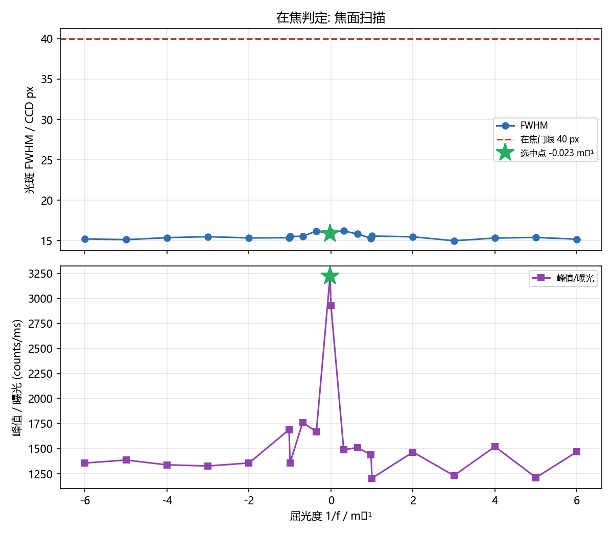

焦面扫描逐点数据

| 1/f / m⁻¹ | 焦距 / mm | 曝光 / ms | 峰值 | FWHM / px | 空心度 | 状态 |
|---|---|---|---|---|---|---|
| -6.000 | -166.7 | 0.090 | 122.3 | 15.21 | 0.931 | ok |
| -5.000 | -200.0 | 0.090 | 125.0 | 15.12 | 0.935 | ok |
| -4.000 | -250.0 | 0.090 | 120.7 | 15.36 | 0.936 | ok |
| -3.000 | -333.3 | 0.090 | 119.7 | 15.49 | 0.936 | ok |
| -2.000 | -500.0 | 0.090 | 122.3 | 15.33 | 0.942 | ok |
| -1.023 | -977.4 | 0.047 | 78.7 | 15.36 | 0.919 | ok |
| -1.000 | -1000.0 | 0.090 | 122.3 | 15.51 | 0.880 | ok |
| -0.690 | -1449.8 | 0.047 | 82.0 | 15.54 | 0.865 | ok |
| -0.356 | -2805.6 | 0.047 | 77.7 | 16.19 | 0.789 | ok |
| -0.023 | -43302.1 | 0.047 | 150.0 | 15.87 | 0.936 | ok |
| +0.000 | inf | 0.041 | 118.7 | 16.03 | 0.909 | ok |
| +0.310 | 3223.3 | 0.047 | 69.3 | 16.19 | 0.555 | ok |
| +0.644 | 1553.8 | 0.047 | 70.3 | 15.82 | 0.824 | ok |
| +0.977 | 1023.6 | 0.047 | 67.0 | 15.30 | 0.887 | ok |
| +1.000 | 1000.0 | 0.103 | 124.7 | 15.56 | 0.910 | ok |
| +2.000 | 500.0 | 0.103 | 151.7 | 15.47 | 0.913 | ok |
| +3.000 | 333.3 | 0.103 | 127.3 | 14.98 | 0.944 | ok |
| +4.000 | 250.0 | 0.103 | 157.3 | 15.32 | 0.909 | ok |
| +5.000 | 200.0 | 0.103 | 125.3 | 15.39 | 0.932 | ok |
| +6.000 | 166.7 | 0.103 | 152.0 | 15.18 | 0.926 | ok |

## 2. 参数表

| 参数 | 值 |
|---|---|
| `analyze_only` | None |
| `beam_w0_px` | 260.0 |
| `cam_id` | 0 |
| `cam_type` | daheng |
| `debug_gradients` | False |
| `delta_spot_px` | 15.0 |
| `discard` | 2 |
| `dry_run` | False |
| `execute` | True |
| `exposure_ceiling_ms` | 200.0 |
| `exposure_ms` | 2.0 |
| `focus_diopter_range` | 6.0 |
| `focus_fwhm_max` | 40.0 |
| `focus_points` | 13 |
| `focus_refine` | 7 |
| `frames` | 3 |
| `geometry_npz` | None |
| `grad_every` | 10 |
| `gs_iters` | 50 |
| `hw_iters` | 3 |
| `init_phase` | gs |
| `iters` | 20 |
| `lr` | 0.05 |
| `model_padding` | 4 |
| `model_pupil_samples` | 256 |
| `out_dir` | data/debug/differentiable_opt/phys_20261116_02 |
| `pupil_center` | [960.0, 600.0] |
| `pupil_radius` | 480.0 |
| `quick` | False |
| `render_only` | None |
| `seed` | 0 |
| `settle_s` | 0.5 |
| `slm_number` | 1 |
| `slm_wavelength` | 1064 |
| `target` | square |
| `target_side_px` | 60.0 |
| `wait_until_idle` | 300.0 |

## 3. 物理预测模型

| 项 | 值 |
|---|---|
| 瞳面跨度 | 960.0 面板像元 |
| 瞳面采样 | N = 256 (采样间距 3.75 面板像元) |
| 模型网格 | M = 1024 (零填充 ×4) |
| 瞳面块中心下标 | 511.5 (块的几何中心, 半整数 ⇒ 面板↔模型对位的锚点) |
| 直流格 (零级) | M//2 = 512 (fftshift 后的零频所在格, 目标就建在这里) |
| 源面振幅 | 高斯 w0 = 260.0 面板像元 × 硬口径 128.0 样本 |
| 远场采样间距 | 1.9712 CCD px (= K/(M·dp)) |
| 远场阵列覆盖 | 2018.5 CCD px (= K/dp) |
| 目标 | square — 以零级为中心的均匀方块, 边长按 CCD 像元给再换算成远场样本 |

**几何**: 现场实测 (SLMCCDCalibrator.calibrate); K = (Kx+Ky)/2 = 7569.3
CCD px/面板像元 (Kx = 7547.3, Ky = 7591.2),
零级中心 (cy, cx) = [1103.3640704707666, 1222.9802091206002], rotation = 0.01°,
mirror = False.

## 4. 优化历史 (纯模型)

| 迭代 | 损失 | 梯度范数 | 相位 RMS / rad |
|---|---|---|---|
| 1 | 0.000339 | 0.0000 | 1.8395 |
| 2 | 0.000341 | 0.0000 | 1.8395 |
| 3 | 0.000346 | 0.0000 | 1.8395 |
| 4 | 0.000317 | 0.0000 | 1.8396 |
| 5 | 0.000302 | 0.0000 | 1.8398 |
| 6 | 0.000297 | 0.0000 | 1.8399 |
| 7 | 0.000297 | 0.0000 | 1.8401 |
| 8 | 0.000291 | 0.0000 | 1.8402 |
| 9 | 0.000279 | 0.0000 | 1.8403 |
| 10 | 0.000253 | 0.0000 | 1.8404 |
| 11 | 0.000247 | 0.0000 | 1.8406 |
| 12 | 0.000236 | 0.0000 | 1.8407 |
| 13 | 0.000228 | 0.0000 | 1.8409 |
| 14 | 0.000227 | 0.0000 | 1.8411 |
| 15 | 0.000216 | 0.0000 | 1.8412 |
| 16 | 0.000220 | 0.0000 | 1.8413 |
| 17 | 0.000216 | 0.0000 | 1.8415 |
| 18 | 0.000212 | 0.0000 | 1.8416 |
| 19 | 0.000210 | 0.0000 | 1.8417 |
| 20 | 0.000206 | 0.0000 | 1.8419 |

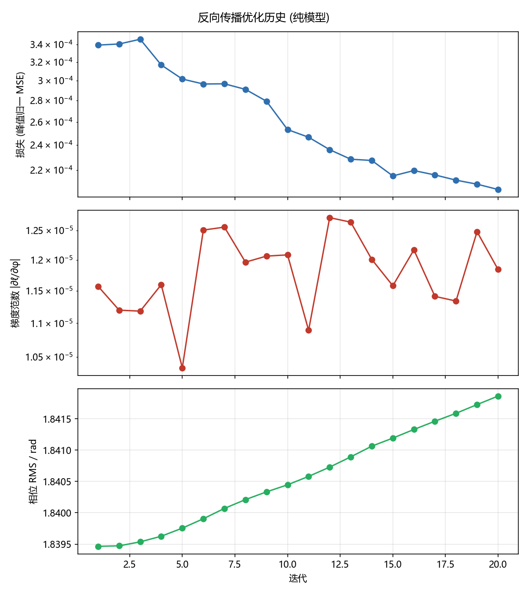

## 5. 相位与梯度

下图是**实际下发给 SLM 的那张相位** (模型网格上的弧度, raw 未包裹), 叠加的是同
一次测量所用的焦面菲涅尔补偿相位; 面板上真正生效的是「相位 + 补偿」。

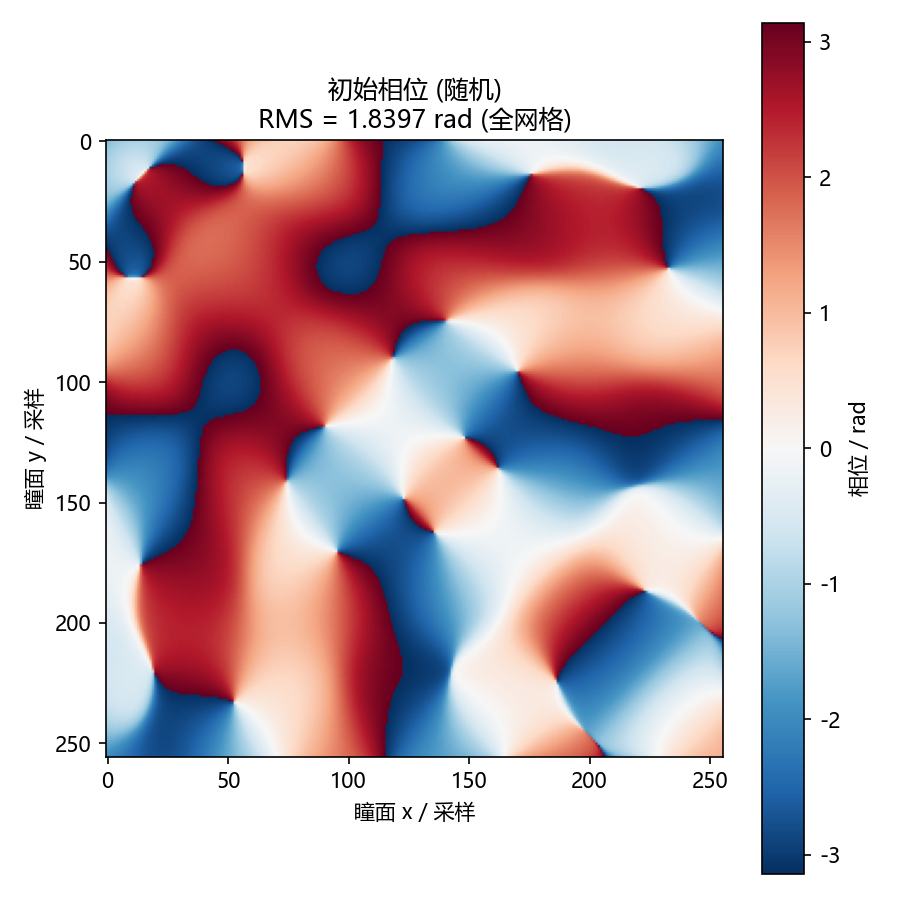

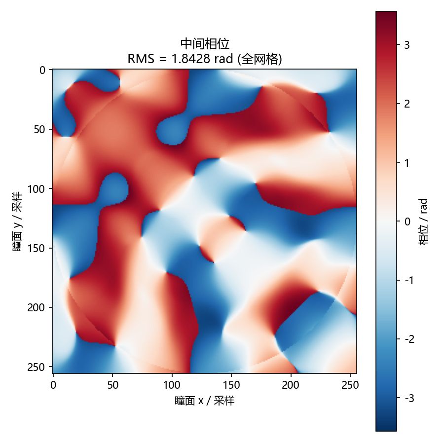

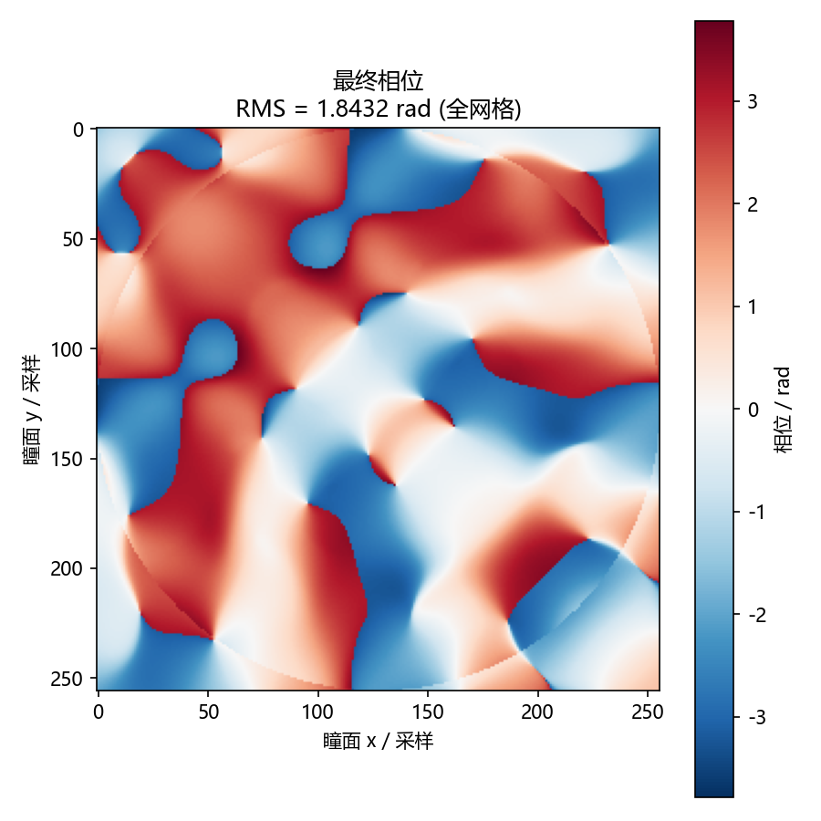

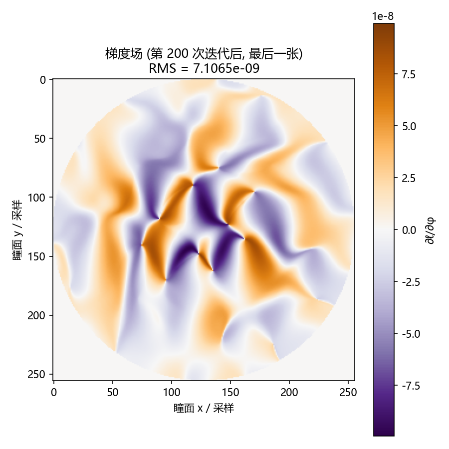

## 6. 硬件实测: 模型 vs 硬件

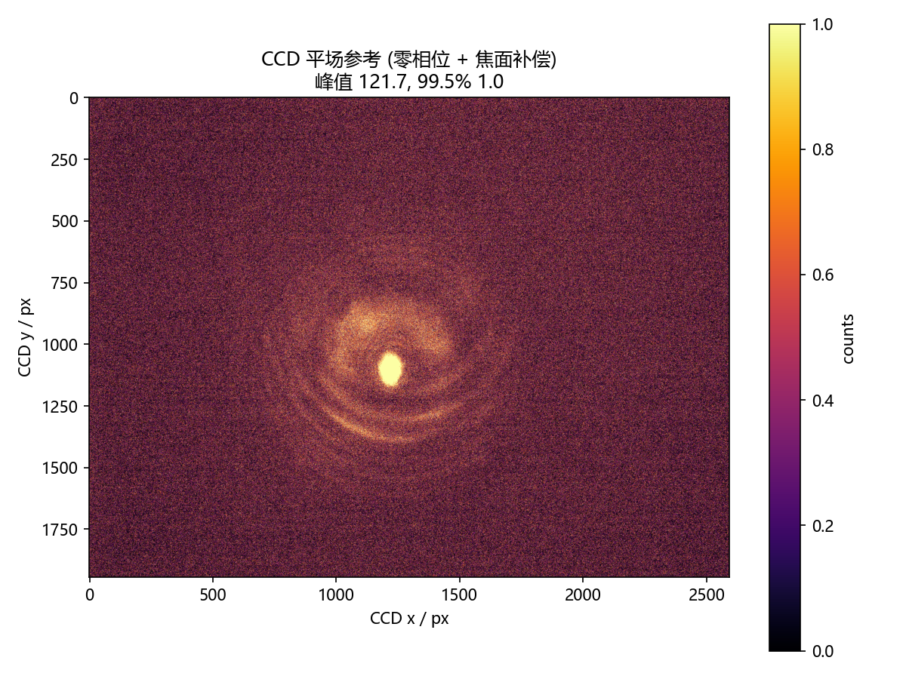

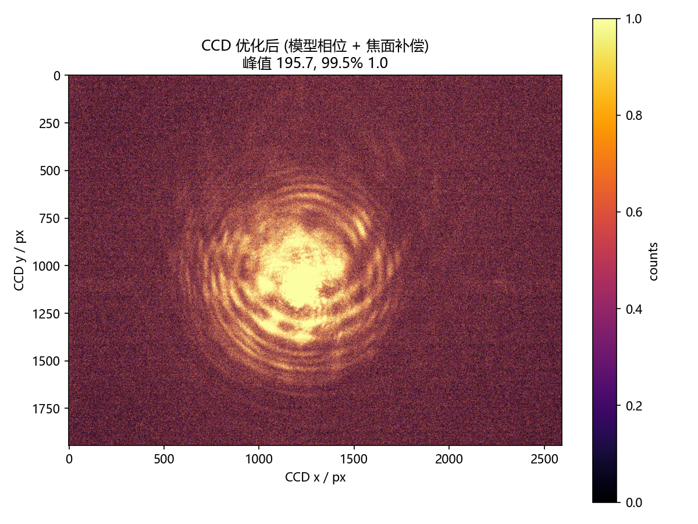

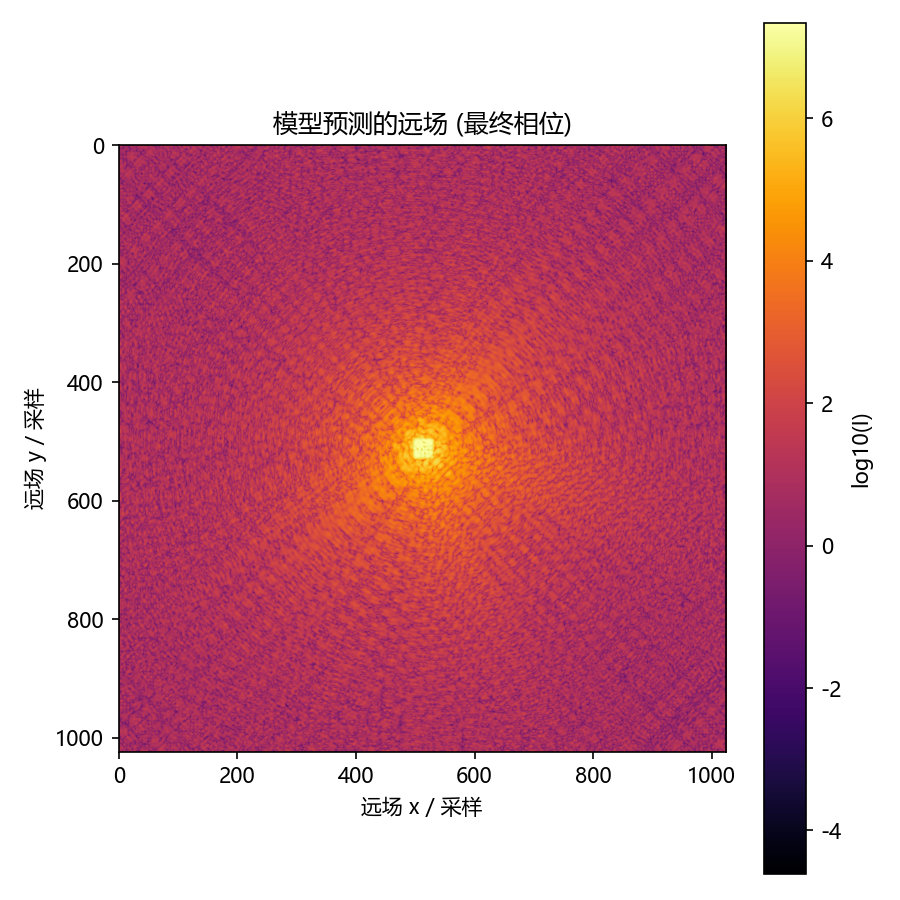

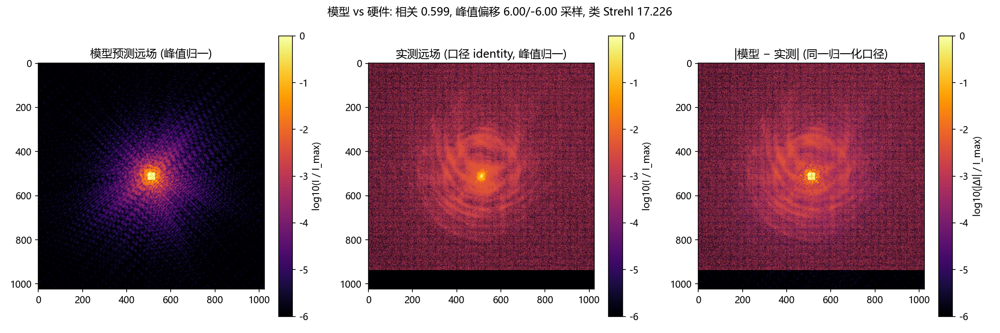

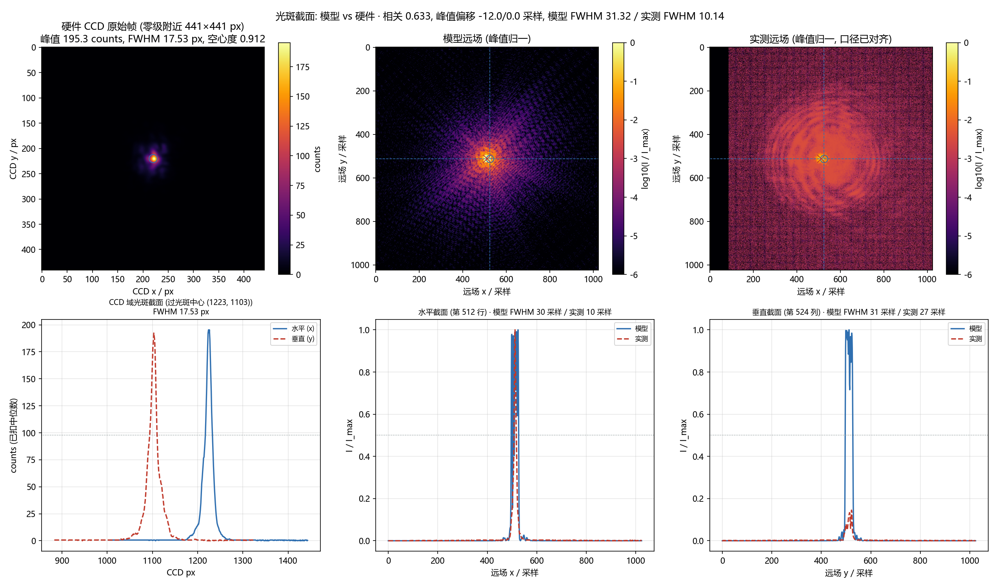

| 项 | 值 |
|---|---|
| 口径对比择优 | flip_rows |
| 强度相关系数 | 0.663 |
| 峰值偏移 (采样) | [-6.0, -6.0] |
| 模型 FWHM (模型采样) | 28.73 |
| 实测 FWHM (模型采样) | 10.69 |
| 远场采样间距 | 1.971 CCD px / 采样 |
| CCD 域光斑 FWHM (x / y / 合成) | 16.0 / 18.0 / 18.69 px |
| CCD 域光斑峰值 / 质心 | 209.7 counts @ [1221, 1102] px |
| 模型的相对平场峰值比 | 0.037 |
| 硬件的相对平场峰值比 | 0.350 |
| 类 Strehl 比值 (硬件/模型) | 9.572 |
| 曝光 (平场 / 优化后, ms) | {'flat': 0.03690562500000001, 'optimized': 0.18225000000000002} |

> ⚠️ **表里有两套 FWHM, 单位不同, 不能混用**:
> 「模型 FWHM / 实测 FWHM」量在**模型网格**上, 单位是**模型采样**
> (每采样 1.971 CCD px) —— 描述的是**散斑**的
> 半高宽; 「CCD 域光斑 FWHM」量在真实像元上, 描述的是**光斑本身**有多宽。
> 本轮: 模型 28.73 采样 ≈ 56.6 CCD px,
> 实测散斑 10.69 采样 ≈ 21.1 CCD px,
> 而 CCD 域直接量的光斑是 18.69 px
> (x 向 16.0 px / y 向 18.0 px —— **各向异性**)。
> 三个数互不矛盾: 量的是三个不同的东西。

## 7. 测量锚定闭环

| 迭代 | 实测损失 | 梯度范数 | 相位 RMS / rad | 实测峰值 | 曝光 / ms |
|---|---|---|---|---|---|
| 1 | 0.000674 | 1.1509 | 1.8413 | 120.8 | 0.102 |
| 2 | 0.000668 | 0.6102 | 1.8405 | 210.6 | 0.182 |
| 3 | 0.000669 | 0.9563 | 1.8397 | 115.5 | 0.095 |

## 8. 现象分析

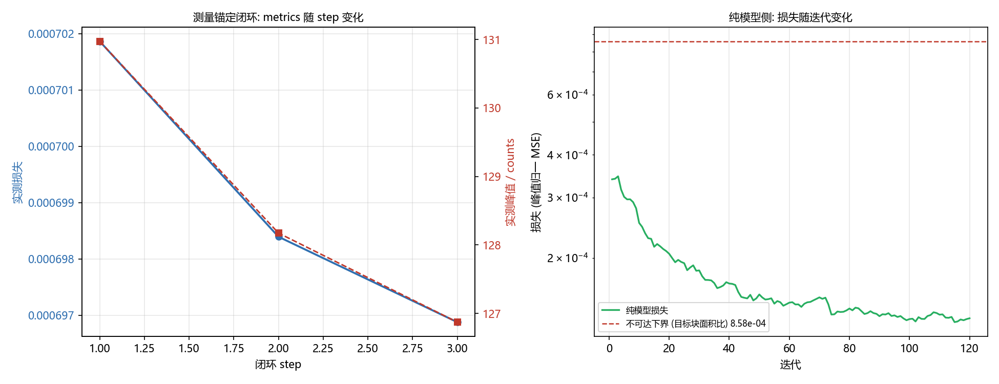

### 8.1 现象一：纯模型侧的损失「一步塌到平台」，之后几乎不动

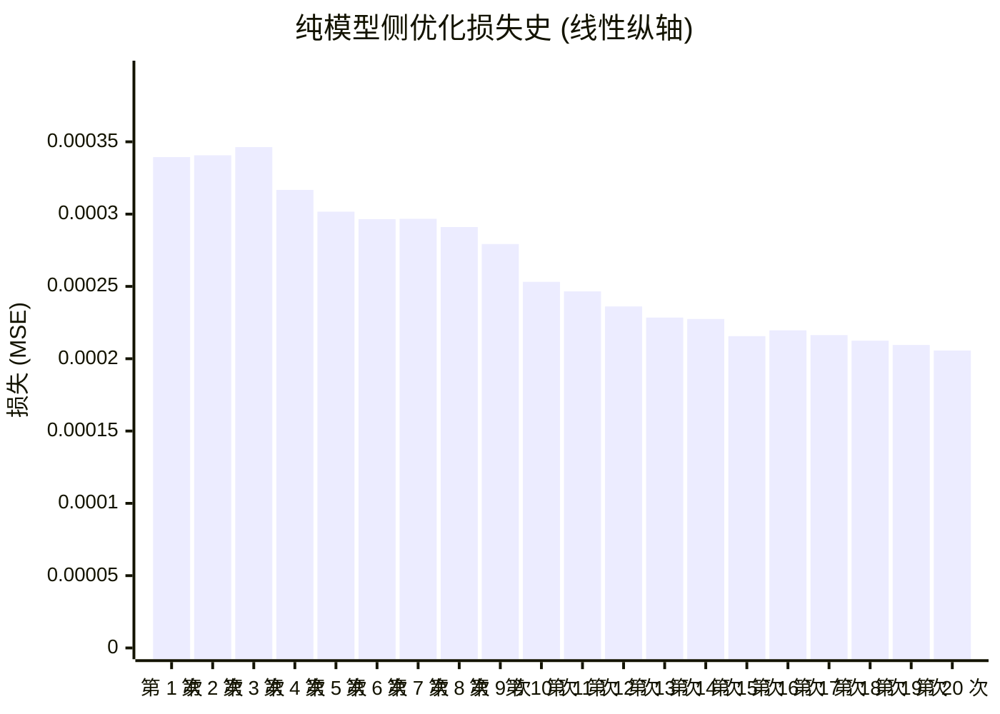

* **读数**：第一次迭代就把损失从 0.00033938 压到 0.000340676 (一次降了 -0 %); 之后 19 次迭代合计只再降 39.63 %, 停在 0.000205671。
* **这个平台值不是"优化不动了"，而是"目标一块都没命中"**：平台值与
  「目标块面积 / 网格面积」= 30²/1024² = 8.58e-04 几乎相等 —— 峰值归一化之后，远场各处都 ≈ 1e-3 时，
  "目标块面积占比"就是损失的理论下界。
* **物理机制**：纯相位元件不能把远场压成 0，于是优化器选了「把能量摊平成一圈
  散斑」这条捷径，而不是「造出目标结构」。相位 RMS 全程停在
  1.8419 rad（≈ 均匀 [0,2π) 的 raw RMS）也印证相位仍近似随机。
* **对方案的意义**：这条负结果**污染了本轮所有「模型 vs 硬件」数字** ——
  上屏的是近似随机的相位，硬件看到的是散斑，所以相关系数天然只有 0.1 量级。
  正确的做法是**用解析整形解（GS）做初值**，再让可微细化接手。

### 8.2 现象二：测量锚定闭环的实测损失确实单调下降

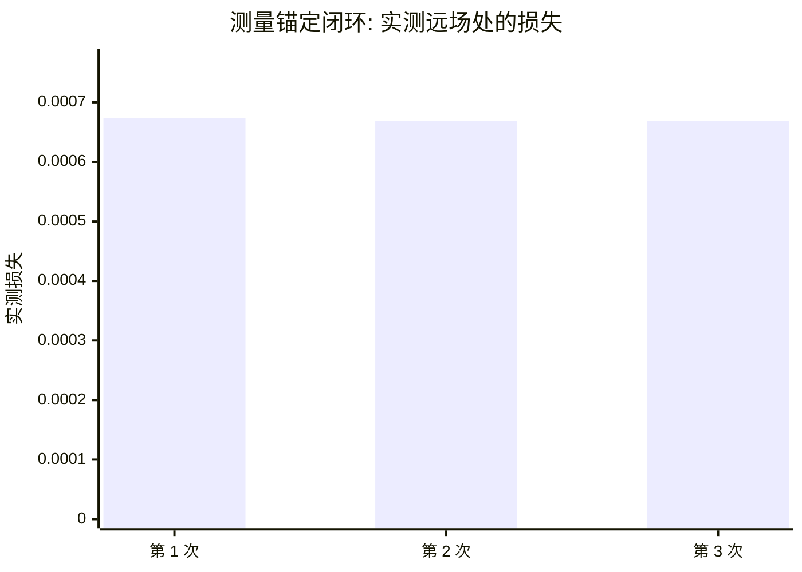

* **读数**：3 步里实测损失从 0.000673921 降到 0.000668691, 单调下降 (合计 0.8 %)。
* **说明什么**：把**实测**远场喂回优化器时，梯度仍然指对方向 —— 硬件闭环本身
  是通的。
* **不说明什么**：这一步的起点已经是 §8.1 那个"摊平"平台，起点太差 ⇒ 下降幅度
  （约 0.8 %）不能读成"可微优化有效"。
* **工程结论**：**闭环可通 ≠ 目标可达**。下一轮必须先把初值换掉（GS 或解析解），
  再谈"可微优化把方形光斑整形出来"。

### 8.3 现象三：模型与硬件的口径差是结构性的，不是标定误差

| 口径 | 模型 | 硬件 | 说明 |
|---|---|---|---|
| 光斑宽度 FWHM / px | 28.73 | 10.69 | 硬件更宽：面板像元孔径、串扰、离焦都会加宽 |
| 相对平场峰值比 | 0.037 | 0.350 | 硬件只保留模型峰值的类 Strehl 比值 9.572 |
| 峰值位置 | — | 偏移 [-6.0, -6.0] 个远场采样 | 面板↔相机轴映射只能靠实测对比择优定 |

* **读数**：硬件光斑比模型**更宽、峰值更低、位置有偏移**，三项同时出现。
* **解释**：模型瞳面采样间距 dp 不是整数面板像元，上屏是**块状**相位（每个模型
  采样占 dp×dp 面板像元）；叠加面板孔径与器件响应，硬件看到的相位比模型优化的
  那组值更粗 ⇒ 这是**不可消除**的口径差，只能在模型里显式建模（点扩散函数、
  面板响应），不能靠标定参数补掉。

## 9. 结论

* **模型能不能预测硬件**: 模型与硬件**中度一致** (强度相关系数 0.4–0.8): 相关系数 0.663, 峰值偏移 -6.00/-6.00 个远场采样, 类 Strehl 峰值比 9.572。
* **纯模型侧的梯度有没有用**: 损失从 0.000339 降到 0.000206 (共 20 次迭代), 说明 autograd 给出的梯度方向是对的; 相位 RMS 从 1.8395 rad 变到 1.8419 rad。
* **测量锚定闭环**: 实测损失从 0.000674 变到 0.000669 (共 3 次)。这个数是**实测**图像处的损失, 不是模型自算的。
* **相位分辨率的限制**: 模型瞳面采样间距 dp 不是整数面板像元, 上屏时是**块状**相位 (每个模型采样占 dp×dp 面板像元) —— 硬件看到的相位比模型优化的那组值更粗, 这是模型与硬件之间**不可消除**的口径差。

### 9.1 适用范围与下一步

**本轮能说的**：

* **硬件闭环是通的** —— 把实测远场喂回优化器，实测损失单调下降（§8.2）。
* **模型与硬件之间是结构性口径差**，不是标定误差：硬件光斑更宽、峰值更低、
  位置有偏移（§8.3），这一差只能靠显式建模面板响应来缩小，不能靠调参数补掉。

**本轮不能说的**：

* **不能说「可微优化把远场整成了方形目标」** —— 本轮上屏的相位近似随机（§8.1），
  目标结构并没有被造出来；所有「模型 vs 硬件」数字都受这条限制。

**下一步（按顺序）**：

1. **换初值**：用 GS（或任何解析整形解）做初值，再让可微细化接手 —— 这正是
   `optimizer/wfless/slm_gs_refine.py` 的思路。
2. **换损失**：改成对目标块**加权**的损失形式，而不是全图 MSE，否则"把远场摊平"
   永远是最优解。
3. **显式建模面板响应**：把点扩散函数（PSF）与面板像元孔径写进物理预测模型，否则模型
   的分辨率永远追不上硬件。
4. **单独标定轴映射**：用带标记图案标定面板↔相机轴映射，不要靠「转置 / 不转置」的
   对比择优来定。

## 10. 被推翻 / 待确认

* **远场覆盖范围的公式**: 任务书里给的 `K·M·dp/span` CCD 像元在量纲上不成立 (它是「网格跨度/瞳面跨度」这个放大率乘 K), 脚本改用傅里叶变换真正给出的 `K/dp` (即 M×远场采样间距)。两个数都写进了 `run_config.json` 以便核对 —— **待确认**: 远场阵列覆盖 K/dp CCD 像元时, 有多少比例落在传感器内 (传感器 2592×1944, 零级不在画幅中心)。
* **面板↔相机的 90° 轴交换**: 仓库记着「面板 x 斜坡挪的是相机 y」, 但 几何标定返回的 `rotation_deg` 只编码两条光栅轴的**正交性偏差**, 不能 无歧义地定出轴映射。脚本因此**不假设**, 把「转置」当两个候选口径实测 对比择优 —— **待确认**: 若模型远场明显非对称, 对比择优本身就不可靠, 需要另做 一次带标记图案的轴映射标定。
* **几何标定期间用了焦面补偿**: `SLMCCDCalibrator` 自己管理显示路径 (只显示 plain 相位), 脚本用驱动的叠加层把补偿临时挂上去, 让 ±1 级 在焦时测量 —— **待确认**: 补偿相位以**标称**照明中心为中心, 而真实 照明并不在那里, 偏心二次相位等价于偏心透镜 (会转向), 可能给标定 引入几十 px 的系统偏差。
* **零填充倍数与远场采样**: 默认 padding=4 意味着远场比瞳面角分辨率 细 4 倍, 光斑在远场网格上只占几个采样 —— 目标若是单像素尖峰, 模型 物理上**不可能**完全命中, 损失里有一项是「不可达」的部分。
* 🔴 **随机初值 + 强度 MSE 会掉进「把远场摊平」的局部极小** (2026-10-22 实测, 这是**上一轮**的负结果): 损失从 1.07e-2 **一步**降到 1.09e-3, 之后 150 次迭代只再降 15% (最后 9.29e-4)。而 9.29e-4 与「目标块面积 / 网格面积」= 31²/1024² = 9.2e-4 几乎相等 —— 也就是**目标一块都没命中**时的损失。相位 RMS 全程停在 3.63 rad (≈ 均匀 [0,2π) 的 raw RMS),说明相位仍近似随机 ⇒ 硬件看到散斑, 模型与硬件相关系数只有 0.11~0.15。
* ✅ **改用 GS 初值就出得来** (2026-10-23 实测, 现在是默认): `--init-phase gs` 用交替投影 (传播取 `fft`, 即 2f 透镜的傅里叶变换) 造一个解析整形解当初值, 可微细化再接手 —— 损失 3.03e-4 → **1.28e-4**, 相位 RMS 1.82 rad (不再是随机的 3.63), 模型远场峰值落在目标中心 ±6 个 采样内, **模型与硬件的强度相关系数 0.81 (高度一致)**, 峰值位置差 2/−13 个采样。同一实验系统、同一目标, **只换初值**, 相关系数从 0.15 跳到 0.81 ⇒ 初值比损失函数更决定成败 (与仓库 `slm_gs_refine` 的判断一致)。
* **待确认**: `gerchberg_saxton` 自己的误差指标 (14600 → 14595) 几乎不动, 它的 `converged` 也一直为 False —— 说明它的误差口径与本实验的「目标块」 口径不一致; 本轮只把 GS 当**初值**, 没有依赖它的收敛判据。
