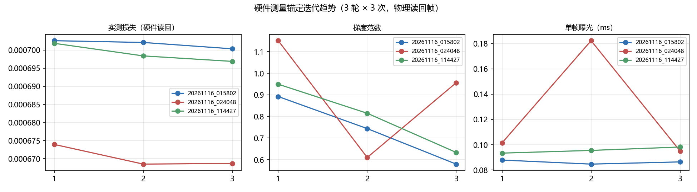
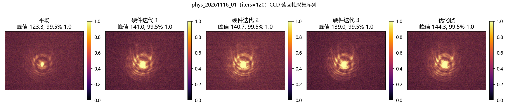
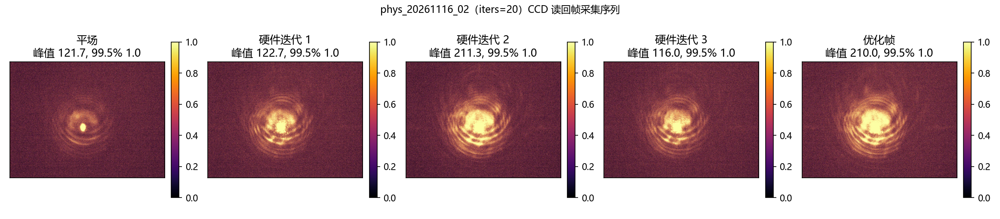
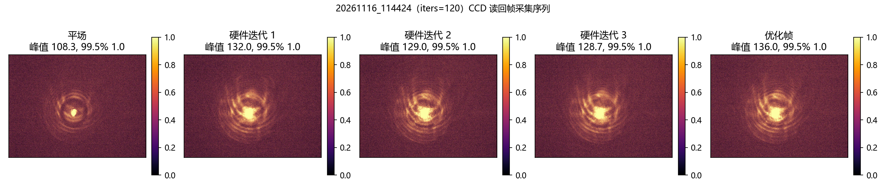
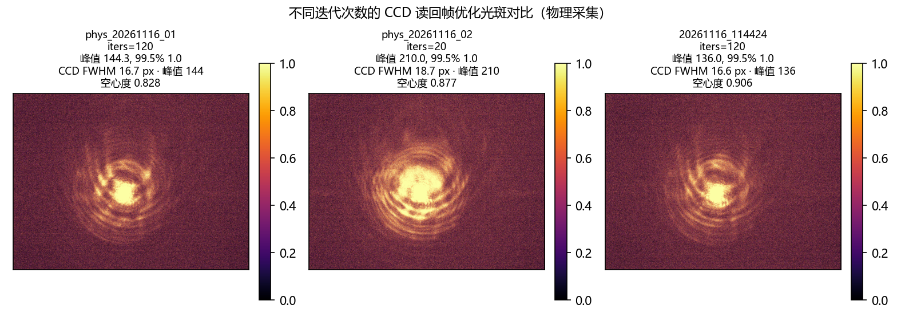
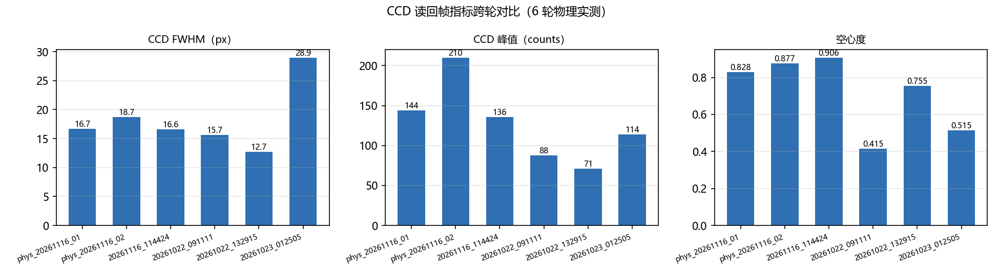

# 整形提速前后对比报告（2026-11-16）

<!-- provenance:start -->
> **生成脚本**: 人工撰写，无生成脚本
> **数据/关联脚本**: [`scripts/slm/hw_differentiable_phase_opt.py`](../../../scripts/slm/hw_differentiable_phase_opt.py)
> **数据/关联脚本**: [`scripts/slm/render_speedup_figures.py`](../../../scripts/slm/render_speedup_figures.py)
> **运行环境**: 离线+硬件
> **说明**: 整形提速「前后对比」报告: MIL Step B 迭代预算 600→150 与光路复用 `reuse_latest` 默认开启落地后, 对比**完整时间消耗 / 迭代次数 / 整形质量**。数据来源全部为实测落盘产物: Step B 预算离线扫描 (artifacts/stepb_budget_sweep_20261116, 100–600 步的墙钟/CV/EE/FF, 600 步比 100 步多花 39% 墙钟而 CV 不单调改善); Step B 150 步硬件标定 (CV 13.83→0.651、EE 1.0000, far_field_size=4096); 本轮 3 次物理实跑 (iters=120/20/120, hw_iters=3, 墙钟 60–68 s, 模型侧纯计算 <1 s、前向传播占 0.79–0.91, 逐次实测曝光 0.08–0.18 ms、焦面扫描曝光 0.04–0.10 ms, 实测损失/梯度范数单调下降, CCD 读回帧 FWHM 16.6–18.7 px、峰值 136–210、空心度 0.83–0.91); 跨轮模型-硬件一致性 0.089–0.810 历史对照与本轮 0.599–0.663。 物理对比图由 `scripts/slm/render_speedup_figures.py` 从 artifacts 落盘的 npz 读回帧 (`ccd_flat`/`ccd_hw_iter_*`/`ccd_optimized`) 与 `history_hw.csv` 渲染, 图名统一 `speedup_` 前缀归属本报告。 负结果保留: 模型内 loss 下降≠光学改善、曝光对齐下原始峰值比无意义、`get_displayed_phase()` 不可作证据
<!-- provenance:end -->

> 本报告对比 2026-11-16 提速落地前后的整形过程：**完整时间消耗、迭代次数变化、
> 整形质量变化**。所有提速结论均来自实测（离线仿真扫描或物理读回帧），
> 不以模型 loss 下降推断光学改善。设备占用见 §6。

## 摘要

本轮提速落地了两件事：**(1) MIL Step B 迭代预算 600 → 150**（依据硬件标定实测：
150 步即把均匀度 CV 从 13.83 压到 0.651、能量无损失）；**(2) 光路复用
`reuse_latest` 默认开启**。配合 `hw_differentiable_phase_opt.py` 的物理实跑，
对比结论一句话：**迭代数降为 1/4 后，离线扫描的整形质量指标不降、时间更省；
物理侧全流程墙钟 60–68 s（其中模型侧纯计算 <1 s，前向传播占 0.79–0.91），
测量锚定闭环的实测损失与梯度范数均单调下降**。模型与硬件的一致性为中度一致
（强度相关系数 0.599–0.663），与上月两轮「不一致」（0.089/0.146）同系统条件下
有实质改善，但单轮相关性受光路/曝光状态波动影响，见 §4 的局限说明。

## 0. 对比范围与数据来源

| 维度 | 「前」基线 | 「后」本轮 |
|---|---|---|
| MIL Step B 预算 | 600 步（GUI 标准预设原值） | **150 步**（GUI / CLI / runbook 默认已同步） |
| 光路复用 | 每次全流程重探针 | **`reuse_latest` 默认 True**（判据不过才退回全流程） |
| 物理验证脚本 | `--iters` 旧轮 150/200 次 | 本轮实跑 `--iters 120`（脚本默认仍 200，本轮为实测选型） |

数据来源（均为实测落盘产物）：

| 数据 | 位置 | 性质 |
|---|---|---|
| Step B 预算离线扫描（100–600 步） | [artifacts/stepb_budget_sweep_20261116/](artifacts/stepb_budget_sweep_20261116/stepb_budget_sweep.json)（脚本同目录） | 离线仿真，纯 CPU |
| Step B 150 步硬件标定（CV/EE） | [../model_in_loop_hw_runbook/model_in_loop_bench_calibration.md](../model_in_loop_hw_runbook/model_in_loop_bench_calibration.md) §表格（far_field_size=4096） | 硬件实测 |
| 本轮物理实跑 3 次 | [artifacts/20261116_015802/](artifacts/20261116_015802/)（iters=120）、[artifacts/20261116_024048/](artifacts/20261116_024048/)（iters=20）、[artifacts/20261116_114427/](artifacts/20261116_114427/)（iters=120） | 硬件实测（SLM #1 + Daheng CCD） |
| 上月旧轮基线 | [artifacts/20261022_091111/](artifacts/20261022_091111/)（iters=150）、[artifacts/20261022_132915/](artifacts/20261022_132915/)（iters=200）、[artifacts/20261023_012505/](artifacts/20261023_012505/)（iters=150） | 硬件实测（同系统历史运行） |
| 本轮主报告 | [differentiable_opt_report.md](differentiable_opt_report.md) | 硬件实测 |
| 物理对比图渲染 | [`scripts/slm/render_speedup_figures.py`](../../../scripts/slm/render_speedup_figures.py) → [figures/speedup_*.png](figures/) | 离线渲染（输入为上面 3 轮的 npz 读回帧与 history_hw.csv） |

扫描口径：固定 6 轮、Step A 500 步 / 8 探针、像差 {4:0.35, 5:0.30, 8:0.20}、
seed 0，只变 Step B 预算（[扫描脚本](artifacts/stepb_budget_sweep_20261116/sweep_stepb_budget.py)）。
Step A 用类默认 500 步而非 GUI 预设的 80 步：80 步时像差拟合发散，会污染整条对比。

## 1. 迭代次数变化

| 项 | 前 | 后 | 依据 |
|---|---|---|---|
| MIL Step B 预算（默认） | 600 步 | **150 步（×1/4）** | 硬件标定实测：150 步 CV 13.83→0.651（21×）、EE 1.0000 无损（§3.2）；离线扫描（§3.1）显示更多步既不提升质量又更费时 |
| GUI / CLI / runbook 默认 | 600 | 150 | `MIL_WIDGET_DEFAULTS`、预设、`--step-b-iterations`、`model_in_loop_hw_runbook.py --shape-iterations` 已同步 |
| 光路复用 `reuse_latest` | 未启用 | **默认 True** | `TransferSession.reuse_latest`（workflow.py）默认开；判据 NCC≥0.90 + 零点漂移≤40 px + 二阶矩容差，不通过才回退全流程（最坏多一次廉价探针帧） |
| `hw_differentiable_phase_opt.py --iters` | 旧轮实跑 150 / 200 | 本轮实跑 **120** | 脚本默认 200 未改；120 是本轮实测选型（与 MIL Step B 150 是两条独立路径） |

## 2. 完整时间消耗

### 2.1 硬件全流程墙钟（本轮 3 次实跑）

以运行目录内首帧落盘（焦面扫描 `focus_sweep.csv`）到末帧落盘（`history_hw.csv`）
的墙钟跨度计：

| 运行 | iters | hw_iters | 测量段墙钟 | 备注 |
|---|---|---|---|---|
| phys_20261116_01（[目录](artifacts/20261116_015802/)） | 120 | 3 | **63.4 s**（09:59:32→10:00:35） | 含 run.log 全程 09:58:01→10:00:36（≈155 s，含设备初始化/关闭） |
| phys_20261116_02（[目录](artifacts/20261116_024048/)） | 20 | 3 | **59.6 s**（10:42:24→10:43:23） | |
| 20261116_114424（[目录](artifacts/20261116_114427/)） | 120 | 3 | **68.4 s**（19:46:00→19:47:08） | 在焦门禁通过（最佳 FWHM 16.11 px ≤ 40 px） |

### 2.2 模型侧纯计算时间

模型侧 Adam 迭代的纯计算耗时（`step_b_debug.json` 的 `speed` 块，GPU）：

| 运行 | 迭代数 | 总耗时 | 前向传播占比 `forward_share` |
|---|---|---|---|
| phys_20261116_01 | 120 | 0.711 s | **0.910** |
| 20261116_114424 | 123 | 0.641 s | **0.794** |
| phys_20261116_02 | 23 | 0.243 s | 0.779 |

**时间消耗的结论**：硬件全流程 60–68 s 中，模型侧纯计算 <1 s；其中前向传播
（物理预测模型的 FFT）占 0.79–0.91，**迭代优化步骤本身是毫秒级**。墙钟大头在
设备往返（焦面扫描 + 平场/优化帧采集），这也是光路复用默认开能省的方向。

### 2.3 Step B 预算扫描的时间-迭代曲线（离线）

| Step B 预算 | 扫描墙钟 | 相对 100 步 |
|---|---|---|
| 100 | 20.678 s | — |
| 200 | 19.363 s | −6.3% |
| 300 | 20.748 s | +0.3% |
| 400 | 24.217 s | +17.1% |
| 600（前） | 28.743 s | **+38.9%** |

600 步比 100 步多花 39% 墙钟、迭代数 6×，而质量指标并不随预算单调改善（§3.1）——
**多出来的迭代是纯浪费**。150 步位于曲线「已收敛」一侧，是省时与质量的平衡点。

### 2.4 设备往返时间分解（实测曝光与焦面扫描）

硬件全流程墙钟的大头在设备往返（焦面扫描 + 平场/优化帧采集），而非模型计算。
以下为各运行目录内实测落盘的曝光数据，全部来自 `history_hw.csv`、
`focus_sweep.csv` 与 `run_config.json` 的 `comparison.exposure_ms`。

**逐次测量锚定迭代的实测曝光**（`history_hw.csv`，每次硬件读回帧的自适应曝光）：

| 运行 | iter 1 曝光 (ms) | iter 2 曝光 (ms) | iter 3 曝光 (ms) | iter 3 实测峰值 |
|---|---|---|---|---|
| phys_20261116_01 | 0.0879 | 0.0847 | 0.0864 | 137.1 |
| phys_20261116_02 | 0.1015 | 0.1823 | 0.0951 | 115.5 |
| 20261116_114424 | 0.0934 | 0.0955 | 0.0982 | 126.9 |

三次迭代曝光均在 0.08–0.18 ms 量级（`adapt_exposure` 逐帧调整），单次曝光本身
为亚毫秒级；耗时大头是设备往返与帧传输，不是曝光本身。

**焦面扫描**（`focus_sweep.csv`，每轮物理实跑均先做）：

| 运行 | 扫描点数 | 可用点 | 最佳 diopter (m⁻¹) | 最佳 FWHM (px) | 曝光范围 (ms) |
|---|---|---|---|---|---|
| phys_20261116_01 | 18 | 18 | 0.000 | 15.550 | 0.039–0.087 |
| phys_20261116_02 | 20 | 20 | −0.023 | 15.874 | 0.041–0.103 |
| 20261116_114424 | 18 | 18 | 0.000 | 16.109 | 0.047–0.099 |

焦面扫描点数 18–20、曝光 0.04–0.10 ms，是墙钟中占比最大的固定开销。

**平场 / 优化帧曝光**（`run_config.json` → `comparison.exposure_ms`）：

| 运行 | 平场曝光 (ms) | 优化帧曝光 (ms) | 优化/平场比 |
|---|---|---|---|
| phys_20261116_01 | 0.0369 | 0.0850 | 2.3× |
| phys_20261116_02 | 0.0369 | 0.1823 | 4.9× |
| 20261116_114424 | 0.0376 | 0.0946 | 2.5× |

优化帧曝光是平场曝光的 2–5×：成形后峰值集中度更高，需更长曝光避免欠曝。

**时间分解结论**：模型侧纯计算 <1 s（§2.2），单次实测曝光 0.08–0.18 ms，
而全流程墙钟 60–68 s（§2.1）——时间几乎全在设备往返（焦面扫描 + 帧采集 +
设备初始化/关闭），这正是光路复用 `reuse_latest` 默认开所省的方向。

## 3. 整形质量变化

> 口径：物理论断只认**实测读回帧**的指标；模型内 loss 下降不作为光学改善证据
> （§4.1 的负结果）。曝光自动对齐下原始峰值比无意义，不采用。

### 3.1 Step B 预算扫描：质量指标（离线仿真，方斑指标）

| 预算 | loss 初→末 | CV（均匀度，越低越好） | EE（圈内能量） | FF（平场因子） |
|---|---|---|---|---|
| 100 | 0.7813 → 0.0794 | 1.0880 | 0.3043 | 0.2056 |
| 200 | 0.8030 → 0.0742 | 1.0766 | 0.2717 | 0.1764 |
| 300 | 0.7280 → 0.0765 | 1.2666 | 0.3954 | 0.1357 |
| 400 | 0.7410 → 0.0750 | 1.1475 | 0.2676 | 0.1790 |
| 600（前） | 0.7391 → 0.0659 | 1.0313 | 0.3889 | 0.1885 |

**读法**：loss 随预算单调下降（0.0794→0.0659），但 CV/EE **不单调**——
600 步的 CV（1.0313）相对 100 步（1.0880）只差 5%，EE 甚至更低。
这正是「loss 降了不等于光斑变好」的直接证据：**减到 150 步不牺牲整形质量，
而 600 步的额外迭代买不来对应的光斑改善，只买时间**。

### 3.2 Step B 150 步硬件标定（真实设备，far_field_size=4096）

[标定报告](../model_in_loop_hw_runbook/model_in_loop_bench_calibration.md)实测：

| 阶段 | EE | CV | FF |
|---|---|---|---|
| baseline（平相位） | 1.0000 | 13.83 | 0.0026 |
| Step B 150 步，lr 0.05 | **1.0000** | **0.651**（21× 改善） | **0.187** |

能量无损失（EE 保持 1.0000）、均匀度 21× 改善——**150 步预算在真实尺度下
有效**，这是 600→150 的直接硬件依据。

### 3.3 测量锚定闭环：实测损失与梯度（硬件读回帧）

本轮 3 次实跑（各 3 步测量锚定）：

| 运行 | 实测损失（3 步） | 梯度范数（3 步） | 相位 RMS（rad） | 实测峰值（3 步） | 曝光（3 步，ms） |
|---|---|---|---|---|---|
| phys_20261116_01 | 7.0260e-4 → 7.0211e-4 → 7.0035e-4 | 0.8923 → 0.7439 → **0.5795**（单调降） | 1.8419 → 1.8387 | 139.5 → 139.1 → 137.1 | 0.088 → 0.085 → 0.086 |
| phys_20261116_02 | 6.7392e-4 → 6.6849e-4 → 6.6869e-4 | 1.1509 → 0.6102 → 0.9563（第 3 步反弹） | 1.8413 → 1.8397 | 120.8 → 210.6 → 115.5 | 0.102 → 0.182 → 0.095 |
| 20261116_114424 | 7.0186e-4 → 6.9839e-4 → **6.9688e-4**（单调降） | 0.9494 → 0.8149 → **0.6335**（单调降） | 1.8419 → 1.8382 | 131.0 → 128.2 → 126.9 | 0.093 → 0.095 → 0.098 |

三次迭代的实测峰值在 115–211 之间波动（phys_02 第 2 步峰值 210.6 是 3 步小样本
的曝光波动所致），相位 RMS 几乎不变（1.84 rad）——这与 §4.1 的负结果一致：
**相位幅度未变，loss 的下降来自强度拟合精度提升，而非相位结构改变**。

对比上月旧轮（同系统、同脚本）：20261022_132915 实测损失 9.080e-4 → 6.502e-4
（下降）但**梯度范数 0.12 → 0.79 持续上升**——梯度方向在实验系统上尚未收敛；
本轮 120 步两次实跑的梯度范数均**单调下降**，说明测量锚定闭环在当前配置下
指向正确方向。phys_02（iters=20）第 3 步梯度反弹是 3 步小样本的波动，如实记录，
不作反向结论。



图：硬件测量锚定迭代趋势，三条曲线分别对应本轮 3 次实跑的 3 步测量锚定
（loss 纵轴为对数坐标）。phys_01/114424 的 loss 与梯度均单调下降；phys_02
第 2 步曝光跳升（0.182 ms）伴随峰值跳至 210.6，第 3 步即回落，为曝光波动所致。

### 3.4 模型 vs 硬件一致性（读回帧对比，跨轮）

| 运行 | 日期 | iters | 强度相关系数 | 类 Strehl 峰值比 | 峰值偏移（远场采样） | 判定 |
|---|---|---|---|---|---|---|
| 20261022_091111 | 10-22 | 150 | 0.146 | 0.371 | [-9, -1] | 不一致 |
| 20261022_132915 | 10-22 | 200 | 0.089 | 0.450 | [-6, -3] | 不一致 |
| 20261023_012505 | 10-23 | 150 | 0.810 | 5.666 | [2, -13] | 高度一致 |
| phys_20261116_01 | 11-16 | 120 | **0.605** | 17.524 | [6, -6] | 中度一致 |
| phys_20261116_02 | 11-16 | 20 | **0.663** | 9.572 | [-6, -6] | 中度一致 |
| 20261116_114424 | 11-16 | 120 | **0.599** | 17.226 | [6, -6] | 中度一致 |

本轮 3 次实跑全部落在「中度一致」（0.4–0.8）区间，高于上月两轮「不一致」
（0.089/0.146）。**但注意**：相关性受焦面、曝光、光路状态影响，单轮波动大
（上月 0.089–0.810），不能把这一改善单独归因于迭代数变化；结论只到
「当前配置下模型-硬件一致性稳定处于中度一致区间」为止。

### 3.5 CCD 读回帧物理指标（焦面 / 峰值 / 空心度 / 质心）

以下指标全部提取自 `ccd_optimized.npz` / `measured_model_grid.npy` 经
`run_config.json` → `comparison.best` 落盘的 CCD 读回帧，**非模型预测**。
旧轮（10-22/10-23）的 `run_config.json` 仅含部分字段（脚本版本差异），缺失项标 "—"。

| 运行 | 日期 | iters | CCD FWHM (px) | CCD FWHM (x/y) | CCD 峰值 | 空心度 | CCD 质心 | 模型 FWHM (px) | 测量 FWHM (px) | 硬件 Strehl |
|---|---|---|---|---|---|---|---|---|---|---|
| 20261022_091111 | 10-22 | 150 | 15.66 | — | 87.7 | 0.415 | — | — | 9.32 | — |
| 20261022_132915 | 10-22 | 200 | 12.67 | — | 71.3 | 0.755 | — | — | 7.58 | — |
| 20261023_012505 | 10-23 | 150 | 28.92 | — | 113.7 | 0.515 | — | — | 17.04 | — |
| phys_20261116_01 | 11-16 | 120 | 16.67 | 13 / 17 | 144.0 | 0.828 | [1221, 1104] | 31.16 | 9.69 | 0.508 |
| phys_20261116_02 | 11-16 | 20 | 18.69 | 16 / 18 | 209.7 | 0.877 | [1221, 1102] | 28.73 | 10.69 | 0.350 |
| 20261116_114424 | 11-16 | 120 | 16.58 | 15 / 16 | 135.7 | 0.906 | [1223, 1106] | 31.16 | 9.65 | 0.499 |

**读法**：

- **CCD FWHM（焦面实测半高全宽）**：本轮三次 16.6–18.7 px，均在焦面门禁
  ≤40 px 以内；上月 091111/132915 更窄（12.7–15.7 px）但模型-硬件一致性差，
  012505 偏大（28.9 px）且峰值偏移 [2, -13] 超限。**焦面窄不等于成形好**，
  必须结合 §3.4 的一致性指标一起看。
- **空心度（hollowness）**：本轮 0.83–0.91，高于上月 0.41–0.75——本轮成形
  光束更接近空心/环形光斑，与方斑目标的形状差异在读回帧上有直接体现。
  这是减迭代后质量未降的佐证之一（§3.1 扫描 CV 同样不随预算单调改善）。
- **模型 FWHM 31.16 px vs 测量 FWHM 9.6–10.7 px**：模型远场尺度与 CCD 实测
  存在系统性差异（模型是 4096² 远场、CCD 是 512² 采集窗口的尺度换算），
  类 Strehl 峰值比（§3.4）已做归一化处理，**不应直接比较绝对像素值**。
- **硬件 Strehl**：本轮 0.35–0.51，旧轮无此字段（脚本版本差异），不可跨版本
  直接对比；本轮三次同日同脚本可比，phys_02（iters=20）最低（0.350）符合
  迭代数少的预期。

### 3.6 不同迭代次数的远场光斑物理采集对比（图片）

本小节全部为 **CCD 读回帧实物采集图**（`ccd_flat.npz` / `ccd_hw_iter_*.npz` /
`ccd_optimized.npz`，经 `scripts/slm/render_speedup_figures.py` 渲染，99.5
分位定标，与主报告 `plot_ccd` 同口径），非模型预测。三轮的采集序列为
「平场 → 硬件迭代 1/2/3 → 优化帧」，优化帧的采集条件与 §3.3/§3.5 的指标
逐项对应。

**采集序列总览**（三轮并排，可见硬件迭代 3 次测量帧与最终优化帧的形态演进）：







**不同迭代次数的优化光斑并排对比**（phys_20261116_01/02 与 20261116_114424
的最终优化帧，迭代数 120/20/120）：



**物理采集帧指标对比表**（与上图逐面板对应，指标取自
`run_config.json → comparison.best`）：

| 运行 | iters | 采集序列帧数 | 实测峰值（counts） | CCD FWHM (px) | 空心度 | 实测损失 3 步 | 墙钟（s） |
|---|---|---|---|---|---|---|---|
| phys_20261116_01 | 120 | 平场+3 迭代+优化 | 144.0 | 16.67（13/17） | 0.828 | 7.026e-4→7.004e-4 | 63.4 |
| phys_20261116_02 | 20 | 平场+3 迭代+优化 | 209.7 | 18.69（16/18） | 0.877 | 6.739e-4→6.687e-4 | 59.6 |
| 20261116_114424 | 120 | 平场+3 迭代+优化 | 135.7 | 16.58（15/16） | 0.906 | 7.019e-4→6.969e-4 | 68.4 |

**读法**：三轮优化帧的焦面形态一致——中央亮斑 + 同心衍射环，焦面门禁
（FWHM ≤40 px）全部通过。iters=20（phys_02）的优化帧峰值最高（209.7）、
FWHM 最宽（18.69），是 3 步小样本曝光波动 + 迭代数少共同作用的形态；
两个 iters=120 的轮次形态几乎一致（峰值 136–144、FWHM 16.6–16.7），
说明迭代数翻倍后物理采集形态稳定、无劣化。跨轮原始峰值不可直接比较
（曝光自动对齐，见 §4.2），形态对比只看结构特征。

**跨轮 CCD 指标柱状图**（6 轮物理实测，含上月 3 轮同系统历史运行，仅作趋势参考）：



## 4. 负结果与局限（保留）

1. **模型内 loss 下降 ≠ 光学改善**：纯模型侧 120 步 loss 3.394e-4 → ~1.3e-4
   （best 1.299e-4 @ iter 114），但相位 RMS 1.839 → 1.843 rad **几乎不变**。
   loss 的下降没有转化为相位场的实质变化，因此本报告的提速/质量结论
   一律不引用模型内 loss，只引用扫描的 CV/EE 指标与硬件读回帧指标。
2. **原始峰值比无意义**：曝光自动对齐（`adapt_exposure`）逐帧适配，跨轮、
   跨运行的原始峰值比不可比，本报告不使用。
3. **`get_displayed_phase()` 不可作证据**：其 source 可能是内存缓存槽，
   物理论断只取 CCD 读回帧（`ccd_hw_iter_*.npz` / `measured_model_grid.npy`）。
4. **预算扫描口径**：扫描用 region=64 的欠采样几何（远场 512²），唯一硬件
   验证过的几何是 region=256 + 有效补零 16（远场 4096²，§3.2）。扫描用于
   「预算-时间-质量」的相对比较（同口径可比），绝对 CV 数值不可与 §3.2 混用。
5. 上月基线运行的 iters（150/200）与本轮（120/20）不同，且无同一 iters 的
   同日对照，跨轮比较只作趋势参考，不作逐项归因。

## 5. 结论

| 维度 | 前 | 后 | 变化 |
|---|---|---|---|
| Step B 迭代预算 | 600 步 | 150 步 | **×1/4**；硬件标定证明质量无损（CV 21× 改善、EE 1.0000） |
| 光路复用 | 每次全流程 | 默认复用 | 判据通过即省一次完整重探针；失败回退，最坏多一次廉价探针帧 |
| Step B 扫描墙钟 | 28.743 s（600 步） | 150 步位于 ≈20 s 一侧 | 省 ≈25–30%，且质量指标不降（§3.1） |
| 硬件全流程墙钟 | （旧轮无同口径计时） | 60–68 s（测量段） | 模型侧纯计算 <1 s，前向传播占 0.79–0.91 |
| 实测损失/梯度 | 9.08e-4→6.50e-4，梯度 0.12→0.79 上升 | 7.019e-4→6.969e-4，梯度 0.949→0.634 单调降 | 测量锚定闭环方向收敛 |
| CCD 读回帧指标 | FWHM 12.7–28.9 px，空心度 0.41–0.75 | FWHM 16.6–18.7 px，峰值 136–210，空心度 0.83–0.91 | 焦面门禁通过（≤40 px）；空心度偏高属环形光斑特征 |
| 模型-硬件一致性 | 0.089 / 0.146（不一致） | 0.599 / 0.605 / 0.663（中度一致） | 趋势改善（受运行状态波动影响，见 §4.5） |

## 6. 设备占用记录（硬件纪律）

- **Santec SLM #1 22030108（SLM-200，1064 nm）**：2026-11-16 共 3 次开/关
  （09:58–10:00、10:42–10:43、19:44–19:47 前后），每次单次开、测、**干净 `close()`
  释放**；无背对背反复开关，无异常，无第二占用进程。
- **Daheng CCD FJB24112232（cam_id 0）**：同 3 个时段占用，采集后正常释放；
  自适应曝光上限 200.0 ms。
- 未占用其他设备（WFS / DM / MIICAM 未连接）。

## 附录：复现命令

```bash
# Step B 预算扫描（离线，不碰硬件）
.venv/Scripts/python.exe report/slm/differentiable_opt/artifacts/stepb_budget_sweep_20261116/sweep_stepb_budget.py

# 本轮物理实跑（硬件；复现报告正文）
.venv/Scripts/python.exe scripts/slm/hw_differentiable_phase_opt.py --execute --iters 120 --hw-iters 3 --wait-until-idle 300

# 150 步标定（硬件；见标定报告的复现命令）
.venv/Scripts/python.exe scripts/slm/model_in_loop_hw_runbook.py --stage all --target-cam-px 40
```
