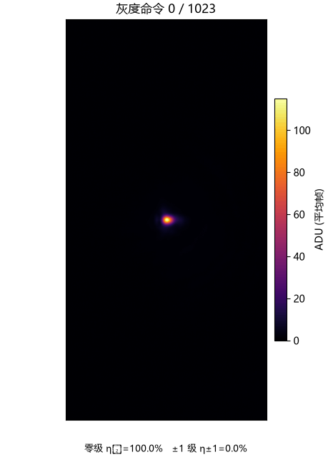
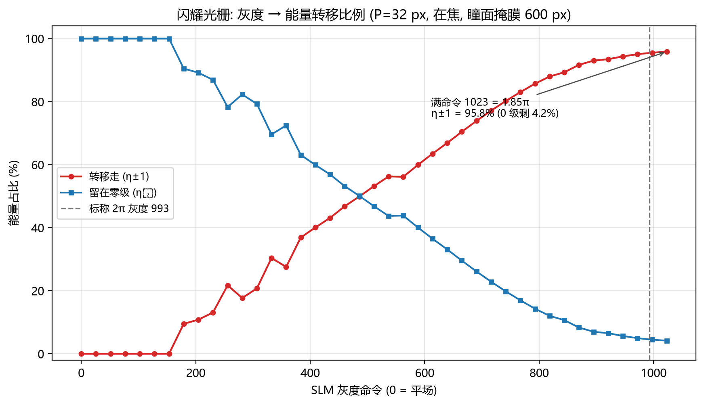

# 闪耀光栅衍射效率: 平面态 0 级能转移走多少能量

<!-- provenance:start -->
> **生成脚本**: [`scripts/slm/gen_diffraction_efficiency_hw_report.py`](../../../../scripts/slm/gen_diffraction_efficiency_hw_report.py)
> **复现命令**: `python scripts/slm/gen_diffraction_efficiency_hw_report.py`
> **数据/关联脚本**: [`scripts/slm/calib_geometry_from_orders.py`](../../../../scripts/slm/calib_geometry_from_orders.py)
> **数据/关联脚本**: [`src/ao_shaping/tools/slm/calibration/diffraction_efficiency/measure.py`](../../../../src/ao_shaping/tools/slm/calibration/diffraction_efficiency/measure.py)
> **数据/关联脚本**: [`src/ao_shaping/tools/slm/calibration/diffraction_efficiency/core.py`](../../../../src/ao_shaping/tools/slm/calibration/diffraction_efficiency/core.py)
> **运行环境**: 离线 (读已落盘的实测扫描 CSV)
> **说明**: 闪耀光栅实测衍射效率曲线 + 光斑演化 GIF: 在焦条件下器件满命令只有 1.89π, 0 级仍剩 4.2% —— 2π 灰度外推约 1083, 超出面板上限 1023, 因此“调灰度把 0 级彻底搬空”在这台器件上不可达; 同时给出离焦把深度抬高到 2.2π 的实测对比
<!-- provenance:end -->

## 结论一句话

在**在焦、重新标定**的条件下, 面板能给出的最大相位深度只有 **1.85π** (灰度 1023, 拟合残差 RMS 0.024) —— **达不到 2π**。所以满命令处零级还剩 **4.16%**, 也就是 **95.84%** 的光被转移出零级 (几乎全进 +1 级)。**剩下的 4.16% 不是光栅没做好, 而是相位行程不够 —— 无论怎么调灰度都搬不走。**

## 可视化

上图: 固定亮度标尺 (不是逐帧归一化), 所以零级**变暗**是真的变暗。从平场开始, 零级逐步熄灭、两侧一级亮起 (本光路轴交叉, ±1 沿**行**方向), 到满命令时零级只剩一个很弱的核。

## 为什么没有“2π 对应灰度”这个数

驱动读到的标称 2π 灰度是 993, 但**它不等于器件的真实 2π**。实测 + 拟合 (Δφ(u) = Δφ_max·u^γ) 给出:

| 量 | 值 | 说明 |
|---|---|---|
| 满命令 (1023) 处的真实深度 | **1.845π** | 拟合值 |
| 幂律指数 γ | 0.808 | < 1 = 亚线性 (低灰度段相位长得慢) |
| 未调制泄漏 ℓ | 0.51% | 即使 2π 也搬不走的固定底 |
| 反解出的 2π 灰度 | **1130** (由 γ 外推) | **超出面板上限 1023, 不可达** |

所以正确的问题不是“2π 对应多少灰度”, 而是: **这台器件在 1064 nm 下最多只能到 1.85π, 于是零级至少要留下 4.16% 的能量。**想再高只能改器件/波长 (增大相位行程), 不是调灰度能解决的。

## 与前一次(离焦)测量的对比 —— 深度虚高是怎么来的

同一台器件、同一周期, 在**未补偿离焦**的条件下拟合出的深度是 **2.20π**、满命令 η±1 = 98.8%; 在焦之后是 **1.85π**、95.84%。这正是 `report/slm/diffraction_efficiency/sim_nonideality_20261022.md` 预警的离焦偏置(仿真 +11%, 本次实测更大), 也是本工具把**在焦判定放在测量之前**的理由: 离焦曲线看着完全正常、残差也很小, 只有把光斑宽度钉住才看得见。

## 口径与前提 (引用这些数字前请先读)

* **扫描模式**: ``mode=gray`` —— 原始灰度直写, 绕开驱动的弧度→灰度管线, 测的是**器件本征**的灰度→相位关系。
* **周期**: P = 32 px; 方向: x 轴。
* **在焦**: 零级 FWHM 约 11.5 px (新光路最佳点 1/f = 0, 无需补偿)。
* **瞳面掩膜半径**: 600 px。⚠️ 不能沿用旧值: 实测 400/480/560/600 px 时满命令 η₀ 分别是 9.3%/5.4%/4.2%/4.0% —— 掩膜小于照明区时, 掩膜外的光不发光栅、直漏零级, 效率被系统性低估。
* **几何**: 零级中心 [963.0, 1221.0], 预期间距 234.80 px; 由 `scripts/slm/calib_geometry_from_orders.py` 单帧实测 (Kx=7513.5 / Ky=7507.7); 最大阶次定位残差 1.14 px。
* **轴交叉**: 本光路 SLM 的 x 轴在 CCD 上表现为**行**方向 (实测约 −89°), “+1 级在哪个方向”只能按实测落点, 不能按面板轴推。
* **归一化**: 三者和 (E₀+E₊₁+E₋₁), 所以通量/曝光漂移基本抵消, η₀ + η±1 ≡ 1。

## 已知限制

1. 这里测的是“进入 ±1 级的能量占比”, 不是“入射光的总衍射效率”; 后者还要扣掉高阶损耗与未调制泄漏。
2. 满命令附近仍在缓慢下降 → 真实 2π 在面板之外; 报告里的 2π 灰度是**由 γ 外推**得到的, 不是测到的点。
3. 只做了 P=32 px、单轴 (x) 一轮扫描; 未做周期/方向交叉验证。

## 产物

* 全量程扫描 (41 点, 含原始帧): `data/diffraction_efficiency/gifscan_20261023_1420/`
* 高精度确认段 (21 点, 每点 8 帧): `data/diffraction_efficiency/fine_newoptics_20261023_1415/`
* 图: `figures/transfer_vs_gray.png`, `figures/fine_scan.png`, `figures/spot_vs_gray.gif`
