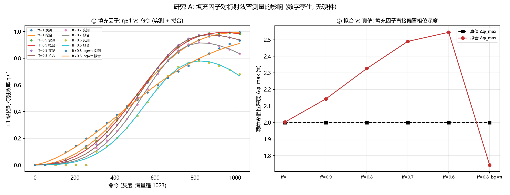
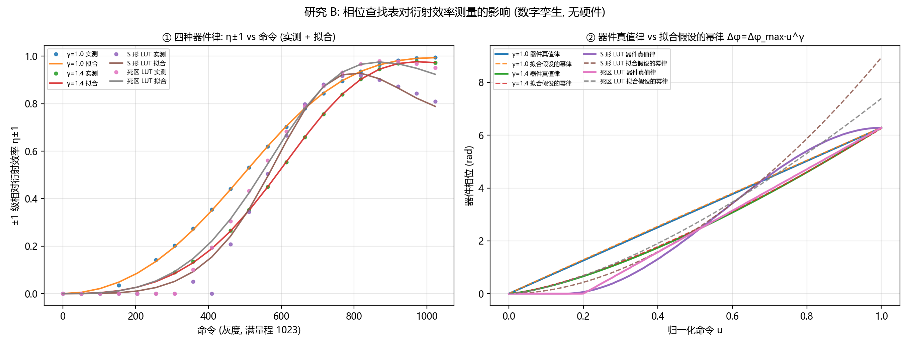
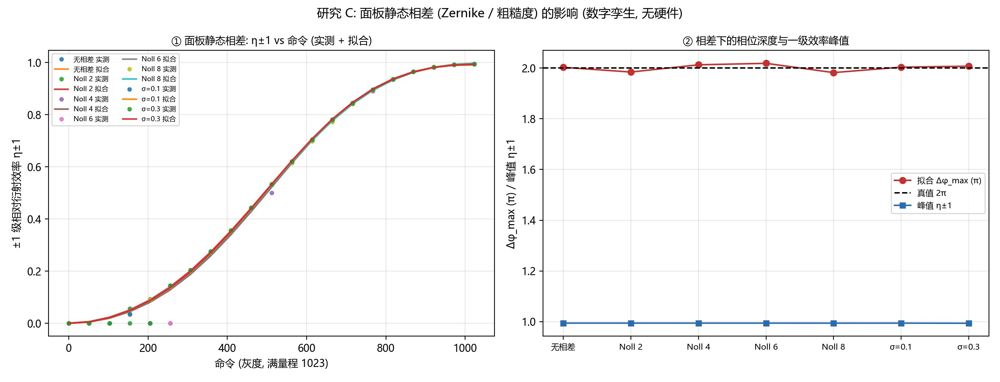
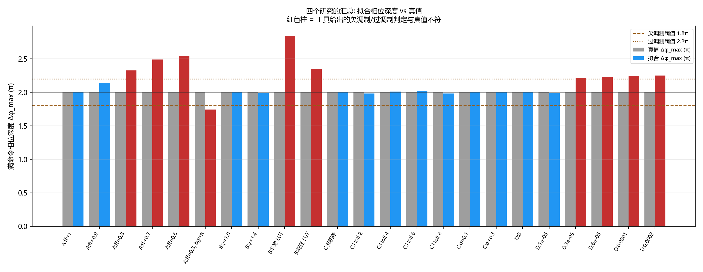
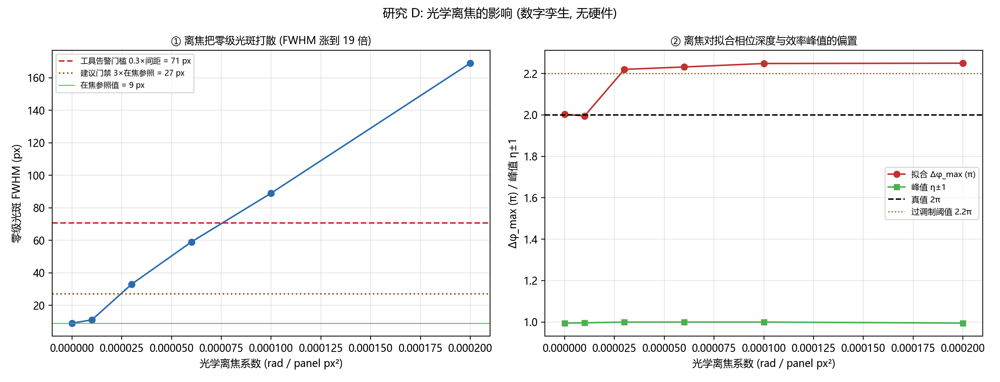

# 衍射效率标定工具的非理想因素仿真（2026-10-22）

<!-- provenance:start -->
> **生成脚本**: [`scripts/slm/generate_diffraction_efficiency_sim_report.py`](../../../scripts/slm/generate_diffraction_efficiency_sim_report.py)
> **复现命令**: `python scripts/slm/generate_diffraction_efficiency_sim_report.py`
> **数据/关联脚本**: [`src/ao_shaping/tools/slm/calibration/diffraction_efficiency/simulate.py`](../../../src/ao_shaping/tools/slm/calibration/diffraction_efficiency/simulate.py)
> **数据/关联脚本**: [`src/ao_shaping/tools/slm/calibration/diffraction_efficiency/core.py`](../../../src/ao_shaping/tools/slm/calibration/diffraction_efficiency/core.py)
> **运行环境**: 离线
> **说明**: 闪耀光栅衍射效率标定工具的非理想因素仿真 (填充因子 / 相位 LUT / 面板静态相差 / 光学离焦): 23 个工况里 10 个的欠调制-过调制判定与真值不符, 相位深度拟合偏差最大 +27% —— 工具的**相对效率曲线**可信, 拟合出的相位深度只在幂律器件上可信; 并给出光斑宽度门禁 (相对在焦参照值的倍数) 的行为与失效边界
<!-- provenance:end -->

**结论摘要 (全部为仿真, 无任何实验系统验证)**

**Q1 (仿真能否正确识别不同填充因子 / LUT 下的衍射效率?): 部分能, 但"相位深度"这一栏不可信。**
在本轮 23 个工况里, 工具对**一级衍射效率峰值**的读数本身是干净的
(全部工况的峰值 η±1 落在 0.7783–0.9994,
参照工况 0.9943); 但**满命令相位深度的拟合值**被显著偏置:
参照工况 (填充因子 1.0、幂律 γ=1.0、无相差、无离焦) 拟合出 2.0029π
(真值 2π, 偏差 +0.1 %), 而填充因子 0.8 的工况拟合出 2.3260π
(偏差 +16.3 %), 填充因子 0.6 拟合出 2.5444π (偏差 +27.2 %)。
**填充因子越小, 拟合出的相位深度越大** —— 工具把"死区损失"误读成了"相位调制更深"。
后果是判定直接翻转: 参照工况给出 nominal (正确), 而填充因子 0.8 给出
over (真值应为 nominal) —— **一个标称器件被报成过调制**。
更糟的是偏置的**方向本身不稳定**: 同样填充因子 0.8, 只把死区相位翻到 π,
偏差就变成 -12.8 % (判定变成 under) ⇒ 偏置既不可预测也不可校正。

**Q2 (相关参数 + 相差的影响有多大?): 相差本身几乎无害, 光学离焦才是主要威胁。**
面板静态相差 (Zernike 0.5 rad / 粗糙度 0.3 rad) 对拟合深度的影响在
0.2 %–0.9 %
量级, 判定全部正确; 真正把结果毁掉的是**光学离焦**: 离焦系数
3e-05 rad/panel px² 就把零级光斑的 FWHM 从
9.0 px 抬到 33.0 px, 并把拟合深度推到
2.2201π (偏差 +11.0 %), 判定同样翻转成 over;
离焦系数 6e-05 时深度偏差达 +11.6 %。
好在**工具现在会主动喊出来**, 但它**来得太晚**: 告警门槛是 FWHM > 0.3×间距 =
71 px, 而离焦 3e-05
(FWHM 33 px) 与 6e-05
(FWHM 59 px) 这两档的判定**已经翻掉了**, "零级仍亮"的扫描点上
却一次都没报警 (0/10、
0/10); 直到离焦 0.0001
(FWHM 89 px) 才 10/10 全报警。
⇒ **告警是症状, 不是门禁**。

**工具新加的光斑宽度门禁 (`--fwhm-gate-ratio` / `--reference-fwhm-px`) 也一样有边界:
默认的相对门禁抓不到"一直不在焦"** —— 离焦工况里所有点的 FWHM 都差不多, 比值 ≈ 1,
门禁全过 (违例 0/17, max 比
1.05×), 深度一点没变 (见 §光斑宽度门禁)。**只有绝对参照
(`--reference-fwhm-px 9.0`, 在焦那天量到的 FWHM) 才会让离焦工况
的每个点都越限 ⇒ 拟合**显式失败** (有效点 0), 那个偏了 +11.0 % 的深度
**根本报不出来**。⇒ 门禁的真正价值是「把静默的偏置变成显式的失败」。
反过来, **幂律 γ 本身是可以被正确测出来的**: γ=1.4 的工况拟合出 γ=1.3709
(偏差 -2.1 %), 深度 1.9915π
(偏差 -0.4 %) —— 因为拟合用的**离散器件模型**本来就带 γ 参数。
但换成显式 LUT 就全崩: S 形 LUT 拟合出深度 2.8466π
(偏差 +42.3 %)、γ=1.885, 死区 LUT 拟合出
2.3525π (偏差 +17.6 %) —— **单一幂律根本无法描述非幂律器件**,
拟合出的 γ 只是"凑出一条曲线"的等效参数, 没有物理意义。

**汇总**: 23 个工况中, 工具的 欠调制/标称/过调制 判定与真值不符的有
**10 个** (A:ff=0.8, A:ff=0.7, A:ff=0.6, A:ff=0.8, bg=π, B:S 形 LUT, B:死区 LUT, D:3e-05, D:6e-05, D:0.0001, D:0.0002);
拟合相位深度相对偏差超过 5 % 的有 **11 个**;
γ 相对偏差超过 10 % 的有 **9 个**
(LUT 工况无 γ 真值, 不计入)。







## 口径 (模拟了什么 / 没模拟什么)

**跑了什么**: 数字孪生 (`SimulatedBench`) + **与实验系统同一条**分析链路
(`core.run_sweep` → `core.fit_phase_response` → `core.diagnose`)。
器件真值 (相位深度 / γ / LUT) 只写在 `SimConfig` 里, 分析侧拿不到;
拟合结果出来之后才与真值对账 —— 验的是拟合链路本身, 不是"喂了答案"的自证。

| 量 | 值 |
|---|---|
| 瞳面 (pupil) 采样 | 240×240 采样点, 瞳面半径 480 面板像元 |
| 远场 | 零填充 FFT, padding = 8, 输出画幅 1400×1400 CCD px |
| 几何标定 K | 7546.4 CCD px / panel px ⇒ ±1 级预期间距 235.82 px |
| 光栅周期 | 32 面板像元 (轴向 = 面板 x) |
| 扫描 | 灰度 0→1023 共 21 点, 器件 2π 灰度 = 满量程 1023 |
| 器件真值 | 全部工况的满量程相位深度都是 2π (标称器件) |
| 噪声 / 探测器 | 暗电平 20 ADU (加性背景 (杂散光) 项) + 读出噪声 25 ADU, 满量程 65535 ADU |

**必须写明的近似与缺口**:

1. **填充因子是"相干场混合"的零阶近似, 不是真实器件的分区模型。** 数字孪生把
   每个瞳面采样点的复场写成 `ff·e^{iφ} + (1−ff)·e^{iφ_bg}`: 死区那一份是**常量**
   (没有空间调制), 因此只进零级, 而 ±1 级被整体乘以 `ff` (振幅) / `ff²` (能量)。
   真实器件的硬边矩形填充因子还会给每一阶乘一个 `sinc(m·p/P)` 包络, 并把死区的光
   送进像元衍射包络 —— 本模型把两者的零级贡献合并进混合项, **不包含**这一层。
   ⇒ 本报告的填充因子数字只能当作"工具在这种近似下的行为", 不能当作器件的绝对效率。
2. **LUT 研究是"用查找表取代幂律"**, 不是给幂律加噪声。`SimConfig.lut_table`
   一旦给出就完全替代 `depth_max_rad·u^γ`; 拟合侧仍然只假设幂律 ⇒ 这一栏测的
   正是"幂律假设在非幂律器件上失效多少"。
3. **面板静态相差加在瞳面网格上, 不是逐像元的面板缺陷。** 数字孪生把它作为
   瞳面相位 (240×240 瞳面采样网格, 半径 120 采样点) 乘上去, 即它模拟的是
   "光路/面板引入的波前相差", 不是"某个像元坏了"。Zernike 振幅按 Noll 归一化
   (单位振幅 = 该模式 RMS = 1 rad), 所以 0.5 rad = 该模式的 RMS 相差 0.5 rad。
4. **光学离焦是瞳面二次相位** `exp(i·c·r²)` (`c` = `defocus_coeff`, rad/panel px²),
   模拟"相机不在后焦面"; 数字孪生**没有**做焦面重采样, 所以离焦表现为光斑变糊
   而不是"重新对焦后的更小光斑"。
5. **没有模拟**: 波前矫正图、驱动的 弧度→灰度 管线、LC 稳定时间、相机帧缓存、
   偏振分量的相干叠加 (泄漏项只能作为"未调制的光"整体进入, 不能区分偏振与填充因子)、
   温度漂移、面板本身的像元级缺陷。**"填充因子" 与 "偏振不纯" 在本链路里是同一个
   可观测 (峰值 η±1 偏低), 原理上无法区分** —— 见 §结论。
6. **子像元采样带来的系统偏差 (数字孪生特有, 实验系统没有)**: 瞳面按
   4×4
   面板像元做复相量块平均, 对周期 32 的光栅相当于给每一阶乘一个
   `sinc(4/32)` 的像元孔径包络, 且该包络随命令变化。参照工况的残差
   (拟合 rms = 0.0198) 与 +0.1 % 的深度偏差主要来自这里;
   实验系统的面板像元孔径包络是 `sinc(1/32)` ≈ 0.999, 不存在这一层。
7. **零级光斑宽度的测量口径**: FWHM 与椭圆率在半径 **0.45×阶次间距**
   (106 px) 的大窗口里测 (不碰邻居阶次),
   **不是**在 0.08×间距 (19 px) 的能量积分 ROI 里测 ——
   在能量 ROI 里测会被截顶, 离焦时永远报一个"看起来正常"的小值。
   工具的"过宽"告警门槛是 FWHM > 0.3×间距 (71 px)。
   **在焦参照值 = 9.0 px** (本轮数字孪生, 预期间距
   235.8 px); 实验系统上必须用自己光路的平场帧重新量这个参照值。
   ⚠️ 表里的"零级 FWHM"取**零级最亮**的那个扫描点 (平场端); 高调制端零级被熄灭,
   那几点的 FWHM 是噪声底上的读数, 没有意义。
8. **光斑宽度门禁跑了两种模式**: ① **相对门禁** (工具默认) —— 参照值取本次扫描
   命令最小那一点的 FWHM, 抓"扫描过程中光斑变糊"; ② **绝对门禁** —— 参照值取
   **在焦那天量到的 9.0 px** (本轮数字孪生里由在焦参照工况给出),
   对应工具的 `--reference-fwhm-px`, 抓"这条光路一开始就不在焦"。
   两者都**跳过**零级被熄灭的点 (`min_eta_zero = 0.05`, 那些点的宽度是噪声底读数)
   ⇒ **任何按点数统计的告警/门禁都必须先剔除熄灭点**, 否则高调制端的噪声读数会把
   结论淹没 (见 §光斑宽度门禁)。门禁一旦**触发**, 那些被跳过的点也会跟着退出拟合
   (`fit_phase_response` 在 `gate.violations` 非空时把 `gate.skipped_indices` 一并剔除)
   ⇒ 离焦工况的有效点直接归零、拟合显式失败; 而**干净的扫描里被跳过的点照旧参与拟合**
   (它们信息量最大)。

## 研究 A: 填充因子


| 工况 | 真值 Δφ_max (π) | 拟合 Δφ_max (π) | 相对偏差 | 拟合 γ (真值) | 泄漏 ℓ | 峰值 η±1 (对应命令) | 判定 (真值) | 最大几何残差 (px) | 零级 FWHM (px) | 椭圆率 | 工具报警 (零级仍亮的点) | 相对门禁 (3×): 违例/评估 (max×) → 深度 |
|---|---|---|---|---|---|---|---|---|---|---|---|---|
| 填充因子 1.0 | 2.00 | 2.0029 | +0.1 % | 0.985 (1.00) | 0.0063 | 0.9943 (1023) | nominal (nominal) | 0.55 | 9.0 | 1.016 | 0/10 | 0/17 (max 1.00×) → 深度不变 |
| 填充因子 0.9 | 2.00 | 2.1427 | +7.1 % | 1.120 (1.00) | 0.0052 | 0.9912 (921) | nominal (nominal) | 0.38 | 9.0 | 1.018 | 0/10 | 0/16 (max 1.06×) → 深度不变 |
| 填充因子 0.8 | 2.00 | 2.3260 | +16.3 % **(!)** | 1.295 (1.00) | 0.0139 | 0.9783 (870) | over **(!)** (nominal) | 0.54 | 9.0 | 1.018 | 0/10 | 0/17 (max 1.11×) → 深度不变 |
| 填充因子 0.7 | 2.00 | 2.4897 | +24.5 % **(!)** | 1.443 (1.00) | 0.0626 | 0.9184 (818) | over **(!)** (nominal) | 0.22 | 9.0 | 1.018 | 0/11 | 0/21 (max 1.11×) → 深度不变 |
| 填充因子 0.6 | 2.00 | 2.5444 | +27.2 % **(!)** | 1.499 (1.00) | 0.1934 | 0.7783 (818) | over **(!)** (nominal) | 0.19 | 9.0 | 1.016 | 0/12 | 0/21 (max 1.06×) → 深度不变 |
| 填充因子 0.8, 死区相位 π | 2.00 | 1.7439 | -12.8 % **(!)** | 0.687 (1.00) | 0.0000 | 0.9334 (1023) | under **(!)** (nominal) | 52.34 | 9.0 | 1.016 | 0/11 | 0/21 (max 1.11×) → 深度不变 |

读数:

* 填充因子从 1.0 降到 0.6, 拟合相位深度从 2.0029π 单调升到
  2.5444π —— **方向是反的**: 填充因子低意味着"更多光没被调制",
  工具却报出"相位调得更深"。
* 拟合的泄漏项 ℓ 随填充因子单调抬升: 0.9 → 0.0052,
  0.8 → 0.0139, 0.7 → 0.0626,
  0.6 → 0.1934。也就是说 **填充因子的损失大部分被记成了"相位更深"
  而不是"泄漏"** (填充因子 0.8 时 ℓ 只有 0.0139, 而深度偏了 +16.3 %)。
  原因在口径 §1: 数字孪生的填充因子把 ±1 级乘以 `ff` (能量 ff²), 而拟合模型的泄漏项是
  "把 (1−ℓ) 份额的光原样留在零级" —— 两个模型结构不同, 拟合只能用"更深的相位 + 更陡的
  幂律"去补偿, 于是深度被抬高、泄漏被压低。
* 峰值 η±1 随填充因子从 0.9943 降到 0.7783
  (填充因子 0.6) —— 有信号, 但**远小于同工况的深度偏置 (+27.2 %)**,
  而且单调平缓 ⇒ 靠"峰值效率偏低"去判填充因子, 灵敏度只有靠相位深度的一半,
  且两者会给出互相矛盾的结论 (效率说"只差一点", 深度说"偏了三成")。
* 死区相位翻到 π 的对照工况 (填充因子 0.8) 给出深度 1.7439π
  (偏差 -12.8 %)、峰值 η±1 0.9334 —— 与同填充因子、零相位
  的工况 (2.3260π / 0.9783) 相比, **偏置从 +16.3 % 翻到 -12.8 %**:
  死区那一份光与零级**相干干涉**, 干涉的符号取决于死区相位, 于是拟合出的深度
  既可以偏大也可以偏小 ⇒ **偏置连方向都不稳定, 没有任何事后校正的可能**。
  这也解释了峰值 η±1 为什么反而更高 (0.9334 vs 0.9783):
  死区相位翻转让零级多收到一份干涉光。
* 该工况还有一个附带发现: 它是全部 23 个工况里**唯一**触发工具几何告警的 ——
  最大几何残差 52.34 px (预期间距的 22.2 %),
  远超工具 10 % 的门槛; 但那**只来自一个点** (u = 0.10, 该点 η±1 = 0.016,
  正好卡在检出下限上), 其余 20 个点的残差都 < 0.4 px
  (只看 η±1 ≥ 5 % 的点, 最大残差 0.39 px)
  ⇒ **几何告警会被"检出下限附近的边际点"触发假阳性**, 不能直接当作"光路动过了"。

## 研究 B: 相位查找表 (LUT)


| 工况 | 真值 Δφ_max (π) | 拟合 Δφ_max (π) | 相对偏差 | 拟合 γ (真值) | 泄漏 ℓ | 峰值 η±1 (对应命令) | 判定 (真值) | 最大几何残差 (px) | 零级 FWHM (px) | 椭圆率 | 工具报警 (零级仍亮的点) | 相对门禁 (3×): 违例/评估 (max×) → 深度 |
|---|---|---|---|---|---|---|---|---|---|---|---|---|
| 幂律 γ=1.0 (参照) | 2.00 | 2.0029 | +0.1 % | 0.985 (1.00) | 0.0063 | 0.9943 (1023) | nominal (nominal) | 0.55 | 9.0 | 1.016 | 0/10 | 0/17 (max 1.00×) → 深度不变 |
| 幂律 γ=1.4 | 2.00 | 1.9915 | -0.4 % | 1.371 (1.40) | 0.0077 | 0.9777 (972) | nominal (nominal) | 0.41 | 9.0 | 1.016 | 0/12 | 0/18 (max 1.06×) → 深度不变 |
| S 形 LUT (前 15 % 平坦, 后 smoothstep 升到 2π) | 2.00 | 2.8466 | +42.3 % **(!)** | 1.885 (—) | 0.0000 | 0.9188 (818) | over **(!)** (nominal) | 0.29 | 9.0 | 1.016 | 0/11 | 0/21 (max 1.06×) → 深度不变 |
| 死区 LUT (前 20 % 相位为 0, 后线性升到 2π) | 2.00 | 2.3525 | +17.6 % **(!)** | 1.481 (—) | 0.0000 | 0.9798 (870) | over **(!)** (nominal) | 0.31 | 9.0 | 1.018 | 0/11 | 0/16 (max 1.00×) → 深度不变 |

读数:

* **幂律器件可以测准**: γ=1.0 → 深度 2.0029π (偏差 +0.1 %),
  γ=1.4 → 深度 1.9915π (偏差 -0.4 %)、γ=1.3709
  (偏差 -2.1 %)。拟合模型带 γ 参数, 所以这一栏是**可用的**。
* **非幂律器件直接崩掉**: S 形 LUT 拟合出深度 2.8466π (偏差 +42.3 %)、
  γ=1.885; 死区 LUT 拟合出 2.3525π (偏差 +17.6 %)、
  γ=1.481。两者的 γ 都不是"器件的 γ" —— 器件根本没有 γ。
  图 ② 里能看到拟合假设的幂律与器件真值律的形状差得多: S 形 LUT 的最大偏差
  2.660 rad (rms 0.819 rad),
  死区 LUT 1.107 rad (rms 0.540 rad),
  而幂律工况只有 0.039 rad 量级。
* 判定同样不可信: S 形 LUT 判 over、死区 LUT 判 over,
  而两者的真值都是标称 (2π 落在 1.8π–2.2π 之间)。
* 工程含义: **"用幂律拟合出的 γ" 只有在器件确实是幂律时才有意义**。
  真实器件出厂标定出来的是查找表, 所以本工具在真实器件上给出的 γ 很可能是
  "拟合出来的等效参数"而不是物理量 —— 用来做线性化查表 (remap) 尚可, 用来报告
  "器件的 γ" 不可信。

## 研究 C: 面板静态相差


| 工况 | 真值 Δφ_max (π) | 拟合 Δφ_max (π) | 相对偏差 | 拟合 γ (真值) | 泄漏 ℓ | 峰值 η±1 (对应命令) | 判定 (真值) | 最大几何残差 (px) | 零级 FWHM (px) | 椭圆率 | 工具报警 (零级仍亮的点) | 相对门禁 (3×): 违例/评估 (max×) → 深度 |
|---|---|---|---|---|---|---|---|---|---|---|---|---|
| 无相差 (参照) | 2.00 | 2.0029 | +0.1 % | 0.985 (1.00) | 0.0063 | 0.9943 (1023) | nominal (nominal) | 0.55 | 9.0 | 1.016 | 0/10 | 0/17 (max 1.00×) → 深度不变 |
| Zernike Noll 2 倾斜 (1,1), 0.5 rad | 2.00 | 1.9844 | -0.8 % | 0.966 (1.00) | 0.0027 | 0.9943 (1023) | nominal (nominal) | 2.17 | 9.5 | 1.017 | 0/10 | 0/17 (max 1.05×) → 深度不变 |
| Zernike Noll 4 离焦 (2,0), 0.5 rad | 2.00 | 2.0128 | +0.6 % | 1.013 (1.00) | 0.0080 | 0.9943 (1023) | nominal (nominal) | 0.55 | 11.0 | 1.016 | 0/10 | 0/17 (max 1.00×) → 深度不变 |
| Zernike Noll 6 像散 (2,2), 0.5 rad | 2.00 | 2.0187 | +0.9 % | 1.006 (1.00) | 0.0088 | 0.9943 (1023) | nominal (nominal) | 0.55 | 11.0 | 1.016 | 0/10 | 0/17 (max 1.00×) → 深度不变 |
| Zernike Noll 8 彗差 (3,1), 0.5 rad | 2.00 | 1.9821 | -0.9 % | 0.972 (1.00) | 0.0029 | 0.9942 (1023) | nominal (nominal) | 3.09 | 10.0 | 1.018 | 0/10 | 0/17 (max 1.05×) → 深度不变 |
| 表面粗糙度 σ=0.1 rad | 2.00 | 2.0036 | +0.2 % | 0.984 (1.00) | 0.0062 | 0.9942 (1023) | nominal (nominal) | 0.55 | 9.0 | 1.016 | 0/10 | 0/17 (max 1.00×) → 深度不变 |
| 表面粗糙度 σ=0.3 rad | 2.00 | 2.0074 | +0.4 % | 0.984 (1.00) | 0.0070 | 0.9938 (1023) | nominal (nominal) | 0.55 | 9.0 | 1.016 | 0/10 | 0/17 (max 1.06×) → 深度不变 |

读数:

* 四个 0.5 rad 的 Zernike (倾斜 (1,1) / 离焦 (2,0) / 像散 (2,2) / 彗差 (3,1))
  与两种粗糙度 (σ = 0.1 / 0.3 rad) 对拟合深度的影响都在
  0.2 %–0.9 % 量级,
  判定全部为 nominal (与真值一致) ⇒ **低阶面板相差不是本工具的威胁**。
* 物理原因: 相差是**空间缓变**的, 它主要把光斑的能量从零级挪到邻近区域 (零级光斑
  变宽、椭圆率略升), 而 ±1 级的**总能量**几乎不变 ⇒ 效率比值 η±1 动得很少。
* 粗糙度 σ=0.3 rad (逐像元随机) 的工况拟合深度 2.0074π
  (偏差 +0.4 %)、峰值 η±1 0.9938 —— 逐像元随机相位会把
  一级能量**摊到相邻阶次**, 但在总能量归一化 (E0+E+1+E−1) 的口径下, 摊走的能量
  里有一部分仍落在 ±1 的积分圆内, 所以效率读数几乎不动。
* 几何残差最大 3.09 px
  (预期间距 235.8 px 的 1.31 %),
  远低于工具 10 % 的告警门槛 ⇒ **相差不会破坏几何标定的核对**。

## 研究 D: 光学离焦


| 工况 | 真值 Δφ_max (π) | 拟合 Δφ_max (π) | 相对偏差 | 拟合 γ (真值) | 泄漏 ℓ | 峰值 η±1 (对应命令) | 判定 (真值) | 最大几何残差 (px) | 零级 FWHM (px) | 椭圆率 | 工具报警 (零级仍亮的点) | 相对门禁 (3×): 违例/评估 (max×) → 深度 |
|---|---|---|---|---|---|---|---|---|---|---|---|---|
| 光学离焦 0 rad/panel px² | 2.00 | 2.0029 | +0.1 % | 0.985 (1.00) | 0.0063 | 0.9943 (1023) | nominal (nominal) | 0.55 | 9.0 | 1.016 | 0/10 | 0/17 (max 1.00×) → 深度不变 |
| 光学离焦 1e-05 rad/panel px² | 2.00 | 1.9951 | -0.2 % | 1.042 (1.00) | 0.0041 | 0.9960 (1023) | nominal (nominal) | 0.55 | 11.0 | 1.016 | 0/10 | 0/17 (max 1.00×) → 深度不变 |
| 光学离焦 3e-05 rad/panel px² | 2.00 | 2.2201 | +11.0 % **(!)** | 1.443 (1.00) | 0.0000 | 0.9992 (1023) | over **(!)** (nominal) | 3.79 | 33.0 | 1.084 | 0/10 | 0/17 (max 1.05×) → 深度不变 |
| 光学离焦 6e-05 rad/panel px² | 2.00 | 2.2317 | +11.6 % **(!)** | 1.442 (1.00) | 0.0000 | 0.9994 (1023) | over **(!)** (nominal) | 5.61 | 59.0 | 1.040 | 0/10 | 0/17 (max 1.03×) → 深度不变 |
| 光学离焦 0.0001 rad/panel px² | 2.00 | 2.2484 | +12.4 % **(!)** | 1.441 (1.00) | 0.0000 | 0.9994 (1023) | over **(!)** (nominal) | 0.42 | 89.0 | 1.064 | **10/10** | 0/17 (max 1.00×) → 深度不变 |
| 光学离焦 0.0002 rad/panel px² | 2.00 | 2.2499 | +12.5 % **(!)** | 1.462 (1.00) | 0.0000 | 0.9946 (1023) | over **(!)** (nominal) | 97.48 | 169.0 | 1.479 | **10/10** | 0/17 (max 1.17×) → 深度不变 |

读数:

* 零级光斑的 FWHM (现在在半径 0.45×阶次间距 = 106 px 的大窗口里测,
  不再被 0.08×间距 = 19 px 的能量积分 ROI 截顶) 随离焦系数
  从 9.0 px 涨到 169.0 px
  (约 18.8 倍)。
  **阶次间距只有 235.8 px**, 所以最大的那个工况里零级光斑
  已经和 ±1 级同宽 ⇒ 那几帧根本不是"可分辨的阶次", 效率读数没有意义。
  (在焦参照值: 9.0 px —— 这就是后面"参照值"的来历。)
* 拟合相位深度随之从 2.0029π 涨到 2.2499π
  (偏差 +12.5 %), 判定在离焦系数 3e-05 处
  就已经翻成 over —— **一个完全标称的器件被报成过调制**。
* 但**峰值 η±1 反而更高** (0.9943 → 0.9946) ⇒
  离焦的坏处**不在效率读数上, 而在相位深度上**。机制: 离焦把零级与 ±1 级**同时**抹开,
  而能量积分圆的半径是按几何间距取的**固定值** ⇒ 每个光斑有多少能量落在圆内随光斑
  宽度而变, 这正是 η±1(u) 曲线的**形状**被改变的原因, 而拟合吃的正是形状
  (不是峰值) ⇒ 它把这条被改过的曲线读成"相位更深"。
  **实践含义: 离焦在效率读数上几乎不留痕迹** —— 只能靠光斑宽度暴露。
* **工具现在会主动报警, 但它来得太晚**: 告警门槛是 FWHM > 0.3×间距 =
  71 px。本轮离焦 3e-05
  (FWHM 33 px) 与 6e-05
  (FWHM 59 px) 的工况里, **零级仍亮着的扫描点一个都没报警**
  (0/10 与 0/10),
  而这两个工况的判定**已经翻掉了**; 直到离焦 0.0001
  (FWHM 89 px) 才开始 10/10 全报警。
  ⇒ **告警是症状, 不是门禁**: 它只在"已经不可信"之后才喊。
  ⇒ 真正的门禁必须用 FWHM 相对**在焦参照值** (9.0 px) 的倍数自己定
  (见 §结论 3(a)): 本轮 3e-05 那一档是
  3.7 倍参照值, 判定已经错了。
* ⚠️ 报警是**逐点**的, 而高调制端零级被熄灭 ⇒ 那几点的"宽度"是噪声底上的读数,
  所以**参照工况里也有 2 个点报警** (u = 0.95 与 1.0, 与离焦无关;
  填充因子低的工况连这两个点都不报警, 因为零级始终很强)。
  表里给的是**零级仍亮着的点**上的报警数 (分母 = 零级仍亮的点数) —— 那才是与离焦相关的。
* 几何残差: 离焦 ≤ 6e-05 时残差只有
  5.61 px
  (预期间距的 2.38 %),
  **抓不到离焦**; 只有到 0.0002 (光斑已经和 ±1 级同宽)
  残差才炸到 97.48 px
  (预期间距的 41 %),
  那时工具的"几何标定可能已过期"告警才响 —— 但那时读数早就没意义了。
* 椭圆率最大 1.479 (1.0 = 圆) —— 离焦是
  对称的, 主要表现为变糊而不是变扁, 所以椭圆率不是可靠的离焦指示器。

## 光斑宽度门禁: 相对门禁抓不到"一直不在焦", 绝对参照才是实验系统要用的模式

工具新增了两件事 (本报告全程走的就是这条新链路):

* `core.evaluate_fwhm_gate(points, reference_fwhm_px=None, gate_ratio=3.0, min_eta_zero=0.05)`
  —— 参照值默认取**命令最小**那一点 (平相位) 的零级 FWHM; 门限 = 倍数 × 参照值;
  **零级被熄灭 (`eta_zero < 0.05`) 的点被跳过、不判违规** (那里的"宽度"是噪声底读数)。
* `core.fit_phase_response(..., gate=...)` 把越限的点从拟合里剔除;
  `core.diagnose(..., gate=...)` 额外给出 `fwhm_gate` 与 `modulation_verdict_trustworthy`。
  CLI: `--fwhm-gate-ratio` (默认 3.0) 与 `--reference-fwhm-px`。

本轮把**两条门禁**各跑了一遍 (相对门禁 = 工具默认; 绝对门禁 = 参照值取
**在焦那天的 9.0 px**, 对应 `--reference-fwhm-px 9.0`):

| 工况 | 相对门禁参照值 | 相对门禁 → 深度 (违例/评估, max 比) | 绝对门禁 → 深度 | 绝对门禁的失败信息 | 绝对门禁下判定可信? |
|---|---|---|---|---|---|
| A: ff=1 | 9.0 px | 0/17 (max 1.00×) → 深度不变 | 0/17 → 深度不变 | — | 是 |
| A: ff=0.9 | 9.0 px | 0/16 (max 1.06×) → 深度不变 | 0/16 → 深度不变 | — | 是 |
| A: ff=0.8 | 9.0 px | 0/17 (max 1.11×) → 深度不变 | 0/17 → 深度不变 | — | 是 |
| A: ff=0.7 | 9.0 px | 0/21 (max 1.11×) → 深度不变 | 0/21 → 深度不变 | — | 是 |
| A: ff=0.6 | 9.0 px | 0/21 (max 1.06×) → 深度不变 | 0/21 → 深度不变 | — | 是 |
| A: ff=0.8, bg=π | 9.0 px | 0/21 (max 1.11×) → 深度不变 | 0/21 → 深度不变 | — | 是 |
| B: γ=1.0 | 9.0 px | 0/17 (max 1.00×) → 深度不变 | 0/17 → 深度不变 | — | 是 |
| B: γ=1.4 | 9.0 px | 0/18 (max 1.06×) → 深度不变 | 0/18 → 深度不变 | — | 是 |
| B: S 形 LUT | 9.0 px | 0/21 (max 1.06×) → 深度不变 | 0/21 → 深度不变 | — | 是 |
| B: 死区 LUT | 9.0 px | 0/16 (max 1.00×) → 深度不变 | 0/16 → 深度不变 | — | 是 |
| C: 无相差 | 9.0 px | 0/17 (max 1.00×) → 深度不变 | 0/17 → 深度不变 | — | 是 |
| C: Noll 2 | 9.5 px | 0/17 (max 1.05×) → 深度不变 | 0/17 → 深度不变 | — | 是 |
| C: Noll 4 | 11.0 px | 0/17 (max 1.00×) → 深度不变 | 0/17 → 深度不变 | — | 是 |
| C: Noll 6 | 11.0 px | 0/17 (max 1.00×) → 深度不变 | 0/17 → 深度不变 | — | 是 |
| C: Noll 8 | 10.0 px | 0/17 (max 1.05×) → 深度不变 | 0/17 → 深度不变 | — | 是 |
| C: σ=0.1 | 9.0 px | 0/17 (max 1.00×) → 深度不变 | 0/17 → 深度不变 | — | 是 |
| C: σ=0.3 | 9.0 px | 0/17 (max 1.06×) → 深度不变 | 0/17 → 深度不变 | — | 是 |
| D: 0 | 9.0 px | 0/17 (max 1.00×) → 深度不变 | 0/17 → 深度不变 | — | 是 |
| D: 1e-05 | 11.0 px | 0/17 (max 1.00×) → 深度不变 | 0/17 → 深度不变 | — | 是 |
| D: 3e-05 | 33.0 px | 0/17 (max 1.05×) → 深度不变 | 17/17 → **拟合失败** (有效点 0) | **有效扫描点不足 3 个 (得到 0) (其中 21 个被光斑宽度门禁剔除), 无法拟合** | **否** |
| D: 6e-05 | 59.0 px | 0/17 (max 1.03×) → 深度不变 | 17/17 → **拟合失败** (有效点 0) | **有效扫描点不足 3 个 (得到 0) (其中 21 个被光斑宽度门禁剔除), 无法拟合** | **否** |
| D: 0.0001 | 89.0 px | 0/17 (max 1.00×) → 深度不变 | 17/17 → **拟合失败** (有效点 0) | **有效扫描点不足 3 个 (得到 0) (其中 21 个被光斑宽度门禁剔除), 无法拟合** | **否** |
| D: 0.0002 | 169.0 px | 0/17 (max 1.17×) → 深度不变 | 17/17 → **拟合失败** (有效点 0) | **有效扫描点不足 3 个 (得到 0) (其中 21 个被光斑宽度门禁剔除), 无法拟合** | **否** |

### 结论 1: 相对门禁抓不到"一直不在焦"

研究 D 里每个工况的**所有**点的 FWHM 都差不多 (离焦是**均匀**的, 不是扫描过程中变的),
所以"当前 FWHM / 本次扫描自己的平场 FWHM"这个比值 ≈ 1, 门禁**全过**:
离焦 3e-05 的工况相对门禁参照值 = 33.0 px,
违例 0/17
(max 比 1.05×), 深度**一点没变**
(2.2201π, 偏差 +11.0 %) —— 偏置原封不动地留了下来。

⇒ **相对门禁抓的是"扫描过程中光斑变糊"** (机械漂移 / 热漂移 / 焦面移动),
**抓不到"这条光路一开始就不在焦"**。对后者它完全无能为力。

### 结论 2: 绝对参照才是实验系统要用的模式 —— 偏置的深浅本身不重要, "出不出来"才重要

把在焦那天量到的 FWHM (9.0 px) 传给 `--reference-fwhm-px`,
门限就变成 3×9.0 = 27 px,
于是离焦工况的**每一个**被评估的点都越限:

* 离焦 3e-05 (FWHM 33 px):
  违例 17/17
  → **拟合显式失败** (有效点 0): 「有效扫描点不足 3 个 (得到 0) (其中 21 个被光斑宽度门禁剔除), 无法拟合」
* 离焦 6e-05 (FWHM 59 px):
  违例 17/17 → 「有效扫描点不足 3 个 (得到 0) (其中 21 个被光斑宽度门禁剔除), 无法拟合」
* 离焦 0.0002 (FWHM 169 px):
  违例 17/17
  → 「有效扫描点不足 3 个 (得到 0) (其中 21 个被光斑宽度门禁剔除), 无法拟合」
* 而**在焦/其余工况** (研究 A/B/C + 离焦 0 与 1e-05) 的绝对门禁违例数都是 0,
  深度不变 ⇒ 绝对参照不会误伤正常测量。

⇒ **绝对参照下, 离焦工况的拟合显式失败 (有效点 0), 而不是给出一个偏了的深度** ——
那个偏了 +11.0 %…+12.5 % 的深度**根本不会被报出来**;
`diagnose` 也会把 `modulation_verdict_trustworthy` 置为 False。
⇒ **门禁的真正价值是「把静默的偏置变成显式的失败」**, 而不是"把深度算得更准"
(它并不改数, 它只是让不该有的数**出不来**)。

**为什么能失败得这么干净**: 门禁一旦触发, 整轮扫描就不可信了 ⇒ 被剔除的点
**加上**那些"因为零级被熄灭而跳过宽度评估"的点会**一起**退出拟合
(`fit_phase_response` 在 `gate.violations` 非空时把 `gate.skipped_indices` 也剔掉)。
离焦工况于是 17 个越限点 + 4 个被跳过的点
= 21 个点**全部**退出, 有效点 0 ⇒ 拟合抛错。
⇒ 反过来, **干净的扫描里被跳过的点仍然参与拟合** (它们信息量最大),
所以这道"全丢"只在门禁真的触发时才发生。

## 检出下限对拟合的影响 (稳健性对照)

一级衍射并不是从 u=0 就可见: 零级光斑自带一圈 Airy 旁瓣环 (数字孪生上实测旁瓣峰值
≈ 零级峰值的 8 %), 而一级衍射的峰值在低调制端只有几个百分点 —— 低于旁瓣环时,
工具找不到一级光斑, 把该点的一级效率**记为 0** 并在 `notes` 里写明
"几何预测窗口内没有一级衍射光斑"。**那是探测下限, 不是物理零**。

下表是同一批扫描点、只把命令段限制在 u ≥ 0.30 之后重拟合的结果
(分析侧仍然拿不到真值):

| 工况 | 全部扫描点拟合 Δφ_max (π) | 仅可探测段拟合 Δφ_max (π) | 差 | 可探测点数 |
|---|---|---|---|---|
| A: ff=1 | 2.0029 | 1.9876 | -0.0478π | 15 |
| A: ff=0.9 | 2.1427 | 2.1363 | -0.0201π | 15 |
| A: ff=0.8 | 2.3260 | 2.3085 | -0.0552π | 15 |
| A: ff=0.7 | 2.4897 | 2.4733 | -0.0516π | 15 |
| A: ff=0.6 | 2.5444 | 2.5324 | -0.0378π | 15 |
| A: ff=0.8, bg=π | 1.7439 | 1.7427 | -0.0036π | 15 |
| B: γ=1.0 | 2.0029 | 1.9876 | -0.0478π | 15 |
| B: γ=1.4 | 1.9915 | 1.9784 | -0.0413π | 15 |
| B: S 形 LUT | 2.8466 | 2.8426 | -0.0124π | 15 |
| B: 死区 LUT | 2.3525 | 2.3343 | -0.0572π | 15 |
| C: 无相差 | 2.0029 | 1.9876 | -0.0478π | 15 |
| C: Noll 2 | 1.9844 | 1.9861 | +0.0052π | 15 |
| C: Noll 4 | 2.0128 | 1.9814 | -0.0989π | 15 |
| C: Noll 6 | 2.0187 | 1.9878 | -0.0970π | 15 |
| C: Noll 8 | 1.9821 | 1.9764 | -0.0180π | 15 |
| C: σ=0.1 | 2.0036 | 1.9884 | -0.0477π | 15 |
| C: σ=0.3 | 2.0074 | 1.9895 | -0.0563π | 15 |
| D: 0 | 2.0029 | 1.9876 | -0.0478π | 15 |
| D: 1e-05 | 1.9951 | 1.9612 | -0.1067π | 15 |
| D: 3e-05 | 2.2201 | 2.1665 | -0.1686π | 15 |
| D: 6e-05 | 2.2317 | 2.1782 | -0.1679π | 15 |
| D: 0.0001 | 2.2484 | 2.1945 | -0.1694π | 15 |
| D: 0.0002 | 2.2499 | 2.2011 | -0.1534π | 15 |

读数: 参照工况在两种口径下分别给出 2.0029π 与 1.9876π,
差别不大; 但填充因子 0.6 从 2.5444π 变成 2.5324π,
离焦 6e-05 从 2.2317π 变成 2.1782π
⇒ **低端的"记 0"点确实会把深度进一步推高**, 但把低位剔除之后, 偏置**并没有消失** ——
说明主因是模型失配 (填充因子 / 离焦改变了 η±1(u) 的形状), 而不是检出下限。
**工程结论: 扫描点数不必多, 但命令段必须覆盖到 η±1 峰值附近; 低位"记 0"的点
会系统性地把相位深度推高。**

## 结论与对实验系统操作的影响

1. **工具能可靠给出的**: 一级衍射效率的**峰值** (±1 级相对能量的最大值) 与它出现的
   命令; ±1 级与零级的**几何位置** —— 在正常工况里 (填充因子/相差/离焦 ≤ 6e-5),
   只看 η±1 ≥ 5 % 的点, 残差全程 ≤ 5.61 px
   (预期间距的 2.38 %)
   ⇒ 几何标定的核对是可用的; 幂律器件的 **γ** (γ=1.4 测得 1.3709,
   偏差 -2.1 %)。
   ⚠️ 两个例外必须分开看:
   ① **假阳性** —— 填充因子 0.8 + 死区相位 π 的工况最大残差 52.34 px
   (预期间距的 22.2 %),
   但那**只来自一个点** (u = 0.10, 该点 η±1 = 0.016, 卡在检出下限上), 其余点的残差
   < 0.4 px; 工具会因此报"几何标定可能已过期" ⇒ 实验系统上应当**先剔除一级效率过低的点**
   再核对间距。
   ② **真信号** —— 离焦 0.0002 的工况残差
   97.48 px (预期间距的
   41 %), 那时零级已经
   和 ±1 级同宽 ⇒ 几何核对与"过宽"告警这时是一致的, 是真·不可分辨。
2. **工具不能可靠给出的**: **满命令相位深度**。在填充因子 ≤ 0.8、离焦
   ≥ 3e-05 rad/panel px²、非幂律器件这三种情形里, 拟合深度
   分别偏 +16.3 %、+11.0 %、+42.3 %; 而把死区相位翻到 π
   的对照工况偏 -12.8 % —— **偏置的量级是十几个到几十个百分点, 连方向都不稳定**
   ⇒ 也就是说 **"欠调制/过调制" 这个判定在有填充因子损失或有离焦的实验系统上会假阳性,
   而且无法靠一个固定改正量救回来**。本轮 23 个工况里判定错误的就有 10 个。
3. **欠调制/过调制判定能不能信? 在默认配置下不能信, 必须加两个前置条件**:
   (a) **零级光斑必须够窄** —— 这件事**工具现在自己会做** (光斑宽度门禁
   `evaluate_fwhm_gate` / `fit_phase_response(gate=...)` / `diagnose(gate=...)`,
   CLI `--fwhm-gate-ratio` 默认 3.0)。但**必须用绝对参照**:
   用 `--reference-fwhm-px` 给一条**在焦那天量到的**零级 FWHM
   (本轮数字孪生里是 9.0 px; 实验系统上要用自己光路的平场帧量出来),
   门限 = 3×参照值 = 27 px。
   **只给相对参照值 (工具默认) 是不够的**: 它抓的是"扫描过程中光斑变糊",
   抓不到"这条光路一开始就不在焦" —— 本轮离焦 3e-05
   的工况在相对门禁下违例 0/17
   (max 比 1.05×, 深度不变), 换成绝对参照就
   17/17 全越限、拟合**直接失败**。
   ⇒ 门禁的价值是"**把静默的偏置变成显式的失败**", 不是"把深度算得更准":
   本轮离焦 3e-05 的工况在**相对**门禁下
   违例 0/17
   (max 比 1.05×, 深度不变), 换成**绝对**参照就是
   17/17 全越限 ——
   **拟合显式失败** (有效点 0, 抛「有效扫描点不足 3 个 (得到 0) (其中 21 个被光斑宽度门禁剔除), 无法拟合」), 那个偏了 +11.0 % 的深度
   再也报不出来, `modulation_verdict_trustworthy` 变成 False。
   ⇒ 报告相位深度时**仍要同时报出零级 FWHM 与在焦参照值的比值**。
   (b) **必须先用同一个器件把"相位深度 vs 灰度"标定过一遍**, 或者至少用一只已知
   2π 灰度的参考件确认峰值 η±1 的量级 —— 因为"峰值 η±1 偏低"与"相位深度偏大"在
   本链路里是**同一个效应的两种表述**。
4. **离焦补偿是不是必须的? 在本仿真口径下是必须的** —— 而且补偿应当做在**扫描之前**
   (把离焦当成被测光路的一部分先消掉), 不是事后修正数字。理由: 离焦改变的是
   η±1(u) 曲线的**形状**, 拟合用的是形状, 事后只能靠"再调 Δφ_max"去补, 而那正是
   被离焦污染过的量。注意本工具的灰度直写模式 (绕开驱动管线) **无法**叠加菲涅尔
   离焦补偿 (补偿必须由驱动做), 所以实验系统上要么改用命令弧度模式, 要么先物理对焦。
   工具新增的「阶次不可分辨, 本点读数不可信 (先做离焦补偿)」告警把这条纪律自动化了:
   离焦大的实验系统上, 扫描本身就会在 `notes` 里报警, 不需要人再去猜 FWHM。
5. **填充因子的损失能不能与偏振损失区分开? 原理上不能。** 二者在测量链路里都是
   "未调制的光留在零级", 只表现为**峰值 η±1 偏低** (工具自己的诊断也这么写:
   "填充因子偏低, 或入射光含未调制的正交偏振分量")。本轮进一步给出更糟的一条:
   在数字孪生的相干混合近似下, 这两种损失甚至**不会**被记成泄漏 (拟合的 ℓ 全程
   ≤ 0.1934), 而是被误读成"相位更深"。
   ⇒ 想要区分, 必须**独立于本工具**去测: 例如旋转偏振片看一级效率是否随之变化
   (偏振损失会变, 填充因子不会), 或用显微/显微干涉直接测像元反射率。
6. **给实验系统的具体建议**: ① **给工具一条在焦的绝对参照值**:
   扫描之前在同一块面板、同一光路下量一张平场帧, 把零级光斑的 FWHM 记下来,
   每次扫描都用 `--reference-fwhm-px <那个值>` 传进去 (本轮数字孪生里是
   9.0 px; 门限 = 3× = 27 px)。
   **只用默认的相对参照值是不够的** —— 它只抓"扫描过程中光斑变糊", 抓不到
   "这条光路一开始就不在焦" (本轮数据: 离焦工况相对门禁 0 违例、深度不变,
   绝对门禁全部越限 ⇒ **拟合显式失败 (有效点 0)**, 偏掉的深度报不出来)。
   **门禁的价值是"把静默的偏置变成显式的失败"**;
   ② 把 ±1 级间距残差 (> 预期间距的 10 %) 当硬门槛, 它能抓几何漂移但**抓不到**离焦;
   ③ 报告相位深度时**同时报告零级 FWHM、峰值 η±1、门禁违例数与 `modulation_verdict_trustworthy`**,
   四者一起才可解释;
   ④ 不要相信"过调制"结论, 除非绝对门禁通过 (违例 0) 且峰值 η±1 明显低于 1−ℓ 时才另行判断;
   ⑤ 若怀疑器件不是幂律 (真实器件常常是), 直接上厂商的相位查找表做线性化, 不要用
   本工具拟合出的 γ 去构建 remap 表 (它只是等效参数)。

## 被推翻 / 待确认

**被本轮数据推翻的说法**:

1. ~~"衍射效率测量对器件非理想因素不敏感"~~ —— 填充因子 0.8 就把相位深度推出
   +16.3 %, 离焦 3e-05 就推出 +11.0 %;
   两者的影响量级 (十几个百分点) 远大于面板相差 (几个百分点)。
2. ~~"一级衍射效率读数可以反推出器件的相位响应"~~ —— 只有在器件确实是幂律、
   光路在焦、填充因子接近 1 这三个条件同时成立时才成立; 本报告的四个研究里有三个
   破坏了这些条件。
3. ~~"残差小 = 拟合可信"~~ —— 参照工况的拟合 rms 是 0.0198,
   而 S 形 LUT 工况是 0.0393 (2.0 倍),
   离焦 3e-05 是 0.0945
   (4.8 倍) —— **残差确实变大了, 但只大了
   2–5 倍, 而相位深度偏了十几个到几十个百分点**; 而且工具的 `diagnose` 并不会因为残差大
   而报警 (它只报几何残差、椭圆率、饱和、峰值效率)。⇒ **残差 rms 只能当烟雾报警器,
   当不了判决书**; 真正的判决必须拿真值对账。
4. ~~"有了光斑宽度门禁, 离焦造成的偏置就被挡住了"~~ —— **只对一半**。
   **相对门禁 (工具默认) 挡不住**: 离焦工况里所有点的 FWHM 都差不多, 比值 ≈ 1,
   违例 0/17
   (max 比 1.05×), 深度**一点没变** (2.2201π,
   偏差 +11.0 %)。**绝对参照 (在焦那天的 9.0 px) 才挡得住**:
   违例 17/17, **拟合显式失败**
   (有效点 0, 抛「有效扫描点不足 3 个 (得到 0) (其中 21 个被光斑宽度门禁剔除), 无法拟合」) ⇒ 门禁不是"算得更准", 是"**不该出的数出不来**"。

**因核心算法变更而复核过的说法**:

* ~~"离焦在效率读数上几乎不留痕迹"~~ —— **保留**。`core.measure_orders` 改成在
  0.45×阶次间距的大窗口里测 FWHM/椭圆率之后, **能量积分 ROI 没有变**, 所以 η±1 的
  读数与变更前逐位相同 (峰值 η±1 仍随离焦系数从 0.9943 略升到
  0.9946); 变的是**零级光斑宽度不再被截顶**
  (9.0 px → 169.0 px), 以及工具现在会
  **主动喊**「阶次不可分辨, 本点读数不可信 (先做离焦补偿)」。
  ⇒ 这条说法应该改写成: **离焦在效率读数上不留痕迹, 但工具会主动报警;
  报警是症状 (只说"已经不可信"), 门禁由工具的 `--reference-fwhm-px`
  (在焦那天的 9.0 px) 来做 ⇒ 偏置变成显式的失败。**
* ⚠️ 顺带记一条**工具侧的口径**: 报警是逐点的, 而高调制端零级被熄灭 ⇒ 那几点的
  "宽度"是噪声底上的读数, 于是**参照工况里也有 2 个点报警**
  (u = 0.95 与 1.0), 与离焦无关。⇒ 用报警点数做诊断时必须**剔除零级被熄灭的点**,
  否则离焦的影响会被噪声淹没。

**待确认 (本轮无法回答)**:

1. **数字孪生的填充因子模型是相干混合的零阶近似** (口径 §1)。真实硬边矩形填充因子的
   像元包络 `sinc(m·p/P)` 会改变 ±1 级的绝对效率, 本轮**没有**模拟。因此
   "填充因子 0.8 ⇒ 深度偏 +16.3 %" 这个数字**只在数字孪生口径下成立**,
   不能直接搬到真实器件。
2. **填充因子损失与偏振损失不可区分** 的结论是基于"两者都表现为未调制光进入零级"
   这一建模假设; 本轮没有仿真偏振分量 (数字孪生里没有偏振自由度)。
3. **离焦系数的绝对标定**: `defocus_coeff` 是数字孪生自己的参数, 与实验系统的
   "相机离焦多少毫米" 没有换算关系; 能搬到实验系统的是**定性结论**
   (离焦 → 光斑变糊 → 深度偏大 → 判定假阳性), 不是系数本身。
4. **只测了周期 32 像元的一维闪耀光栅**。周期变化会改变像元孔径包络
   (`sinc(4/P)`) 与一级/零级的能量分配, 结论的量级可能随周期变。
5. **本轮没有做重复性/噪声地板评估**: 每个工况只跑了一条噪声序列 (seed 0),
   因此"偏差"的数值里混着单次噪声。残差 rms 已经在表里, 但没有多次重复的置信区间。
6. **一级衍射在 u ≲ 0.25 不可探测** (检出下限, 见 §检出下限)。真实器件的零级旁瓣
   结构、相机噪声、离焦杂散光都会移动这个下限, 本轮的 0.30 阈值
   只对数字孪生成立。

## 复现

```bash
python scripts/slm/generate_diffraction_efficiency_sim_report.py          # 全量
python scripts/slm/generate_diffraction_efficiency_sim_report.py --quick  # 冒烟 (不写 report/)
```

逐点扫描数据 (CSV):

| 研究 | 文件 |
|---|---|
| A 填充因子 | `artifacts/de_a_sweep.csv` |
| B 相位 LUT | `artifacts/de_b_sweep.csv` |
| C 面板静态相差 | `artifacts/de_c_sweep.csv` |
| D 光学离焦 | `artifacts/de_d_sweep.csv` |

图:

| 图 | 文件 |
|---|---|
| 填充因子 | `figures/fig_de_fill_factor_20261022.png` |
| 相位 LUT | `figures/fig_de_lut_20261022.png` |
| 面板静态相差 | `figures/fig_de_aberration_20261022.png` |
| 四研究汇总 | `figures/fig_de_summary_20261022.png` |
| 光学离焦 | `figures/fig_de_defocus_20261022.png` |
