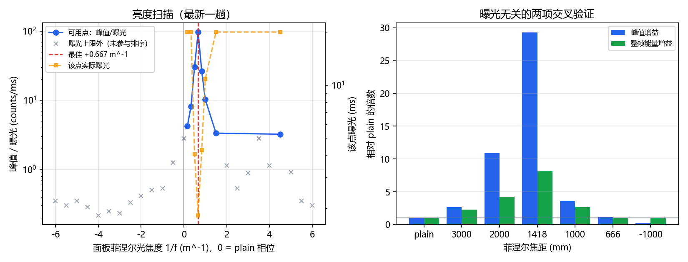

# 焦面补偿：相机离开 2f 焦面后的菲涅尔焦距实测

<!-- provenance:start -->
> **生成脚本**: [`scripts/slm/generate_focus_plane_report.py`](../../../scripts/slm/generate_focus_plane_report.py)
> **复现命令**: `python scripts/slm/generate_focus_plane_report.py`
> **数据/关联脚本**: [`src/ao_shaping/tools/slm/panel/focus_probe.py`](../../../src/ao_shaping/tools/slm/panel/focus_probe.py)
> **数据/关联脚本**: [`scripts/slm/verify_focus_plane_hw.py`](../../../scripts/slm/verify_focus_plane_hw.py)
> **运行环境**: 离线
> **说明**: 相机离开 2f 焦面后的菲涅尔补偿实测 (1/f≈+0.70 m⁻¹, f≈+1420 mm): 逐点自适应曝光的必要性 (曝光跨度达 96×)、峰值与整帧能量两项交叉验证、4 趟重复性与跨趟光强 7.3× 变化
<!-- provenance:end -->

- 生成时间：2026-10-19 14:45
- 实验系统：SLM #1 (22030108) + 大恒 FJB24112232，1064 nm，2f 傅里叶光路
- 测量条件：入射中心 960,690 面板px，照明半径 450 面板px，4 趟扫描

## 1. 结论

相机挪离 2f 焦面之后，**plain 相位不再是最亮的**。实测把它拉回焦点的面板菲涅尔光焦度为

> **1/f ≈ +0.70 m⁻¹（f ≈ +1422 mm）**

4 趟扫描的极差是 0.039 m⁻¹（5.5%）；中位数 0.7031 m⁻¹。取整到 **0.70 m⁻¹ / f ≈ +1420 mm** 使用。

独立验证（`scripts/slm/verify_focus_plane_hw.py`，与探测器独立的一趟）：峰值/曝光 ×29.3、**整帧能量 ×8.1**、FWHM 39.1 → 15.8 px、空心度 0.88 → 0.93；曝光线性度 1.046。

能量也涨了 —— 这一项重要：峰值是可以靠「把框外的光挤回框内」变高的，而整帧能量只有真的把光聚到探测器上才会涨。

## 2. 为什么必须实测，不能从标称 125 mm 推

相机在 2f 之后时，光斑是一个发散锥，弥散直径随偏移线性增长，峰值随之塌陷。修正手段是在面板上加二次相位，也就是一个菲涅尔透镜。但它的量：

1. 取决于相机偏离焦面**多少毫米** —— 光路事实，纸面上没有；
2. **符号不预设**：把面板相位加到光上的极性没有权威记录，猜错一侧就要多扫一遍；
3. 还要落在面板能分辨的范围里：f = ±167 mm 时孔径边缘的条纹周期约 49 μm，再强就欠采样、效率反而塌掉。

所以扫参量用**光焦度 1/f** 而不是焦距：离焦本身是半径的二次项，1/f 才是修正量。

## 3. 方法

- **相位**：plain 相位 + 以实测入射中心为心的菲涅尔相位，圆孔裁剪，raw 弧度；
- **扫描**：1/f 对称扫 ±6 m⁻¹（含 0 = plain），粗扫 25 点；
- **逐点曝光自适应**：每个点单独把曝光调到满量程的 25%–80%，落在带外就标记（`clipped` / `dim`）并排除出排序；
- **判据**：`峰值 / 曝光`。传感器对曝光线性时它正比于真实强度，是唯一能跨不同曝光比较的量；
- **细化**：抛物线顶点 + 附近细扫，且必须复测确认才采纳；
- **线性度复核**：在最优点换一个曝光再读一次，比值偏离 1 超过 25% 就在证据里明说。

### 3.1 曝光确实必须逐点重调

最新一趟里，各点实际曝光从 **1.823 ms 到 20.000 ms**，跨度 11 倍；4 趟里最大的一趟跨度 **96×**（11–96×）。

固定曝光排不出这个顺序：近焦面直接饱和、远焦面只剩读出噪声，`argmax(峰值)` 报出的是「哪个点恰好被固定曝光打满」，而不是「哪个点最亮」。曝光跨度越大，越说明「一次标定、一个曝光值」这种做法在这条光路上不成立。

## 4. 实测扫描曲线（最新一趟）

| 1/f (m⁻¹) | f (mm) | 曝光 (ms) | 峰值/满量程 | 峰值/曝光 | FWHM (px) | 状态 |
|---|---|---|---|---|---|---|
| -6.000 | -167 | 20.000 | 0.03 | 0.3 | 36.2 | dim |
| -5.500 | -182 | 20.000 | 0.02 | 0.3 | 90.4 | dim |
| -5.000 | -200 | 20.000 | 0.03 | 0.3 | 23.2 | dim |
| -4.500 | -222 | 20.000 | 0.02 | 0.3 | 91.9 | dim |
| -4.000 | -250 | 20.000 | 0.02 | 0.2 | 299.2 | dim |
| -3.500 | -286 | 20.000 | 0.02 | 0.2 | 147.2 | dim |
| -3.000 | -333 | 20.000 | 0.02 | 0.2 | 198.4 | dim |
| -2.500 | -400 | 20.000 | 0.03 | 0.3 | 39.4 | dim |
| -2.000 | -500 | 20.000 | 0.03 | 0.4 | 82.4 | dim |
| -1.500 | -667 | 20.000 | 0.04 | 0.5 | 96.2 | dim |
| -1.000 | -1000 | 20.000 | 0.04 | 0.5 | 214.4 | dim |
| -0.500 | -2000 | 20.000 | 0.10 | 1.2 | 49.6 | dim |
| +0.000 | plain | 20.000 | 0.22 | 2.8 | 40.1 | dim |
| +0.167 | 6000 | 20.000 | 0.33 | 4.3 | 37.4 | ok |
| +0.333 | 3000 | 20.000 | 0.64 | 8.2 | 39.9 | ok |
| +0.500 | 2000 | 4.050 | 0.48 | 30.5 | 22.6 | ok |
| +0.667 | 1500 | 1.823 | 0.69 | 97.1 | 14.4 | ok |
| +0.833 | 1200 | 4.268 | 0.44 | 26.5 | 27.1 | ok |
| +1.000 | 1000 | 10.808 | 0.44 | 10.3 | 44.1 | ok |
| +1.500 | 667 | 20.000 | 0.26 | 3.4 | 60.1 | ok |
| +2.000 | 500 | 20.000 | 0.09 | 1.1 | 166.3 | dim |
| +2.500 | 400 | 20.000 | 0.04 | 0.5 | 190.5 | dim |
| +3.000 | 333 | 20.000 | 0.07 | 0.9 | 36.0 | dim |
| +3.500 | 286 | 20.000 | 0.22 | 2.8 | 23.3 | dim |
| +4.000 | 250 | 20.000 | 0.09 | 1.1 | 40.0 | dim |
| +4.500 | 222 | 20.000 | 0.25 | 3.2 | 19.0 | ok |
| +5.000 | 200 | 20.000 | 0.07 | 0.9 | 51.0 | dim |
| +5.500 | 182 | 20.000 | 0.03 | 0.3 | 97.1 | dim |
| +6.000 | 167 | 20.000 | 0.02 | 0.3 | 74.8 | dim |

盆地是单峰的：`dim` 点共 21 个，全部落在曝光上限之外，没有参与排序 —— 这是有意的：欠曝的点只能给出「不够亮」的上界，把它排进序列等于用曝光上限去惩罚远端点。

## 5. 曝光阶梯（plain 相位，判定线性用）

| 曝光 (ms) | 峰值 | 计数/ms | 中位数 | FWHM (px) |
|---|---|---|---|---|
| 0.05 | 1.0 | 20.0 | 0.33 | 1064.1 |
| 0.1 | 1.0 | 10.0 | 0.33 | 676.4 |
| 0.25 | 1.0 | 4.0 | 0.33 | 556.5 |
| 0.5 | 2.0 | 4.0 | 0.33 | 205.5 |
| 1 | 3.3 | 3.3 | 0.33 | 61.8 |
| 2 | 6.3 | 3.2 | 0.33 | 36.2 |
| 5 | 14.7 | 2.9 | 0.33 | 40.0 |
| 10 | 29.3 | 2.9 | 0.33 | 34.0 |
| 20 | 58.0 | 2.9 | 0.67 | 39.3 |

1 ms 以上各档的计数/ms 落在 2.9–4.0，即响应与曝光成正比 —— 这正是 `峰值/曝光` 可用作判据的前提。0.1 ms 以下已经掉进读出噪声，FWHM 也失去意义（表中可见其发散）。

## 6. 独立验证（曝光无关的两项）

| f (mm) | 曝光 (ms) | 峰值 | 峰值/曝光 | FWHM (px) | 空心度 | 能量/曝光 | 框内能量占比 | 峰值增益 | 能量增益 |
|---|---|---|---|---|---|---|---|---|---|
| plain | 20.000 | 57.7 | 2.9 | 39.1 | 0.88 | 48066 | 0.227 | 1.00 | 1.00 |
| 3000 | 14.495 | 112.0 | 7.7 | 42.7 | 0.63 | 108808 | 0.214 | 2.68 | 2.26 |
| 2000 | 3.624 | 114.0 | 31.5 | 22.4 | 0.86 | 205162 | 0.125 | 10.91 | 4.27 |
| 1418 | 1.200 | 101.3 | 84.4 | 15.8 | 0.93 | 389778 | 0.076 | 29.29 | 8.11 |
| 1000 | 7.200 | 73.7 | 10.2 | 50.5 | 0.95 | 127899 | 0.203 | 3.55 | 2.66 |
| 666 | 20.000 | 65.0 | 3.2 | 63.7 | 0.91 | 47693 | 0.261 | 1.13 | 0.99 |
| -1000 | 20.000 | 11.0 | 0.6 | 227.3 | 0.86 | 46403 | 0.058 | 0.19 | 0.97 |

- **能量/曝光**：整帧信号总和除以曝光。光学不凭空产生或消灭光，它涨就说明离焦态确实把光丢在了画幅之外，聚焦把它收了回来；
- **框内能量占比**：光斑 60 px 邻域内的能量占比，对曝光免疫，回答「这到底是不是一个光斑」。

## 7. 重复性与对光强的依赖

| 测量时间 | 最佳 1/f (m⁻¹) | f (mm) | plain 基准 (counts/ms) | 相对 plain 增益 | 可用点 |
|---|---|---|---|---|---|
| 2026-10-18 21:49:32 | +0.7017 | 1425 | 12.1 | 27.6 | 17/32 |
| 2026-10-19 11:42:01 | +0.7053 | 1418 | 20.5 | 30.5 | 21/32 |
| 2026-10-19 11:46:39 | +0.7045 | 1419 | 18.2 | 32.1 | 21/32 |
| 2026-10-19 11:55:07 | +0.6667 | 1500 | 2.8 | 34.7 | 8/29 |

同一配置（plain、5.0 ms）连续 30 次、每 4 s 采一次：峰值 14.7–15.3，max/min = **1.05×**。也就是说**扫描期间的光强是稳的**，`峰值/曝光` 的逐点比较成立。

低光强那趟（光强低约 7 倍、可用点只剩 8 个）落在 0.667 m⁻¹，与其余三趟的 0.702–0.705 差约 5%。盆地顶部是平的（见第 4 节 ±0.17 m⁻¹ 仍在同一量级），所以这个差别落在**可用区间**内；把它当作不确定度的一部分，而不是当成又一次独立复现。

## 8. 会话中途光强发生了一次阶跃

每趟扫描自己都测了 plain 基准（1/f = 0 那一点的 `峰值/曝光`），它就是当时的光强记录：

| 测量时间 | plain 基准 (counts/ms) |
|---|---|
| 2026-10-18 21:49:32 | 12.1 |
| 2026-10-19 11:42:01 | 20.5 |
| 2026-10-19 11:46:39 | 18.2 |
| 2026-10-19 11:55:07 | 2.8 |

最高与最低相差 **7.3 倍**。单趟之内光强是稳的（第 7 节：2 分钟内 max/min 只有 1.05×），所以这 7.3 倍的变化发生在**两趟之间**，而不是扫描过程中 —— 这正是逐点自适应曝光要覆盖的场景：变化再大，只要发生在扫描内部，逐点重调就吸收得掉。

两条推论：
1. **跨会话的绝对亮度不可比**，只有同一趟扫描内的比值有意义 —— 本报告所有「增益」都是比值，正因如此它们不受这次阶跃影响；
2. 想比较两次实验的绝对亮度，必须先各自重新探测曝光。

### 8.1 顺带查出的另一处矛盾：曝光上限探测器与直接阶梯差 37 倍

按第 5 节的阶梯，20 ms 才让峰值到 23% 满量程，也就是本实验系统当前约 2.9 counts/ms，要打满 255 得用到几十毫秒。但 `scripts/slm/check_flat_stability.py` 在同一时段解析出的「90% 饱和上限」是 **2.07 ms**，反推相当于 111 counts/ms —— 比实测**高约 37 倍**。

本报告没有判定谁对，但这件事有直接后果：`probe_session_exposure_ms()`（GUI 曝光探测的入口）走的是同一个上限探测函数，若它给出的上限偏小，工作曝光就会偏大并**接近饱和**——而实测记录里已经出现过「阶梯给出的上限减半后读数 255/255」这类情况。**建议单独查这一条。**

## 9. 几何交叉校验，以及一处未解的矛盾

薄透镜模型下，面板上的菲涅尔透镜把焦点从 125 mm 移到 114.0 mm（方向取决于面板相位极性，本次不预设），即相机偏离 2f 焦面约 **11 mm**。

**未解**：用离焦弥散反过来推照明半径，与半径探测器给出的量不一致。

离焦态 FWHM 39.1 px、聚焦态 15.8 px，多出来的弥散约 36 px；按锥角 R/f 反推，得到的照明半径只有约 100 面板px 量级，而半径探测器此前给的是入射中心 (960,690)、半径 300 px 以上。

两条线索必须有一条是错的：要么半径探测器的口径仍不可信（本仓库此前已确认 `edge/2` 与「中心相减」两种算法给出过 180 / 300 px 的分歧），要么薄透镜模型在这条光路上不适用（例如 SLM 并非精确位于前焦面）。**这不影响补偿量本身** —— 它是直接测出来的，不依赖任何几何模型 —— 但它会影响「用几何模型做二次校验」这条路，所以留作待查项。

## 10. 怎么用

```bash
python -m ao_shaping.tools.slm.panel.focus_probe \
    --exposure-ms 2.0 --radius-px 450 --centre-x 960 --centre-y 690
```

GUI：侧栏「SLM 1 · 光路几何与标定」→ **D2 焦面** → 「探测焦面」。整形页的「离焦 / 聚焦微调」区块会**默认采用**探测到的 f，也可以手工覆盖；焦距是粗补偿，Zernike (2,0) 滑块是细调，两者同为二次相位直接相加。

操作注意：

- **光弱时要放宽曝光上限**：本次 20 ms 上限在低光强下让 21/29 个点落到带外；必要时加 `--max-exposure-ms`，或收窄 `--diopter-range`；
- 探测结束面板会**恢复 plain**，不会把透镜悄悄留给下一次运行；
- 校正值依赖**入射中心**：透镜偏离光轴会产生线性相位并大幅偏转光斑（本次实测位移 ≤ 96 px）。改光路后必须重测中心。

## 10.1 光路指纹：光路被挪动时的强制失效

上面的补偿量是**光路状态**的量，而光路随时会被挪动。所以配了一套指纹：给定平场相位与一个**已知倾斜**的 Zernike 相位，读 CCD 光斑的宽度、倾斜造成的位移与质心，和标定时那份比对 —— 挪过就拒绝复用那份标定。不用 TTL，因为光路可能一秒内被挪动、也可能一周不动。

| 测量时间 | 平场宽 (px) | 倾斜位移 (px) | 质心 | 峰值/曝光 | 判定 |
|---|---|---|---|---|---|
| 2026-10-19T14:32:14 | 79.2 | 36.2 | (1386,982) | 11.2 | 跳过（无参考 / 已跳过） |
| 2026-10-19T14:32:33 | 78.1 | 36.9 | (1386,981) | 11.2 | **不一致** |
| 2026-10-19T14:35:27 | 59.9 | 0.0 | (1386,980) | 11.8 | **不一致** |
| 2026-10-19T14:35:48 | 58.4 | 0.0 | (1386,981) | 12.0 | **不一致** |

> 表里「不一致」的行是**闸门落地之前**记录的：当时光斑宽 58–79 px，代码会拿这种噪声去否决运行；现在的行为是「未判定」。这一条本身就是闸门存在的理由。

三条设计决定，都是实测逼出来的：
1. **判据不含亮度**。同一台面上平场亮度两趟之间能差 7.3 倍，把亮度放进判据等于让激光而不是光学路径决定否决与否；
2. **倾斜位移用相位相关而不是质心差**。仓库里早已实测：足以给出信号的倾斜会同时改变光斑形状，质心在重复之间跳 ±8 px，足以造成 2 倍误差（见 `frame_analysis.estimate_shift` 的说明）；
3. **有可信度闸门**。光斑没合焦时（宽度超过 30 px）任何形状统计量都是噪声 —— 实测离焦面下20 秒内两次读数就差 20% —— 此时指纹**拒绝下结论**，而不是拿噪声去否决一次运行。

强制不检验的开关：侧栏「运行前校验光路指纹」取消勾选，或 CLI 加 `--skip-bench-path-check`。

## 11. 还没做的
2. **相机窗口没跟着挪**。聚焦态光斑质心从 (1366,1031) 移到 (1409,973)，ROI 需要重新定位。
3. **入射中心没有为此重新标定**。本次沿用 (960,690)，从光斑位移反推的偏心约 2 px，但没有用 `panel_locate` 在同会话内实测。

## 12. 复现

```bash
python -m ao_shaping.tools.slm.panel.focus_probe \
    --exposure-ms 2.0 --radius-px 450 --centre-x 960 --centre-y 690 --steps 25 --refine 7 --frames 3
python scripts/slm/verify_focus_plane_hw.py
python scripts/slm/generate_focus_plane_report.py
```

证据目录：`data/debug/bench_settings/focus_probe/`（`slm1_*.json` 扫描、`verify_*.json` 验证、`flat_drift_*.json` 稳定性）。


