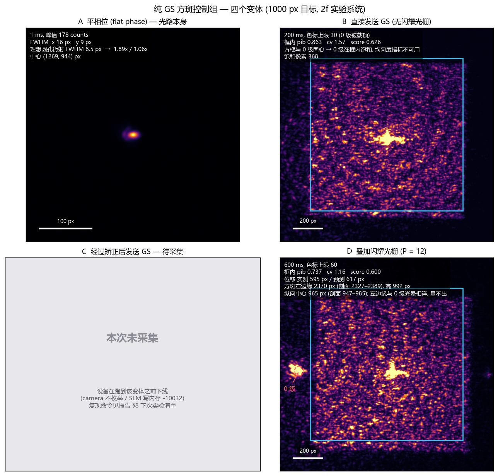
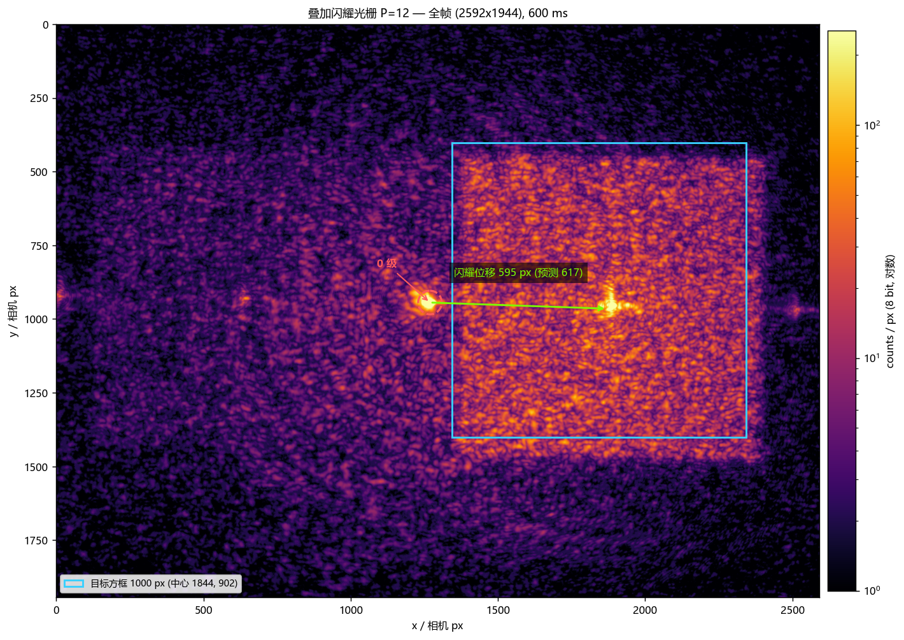
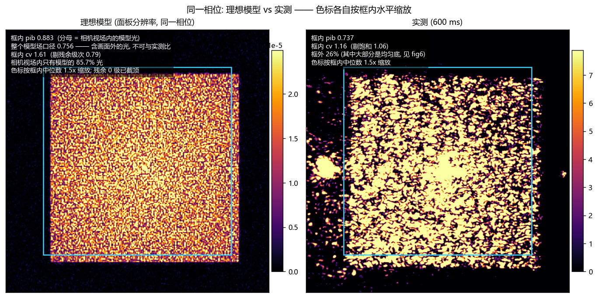
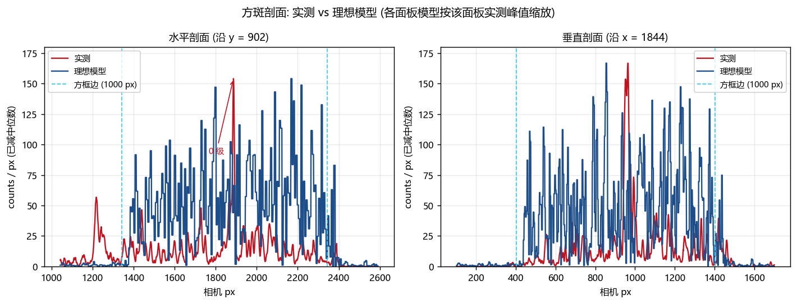
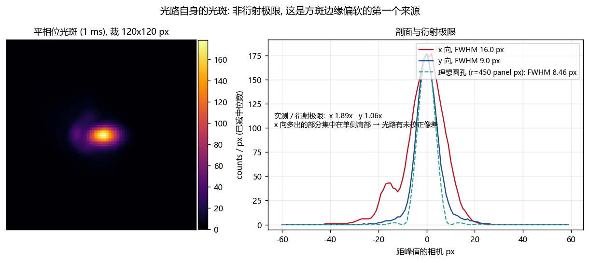
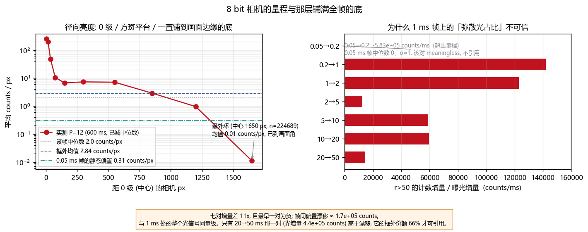
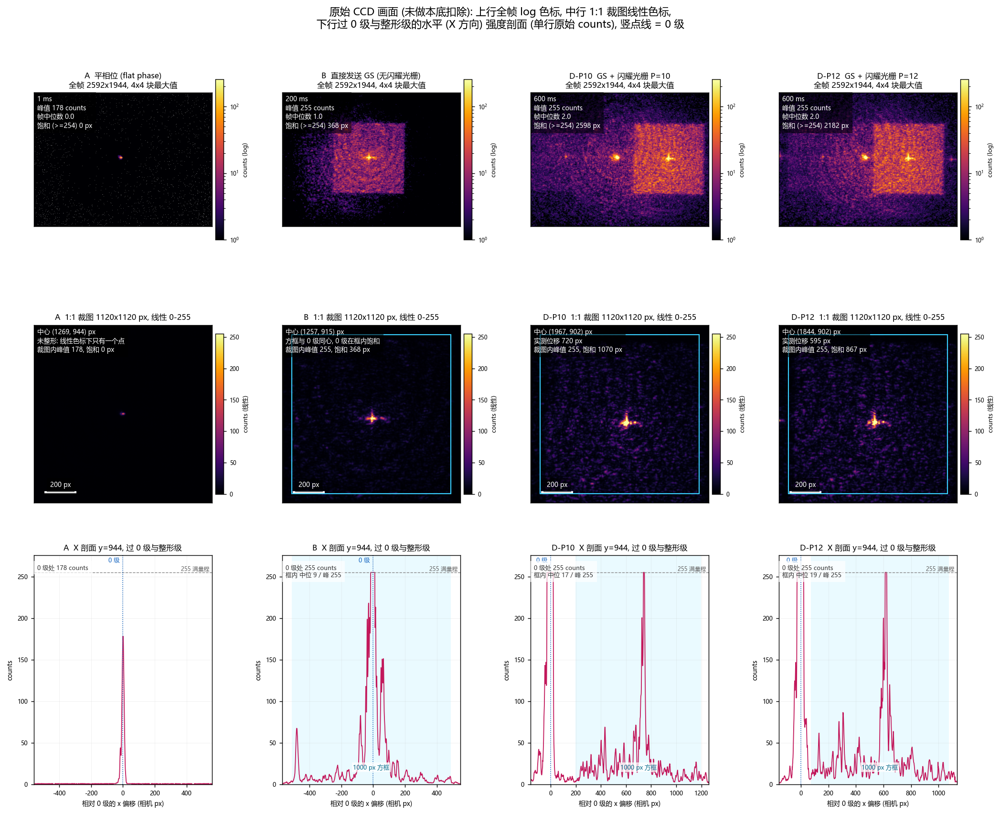
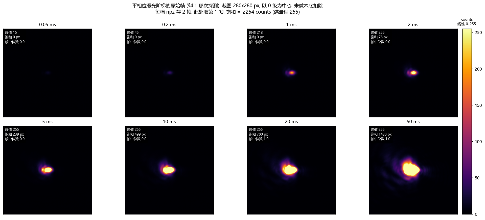

# 纯 GS 方斑控制组 — 1000 px 目标 / 2f 实验系统

<!-- provenance:start -->
> **生成脚本**: [`scripts/slm/generate_gs_control_report.py`](../../../scripts/slm/generate_gs_control_report.py)
> **复现命令**: `python scripts/slm/generate_gs_control_report.py`
> **数据/关联脚本**: [`scripts/slm/hw_gs_square_scans.py`](../../../scripts/slm/hw_gs_square_scans.py)
> **数据/关联脚本**: [`scripts/slm/probe_optical_path_validity.py`](../../../scripts/slm/probe_optical_path_validity.py)
> **运行环境**: 离线渲染 (读硬件采集的帧与相位; 数字为 2f 实验系统实测)
> **说明**: 纯 GS 方斑控制组 (1000 px 目标): 平相位 / 直接 GS / GS+闪耀 P=10,12 三组实测, 外加同相位物理预测模型的同口径对比; 0 级用横向闪耀移出方框后 pib/cv 才可用; C 变体 (先矫正光路像差再发 GS) 因设备下线未采集, 图上留灰色占位; 8 bit 量程把方斑平台压到 11-15 counts, 框外那层底的来源未定论
<!-- provenance:end -->

- 运行根目录：`data/debug/hw_gs_square_scans/20261030_gs1000/`
- 光路探测：`data/debug/optical_path_probe/gs_control_1000px/20261030_031154Z/`
- 图：`report/slm/gs_control_1000px/figures/`（8 张，§6 逐张嵌入）；八张图**内**的数值由
  同一次生成写进 `figure_numbers.json`（51 个键），正文引用图内数值时给键名。不落在图上的数
  （光路探测的曝光阶梯、饱和像素计数、GS 迭代耗时等）各自标了来源文件，**不在**该 JSON 里。
- 日期：2026-10-30（UTC）。设备在 C 变体开始前下线，故该变体留空并标注。

本文只报**这次采到的**数据。凡是靠模型或换算得到的数，一律标注口径；凡是没有定论的，
写进 §8，不写成结论。

---

## 1 目标与四个变体

目标：在 2f 实验系统上做一组纯 GS（Gerchberg–Saxton）方斑控制组 —— 1000 px 方形远场，
用**闪耀光栅**把 0 级移出方框，从而让 `pib` / `cv` 这类均匀度指标第一次变得有意义
（0 级落在框内时它们度量的是「中间那个饱和点」）。

| 变体 | 内容 | 目的 | 状态 |
|---|---|---|---|
| A | 平相位（不施加整形相位） | 光路自身的光斑与衍射极限之比 | 完成 |
| B | 直接发送 GS 相位，无闪耀光栅 | 方框与 0 级同心时的读数（对照组） | 完成 |
| C | 先矫正光路像差，再发送 GS 相位 | 分离「光路像差」与「GS 相位」两个误差源 | **本次未采集**（设备下线） |
| D | GS 相位 + 闪耀光栅（P = 10、12） | 0 级移出方框后的真实均匀度 | 完成 |

A 与 B 各自只需一帧；D 需要先扫出目标边长、再按预测位移摆方框，所以 D 的流程比 A/B 长
（§3）。C **不是「采一帧」就能填的**：它要先从探针拟合出光路像差，再把「已存的 B 相位减该
像差」发下去，至少需要 8 帧拟合探针 + 2 帧验证探针 + 1 帧 C（定义与验收口径见 §8.2）。C 的
槽位在图 1 里是灰色占位；生成器已带 `--corrected-frame` / `--replay-b-frame` /
`--corrected-flat-frame` / `--correction-meta` 四个输入，缺任一输入时该图跳过而不是报错。

---

## 2 算法与几何约定

### 2.1 GS 迭代

`gerchberg_saxton`（`ao_shaping.algorithm.signal_processing.gerchberg_saxton`）在
**512×512** 的瞳面网格上迭代 **200** 次，目标为 1000 px 方形（在 512 网格上边长
**122** 格），本机耗时 **17.7 s**。输出是 raw 未包裹弧度（项目契约：相位生成器不自行
`mod 2π`，唯一的包裹点在驱动的 rad→灰度换算）。

几何换算（`utils/slm/bench_constants.py`）：

- 瞳面面板 1920×1200，光束中心 `(960, 600)`，光束半径 450 panel px；
- 远场标度 `TILT_SHIFT_SCALE = 7400` 相机 px → 一个 panel 像素的线性相位对应 7400 相机 px
  的远场位移；
- 因此 GS 每一格 = 1920/512 × 7400/1920 ≈ **8.22 相机 px**，FFT 窗 = 512 × 8.22 ≈
  **4209.8 相机 px**。

### 2.2 闪耀光栅

线性相位斜坡叠加在 GS 相位上，**每个 panel 像素 2π/P**：

| P | 每像素相位 | 1200 行累计 | 预测位移 `7400/P` |
|---|---|---|---|
| 10 | 0.6283 rad | 754 rad | 740.0 相机 px |
| 12 | 0.5236 rad | 627.8 rad | 616.7 相机 px |

斜坡加在 **panel-y** 方向（实测 `dy = 0.6283 rad/px, dx = 0`）。这是刻意的：panel 与相机
之间有一个 **90° 轴交换**（panel-y 斜坡 → 相机 +x 位移，panel-x 斜坡 → 相机 +y 位移），
该约定由 `utils/wavefront/zero_order_overlay.py::predicted_shift_px` 定义，本次实测复核了
它的符号（位移落在 +x，与预测同向）。

方向选 `horizontal` 而不是 `vertical` 是几何决定的：0 级在 `(1269, 944)`，画幅
2592×1944。1000 px 方框若沿 y 方向移开 0 级，需要 944−500 = 444 px 以上余量，而方框高度
已经 1000 px，纵向根本放不下第二个不重叠的位置；横向余量 1269−500 = 769 px 足够。
`P = 14` 只剩约 60 px 直流余量，`P = 16` 会把 0 级直接推进框内，故只取 10 与 12。

### 2.3 指标口径

`measure_box(frame, center, side)`（`scripts/slm/hw_gs_square_scans.py`，报告生成器直接
import 同一个函数，不存在第二份实现）：

- 先 `prepare_frame`：**减帧中位数并 clip 到 0**。CCD 帧带对称读出噪声，约一半像素为负；
  `power_in_bucket` 除以整帧总和时，负背景会把比值顶到 1 以上（实测见过 1.012），
  优化器于是去追读出噪声。
- `pib` = 框内能量 / 整帧能量（整帧是分母，所以「框外光」直接压低它）。
- `ee` 与 `pib` 在 `prepare_frame` 之后是**同一个量**，两个字段只是为了各自与自己的消费者
  对齐；本文只引 `pib`。
- `cv` = 框内变异系数（标准差/均值，越低越均匀）。
- `ar` = 方斑长宽比；`quality` = 方形整形优化器那套 CV/EE/AR 复合分数
  （`slm_square_shaping.square_quality_score`）。
- `score` = `0.5·pib + 0.5/(1+cv)`。

模型侧（`model_box_pib` / `model_cv`）在**模型坐标系**里积分，不重采样到相机网格：
方框与视场窗都写在相机 px 里，先把模型样本下标换算成相机坐标再判包含。模型由**实际下发
的相位**（`blaze/phase_00X.npy`，1920×1200 raw 弧度）在 panel 分辨率上做远场，不是 512 的
GS 网格 —— 这样面板上的残余结构与量化都进得来。

模型是**相位-only**的：它假定瞳面振幅是理想平顶，而实测光束有振幅起伏与散射。实测与模型的
差别有一部分就来自这里，量级约 12%（模型在直流附近 560–640 行里有 12.4% 的能量，是相位
近似留下的弥散，不是目标方斑）。

---

## 3 执行流程

一条命令一个阶段，全部走 `scripts/slm/hw_gs_square_scans.py`：

```powershell
# 0) 光路探测（先做，任何测量之前）
python scripts/slm/probe_optical_path_validity.py --session gs_control_1000px --wait-until-idle 600

# 1) 扫目标边长（每个边长一帧，200 ms）
python scripts/slm/hw_gs_square_scans.py --execute --scan sides --side-px 1000 --exposure-ms 200

# 2) 选定边长
python scripts/slm/hw_gs_square_scans.py --execute --scan select

# 3) 闪耀光栅：按预测位移摆方框，600 ms，4 帧取 1（丢前 3 帧）
python scripts/slm/hw_gs_square_scans.py --execute --scan blaze --blaze-period 10 12 `
    --blaze-direction horizontal --exposure-ms 600 --frames 4 --discard 3

# 4) 汇总
python scripts/slm/hw_gs_square_scans.py --execute --scan summarize
```

环境：`PYTHONPATH=src;libs`，`PATH` 含 `libs\gxipy`，`PYTHONIOENCODING=utf-8`，
且**必须**显式给 `AO_DAHENG_MAX_EXPOSURE_MS`（本组 200 / 600 ms），否则驱动会自己去探
曝光上限。`--execute` 缺省时脚本走 dry-run，不碰设备。

产物：

| 路径 | 内容 |
|---|---|
| `sides/side_1000/frame_000.npz`, `pupil_phase.npy`, `phase_000.npy` | 200 ms 帧 + 瞳面/面板相位 |
| `sides/selected.json` | 选定边长与分数 |
| `sides/measurements.csv`, `summary.png`, `manifest.json` | 边长扫描汇总 |
| `blaze/frame_000/001.npz`, `phase_000/001.npy` | P=10 / P=12 的帧与相位 |
| `blaze/measurements.csv`, `metrics_00X.json`, `run_config.json` | 逐周期指标 + 冻结的方框与预检 |
| `report/slm/gs_control_1000px/figures/*.png`, `figure_numbers.json` | 8 张图与该图族引用的数 |

离线分析只读上面这些 `.npz` / `.npy`，不需要设备：

```powershell
python scripts/slm/generate_gs_control_report.py            # 8 张图 + figure_numbers.json
```

---

## 4 光路探测结果

`schema = optical_path_probe/1`，`verdict = ok`，exit 0，2026-10-30T03:13:44Z。
SLM 1 号，memory 模式（`video_mode=0`），1064 nm；相机曝光范围 0.02–1000 ms。

### 4.1 曝光阶梯

| 曝光 (ms) | 峰值 (counts) | 中位数 | 均值 | 饱和 | 可用 |
|---|---|---|---|---|---|
| 0.05 | 15 | 0 | 0.326 | 否 | 是 |
| 0.2 | 46 | 0 | 0.302 | 否 | 是 |
| 1.0 | 215 | 0 | 0.334 | 否 | 是 |
| 2.0 | 255 | 0 | 0.338 | **是** | 否 |
| 5.0 | 255 | 0 | 0.394 | 是 | 否 |
| 10 | 255 | 0 | 0.476 | 是 | 否 |
| 20 | 255 | 1 | 0.611 | 是 | 否 |
| 50 | 255 | 1 | 0.757 | 是 | 否 |

- 满量程 255；可用窗口 **0.05 / 0.2 / 1.0 ms**；饱和判据取满量程的 95%。
- 吞吐 **210.77 counts/ms**（0.05–1 ms 段）。与 21 次历史运行比，比值 33.0（历史最小 0.5）
  —— 光比以往更亮，这不是告警，但它解释了为什么 2 ms 就饱和。
- 阶梯的线性拟合 r² = **0.187**：0.05 ms 那一级就在噪声底上（中位数 0、σ = 1、阈值 4、
  峰值 15），拟合被它拖坏。**0.05 ms 不作为定量依据**，只作为「有光」的判据。
- 探测自己给的推荐曝光 1.0 ms 峰值 215，落在它的目标带 [100, 200] **之外**（偏高）。
  实际测量没有沿用这个推荐：A 用 1 ms（峰 178），B 用 200 ms，D 用 600 ms —— 后两者都是
  **有意截顶**的，因为方斑平台只有 11–15 counts，不截顶就看不见方斑（§7.4）。

> 这一阶梯的**原始帧**见 **图 8**（§6）：每档 280×280 裁图，直接看得到 0 级核心先饱和、
> 饱和区再一圈圈往外扩。

### 4.2 离焦响应

基线（0 rad）峰值 **193.8**，FWHM **12.39 px**；±1 rad 离焦时峰值变化 **118.6 counts
（61.2%）**、宽度变化 **3.63 px（29.3%）**，SNR 分别为 18.0 / 41.3。相位确实在调光，且响应
足够强，不需要怀疑「相位没下到面板」。

### 4.3 0 级位置

1 ms 帧的强度加权质心 **(1265.4, 943.2)**，argmax **(1269, 944)**。两者差 4 px，说明光斑
不偏心；后续所有方框都按 argmax 定位。

> ⚠️ 本次运行里 0 级出现过**四个互不相同的估计**：1 ms 平场 argmax (1269, 944)、1 ms 质心
> (1265.4, 943.2)、边长阶段的冻结值 (1257, 915)、闪耀阶段的冻结值 (1227, 902)。最后一个
> 偏离 42 px（两个轴各 42）。600 ms 下 0 级核心饱和成一片平台，平台内 argmax 由噪声决定 ——
> 这是最可能的原因；本次没有单独测到饱和平台的形状，故不作定论（§7.3）。
> 方框摆放用的是这个 42 px 偏了的冻结值 —— 这是 §7.3 的主要误差源。

---

## 5 实测结果

### 5.1 A — 平相位（光路自身）

1 ms，峰值 **178 counts**，FWHM **x 16 px / y 9 px**。

理想圆孔（r = 450 panel px）的一阶零点 **10.03 px**，对应 FWHM **8.46 px**。实测为它的
**1.89×（x）/ 1.06×（y）** —— x 方向多出来的部分集中在单侧肩部。这一条是方斑边缘偏软的
第一个来源。但「肩部 = 光路未校正像差」只是**候选解释**：本次没测过光路像差本身，检验它
的正是 C 变体（§8.2），在 C 采到之前不作为结论。

> 峰值在不同 1 ms 帧之间落在 178–215 之间（探测阶梯 215、平场组 178、离焦基线 193.8）。
> 同一曝光下 20% 的起伏，说明「单帧峰值」不是稳定量，报告里凡是峰值都标了帧来源。

### 5.2 B — 直接发送 GS（无闪耀光栅）

200 ms，`gs_grid` 512，200 迭代，17.7 s；方框与 0 级同心于 **(1257, 915)**。

| 指标 | 值 |
|---|---|
| pib / ee | 0.8631 |
| cv | 1.5683 |
| ar | 1.80 |
| score | 0.6262 |
| quality | 0.3807 |
| 峰值 | 255（满量程） |
| 框内饱和像素 | **368** |
| 模型（同一相位）pib / cv / score | 0.9439 / 0.2118 / 0.8845 |

**这个变体的指标不可用于评价均匀度**：方框正好扣在 0 级上，368 个像素顶在满量程，`cv`
度量的是「一个饱和点 + 周围方斑」，`pib` 则因为 0 级本身几乎全在框内而虚高（0.863 比 D 的
0.737 还高，而它的方斑远不如 D）。它的价值只有一个：给出「不做闪耀时读数是什么样」的对照，
证明为什么必须做 D。

### 5.3 D — GS + 闪耀光栅

600 ms，每周期 4 帧、丢前 3 帧；方框按**冻结的** 0 级 (1227, 902) 摆放。

| P | 预测位移 | 实测位移 | 偏差 | pib | cv | ar | score | quality | 方框中心 |
|---|---|---|---|---|---|---|---|---|---|
| 10 | 740.0 | **719.6** | −20.4 | 0.7307 | 1.2298 | 0.681 | 0.5896 | 0.4032 | (1967, 902) |
| 12 | 616.7 | **595.3** | −21.4 | 0.7370 | 1.1624 | 1.392 | 0.5997 | 0.4032 | (1844, 902) |

两个周期的偏差几乎一样（−20.4 / −21.4 px），说明这**不是**周期相关的物理误差。偏差方向朝
0 级，与「位移估计用框内质心，而框里同时扣着 0 级饱和拖尾，质心被拉向 0 级」这条解释一致，
但每周期只有一帧，这条解释**未单独验证**。两个周期的 `box_clipped = False`、
`fits_frame = true`，方框没有出画。

P = 12 的三项都略优于 P = 10（pib +0.006、cv −0.067、score +0.010）。差值不大，与「位移更
小 → 方斑更靠近光轴 → 像差与渐晕更轻」同向，但每周期只有一帧，**不构成**因果结论。后续以
P = 12 为主。

**方斑实际尺寸**（剖面法，见 §7.5）：右边缘中位数 **2370 px**（10–90 百分位
2327–2389），高度 **992 px**（963.5–1031），纵向中心 **964.75 px**（946.75–985）。左边缘
**不可测** —— 它与 0 级光晕连成一片，任何阈值法都会把光晕算成方斑；宽度与横向中心由
「右边缘 − 设计边长」反推得 1000 px / 1870 px。

### 5.4 能量记账（P = 12，600 ms）

| 量 | 值 |
|---|---|
| 框内均值 / 中位数 | 15.30 / 11.25 counts |
| 框外均值 | 2.835 counts |
| **框外占比** | **26.3%** |
| 整帧中位数 | 2.0 counts |
| 0.05 ms 帧的静态偏置 | 0.306 counts/px |

框外的底从画面中心约 5 counts 衰减到四角约 2 counts —— 它铺满全帧，不跟着方斑走（图 6 左）。

四个变体的**原始帧**（不扣本底、不叠指标）见 **图 7**（§6）：这层底在 1:1 裁图里就是那片
「怎么都不黑」的背景。

---

## 6 八张图怎么看

八张图直接嵌在下面，点开可看原尺寸。每张图都有**自己的色标**，色标上限写在图注里 ——
跨栏比亮度会得出错误结论。图 1–6 是派生量（指标、剖面、模型对比），**图 7–8 是原始 CCD
画面**：不扣本底、不叠指标，只用来看相机上到底拍到了什么。

### 图 1 `fig1_four_arms.png` — 四个变体



2×2。A 平相位光斑（带 100 px 比例尺与 FWHM 对照）；B 200 ms 散斑方斑，方框与 0 级同心；
C 灰色占位，明确标注「本次未采集」与原因；D P = 12 的方斑，青色方框、红色 0 级标记。
四栏各自独立定色标（A 是 0–178，B 上限 30，D 上限 60），因为 B/D 的方斑平台只有十几
counts，用同一色标会让它们整片变黑。**图注里的色标上限必须一起读**。

### 图 2 `fig2_blaze_overview.png` — 全帧



2592×1944 全帧，对数色标 1–255，看得见三件事：左侧饱和的 0 级、方框内的方斑、以及铺满
全帧的底。绿色箭头标出实测位移 595 px（预测 617）。这张图的作用是回答「方框到底摆对了没有」
—— 答案是「大致对，但中心偏了 42 px」。

### 图 3 `fig3_model_vs_measured.png` — 同一相位的模型 vs 实测



左模型、右实测，同一相位。**这是全文最重要的一张，也是最容易被误读的一张**：

- 模型给出**平顶**方斑，框内 pib **0.883**（分母 = 相机视场内的模型光，与实测同口径）；
  若换成「整个 7400² 模型场」作分母则是 0.756 —— 那个分母含了相机根本看不见的光，
  **不可与实测比**。
- 实测框内 pib **0.737**，cv 1.16。
- 差距 0.146 的**记账**是框外光：模型框外 **11.7%**，实测框外 **26.3%**，相差 14.6 个
  百分点，与 0.146 同量级。这是把差距归到「框外」这一栏，**不是**说明框外光由什么产生。
- 模型里仍有一个残余相干峰（单格 3.8e-3，平台 1.8e-5，比值 214×，占框内能量 1.7%），它把
  `model_cv_box` 从 0.787 抬到 1.608。这个峰落在相机坐标 **(1886, 944)**，是**移位后那一级**
  的残余，**不是**留在原位的 0 级（真实 0 级在 (1269, 944)）。实测框内最亮点在 (1884, 928)，
  与它同区；但实测那片亮区是饱和拖尾连到方斑中心的一整块，形状与模型的单格峰不同类 ——
  「两者同一个结构」这一步**不作断言**。
- 两栏色标各自按框内水平缩放（模型峰值是平台的 214×，共用色标会把平顶压成黑色）。看形状，
  不看亮度。

### 图 4 `fig4_profiles.png` — 水平/垂直剖面



沿方框中心切两条单像素剖面，实测 vs 模型。单像素剖面上两条曲线都是尖刺梳状（实测是散斑，
模型是 8.22/3.85 相机 px 一格的台阶），**都不读作平顶** —— 这正是「方斑不均匀」的直接证据。
青虚线是方框边；左侧 ≈1220 px 处那个尖峰是框外的 0 级。

### 图 5 `fig5_flat_psf.png` — 光路自身的光斑



左 120×120 裁图，右剖面 + 理想圆孔参考（虚线）。x 1.89× / y 1.06× 的差距一目了然：x 方向
的单侧肩部。这是方斑边缘偏软的第一个来源，也是 C 变体（先矫正再发 GS，§8.2）要检验的东西。

### 图 6 `fig6_diffuse_floor.png` — 8 bit 量程与那层底



左：径向亮度（0 级 → 方斑平台 → 一直铺到画面边缘的底），三条水平参考线（帧中位数 2.0、
框外均值 2.84、0.05 ms 静态偏置 0.31）。右：逐曝光对的「弥散增量」。

**右图只允许引用一对**：`20→50 ms` 给出 1.466e4 counts/ms，框外占比 65.8%，增量 4.40e5
counts。其余各对全部不可信 —— 相邻帧的偏置漂移有 1.66e5 counts，比 1 ms 帧上要测的增量
还大；`0.05→0.2` 甚至是负的 −5.83e5（0.05 ms 在噪声底上，这一对没有意义）。所以「1 ms 帧上
的弥散光占比」这件事**本次测不出来**，只能报 600 ms 的地板水平与这一对导数。

### 图 7 `fig7_raw_ccd.png` — 四帧原始 CCD 画面（全帧 / 1:1 裁图 / X 剖面）



**未经处理的 CCD 画面**：不扣本底、不做归一化、不叠指标。上行全帧用对数色标 1–255，并先做
4×4 **块最大值**降采样 —— 均值降采样会把衍射极限的光点抹平；中行是 1120×1120 的 1:1 裁图，
线性色标 0–255，青色框是 1000 px 设计方框。

裁图中心**逐帧取该帧自己的方框 / 0 级位置**，不共用 B 的中心：闪耀把方斑整体平移了 595–720 px，
拿 B 的方框中心去裁 D 的帧会把方斑切掉一半。四栏中心分别是 A (1269, 944)、B (1257, 915)、
D-P10 (1967, 902)、D-P12 (1844, 902)。

逐帧读数（`figure_numbers.json` → `raw_ccd_frames`）：

| 栏 | 曝光 | 峰值 | 帧中位数 | 饱和 (≥254) px | 其中裁图内 |
|---|---|---|---|---|---|
| A 平相位 | 1 ms | 178 | 0 | 0 | 0 |
| B 直接 GS | 200 ms | 255 | 1 | 368 | 368 |
| D-P10 | 600 ms | 255 | 2 | 2598 | 1070 |
| D-P12 | 600 ms | 255 | 2 | 2182 | 867 |

看图时注意四件事：

- **A 那一栏在线性色标下几乎是空的**：未整形光斑是 FWHM 16×9 px 的一个点，放进 1120×1120
  的框里只占几个像素。这正是 C 变体（先矫正再发 GS，§8.2）要检验的地方。
- **B 的 0 级在框正中饱和成一团亮斑**，方斑在它周围是一块比背景略亮的散斑方块。方框与 0 级
  同心，所以 `pib` / `cv` 在 B 上不可用（§5.2）。
- **D 的两栏里有两处亮**：一处贴着方框中心（P10 (2010, 924)、P12 (1884, 928)，都饱和），
  另一处是**留在原位的 0 级**（P12 在 (1283, 936)，正好压在裁图左边缘；P10 的 0 级落在裁图
  之外，只在上行全帧里看得到）。框中心那团与 §7.2 的模型残余峰 (1886, 944) 同区，但本图
  **不判断**两者是不是同一个结构。
- **整幅裁图的背景都不是黑的**（112×112 格内最大值 50–90 counts），这就是 §5.4 和图 6 那层
  铺满全帧的底。8 bit 量程下方斑平台只有 11–15 counts，几乎沉进这层底里。

#### 第三行（X 剖面）怎么读

上一节的两行都是**二维**的，看得到位置但读不出数。第三行把它压成**一条线**：取 CCD 第
`y = 944` 行，横轴是相对 0 级的 x 偏移（相机 px），纵轴是该像素的原始 counts —— 不扣本底、
不平滑、不归一化。

- **行 `y = 944` 四栏共用**：它穿过 0 级。四帧的 0 级质心 y 分别是 942.7 / 941.1 / 940.8 /
  940.2（窗口 x1190–1350、y870–1010 内实测），四舍五入都是 941–943；整形方斑在 y 上落在
  920–960 区间内，所以这一条线能同时切到 0 级和整形级。四栏用同一行，读数才可比。
- **x 跨度逐栏取**，不共用：有方框的栏覆盖「0 级 → 方框右缘再留 60 px」，没有方框的 A 栏取
  0 级 ±560 px。理由和中行裁图一样 —— 闪耀把整形级整体搬走 595–720 px，共用一个跨度要么把
  D 的整形级切掉，要么让 A 栏 95% 是空的。
- 纵轴上限固定 275（略高于 255 满量程），四栏同一量程，所以**栏与栏之间可以直接比高度**。

| 栏 | 剖面 x 跨度（相对 0 级, px） | 0 级处 counts | 框内中位 | 框内峰 |
|---|---|---|---|---|
| A 平相位 | −560 … +559 | 178 | — | — |
| B 直接 GS | −572 … +547 | 255 | 8.75 | 255 |
| D-P10 | −160 … +1257 | 255 | 16.75 | 255 |
| D-P12 | −160 … +1134 | 255 | 19.25 | 255 |

（`figure_numbers.json` → `raw_ccd_frames` 的 `x_profile_*` 字段；「框内」是 x 落在方框区间内的
像素，A 栏无方框故为 `null`。）

四条结论，都只能从这一行读出来：

- **A 是单峰**：峰 178，两侧迅速回到 0–1 counts。这就是「未整形光斑只是一个点」的定量版本，
  和图 5 的 FWHM 16×9 px 一致。
- **B 的 0 级顶到 255 并占满一段宽度**（不是一根线），所以框内中位 8.75 里已经混进了 0 级的
  饱和列 —— B 的方框与 0 级同心（§5.2），这一栏的 `pib`/`cv` 本来就不能用。
- **D 的整形级是散斑梳，不是平台**：框内中位只有 16.75 / 19.25 counts，但单像素尖峰反复顶到
  255（P10 在 x ≈ +700 一处、P12 在 x ≈ +600 一处）。也就是说在 1000 px 目标下，**单行剖面
  读不出「方斑边缘」** —— 能读出的是散斑的峰与谷。这与 §7.2 的单像素剖面「尖刺梳状」是同一
  现象，也是 8 bit 量程下平台只有十几 counts 的直接后果。
- **D 的 0 级仍是全帧最亮**：x = 0 处 255，且四帧的全局 argmax 都落在 0 级附近（A (944,1269)、
  B (932,1261)、D-P10 (920,1252)、D-P12 (921,1261)），**没有一帧**是整形级更亮。说明闪耀只搬走
  了一部分能量，残余 0 级仍是画面的主峰（§4）。

### 图 8 `fig8_exposure_ladder.png` — 曝光阶梯的原始帧



§4.1 那张表的原始帧。八档曝光、每档一帧，裁图 280×280 px 以 0 级为中心，线性色标 0–255，
每栏标了该帧的峰值、饱和像素数与帧中位数。

读法：**0 级核心先饱和，饱和区再一圈圈往外扩**，到 50 ms 扩成一个环 —— 这就是「8 bit 量程」
这条限制长什么样。峰值 15 → 45 → 213 → 255 之后不再变，而饱和像素数
0 → 0 → 0 → 76 → 239 → 499 → 780 → 1438 一直在涨：**饱和之后峰值就不再携带信息**，这也是
§7.4 说「8 bit 是主要限制」的直接画面（`exposure_ladder`）。帧中位数 0.05–10 ms 为 0、
20/50 ms 为 1，与 §4.1 表的中位数列一致。

三条口径要一起读：

- 每档 npz 里存了 2 帧，图取**第 1 帧**；§4.1 的 `peak_raw` 是两帧的最大值，所以 0.2 ms 与
  1 ms 各差 1–2 counts（45 vs 46、213 vs 215）。这是取帧口径不同，不是矛盾
  （`ladder_frame_note`）。
- 饱和计数按 **≥254 counts** 计，与 §4.1 表里「饱和 是/否」用的 95% 满量程判据（≥242.25）
  是两个口径：同一档 2 ms 按 ≥254 是 76 px、按 ≥242.25 是 173 px。两者都不改变「2 ms 起
  不可用」这条结论。
- 图 8 的 1 ms 档（213）与图 7 的 A 栏（178）**不是同一帧**：前者来自 §4.1 那次光路探测，
  后者来自平场组，正是 §5.1 注记里「不同 1 ms 帧之间 178–215」的散布。

---

## 7 诊断

### 7.1 模型 0.883 vs 实测 0.737 —— 差在哪

差的不是方框摆放。方框摆在 (1843.67, 902)，而方斑真实中心在 (1885.67, 944)，面积重叠
**91.8%**；这个损失**已经包含在** 0.883 里（`model_pib_box_recentred` = 0.936 是「假如方框
摆正」的口径）。剩下的 0.146 落到下面三栏，逐栏**记账**（不是把差距分解成三个物理机制）：

1. **框外光**：实测 26.3% vs 模型 11.7%（差 14.6 个百分点，与 0.146 同量级）。这层底是
   图 6 那层铺满全帧的光，它到底来自光路漏光还是环境/放大器的光，**未定论**（§8.1）。
2. **散斑**：实测方斑是颗粒约 9 px 的散斑场（等于 Airy 尺度），模型是平滑平顶。散斑不改变
   总能量，但会把能量搬到框边之外，同时把 `cv` 抬起来。
3. **相位-only 近似**：模型假定瞳面振幅为理想平顶，实测光束有振幅起伏与散射；模型自身在
   直流附近就留下 12.4% 的弥散能量。

三条方向一致，量级相加与 0.146 相容；但相加只是记账 —— 哪一条占多少、框外光由什么产生，
本次都没有测出来（第 1 条的来源问题即 §8.1）。**不要**把 0.756 与 0.737 放在一起说「吻合」
—— 那是两个不同分母，0.019 的巧合会掩盖 0.146 的真实差距。

### 7.2 `cv` 1.16 度量的是什么

不是平顶不均匀。剔除饱和像素后 `measured_cv_ex_saturated` = **1.0599**，只降了 0.10；而框内
中央 60% 的 `cv_center` = **1.2256**，**高于**整框的 1.16（模型同口径 2.068）。起伏集中在框内
中段而不是平台边缘，与「残余 0 级光晕与拖尾抬高了 `cv`」一致 —— 这是解释，本次没有把 `cv`
分解到具体来源。可辩护的推论只有一条：`cv` 对「方框正好等于方斑尺寸」极其敏感，方框一挪，
光晕进来的比例就变。真正可辩护的对比只有三条：

1. 位移（实测 vs 预测）；
2. 框内能量占比；
3. 散斑颗粒尺寸。

### 7.3 方框摆放误差

冻结的 0 级 (1227, 902) 与真实的 (1269, 944) 差 **42 px**（两个轴各 42）。600 ms 下 0 级核心
饱和成一片平台，平台内 argmax 由噪声决定 —— 这是冻结值偏掉**最可能**的原因；本次没有单独
测到饱和平台的形状，故不作定论。后果：

- 方框中心偏 (−42, −42)，与方斑重叠 91.8%；
- 位移估计被 0 级拖尾往 0 级方向拉，偏差 −20.4 / −21.4 px（两个周期一致 → 系统性的）。

### 7.4 8 bit 相机是主要限制

满量程 255，而方斑平台只有 **11–15 counts**。为了让方斑可见，D 只能把 0 级整块截顶 ——
实测饱和像素（≥ 250 counts）：B（200 ms）全帧 **383** 个、框内 368 个；D（600 ms）P=10
**2656** 个、P=12 **2222** 个。于是：

- 平台的信噪比被量化台阶限制（1 count 的台阶就是 7% 的相对起伏）；
- 那层 0.3 counts/px 的静态偏置与随曝光增长的底（约 0.0044 counts/px/ms）在 600 ms 下
  与平台同量级 —— 26.3% 的框外占比里有它一份。

提高平台计数的两条路（下次做）：加衰减片把 0 级压下去再拉长曝光；或换 12 bit 相机。

### 7.5 方斑尺寸怎么量的，以及为什么左右不对称

只用**剖面法**，且只信两个方向：

- **右边缘**：逐行找「最后一个高于阈值（8 counts，已减帧中位数）的像素」，取所有行的中位数
  → 2370 px；
- **高度与纵向中心**：逐列同法 → 992 px / 964.75 px；
- **左边缘**：放弃。它与 0 级光晕相连，阈值法必然把光晕算进方斑。宽度与横向中心由
  「右边缘 − 1000 px」反推。

右边缘中位数 2370 px 落在两个预测之间：按真实 0 级 (1269) 预测是 **2385.67**（差 15.7），
按冻结值 (1227) 预测是 **2343.67**（差 26.3）。而右边缘的 10–90 百分位是 **2327–2389** ——
**两个预测都落在带内**，所以这条证据无法判定哪个 0 级是真的。这同时说明
`TILT_SHIFT_SCALE = 7400` 只被确认到约 **7%** 的精度。

纵向中心的中位数 964.75 px 比真实 0 级 y = 944 高 **+21 px**，但它的 10–90 百分位下沿
946.75 只高 **2.75 px**；独立的多剖面复核（10 行 / 10 列）给出 947.5–997 的散布、均值
970.9，且没有系统趋势。所以「纵向中心系统性偏高 21 px」这个说法**不成立**：它是剖面间的
散布加阈值读数偏置，不是一段干净的位移。候选解释（panel-x 方向的束心假设错了 5–11 个
panel 列，即 3.854 相机 px/列）仍然可能，但没有证据支持（§8.3）。

---

## 8 未定论项与下次实验清单

按优先级排序。第 1 项与第 2 项（C 变体）都是设备下线直接掐掉的测量。

1. **那层铺满全帧的底，是激光还是环境光？** 做法：`P = 2` 的闪耀（预测位移 3700 px，
   远超画幅），把方斑与 0 级一起推出画面，再看全帧还剩多少光；再补一帧挡光参考。
   判据：若挡光帧与 P=2 帧的全帧均值相同，底来自环境/放大器；若 P=2 明显更高，底来自
   光路。这一项决定 §7.1 里 14.6 个百分点的归属。
2. **C 变体（先矫正光路像差，再发 GS）**。这是唯一能检验 §5.1「x 肩部来自光路像差」的测量，
   **不是采一帧就能填的**（§1）。定义与验收口径如下，**尚未实施**；采集脚本待写
   （`scripts/slm/gs_control_corrected_arm.py`）。
   - **构造**：`C_panel = B_panel − pupil_phase_to_panel(像差瞳面相位)`。`B_panel` 直接用已存的
     `sides/side_1000/phase_000.npy`，**不重算 GS、不换优化器** —— 否则「光路像差」与「GS
     相位」两个误差源又混在一起，而这正是本变体要拆开的。
   - **像差从探针拟合**：8 帧强随机探针（高斯扰动 `probe_spread = 4.0`）参与最小二乘，另留
     2 帧只作验证集；冻结 Noll 1/2/3（平移项在远场里与载波不可分）。拟合走
     `model_in_loop_shaping.calibrate_shared_aberration`，参数 `region = 64` /
     `far_field_size = 512` / `n_orders = 10` / `epochs = 120` / `lr = 0.05` /
     `pupil_oversampling = 14`。
   - **`pupil_oversampling = 14` 不是调参**：面板相位按双线性放大投到瞳面，模型网格取 1 时
     瞳面是分段常数，与物理链不同类。离线门禁实测：factor 1 给相关系数 0.066、残差 1.917 rad；
     factor 14 给 **0.9999 / 0.084 rad**。取 14 时模型瞳面 896 样点对物理 900 px，0.45% 的
     尺度差已包含在上述门禁里。
   - **探针曝光单独定**：B 的 200 ms 是给方斑平台的，随机探针在同样曝光下会满量程饱和；探针
     曝光由 `panel/exposure_adapt.adapt_exposure` 定，逐帧读回并记进 `params`。
   - **坐标系**：C 与 B 同一口径 —— 冻结 0 级 (1257, 915)、方框边长 1000、面板轴 0 映射到相机
     x 且无符号翻转。拟合窗口只覆盖约 526 相机 px，装不下 1000 px 方框；低阶像差从中心裁片
     仍可辨识，这一点由离线门禁背书（无噪声残差 0.065 rad、验证集相关 0.9959）。
   - **验收三条**：① 验证集相关 ≥ 0.99，否则像差不采信、C 不采；② 同曝光重放 B
     （`--replay-b-frame`）与原帧可比，`psf_peak_comparable = true`；③ 平相位 + 矫正
     （`--corrected-flat-frame`）对 A，看 x 肩部是否真的变窄。三条缺一条只报「不可比」。
   - **产物**：C 存 `.npz` 的 `frame` 键（回退 `frames[0]`），另出 `correction_meta.json`
     （`probe_count` / `heldout_corr` / `rms_before` / `rms_after`）。缺任一输入时生成器
     **退出 0** 且 `psf_peak_comparable = false`、`geometry_ok = null`，图 1 的 C 栏继续留灰色
     占位。C 到位后生成器会多出图 9（同曝光 B/C 对照），§6 的「八张图」一并改成九张。
3. **方斑纵向中心的读数散布**（中位数 964.75 px，10–90 百分位 946.75–985）。它**不是**
   一段干净的偏移（下沿只比 0 级高 2.75 px），但散布明显大于横向。做一次 panel-x 束心扫描
   （改 `BEAM_CENTER_PANEL` 的 x 分量，5–11 列），看方斑 y 中心是否跟着线性移动：跟着动
   ⇒ 束心假设误差；不动 ⇒ 阈值读数偏置，改用「径向能量 50% 处的边缘」重测。
4. **`TILT_SHIFT_SCALE` 的精度**。当前只确认到 7%。做法：用两个已知周期（如 P=10/12）
   的实测位移反解标度，并重复 3 次看散布；或直接用一个已知周期把 0 级推到画幅边缘的
   已知像素位置。
5. **1 ms 帧上的弥散占比**。本次不可分辨（帧间偏置漂移 1.66e5 counts > 待测增量）。
   要么把曝光拉到 50 ms 以上（0 级加衰减片），要么用多帧平均压漂移。
6. **8 bit 的量程**。加衰减片 + 长曝光，或换 12 bit 相机，让方斑平台至少落在 100 counts
   以上；否则 `cv` 的下限就是量化噪声。

### 复现命令（离线部分，不需要设备）

```powershell
$env:PYTHONPATH="src;libs"; $env:PYTHONIOENCODING="utf-8"
.\.venv\Scripts\python.exe scripts\slm\generate_gs_control_report.py
```

`figure_numbers.json` 是**八张图内数值**的来源；图与它由同一次运行生成，改一个数两处同时变。
正文里不落在图上的数另有来源，逐处已标：光路探测（§4）读
`data/debug/optical_path_probe/gs_control_1000px/20261030_031154Z/optical_path_probe.json`；
逐周期指标读 `data/debug/hw_gs_square_scans/20261030_gs1000/blaze/metrics_00X.json` 与
`measurements.csv`；饱和像素计数由这些帧现算。

---

## 9 本次运行的边界（写清楚，避免被引用成结论）

- 设备在 C 变体开始前下线（相机不枚举「未找到第 0 台大恒相机」；SLM 写内存
  `错误码 -10032, USB其他错误`），C 变体与 §8.1 的测量均未做。
- 位移估计器有 −20 px 的系统偏差，两个周期一致；表里的「实测位移」是估计值，不是真值。
- 左边缘不可测，方斑宽度是反推量。
- `pib` 是 `prepare_frame` 之后的口径；raw 帧上的框内占比是 57.2%（P = 12），低于 0.737。
- 本文所有中文叙述遵循 `docs/terminology_glossary.md`。
