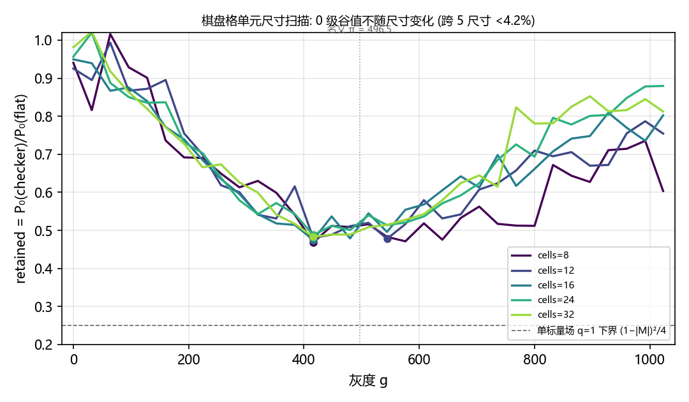
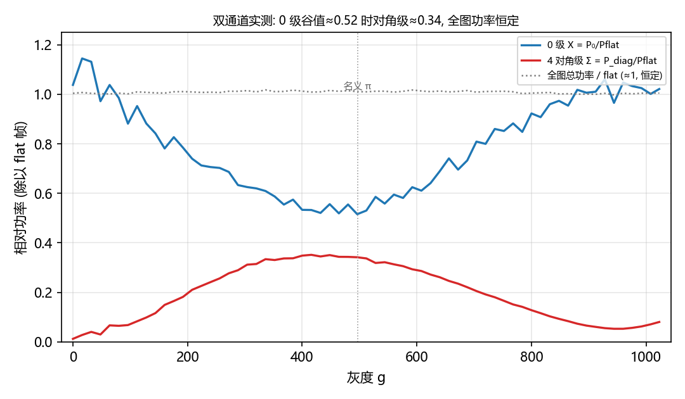
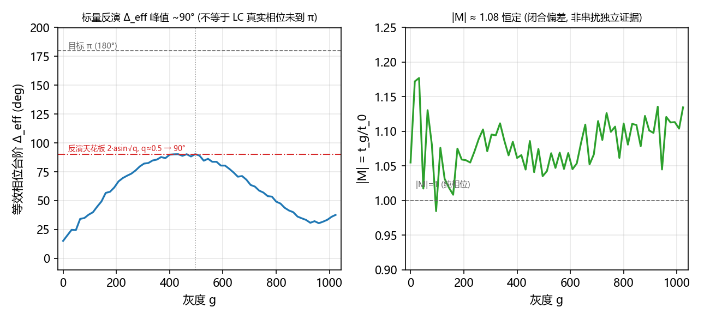
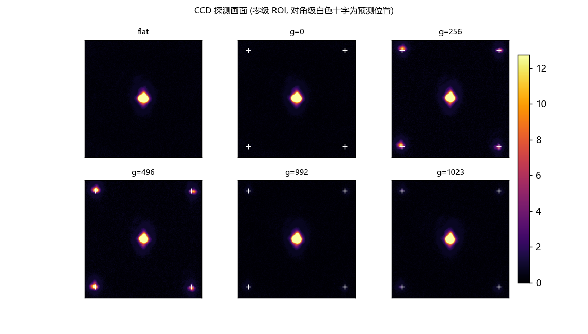
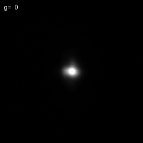

# 棋盘格 LUT 标定探测: 0 级谷值偏高与"未调制静态分量"假设

<!-- provenance:start -->
> **生成脚本**: 人工撰写，无生成脚本
> **数据/关联脚本**: [`scripts/slm/generate_lut_checker_report.py`](../../../scripts/slm/generate_lut_checker_report.py)
> **数据/关联脚本**: [`scripts/slm/calib_slm_lut_checkerboard.py`](../../../scripts/slm/calib_slm_lut_checkerboard.py)
> **数据/关联脚本**: [`scripts/slm/diag_checker_cells_sweep.py`](../../../scripts/slm/diag_checker_cells_sweep.py)
> **数据/关联脚本**: [`src/ao_shaping/utils/slm/slm_lut.py`](../../../src/ao_shaping/utils/slm/slm_lut.py)
> **运行环境**: 离线 (读已落盘的 CCD 帧与重建结果)
> **说明**: 棋盘格 (二维 0/Δ 二元相位) FFT 面双通道强度反演得到的等效相位台阶 Δ_eff(g) 在名义 π 灰度 g≈496 达峰 ~90° 后回落。已排除: 棋盘格几何尺寸 (cells 8–32 谷值 0.468–0.488)、随灰度的散射/损耗 (全图功率 0.997–1.018)。首要嫌疑 (优先于电学串扰): 约一半光是不随灰度变化的未调制静态分量 (偏振未匹配等) —— 调制功率占比 q 时标量反演的天花板是 2·arcsin√q, q≈0.5 恰为 90°, 因此“Δ_eff 不到 π”不能断言 LC 真实相位未到 π。现有 invert_checkerboard_scan 的 LUT 产物不可信, 不应作为已校正 LUT 加载。正文人工撰写; 配图与 GIF 由 scripts/slm/generate_lut_checker_report.py 离线生成 (只读已落盘帧, 只写 figures/, 不改写正文)。
<!-- provenance:end -->

## 1. 结论一句话

**现有棋盘格 LUT (`invert_checkerboard_scan` 产出的 `lut.npz` / `lut_inverse.csv`) 不可信, 不应作为已校正 LUT 加载** —— 但理由不是"这台器件的相位台阶物理上到不了 π"。

双通道强度反演给出的等效相位台阶 Δ_eff(g) 在名义 π 灰度 (g≈496) 达峰 ~90° 后回落。**若约一半光功率是不随灰度变化的未调制静态分量** (偏振未匹配等), 则标量反演的天花板为 `2·arcsin√q`, 在 q≈0.5 时**恰好是 90°**, 而 LC 真实相位完全可以单调越过 π。该假设同时定量解释 0 级谷值 (~0.5) 与对角级功率 (~0.33) 的量级。

因此优先级是:**先查偏振 / 未调制光与测量模型 (含归一化闭合偏差), 再查面积相关的电学串扰**。

## 2. 背景与目的

- 目的: 标定 SLM 灰度→相位 LUT, 用于 #235 的可靠光束中心与后续波前校正。
- 方法: 二维 50/50 棋盘格 (0/Δ 灰度), 在 FFT 面 CCD 采 0 级与衍射级光强; 灰度扫描 0–1023。
- 前置事实: 一次完整 65 点扫描谷值 0.4878 (cells=24, 理想 0); 半屏闪耀光栅 2π 深度法同样撞 0 级残留 ~0.51 → 该限制非棋盘格独有。
- 本文档: 系统性排查"谷值为何不是 0", 并判定标定通道是否可用。

## 3. 方法

### 3.1 装置与采集

| 项 | 值 |
|---|---|
| SLM | Santec SLM-200 (序列号 `22030108`), 1920×1200, 名义 2π=993 灰度 |
| 相机 | daheng `FJB24112232`, 1944×2592 uint8, 全量程 255 |
| 光路 | 4f 系统, 相机在频谱面 (FFT 面), 零级中心 (1102, 1221) |
| 曝光 | 0.02 ms (已验证不饱和; flat≈42.9k, 0.05 ms 饱和) |
| 灰度直写 | `display_data` 直写 raw 灰度, 驱动 LUT 未加载 |
| 采集纪律 | 单次连续设备会话 (避免背对背 open/close 触发驱动板假死); `require_drive_board_entry` + 饱和门禁 |

### 3.2 两套扫描

1. **单元尺寸扫描** ([`scripts/slm/diag_checker_cells_sweep.py`](../../../scripts/slm/diag_checker_cells_sweep.py)): cells ∈ {8,12,16,24,32}, 各扫粗灰度, 只落盘谷值帧+平坦帧。
2. **65 点细扫** ([`scripts/slm/calib_slm_lut_checkerboard.py`](../../../scripts/slm/calib_slm_lut_checkerboard.py)): cells=24, g=0…1023 共 65 点 (等距, 间隔 15–16), 每点一帧; 产物 `data/debug/lut_checker_20261111/`。

### 3.3 双通道标量反演 (及其适用前提)

二维 50/50 棋盘格, 调制区复振幅 `t_g·e^{iΔ}`, 参考区 `t_0`, `M=(t_g/t_0)e^{iΔ}`:

```
X     = P0/Pflat        = |1+M|²/4                            (0 级保留)
Y_sum = P_diag4/Pflat   = C₄·|1−M|²/4,  C₄ = 4(2/π)⁴ = 0.657  (4 个对角 (±1,±1) 级合计)
|M|²  = 2(X + Y_sum/C₄) − 1
Re M  = X − Y_sum/C₄
Im M  = +√(|M|² − Re M²)      (取正分支)
Δ_eff = atan2(Im M, Re M)
```

- 0 级窗: 中心 (1102,1221), 边长 90 px。对角级窗: 预测位置 `(±off,±off)`, `off = K/cells`, `K≈3768 px·cells` (5 尺寸实测校准), 边长 45 px; 每窗净功率 = 窗和 − 局部环带 (1.2–3 倍窗径) 中位数 × 窗面积。
- **适用前提 (关键)**: 单一相干标量场, 且 0 级与各衍射级用同一归一化、同一背景扣除与有效积分范围。
- 因此 **Δ_eff 是"与该组强度相容的标量等效相位", 不等于 LC 真实相位台阶**。若探测器上相加的是多个不可分辨通道 (偏振等), Δ_eff 必然被压缩。
- sanity: g=0 时棋盘格≡平坦, 应有 X=1, Y_sum=0, |M|=1, Re M=1, Δ_eff=0。

### 3.4 未调制静态分量模型 (为何 90° 不是意外)

令 `q` 为参与相位调制的功率占比, 其余 `1−q` 为不随灰度变化的静态分量。50/50 棋盘格、真实相位 δ:

```
X       = (1−q) + q·cos²(δ/2) = 1 − q·sin²(δ/2)
Y_model = q·sin²(δ/2)          ⇒  X + Y_model = 1
用 §3.3 标量公式反演 ⇒ |M| = 1,  cos Δ_eff = 1 − 2q·sin²(δ/2)
δ 单调越过 π 时, 反演角天花板  Δ_eff,max = 2·arcsin√q
```

`q=0.5, δ=π` 预测: `X = 0.5`, `P_diag/P_flat = 0.657×0.5 ≈ 0.329`, `Δ_eff = 90°`。
实测谷值处: `X = 0.516`, `Y_sum = 0.342`, `Δ_eff = 90.3°` —— **三者量级吻合**, 这是把偏振/静态分量排在电学串扰之前的直接理由。

## 4. 结果

### 4.1 单元尺寸扫描: 谷值不随尺寸变化



| cells | retained_min | 谷值灰度 | g=0 | g=992 | g=1023 |
|---|---|---|---|---|---|
| 8 | 0.4683 | 416 | 0.940 | 0.735 | 0.604 |
| 12 | 0.4777 | 544 | 0.925 | 0.787 | 0.754 |
| 16 | 0.4749 | 416 | 0.950 | 0.736 | 0.802 |
| 24 | 0.4878 | 416 | 0.957 | 0.878 | 0.880 |
| 32 | 0.4831 | 416 | 0.981 | 0.845 | 0.813 |

谷值跨度 0.0195 (相对 4.2%), 4/5 尺寸谷值同在 g=416。**像素级边缘场 / 棋盘格几何不是根因。**

### 4.2 窗口尺寸敏感性: 残留是相干核心光

0 级求和窗从 261 px 缩到 9 px, 谷值从 0.53 → 0.47 (越小越低)。残留是**相干核心光**, 不是晕轮底座; 若为杂散光底座, 小窗应快速趋零。

### 4.3 全图功率恒定

65 点扫描每帧扣背景后全图总功率 / 平坦帧 = 0.997–1.018, 与 g 无关。**无随灰度变化的散射/损耗**。(注意: 全图恒定不排除"静态分量"本身 —— 未调制光同样守恒。)

### 4.4 双通道实测与标量反演



| g | X (0 级) | Y_sum (对角) | \|M\| | Re M | Δ_eff (°) | S=X+Y_model |
|---|---|---|---|---|---|---|
| 0 | 1.038 | 0.012 | 1.055 | 1.019 | 15.1 | 1.057 |
| 128 | 0.882 | 0.099 | 1.032 | 0.732 | 44.8 | 1.032 |
| 256 | 0.702 | 0.257 | 1.089 | 0.312 | 73.4 | 1.093 |
| **496** | **0.516** | **0.342** | **1.035** | **−0.005** | **90.3** | **1.036** |
| 640 | 0.689 | 0.261 | 1.083 | 0.292 | 74.4 | 1.087 |
| 992 | 1.025 | 0.063 | 1.113 | 0.930 | 33.4 | 1.120 |
| 1023 | 1.021 | 0.081 | 1.135 | 0.898 | 37.7 | 1.144 |



- **Δ_eff(g): 15°(g=0) → 90.3°(g=496) → 33.4°(g=992)** —— 非单调"爬升—回落", 峰值恰在名义 π 灰度处, 且与 §3.4 的 q≈0.5 天花板一致。
- **|M| = 1.080 恒定** (范围 0.985–1.177): 无随灰度的幅度失配趋势。峰值处 Re M = −0.005 ≈ 0, 与 Δ_eff=90° 自洽。
- **S = X + Y_model = 1.084 ± 0.039** (范围 0.985–1.193): 与 `|M|²=2S−1` 自洽 (`√(2×1.084−1)=1.081`, 实测均值 1.080), 但相对理想闭合 S=1 有 **~8.4% 整体偏差**。
- sanity g=0: Δ_eff=15° (应 0°), |M|=1.055 (应 1) —— 绝对刻度有 ~15° 系统偏差 (flat 帧与 g=0 帧间隔的激光漂移 / 背景扣除), **相对趋势与峰值位置可信**。

### 4.5 CCD 探测画面



谷值 (g=496): 0 级斑显著减弱, 4 个对角强斑出现; 平坦帧同一位置仅晕轮。零级斑形几乎不变、仅峰值减半 (FWHM 17×14 → 15×13 px), 属功率转移非展宽。

显示约定 (避免误读亮度): ROI 半宽 190 px, 大于 cells=24 的对角级单轴偏移 157 px, 白色 "+" 即**预测**的 4 个对角级位置; 六格共用**同一条色标**, 因此格间亮度可直接比较。实测 g=0 / 992 / 1023 三格的十字落在暗背景上 (对角级几乎无功率), g=256 / 496 两格的十字落在亮斑上 —— 与 §4.4 的 Y_model 走势一致。



GIF 为全部 **65 帧**实测灰度 (g=0…1023, 含末点 1023), 左上角烧有 `g=####` 标签; 采用**全序列固定亮度上限** (各帧 ROI 99.9 分位的最大值 ≈ 101.5, 相机 DN) 而非逐帧自适应, 否则每帧都被拉回同一视亮度, 正好抹掉本要展示的谷值。动画中中央 0 级斑在 g≈496 最暗、向 g=992/1023 复亮, 与定量值一致 (以零级为中心、扣背景后的 31×31 px 窗内和: 34574 → 16452 → 32004, 谷/峰比值 0.476)。

## 5. 判据修订: 哪些推断被撤回

对单一标量场, `X = (1+|M|²+2|M|cosΔ)/4`, 若 |M|≤1 则 Δ=π 处 `X_min=(1−|M|)²/4 ≤ 0.25`。

- **撤回**: "实测谷值 0.47–0.52 > 0.25 ⇒ 相位从未到 π"。该上界**只在 q=1 (全部光被调制) 时成立**。存在未调制光时, 真实相位到达 π 仍留下约 `1−q` 的 0 级 (§3.4 预测 0.5, 与实测 0.516 相符)。
- **撤回**: "|M|>1 要求 t_0<t_g, 故是参考区被串扰抬起的独立证据"。在 8.4% 闭合偏差 (归一化 / 背景扣除 / 衍射级截取误差) 排除之前, 反演出的 M 不是单一物理传输系数, |M|>1 只能说明**模型内相对振幅比 ~1.08**。
- **保留有效**: §4.1 几何尺寸不是根因; §4.3 无随灰度的散射/损耗; 对角斑位置与预测差 ≤3 px (几何标定可信)。

## 6. 机制排序 (按当前证据)

1. **未调制静态分量 / 偏振通道 (优先)**: q≈0.5 定量解释 Δ_eff 天花板 90° + 谷值 0.5 + 对角 0.33 三个独立数字。注: 简化两通道模型预测 S=1、|M|=1, 不能同时解释 8.4% 闭合偏差, 属强候选而非完整拟合。
2. **面积相关的电学耦合** (公共电极/共电位拾取、全局边缘场): 未被占空比实验排除; 但必须先用 §7.3 的几何项 `1−4qf(1−f)` 拟合, 再看残差。
3. **LC 相位-电压响应低电压段饱和 / 偏置漂移**: 与 q 模型在强度数据上不可分辨, 需相位敏感参考 (干涉) 区分。
4. **像素尺度边缘场**: §4.1 的 cells 不敏感性使其优先级降低。
5. **测量与归一化误差**: S 的 8.4% 整体偏差、flat 归一化、环带背景扣除、g=0 sanity 的 15° 偏差 —— 须先给出不确定度, 再做机制判定。

## 7. 下一步硬件实验 (可证伪判据)

> 全部在**单次连续设备会话**内完成 (不背对背 open/close); 采集前过 `require_drive_board_entry` 与饱和门禁。

**7.1 会话基线复测** — 原设置复测 flat + 标准 50/50 棋盘格粗扫, 落盘原始帧与 X / Y_model / S。判据: 谷值与 S 均值在本会话重复误差内复现 §4.4。

**7.2 偏振对照 (当前最缺的一刀)** — 在可用的入射偏振 / 检偏设置之间重复关键灰度扫描。
- **支持未调制偏振分量**: 优化调制偏振后谷值明显下降、衍射功率相应上升, 且变化幅度 **> 重复测量波动的 3 倍**; 各偏振设置**各自拟一个 q**、但共享**同一条相位响应曲线** δ(g) 时能同时拟合数据。
- ⚠️ 判据**不是**"同一个 q 拟合各设置": 偏振设置改变的正是调制/未调制占比, q 本就该随之变化; 真正被约束的是相位响应 δ(g) 与峰值灰度位置不随偏振移动。
- 若谷值随偏振设置基本不动 (3 倍重复误差内) → 该假设降级, 回到 §6.2。

**7.3 占空比扫描 (不能用固定谷值阈值)** — 固定 cells=24, 占空 f ∈ {1/8, 1/2, 7/8} (看出趋势再补点)。
理想两区图案: `X = 1 − 4qf(1−f)·sin²(δ/2)`, 真实相位到 π 时 `X_min = 1 − 4qf(1−f)`。
⇒ f=1/8 时**即使 q=1** 理想谷值也只有 0.5625, q=0.5 时预测 0.781。旧判据"f=1/8 谷值 <0.15 才证实串扰"**不成立, 已作废**。
- 正确用法: 检验各 f 的曲线能否由**同一个 q 与同一相位响应**拟合。
- **支持面积耦合**: 必须让相位响应随 f 改变才能解释数据, 且差异 **> 3 倍重复误差**并在多个 f 上一致。单看谷值变化不足以区分几何效应与耦合。
- 各占空比图案须用**各自的 Fourier 系数**, 不能沿用 C₄=0.657。

**7.4 半屏两区 (最低空间频率)** — 只测 0 级空深度, 作为对像素级平滑/串扰不敏感的独立对照。

**7.5 谷值灰度连拍 20 帧** — 比较 0 级与衍射级逐帧波动。
- **支持时间不稳定**: 帧间变化明显超过平坦帧与同设置重复测量的基线波动, 尤其出现周期、双峰或灰度相关跳变。
- 注意: 若单次曝光覆盖多个刷新周期, 连拍**不能**排除帧内时间平均; 需控制曝光相对刷新时序, 或比较多个曝光时长。

**判定后走向**: 若偏振对照显示 q 可变 → 先把 q 纳入模型再重标定; 若占空比显示相位随面积变化 → 极小占空比**不自动等于**可信标定 (目标衍射信号变弱, 且面积趋零不保证偏振问题消失)。只有确认响应随 f 稳定、并解决相位分支与幅度归一化, 双通道反演才可作为可靠的 φ(g) 标定; 否则转干涉通道做绝对相位测量。

## 8. 对 LUT 与下游的影响

- **`invert_checkerboard_scan` 的 LUT 产物不可信** (它把谷值处当作 π 反演), 不进入生产加载; 序列号绑定持久化时标记 `provisional`, 不激活。
- **本报告不再断言衍射类标定通道存在"~0.5 残留的物理上限"**。现有数据只支持: 当前标量反演把一条未必等于 LC 真实相位的量称作 Δ_eff。
- #235 的光束中心依赖可靠相位校正, 该阻塞维持 → **保持 issue #235 OPEN**。

### 8.1 本轮已落地的持久化与信任闸门

- 归档位置 `data/calib/lut/<SLM 序列号>/` (`lut.npz` + `lut_forward.csv` + `lut_inverse.csv` + `meta.json`), 原子写; 本台产物在 `data/calib/lut/22030108/`, `status: provisional`。
- ⚠️ 该目录**不进版本库**: `.gitignore` 的 `data/*` 覆盖了 `data/calib/` (仓库里 `data/` 下仅个别文件被显式白名单跟踪)。所以 LUT 归档是**本机设备绑定资产**, 换机器 / 新克隆需重新标定, 不要指望 checkout 能带过去。
- 核验: 归档 npz 的数值数组与源产物逐字节一致, CSV 与 `inverse_gray` 一致, `inverse_gray` 单调 0–992。
- `Santec.load_lut()` **先过信任闸门再解析表数据**: 缺 `meta.json`、非法/空序列号、或 `status != validated` 一律拒绝, 且拒绝时保留驱动原有 LUT 状态。核对过全部调用点: 生产代码不自动 `load_lut` (只有 GUI/CLI/脚本显式调用), 闸门不会影响正常 `open()`。

### 8.2 需设备会话的后续项 (本轮未改采集/权威脚本)

1. **空序列号生产者**: `scripts/slm/calib_slm_lut_checkerboard.py:266` 与 `scripts/slm/diag_checker_cells_sweep.py:244` 用 `getattr(slm, "serial", "")` 取序列号, 而驱动实际暴露的是 `serial_number` 属性 / `get_serial_number()` —— 因此 meta 里的 `slm_serial` **恒为空串**。改走 `save_serial_lut` 前须在一次设备会话里确认序列号的取数时机 (`open()` 之后何处已缓存)。
2. **权威 `slm-lut` 管线与新闸门的冲突**: `src/ao_shaping/tools/slm/calibration/lut_runner.py:848` 的 `save_lut` 不带 meta, 其成功提示 (L894) 让用户直接 `slm.load_lut(...)`, 现会被闸门拒绝。同属需带设备的会话一并改造, 本轮不做盲改。
3. 上述两条完成前, 任何 `slm-lut` / 棋盘格产物都只作**离线诊断输入**, 不得当作已校正 LUT 加载。

## 9. 公式修正历史 (审计用)

| 版本 | 错误 | 后果 (已作废) |
|---|---|---|
| v1 | `\|M\| = √((X+Y)/2 − 1)` | \|M\| 0.588, Δ 132° |
| v2 | `C = (2/π)⁴ = 0.1643` (应为 4 级合计 4(2/π)⁴) | \|M\| 2.09 |
| v3 | `Re M = (X − Y)/4` (应为 `X − Y`) | Δ g=0 sanity 76° |
| **v4** | — | \|M\|≈1.08, Δ 峰 90.3°, sanity 15° (**本文采用**) |

产物: `data/debug/lut_checker_20261111/order_reconstruction_v4.json`。

## 10. 产物与复现

- 数据: `data/debug/lut_checker_cells_20261111/` (尺寸扫描, `summary.json`), `data/debug/lut_checker_20261111/` (65 点扫描, `frames/`, `order_reconstruction_v4.json`)。
- 配图: `figures/01_cells_sweep.png` … `figures/05_checker_scan.gif` (本脚本生成)。
- 表格: `artifacts/cells_sweep.csv`, `artifacts/reconstruction_v4.csv`。
- 复现: `python scripts/slm/generate_lut_checker_report.py` (离线, 只读已落盘帧)。
