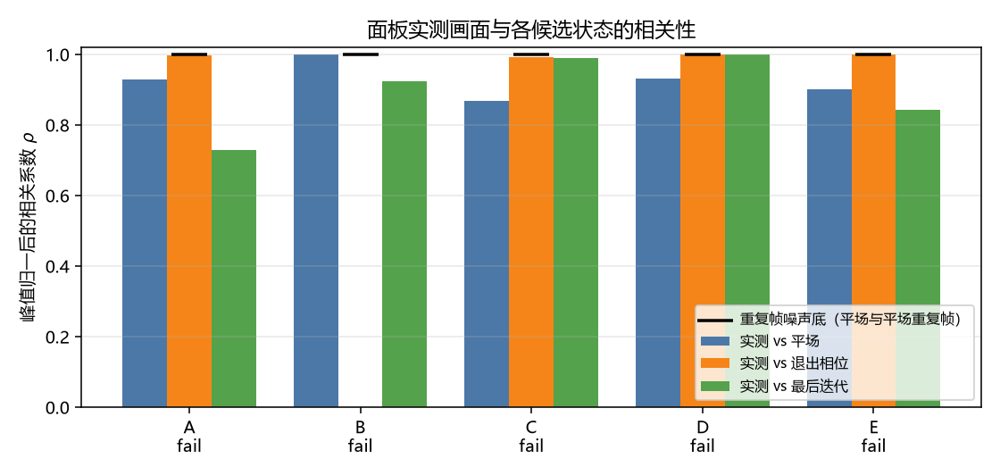
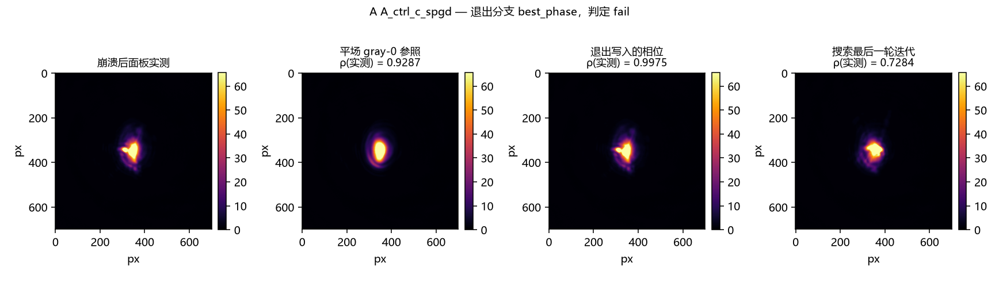
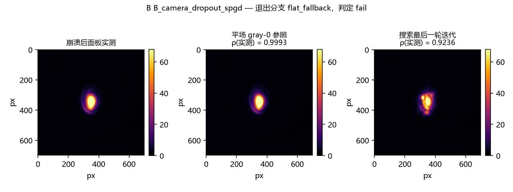
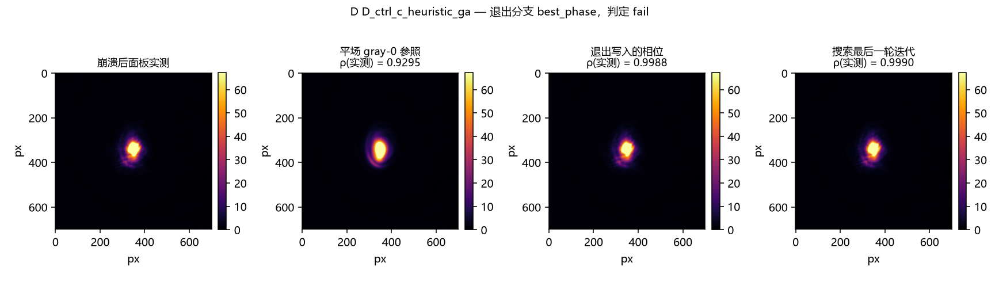
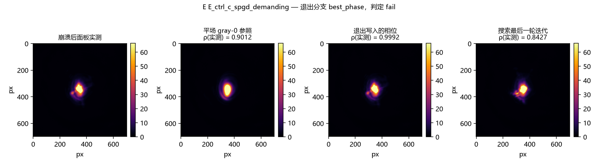

# R-8 安全退出态的硬件验收（issue #145 / H-28）

<!-- provenance:start -->
> **生成脚本**: [`scripts/slm/generate_pib_exit_safety_report.py`](../../../scripts/slm/generate_pib_exit_safety_report.py)
> **复现命令**: `python scripts/slm/generate_pib_exit_safety_report.py`
> **数据/关联脚本**: [`scripts/slm/verify_pib_exit_safety_hw.py`](../../../scripts/slm/verify_pib_exit_safety_hw.py)
> **数据/关联脚本**: [`tests/ao_shaping/scripts/test_verify_pib_exit_safety_hw.py`](../../../tests/ao_shaping/scripts/test_verify_pib_exit_safety_hw.py)
> **运行环境**: 离线 (读硬件采集的 summary.json 与远场裁切)
> **说明**: issue #145 (H-28) 的硬件验收: 搜索主体被 KeyboardInterrupt / 相机掉线打断后, 面板实际停在哪个状态 —— 固件回读 (内存槽号 / 直接灰度) 与光学比对两条独立证据, 外加退出写入是否绕开了「写到当前显示槽是空操作」的固件陷阱
<!-- provenance:end -->

本报告由 `scripts/slm/generate_pib_exit_safety_report.py` 从 `report/slm/pib_exit_safety/artifacts/run_20261110_213859/summary.json` 离线渲染；所有数值来自该目录下的产物，正文不手写数字。

被验收的行为是：`slm_zernike_pib` 的搜索主体整体包在 `try: ... finally: _apply_best_on_exit()` 内，因此相机掉线、系数越界或 `KeyboardInterrupt` 都不会让面板停在搜索最后写入的任意图案上；清理自身失败时强制回到平场 gray-0。

## 结论

| 场景 | 注入的失败 | 退出分支 | 固件回读 | 光学判定 | 清理耗时 (s) | 判定 |
|---|---|---|---|---|---|---|
| A `A_ctrl_c_spgd` | `KeyboardInterrupt` | `best_phase` | 内存槽 #34（退出写入槽 #34） | `exit` | 1.80 | **失败** |
| B `B_camera_dropout_spgd` | `CameraError` | `flat_fallback` | 直接灰度模式，灰度值 0 | `flat` | 0.89 | **失败** |
| C `C_rerun_after_crash` | `—` | `best_phase` | 内存槽 #117（退出写入槽 #117） | `exit` | — | **失败** |
| D `D_ctrl_c_heuristic_ga` | `KeyboardInterrupt` | `best_phase` | 内存槽 #46（退出写入槽 #46） | `last_iterate` | 1.75 | **失败** |
| E `E_ctrl_c_spgd_demanding` | `KeyboardInterrupt` | `best_phase` | 内存槽 #89（退出写入槽 #89） | `exit` | 1.85 | **失败** |

共 5 个场景，0 个通过、5 个未通过：`A`、`B`、`C`、`D`、`E`。未通过的场景逐项列在下方对应小节里。

## 验收口径

issue #145 列出六个观测点；下表把它们映射到本报告读取的字段。参与最终判定的检查项在各场景表格里标注为「门禁」，其余只作记录，避免把一个数字误当成已通过的门槛。

| 观测点 | 证据字段 | 覆盖场景 |
|---|---|---|
| ① Ctrl-C 后面板停在最佳相位或平场 | `exit_branch` + `firmware_is_named_state` + `exit_used_a_fresh_slot` + `optical_is_defined_state` | 场景 A / D / E |
| ② 相机掉线后面板强制平场 gray-0 | `exit_branch == flat_fallback`、`firmware_mode == grayscale`、`current_grayscale == 0` | 场景 B |
| ③ 原始异常不被清理吞掉 | `original_exception_survived_cleanup` + `outcome.exception_message` | 场景 A / B / D / E |
| ④ 清理在 1–2 s 内完成 | `outcome.cleanup_s`（门禁 `cleanup_under_5s` 放宽到 5 s，给记录开销留余量） | 场景 A / B / D / E |
| ⑤ 异常后紧接的正常短跑 epoch-0 正常 | `recorder.epoch0.pib` / `epoch0.max_brt`（门禁 `epoch0_is_sane`） | 场景 C |
| ⑥ `energy_loss_violations` 以 int 出现在 recorder 上 | `recorder.energy_loss_violations` + `energy_loss_violations_recorded` | 场景 A / B / D / E |

本次运行包含的场景：`A`、`B`、`C`、`D`、`E`。

参与判定的门禁项：`cleanup_under_5s`、`energy_loss_violations_recorded`、`epoch0_is_sane`、`exit_used_a_fresh_slot`、`failure_reached_caller`、`firmware_is_named_state`、`optical_is_defined_state`、`original_exception_survived_cleanup`、`run_completed`。



## 场景与结果

### 场景 A — A_ctrl_c_spgd

async KeyboardInterrupt mid-SPGD

| 项 | 值 |
|---|---|
| 搜索配置 | algorithm=`spgd`，epochs=200，pop_size=—，target_size=64.0，n_max=7 |
| 注入的失败 | `KeyboardInterrupt`：_thread.interrupt_main from a timer at memory write #30（触发：是） |
| 到达调用方的异常 | `KeyboardInterrupt`：— |
| 退出分支 | `best_phase` |
| 固件回读 | 内存槽 #34（退出写入槽 #34） |
| 从注入到返回 | 1.80 s |
| 判定 | **失败** |
| 未通过的门禁 | `epoch0_is_sane` |

**检查项**

| 检查 | 结果 | 说明 |
|---|---|---|
| `failure_reached_caller`（门禁） | ✅ | 注入的异常确实到达了调用方（场景真的以失败告终） |
| `original_exception_survived_cleanup`（门禁） | ✅ | 到达调用方的异常类型就是注入的那一种：清理没有用新异常覆盖它 |
| `firmware_is_named_state`（门禁） | ✅ | 固件回读得到的状态是本脚本记录过的某个写入（内存槽号一致，或直接灰度模式且灰度值为 0） |
| `exit_used_a_fresh_slot`（门禁） | ✅ | 退出写入没有落在当前已显示的内存槽上；落在同一槽时 `display_memory` 是空操作，面板不会刷新 |
| `optical_is_defined_state`（门禁） | ✅ | 面板实测画面与某个已写入状态的相关性达到重复帧噪声底，说明面板显示的是写过的状态而非任意图案 |
| `cleanup_under_5s`（门禁） | ✅ | 从注入到函数返回不超过 5 s（报告同时给出实测值；验收要求为 1–2 s） |
| `energy_loss_violations_recorded`（门禁） | ✅ | `recorder` 上带有 int 类型的 `energy_loss_violations` |
| `epoch0_is_sane`（门禁） | ❌ | 异常后紧接的正常短跑，其 epoch-0 的 `pib` 与峰值亮度处于健康量级（不是目标框未对准的坍缩症状） |

**光学比对**

| 比较 | $\rho$ |
|---|---|
| 实测 vs 平场 gray-0 | 0.9287 |
| 实测 vs 退出写入的相位 | 0.9975 |
| 实测 vs 搜索最后一轮迭代 | 0.7284 |
| 平场与平场重复帧（噪声底） | 0.9981 |

**注入前的最后几次写入**

| # | 类型 | 内存槽 | 灰度范围 | 固定灰度 |
|---|---|---|---|---|
| 24 | memory | 26 | 0–1022 | — |
| 25 | memory | 27 | 0–1022 | — |
| 26 | memory | 28 | 0–1022 | — |
| 27 | memory | 29 | 0–1022 | — |
| 28 | memory | 30 | 0–1022 | — |
| 29 | memory | 31 | 0–1022 | — |

**注入后的写入（即清理）**

| # | 类型 | 内存槽 | 灰度范围 | 固定灰度 |
|---|---|---|---|---|
| 30 | memory | 32 | 0–1022 | — |
| 31 | memory | 33 | 0–0 | — |
| 32 | memory | 34 | 0–1022 | — |



### 场景 B — B_camera_dropout_spgd

camera get_numpy_image raises CameraError mid-SPGD

| 项 | 值 |
|---|---|
| 搜索配置 | algorithm=`spgd`，epochs=200，pop_size=—，target_size=64.0，n_max=7 |
| 注入的失败 | `CameraError`：CameraError from get_numpy_image at capture #60（触发：是） |
| 到达调用方的异常 | `CameraError`：injected camera dropout at capture #60 |
| 退出分支 | `flat_fallback` |
| 固件回读 | 直接灰度模式，灰度值 0 |
| 从注入到返回 | 0.89 s |
| 判定 | **失败** |
| 未通过的门禁 | `epoch0_is_sane` |

**检查项**

| 检查 | 结果 | 说明 |
|---|---|---|
| `failure_reached_caller`（门禁） | ✅ | 注入的异常确实到达了调用方（场景真的以失败告终） |
| `original_exception_survived_cleanup`（门禁） | ✅ | 到达调用方的异常类型就是注入的那一种：清理没有用新异常覆盖它 |
| `firmware_is_named_state`（门禁） | ✅ | 固件回读得到的状态是本脚本记录过的某个写入（内存槽号一致，或直接灰度模式且灰度值为 0） |
| `optical_is_defined_state`（门禁） | ✅ | 面板实测画面与某个已写入状态的相关性达到重复帧噪声底，说明面板显示的是写过的状态而非任意图案 |
| `cleanup_under_5s`（门禁） | ✅ | 从注入到函数返回不超过 5 s（报告同时给出实测值；验收要求为 1–2 s） |
| `energy_loss_violations_recorded`（门禁） | ✅ | `recorder` 上带有 int 类型的 `energy_loss_violations` |
| `epoch0_is_sane`（门禁） | ❌ | 异常后紧接的正常短跑，其 epoch-0 的 `pib` 与峰值亮度处于健康量级（不是目标框未对准的坍缩症状） |

**光学比对**

| 比较 | $\rho$ |
|---|---|
| 实测 vs 平场 gray-0 | 0.9993 |
| 实测 vs 搜索最后一轮迭代 | 0.9236 |
| 平场与平场重复帧（噪声底） | 0.9994 |

**注入前的最后几次写入**

| # | 类型 | 内存槽 | 灰度范围 | 固定灰度 |
|---|---|---|---|---|
| 52 | memory | 87 | 0–1022 | — |
| 53 | memory | 88 | 0–1022 | — |
| 54 | memory | 89 | 0–1022 | — |
| 55 | memory | 90 | 0–1022 | — |
| 56 | memory | 91 | 0–1022 | — |
| 57 | memory | 92 | 0–1022 | — |

**注入后的写入（即清理）**

| # | 类型 | 内存槽 | 灰度范围 | 固定灰度 |
|---|---|---|---|---|
| 58 | memory | 93 | 0–1022 | — |
| 59 | grayscale | — | — | 0 |



### 场景 C — C_rerun_after_crash

normal short run right after B

| 项 | 值 |
|---|---|
| 搜索配置 | algorithm=`spgd`，epochs=10，pop_size=—，target_size=64.0，n_max=7 |
| 注入的失败 | `None`：—（触发：否） |
| 到达调用方的异常 | `None`：— |
| 退出分支 | `best_phase` |
| 固件回读 | 内存槽 #117（退出写入槽 #117） |
| 从注入到返回 | — s |
| 判定 | **失败** |
| 未通过的门禁 | `epoch0_is_sane` |

**检查项**

| 检查 | 结果 | 说明 |
|---|---|---|
| `run_completed`（门禁） | ✅ | 该场景不注入异常，正常运行到结束 |
| `firmware_is_named_state`（门禁） | ✅ | 固件回读得到的状态是本脚本记录过的某个写入（内存槽号一致，或直接灰度模式且灰度值为 0） |
| `exit_used_a_fresh_slot`（门禁） | ✅ | 退出写入没有落在当前已显示的内存槽上；落在同一槽时 `display_memory` 是空操作，面板不会刷新 |
| `optical_is_defined_state`（门禁） | ✅ | 面板实测画面与某个已写入状态的相关性达到重复帧噪声底，说明面板显示的是写过的状态而非任意图案 |
| `cleanup_under_5s` | — | 从注入到函数返回不超过 5 s（报告同时给出实测值；验收要求为 1–2 s） |
| `energy_loss_violations_recorded`（门禁） | ✅ | `recorder` 上带有 int 类型的 `energy_loss_violations` |
| `epoch0_is_sane`（门禁） | ❌ | 异常后紧接的正常短跑，其 epoch-0 的 `pib` 与峰值亮度处于健康量级（不是目标框未对准的坍缩症状） |

**光学比对**

| 比较 | $\rho$ |
|---|---|
| 实测 vs 平场 gray-0 | 0.8670 |
| 实测 vs 退出写入的相位 | 0.9905 |
| 实测 vs 搜索最后一轮迭代 | 0.9884 |
| 平场与平场重复帧（噪声底） | 0.9994 |

**注入前的最后几次写入**

| # | 类型 | 内存槽 | 灰度范围 | 固定灰度 |
|---|---|---|---|---|
| 18 | memory | 112 | 0–1022 | — |
| 19 | memory | 113 | 0–1022 | — |
| 20 | memory | 114 | 0–1022 | — |
| 21 | memory | 115 | 0–1022 | — |
| 22 | memory | 116 | 0–0 | — |
| 23 | memory | 117 | 0–1022 | — |


### 场景 D — D_ctrl_c_heuristic_ga

async KeyboardInterrupt mid-GA (heuristic branch)

| 项 | 值 |
|---|---|
| 搜索配置 | algorithm=`ga`，epochs=200，pop_size=6，target_size=64.0，n_max=7 |
| 注入的失败 | `KeyboardInterrupt`：_thread.interrupt_main from a timer at memory write #50（触发：是） |
| 到达调用方的异常 | `KeyboardInterrupt`：— |
| 退出分支 | `best_phase` |
| 固件回读 | 内存槽 #46（退出写入槽 #46） |
| 从注入到返回 | 1.75 s |
| 判定 | **失败** |
| 未通过的门禁 | `epoch0_is_sane` |

**检查项**

| 检查 | 结果 | 说明 |
|---|---|---|
| `failure_reached_caller`（门禁） | ✅ | 注入的异常确实到达了调用方（场景真的以失败告终） |
| `original_exception_survived_cleanup`（门禁） | ✅ | 到达调用方的异常类型就是注入的那一种：清理没有用新异常覆盖它 |
| `firmware_is_named_state`（门禁） | ✅ | 固件回读得到的状态是本脚本记录过的某个写入（内存槽号一致，或直接灰度模式且灰度值为 0） |
| `exit_used_a_fresh_slot`（门禁） | ✅ | 退出写入没有落在当前已显示的内存槽上；落在同一槽时 `display_memory` 是空操作，面板不会刷新 |
| `optical_is_defined_state`（门禁） | ✅ | 面板实测画面与某个已写入状态的相关性达到重复帧噪声底，说明面板显示的是写过的状态而非任意图案 |
| `cleanup_under_5s`（门禁） | ✅ | 从注入到函数返回不超过 5 s（报告同时给出实测值；验收要求为 1–2 s） |
| `energy_loss_violations_recorded`（门禁） | ✅ | `recorder` 上带有 int 类型的 `energy_loss_violations` |
| `epoch0_is_sane`（门禁） | ❌ | 异常后紧接的正常短跑，其 epoch-0 的 `pib` 与峰值亮度处于健康量级（不是目标框未对准的坍缩症状） |

**光学比对**

| 比较 | $\rho$ |
|---|---|
| 实测 vs 平场 gray-0 | 0.9295 |
| 实测 vs 退出写入的相位 | 0.9988 |
| 实测 vs 搜索最后一轮迭代 | 0.9990 |
| 平场与平场重复帧（噪声底） | 0.9984 |

**注入前的最后几次写入**

| # | 类型 | 内存槽 | 灰度范围 | 固定灰度 |
|---|---|---|---|---|
| 44 | memory | 38 | 0–1022 | — |
| 45 | memory | 39 | 0–1022 | — |
| 46 | memory | 40 | 0–1022 | — |
| 47 | memory | 41 | 0–1022 | — |
| 48 | memory | 42 | 0–1022 | — |
| 49 | memory | 43 | 0–1022 | — |

**注入后的写入（即清理）**

| # | 类型 | 内存槽 | 灰度范围 | 固定灰度 |
|---|---|---|---|---|
| 50 | memory | 44 | 0–1022 | — |
| 51 | memory | 45 | 0–0 | — |
| 52 | memory | 46 | 0–1022 | — |



### 场景 E — E_ctrl_c_spgd_demanding

async KeyboardInterrupt mid-SPGD on a 16 px box (forces best != flat)

| 项 | 值 |
|---|---|
| 搜索配置 | algorithm=`spgd`，epochs=200，pop_size=—，target_size=16.0，n_max=7 |
| 注入的失败 | `KeyboardInterrupt`：_thread.interrupt_main from a timer at memory write #40（触发：是） |
| 到达调用方的异常 | `KeyboardInterrupt`：— |
| 退出分支 | `best_phase` |
| 固件回读 | 内存槽 #89（退出写入槽 #89） |
| 从注入到返回 | 1.85 s |
| 判定 | **失败** |
| 未通过的门禁 | `epoch0_is_sane` |

**检查项**

| 检查 | 结果 | 说明 |
|---|---|---|
| `failure_reached_caller`（门禁） | ✅ | 注入的异常确实到达了调用方（场景真的以失败告终） |
| `original_exception_survived_cleanup`（门禁） | ✅ | 到达调用方的异常类型就是注入的那一种：清理没有用新异常覆盖它 |
| `firmware_is_named_state`（门禁） | ✅ | 固件回读得到的状态是本脚本记录过的某个写入（内存槽号一致，或直接灰度模式且灰度值为 0） |
| `exit_used_a_fresh_slot`（门禁） | ✅ | 退出写入没有落在当前已显示的内存槽上；落在同一槽时 `display_memory` 是空操作，面板不会刷新 |
| `optical_is_defined_state`（门禁） | ✅ | 面板实测画面与某个已写入状态的相关性达到重复帧噪声底，说明面板显示的是写过的状态而非任意图案 |
| `cleanup_under_5s`（门禁） | ✅ | 从注入到函数返回不超过 5 s（报告同时给出实测值；验收要求为 1–2 s） |
| `energy_loss_violations_recorded`（门禁） | ✅ | `recorder` 上带有 int 类型的 `energy_loss_violations` |
| `epoch0_is_sane`（门禁） | ❌ | 异常后紧接的正常短跑，其 epoch-0 的 `pib` 与峰值亮度处于健康量级（不是目标框未对准的坍缩症状） |

**光学比对**

| 比较 | $\rho$ |
|---|---|
| 实测 vs 平场 gray-0 | 0.9012 |
| 实测 vs 退出写入的相位 | 0.9992 |
| 实测 vs 搜索最后一轮迭代 | 0.8427 |
| 平场与平场重复帧（噪声底） | 0.9995 |

**注入前的最后几次写入**

| # | 类型 | 内存槽 | 灰度范围 | 固定灰度 |
|---|---|---|---|---|
| 34 | memory | 81 | 0–1022 | — |
| 35 | memory | 82 | 0–1022 | — |
| 36 | memory | 83 | 0–1022 | — |
| 37 | memory | 84 | 0–1022 | — |
| 38 | memory | 85 | 0–1022 | — |
| 39 | memory | 86 | 0–1022 | — |

**注入后的写入（即清理）**

| # | 类型 | 内存槽 | 灰度范围 | 固定灰度 |
|---|---|---|---|---|
| 40 | memory | 87 | 0–1022 | — |
| 41 | memory | 88 | 0–0 | — |
| 42 | memory | 89 | 0–1022 | — |



## 与离线测试的分工

`tests/ao_shaping/optimizer/wfless/test_slm_zernike_pib_hardware_safety.py` 在数字孪生上证明了控制流：`finally` 一定执行、调用顺序正确、清理自身失败时回落到 `set_grayscale(0)`、原始异常存活。它证明不了面板状态，因为假驱动没有固件：

1. `display_data(gray, memory_number=slot)` 在 `slot` 正是当前显示槽时是**空操作**，LCOS 不刷新。清理「写了最佳相位」可能写进了空处。本报告用写入日志（`exit_used_a_fresh_slot`）和光学比对两条独立证据核查这一点。
2. `set_grayscale(0)` 是否真的让面板成为平场，是设备事实，只能在实验系统上读取。
3. 真实拆除路径上的 `close()` 若在异常展开时抛错，会覆盖原始异常；只有走真实驱动才能观察到这一点。

## 复现

```bash
# 1) 采集（需要设备；SLM 用内存模式，且没有别的进程占用 USB 句柄）
python scripts/slm/verify_pib_exit_safety_hw.py
# 2) 离线渲染本报告
python scripts/slm/generate_pib_exit_safety_report.py
```

| 实验系统 | 值 |
|---|---|
| SLM | #1，video_mode=0，λ=1064 nm，2π 对应灰度 993 |
| 会话开始时的显示槽 | 直接灰度模式（回读错误码 1 属正常） |
| 相机 | daheng #0，画幅 [1944, 2592]，验收曝光 0.034 ms |
| 产物目录 | `report/slm/pib_exit_safety/artifacts/run_20261110_213859` |
| 采集时间 | 2026-11-10T13:38:59.303+00:00 → 2026-11-10T13:41:43.472+00:00 |

采集脚本把两个**搜索质量门禁**关掉了（`fold_ratio=0`、`noise_gate_k=-1`）。它们只决定一步梯度更新是否被提交，与退出路径无关；但本实验系统的平场远场是散斑，逐轮峰值在 2–4 倍间起伏，门禁会把每一轮都判成亮度折叠，搜索因此没有任何迭代可回填，「停在最佳相位」这条分支就永远走不到。关掉它们是为了让搜索真的移动面板。

---

本文件由脚本生成，请勿手工编辑；溯源块由 `python scripts/sync_report_provenance.py` 插入。
