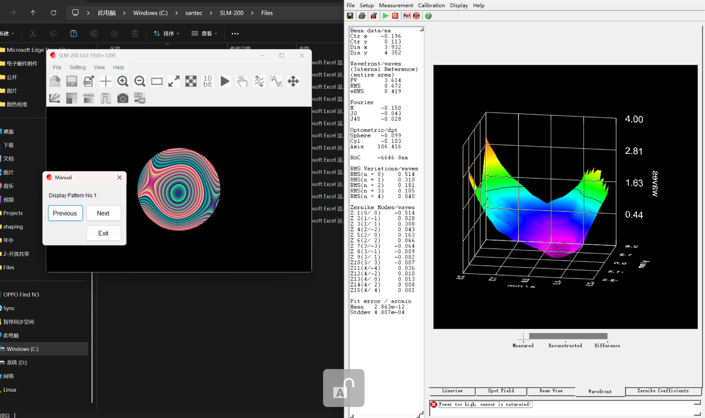
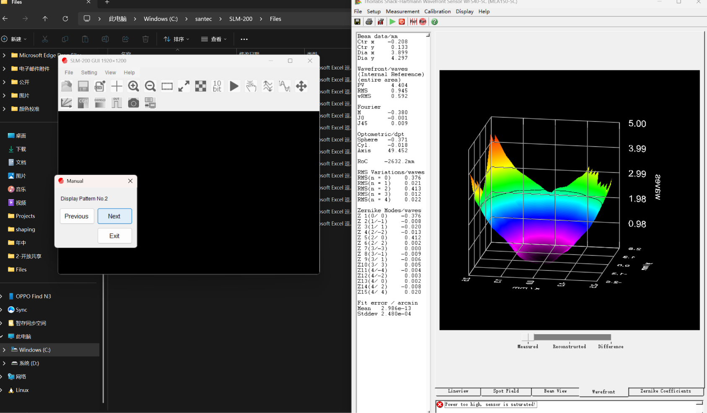

# Zernike 响应矩阵 — 采集现场截图

<!-- provenance:start -->
> **生成脚本**: 人工撰写，无生成脚本
> **运行环境**: 硬件
> **说明**: 响应矩阵采集现场截图记录 (image/capture/)
<!-- provenance:end -->

**本轮结论**：本文件为 Zernike 响应矩阵标定过程的现场截图存档（标定软件界面与光路状态），用于佐证 `report3.md` 所述重标实验的现场条件；数据结论以 `report/slm/report3.md` 为准。
