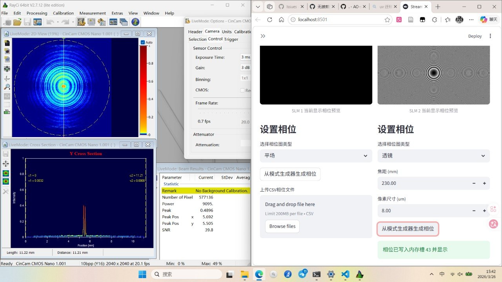
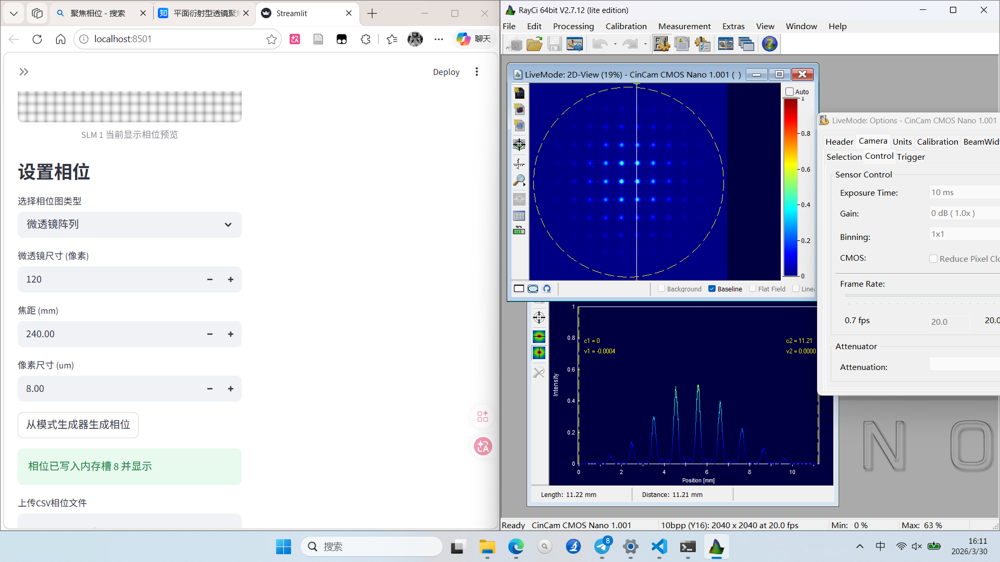

## 实验目标

<!-- provenance:start -->
> **生成脚本**: 人工撰写，无生成脚本
> **运行环境**: 硬件
> **说明**: SLM-200 MLA 实验记录；images/slm_mla_test/ 为同期截图
<!-- provenance:end -->

**本轮结论**（SLM-200 + 微透镜阵列 MLA 动态相位探测前置实验）：本轮打通了 SLM 驱动控制与光路搭建，聚焦相位下出现的双峰光斑经排查归因于**光路未准直**，已通过重新准直解决；同时确认 MLA 与 CCD 的像素匹配须计入外围尺寸，并采用平面衍射公式 Φ(r)=2π/λ·(f−√(f²+r²)) 计算聚焦相位后光斑正常。后续待办：由 Zernike 相位反解波前（加权质心/拟合/端到端三路线）并建立 IAO–Phase 直接映射，作为动态相位探测的下一步。

探究动态相位探测手段，先基于SLM动态相位测试

## 实验记录

### 光斑测试

### slm添加相位测试

1. 本次实验主要测试SLM驱动控制以及光路设置：
2. 添加聚焦相位，出现双峰，怀疑是光路没有准直
   

   1. TODO:

      * ~~研究MLA参数设置与CCD像素匹配关系，可以找张其老师要一下材料~~
      * ~~解决聚焦双峰问题：1. 准直~~
3. 解决问题：

   1. 像素尺寸要计算外围尺寸
   2. 使用平面衍射公式计算相位：
      $$
      \Phi(r)=2\pi/\lambda \cdot (f-\sqrt{f^2+r^2})
      $$
4. 微透镜阵列

   
5. TODO：

   1. 生成特定zernike相位，反解出波前（加权质心计算、拟合、端到端）
   2. 建立IAO~Phase直接映射关系
