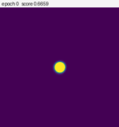
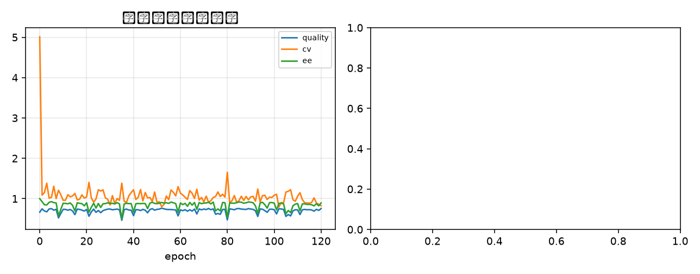

# 湍流仿真整形实验报告 — 20261127_154209

<!-- provenance:start -->
> **生成脚本**: [`scripts/slm/run_turb_shaping_matrix.py`](../../../../scripts/slm/run_turb_shaping_matrix.py)
> **复现命令**: `python scripts/slm/run_turb_shaping_matrix.py --variants model_in_loop --turb-mode dynamic --epochs 120 --n-max 8 --cam-size 256 --out-root data/turb_matrix_m5b_dyn --report-root report/turbulence_shaping/matrix_20261127_m5b_dynamic`
> **运行环境**: 离线（数字孪生 sim 设备，无需 SLM / CCD / 激光）
> **说明**: M5b dynamic 单元 model_in_loop x cn2=2e-13; accepted 3/120; 双 GIF + metrics.png
<!-- provenance:end -->

| 项 | 值 |
|---|---|
| 变体 | model_in_loop |
| 湍流机制 | dynamic |
| cn2 (生成器旋钮) | 2e-13 |
| 实测 σ_total | 0.2832 rad (0.0451 waves) |
| 光学求值次数 | 2021 |
| epochs | 120 |
| quality 首/末/最优 | 0.6659210501654473 / 0.7555077496800806 / 0.7654258603439148 |

## 动态演化

## 口径注记

- 湍流幅度按 `SimDisturbance.stats()` **实测**记录 (生成器旋钮 cn2/距离 退化, 解析值不可信);
- dynamic = 每次光学求值全新独立相位屏 (时间白极限), 依据见 `src/ao_shaping/drivers/sim/disturbance.py` 模块 docstring;
- 相位帧由记录系数经 `utils/wavefront/zernike_utils.generate_zernike_phase` 重建 raw 弧度, 再经 `utils/slm/phase_display.phase_to_slm_grayscale(slm=None)` 纯换算; 全序列共用同一 PV 色标。
