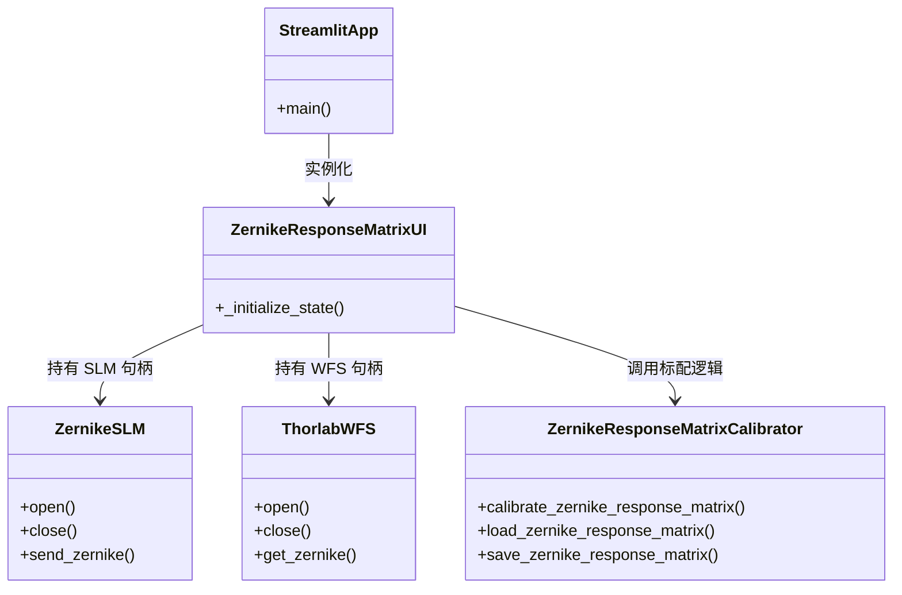
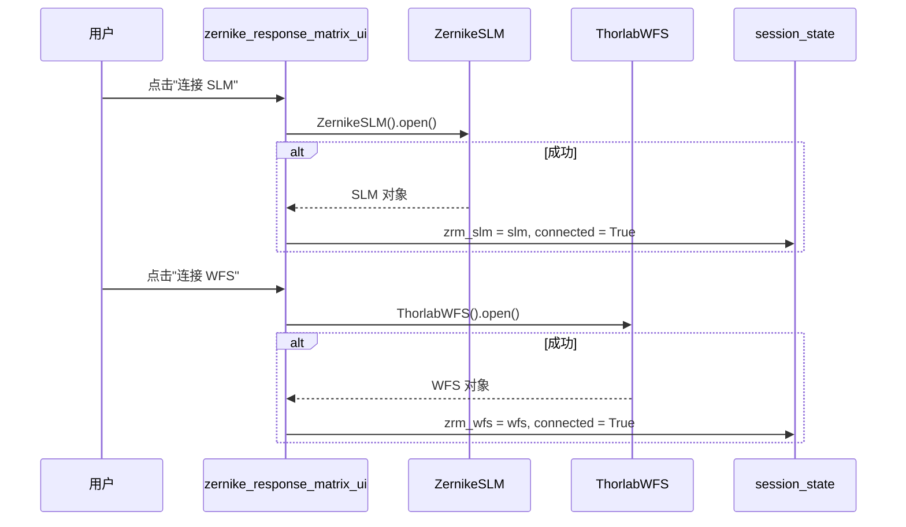
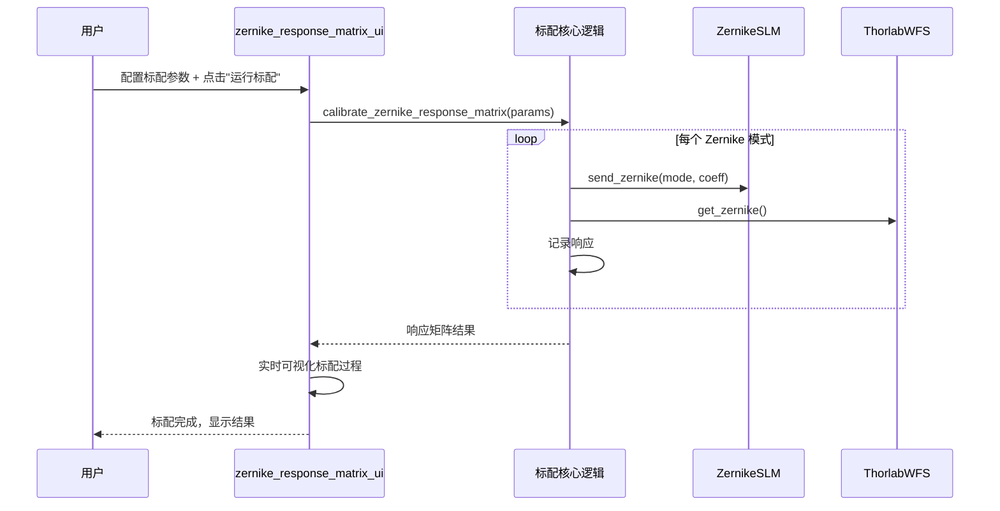

# Zernike 响应矩阵校准 UI (zernike_response_matrix_ui.py) — 软件需求规格说明书 (SRS)

## 1. 概述

### 1.1 文档目的

本文件定义 `src/ao_shaping/gui/zernike/zernike_response_matrix_ui.py` 的功能需求、非功能需求、接口规范与关键设计约束。本模块是 Zernike 响应矩阵校准的 Streamlit 前端页面，支持 SLM→WFS Zernike 响应矩阵标配、实时可视化、加载/查看保存的校准结果。

### 1.2 启动方式

```bash
streamlit run src/ao_shaping/gui/zernike/zernike_response_matrix_ui.py
```

### 1.3 依赖模块

| 模块 | 职责 |
|------|------|
| `ao_shaping.drivers.slm.zernike_slm.ZernikeSLM` | SLM Zernike 驱动 |
| `ao_shaping.drivers.wfs.ThorlabWFS` | Thorlabs 波前传感器驱动 |
| `ao_shaping.optimizer.wf.zernike_response_matrix` | 响应矩阵标配核心逻辑 |
| `ao_shaping.utils.wavefront.matrix_utils.calc_n_zernike_terms` | Zernike 项数计算 |

### 1.4 用户画像

- 光学实验操作员：标配 SLM→WFS Zernike 响应矩阵，查看标配结果与可视化

---

## 2. 功能需求

### 2.1 设备连接

| ID | 需求 | 优先级 |
|----|------|--------|
| FR-1.1 | 支持连接 SLM（ZernikeSLM）与 WFS（ThorlabWFS） | 必须 |
| FR-1.2 | 支持断开设备 | 必须 |

### 2.2 响应矩阵标配

| ID | 需求 | 优先级 |
|----|------|--------|
| FR-2.1 | 支持配置标配参数（N 最大阶数、循环次数、平均次数、等待时间、幅度） | 必须 |
| FR-2.2 | 支持运行标配流程 | 必须 |
| FR-2.3 | 支持实时可视化标配过程 | 必须 |

### 2.3 结果加载与查看

| ID | 需求 | 优先级 |
|----|------|--------|
| FR-3.1 | 支持加载保存的响应矩阵结果 | 必须 |
| FR-3.2 | 支持查看标配结果 | 必须 |

---

## 3. 非功能需求

| ID | 需求 | 说明 |
|----|------|------|
| NF-1 | 会话状态隔离 | 设备句柄与标配参数以 `zrm_*` 为前缀的 session state 命名空间 |
| NF-2 | 错误隔离 | 设备连接/标配失败不导致页面崩溃 |
| NF-3 | 配置持久化 | 标配参数与结果通过 session state 在 rerun 间保持 |

---

## 4. 接口规范

### 4.1 Session State Schema

| 键 | 类型 | 含义 |
|----|------|------|
| `zrm_slm` | ZernikeSLM | SLM 对象 |
| `zrm_slm_connected` | bool | SLM 连接标志 |
| `zrm_wfs` | ThorlabWFS | WFS 对象 |
| `zrm_wfs_connected` | bool | WFS 连接标志 |
| `zrm_n_max` | int | 最大 Zernike 阶数 |
| `zrm_n_cycles` | int | 标配循环次数 |
| `zrm_n_averages` | int | 平均次数 |
| `zrm_wait_time` | float | 等待时间 |
| `zrm_magnitude` | float | 扰动幅度 |
| `zrm_result` | dict | 标配结果 |

### 4.2 主要公共函数

| 函数 | 签名 | 说明 |
|------|------|------|
| `main()` | 无 | Streamlit 页面入口 |
| `_initialize_state()` | 无 | 初始化 session_state |

---

## 5. 系统类图



---

## 6. 功能按钮时序图

### 6.1 连接设备



### 6.2 运行标配



---

## 7. 开发规范（防止用例冲突）

| 规则 ID | 规则说明 | 执行机制 |
|---------|----------|----------|
| DV-1 | 同一设备同一时刻只能有一个连接 | 连接前先断开现有连接 |
| ER-1 | 设备连接/标配失败不导致页面崩溃 | try/except 捕获异常，通过 `st.error` 显示 |

---

## 8. 相关文档

- 用户手册: [`zernike_response_matrix_ui_user_manual.md`](./zernike_response_matrix_ui_user_manual.md)
- 标配算法: [`ao_shaping/optimizer/wf/zernike_response_matrix.py`](../../../../../optimizer/wf/zernike_response_matrix.py)
- GUI 索引: [`docs/gui.md`](../../../../../docs/gui.md)
